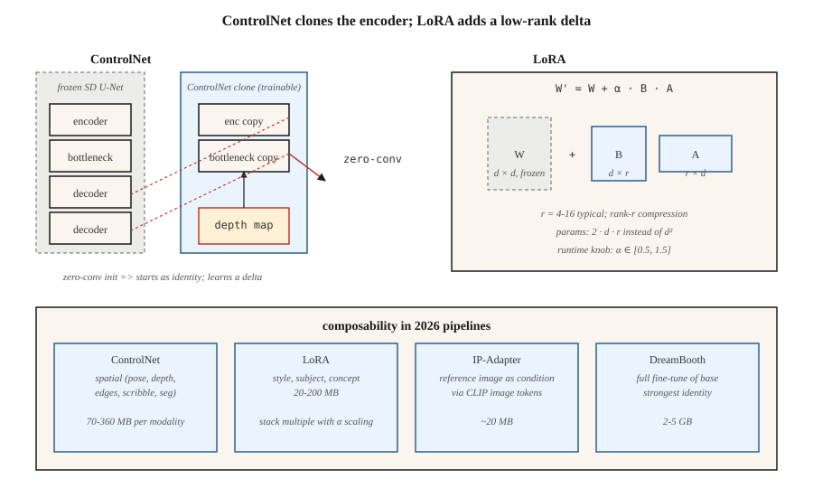

# ControlNet、LoRA 与 Conditioning

> 只靠文本是一种笨拙的控制信号。ControlNet 让你克隆一个 pretrained diffusion model，并用 depth map、pose skeleton、scribble 或 edge image 来 steering。LoRA 让你通过训练 1000 万个参数来 fine-tune 一个 20 亿参数模型。二者一起，把 Stable Diffusion 从玩具变成了 2026 年每家 agency 都在交付的图像 pipeline。

**Type:** Build
**Languages:** Python
**Prerequisites:** Phase 8 · 07（Latent Diffusion），Phase 10（LLMs from Scratch — LoRA foundation）
**Time:** ~75 minutes

## 问题

像 “a woman in a red dress walking a dog on a busy street” 这样的 prompt，并没有告诉模型狗在 **哪里**、女人是什么 **姿势**、街道是什么 **视角**。文本大约只能固定住你需要指定图像内容的 10%。其余部分是视觉的，无法高效地用文字描述。

为每一种信号（pose、depth、canny、segmentation）从零训练一个新的 conditional model，成本太高。你想保留 2.6B 参数的 SDXL backbone，让它 frozen；再接上一个读取 conditioning 的小型 side-network，让 side-network 轻轻推动 backbone 的 intermediate features。这就是 ControlNet。

你还想教会模型新的概念（你的脸、你的产品、你的风格），但不想重新训练整个模型。你想要一个小 100 倍的 delta。这就是 LoRA：插入现有 attention weights 的 low-rank adapters。

ControlNet + LoRA + text = 2026 年 practitioner toolkit。大多数 production image pipelines 会在 SDXL / SD3 / Flux base 之上叠 2-5 个 LoRA、1-3 个 ControlNet，以及一个 IP-Adapter。

## 概念



### ControlNet（Zhang et al., 2023）

取一个 pretrained SD。**克隆** U-Net 的 encoder half。冻结原始模型。训练这个 clone，让它接收额外的 conditioning input（edges、depth、pose）。通过 **zero-convolution** skip connections（初始化为 0 的 1×1 conv，初始是 no-op，随后学习 delta）把 clone 接回原始模型的 decoder half。

```text
SD U-Net decoder:   ... ← orig_enc_features + zero_conv(controlnet_enc(condition))
```

Zero-conv init 意味着 ControlNet 初始时是 identity：即使训练前也不会造成伤害。用标准 diffusion loss 在 1M 个（prompt, condition, image）triples 上训练。

每种 modality 的 ControlNet 都作为小型 side model 发布（SDXL 约 360M，SD 1.5 约 70M）。Inference 时可以组合它们：

```text
features += weight_a * control_a(depth) + weight_b * control_b(pose)
```

### LoRA（Hu et al., 2021）

对于模型中的任意 linear layer `W ∈ R^{d×d}`，冻结 `W`，并添加一个 low-rank delta：

```text
W' = W + ΔW,  ΔW = B @ A,  A ∈ R^{r×d},  B ∈ R^{d×r}
```

其中 `r << d`。Attention 的标准 rank 是 4-16，heavy fine-tune 常用 64-128。新增参数数量是 `2 · d · r`，而不是 `d²`。以 `d=640` 的 SDXL attention 为例，`r=16` 时每个 adapter 只有 20k 参数，而不是 410k，减少 20 倍。整个模型里，一个 LoRA 通常是 20-200MB，而 base 是 5GB。

Inference 时可以缩放 LoRA：`W' = W + α · B @ A`。`α = 0.5-1.5` 很常见。多个 LoRA 会加性叠加（照常要注意：它们会以非线性方式相互作用）。

### IP-Adapter（Ye et al., 2023）

一个 tiny adapter，接收 **image** 作为 conditioning（与 text 并列）。它使用 CLIP image encoder 产生 image tokens，再把这些 tokens 和 text tokens 一起注入 cross-attention。每个 base model 约 20MB。它让你可以做“按这张参考图的风格生成图像”，而不需要 LoRA。

## 可组合性矩阵

| Tool | What it controls | Size | When to use |
|------|------------------|------|-------------|
| ControlNet | Spatial structure（pose、depth、edges） | 70-360MB | 精确 layout、composition |
| LoRA | Style、subject、concept | 20-200MB | Personalization、style |
| IP-Adapter | 来自 reference image 的 style 或 subject | 20MB | 外观无法用文本描述 |
| Textual Inversion | 作为新 token 的单一概念 | 10KB | Legacy，大多已被 LoRA 替代 |
| DreamBooth | Subject 的 full fine-tune | 2-5GB | 强 identity，高 compute |
| T2I-Adapter | 更轻的 ControlNet alternative | 70MB | Edge devices、inference budget |

ControlNet ≈ spatial。LoRA ≈ semantic。两者一起用。

## Build It

`code/main.py` 在 1-D 上模拟这两种机制：

1. **LoRA。** 一个 pretrained linear layer `W`。冻结它。训练 low-rank `B @ A`，使 `W + BA` 匹配一个 target linear layer。展示 `r = 1` 足以完美学习一个 rank-1 correction。

2. **ControlNet-lite。** 一个 “frozen base” predictor，外加一个读取额外 signal 的 “side network”。Side network 的输出由一个初始化为 0 的 learnable scalar gate 控制（我们的 zero-conv 版本）。训练并观察 gate 逐步升高。

### Step 1：LoRA math

```python
def lora(W, A, B, x, alpha=1.0):
    # W is frozen; A, B are the trainable low-rank factors.
    return [W[i][j] * x[j] for i, j in ...] + alpha * (B @ (A @ x))
```

### Step 2：zero-init side network

```python
side_out = control_net(x, condition)
gated = gate * side_out  # gate initialized to 0
h = base(x) + gated
```

在 step 0，输出和 base 完全相同。训练早期会缓慢更新 `gate`，不会发生 catastrophic drift。

## 常见坑

- **LoRA 过度缩放。** `α = 2` 或 `α = 3` 是常见的“让它更强”hack，但会生成过度风格化或破碎的输出。保持 `α ≤ 1.5`。
- **ControlNet weight conflict。** Pose ControlNet 权重 1.0 加 Depth ControlNet 权重 1.0，通常会 overshoot。权重总和 ≈ 1.0 是安全默认值。
- **LoRA 用在错误 base 上。** SDXL LoRA 在 SD 1.5 上会静默 no-op，因为 attention dimensions 不匹配。Diffusers 0.30+ 会给出 warning。
- **Textual Inversion drift。** 在一个 checkpoint 上训练的 tokens，换到另一个 checkpoint 会严重漂移。LoRA 更 portable。
- **LoRA weight-merging 和 storage。** 你可以把 LoRA 烘焙进 base model weights，以获得更快 inference（runtime 不再做 addition），但会失去 runtime 调整 `α` 的能力。两个版本都保留。

## Use It

| Goal | 2026 pipeline |
|------|---------------|
| 复现一个品牌的 art style | 在约 30 张 curated images 上训练 rank 32 的 LoRA |
| 把我的脸放进 generated image | DreamBooth 或 LoRA + IP-Adapter-FaceID |
| Specific pose + prompt | ControlNet-Openpose + SDXL + text |
| Depth-aware composition | ControlNet-Depth + SD3 |
| Reference + prompt | IP-Adapter + text |
| Exact layout | ControlNet-Scribble 或 ControlNet-Canny |
| Background replace | ControlNet-Seg + Inpainting（Lesson 09） |
| Fast 1-step style | SDXL-Turbo 上的 LCM-LoRA |

## Ship It

保存 `outputs/skill-sd-toolkit-composer.md`。这个 skill 接收一个任务（input assets：prompt、optional reference image、optional pose、optional depth、optional scribble），并输出 tool stack、weights 和可复现的 seed protocol。

## 练习

1. **Easy.** 在 `code/main.py` 中，把 LoRA rank `r` 从 1 改到 4。LoRA 在哪个 rank 能精确匹配 rank-2 target delta？
2. **Medium.** 在两个 target transforms 上分别训练两个 LoRA。一起加载它们，并展示它们的 additive interaction。什么时候这种 interaction 会打破 linearity？
3. **Hard.** 使用 diffusers 叠加：SDXL-base + Canny-ControlNet（weight 0.8）+ style LoRA（α 0.8）+ IP-Adapter（weight 0.6）。随着 stack weights 变化，测量 FID-vs-prompt-adherence trade-off。

## 关键术语

| Term | What people say | What it actually means |
|------|-----------------|-----------------------|
| ControlNet | “Spatial control” | Cloned encoder + zero-conv skips；读取 conditioning image。 |
| Zero convolution | “Starts as identity” | 初始化为 0 的 1×1 conv；ControlNet 初始是 no-op。 |
| LoRA | “Low-rank adapter” | `W + B @ A`，`r << d`；比 full fine-tune 少 100 倍参数。 |
| rank r | “The knob” | LoRA compression；4-16 常见，64+ 用于 heavy personalization。 |
| α | “LoRA strength” | LoRA delta 的 runtime scaling。 |
| IP-Adapter | “Reference image” | 通过 CLIP-image tokens 实现的小型 image-conditioning adapter。 |
| DreamBooth | “Full subject fine-tune” | 在约 30 张 subject images 上训练 full model。 |
| Textual Inversion | “New token” | 只学习一个新的 word embedding；legacy，大多已被替代。 |

## 生产备注：LoRA swaps、ControlNet lanes、multi-tenant serving

真正的 text-to-image SaaS 会在同一个 base checkpoint 上服务数百个 LoRA 和十几个 ControlNet。这个 serving 问题很像 LLM multi-tenancy（production literature 在 continuous batching 和 LoRAX / S-LoRA 下讨论 LLM case）：

- **Hot-swap LoRAs，不要 merge。** 把 `W' = W + α·B·A` merge 进 base，可以让每步 inference 快约 3-5%，但会冻结 `α` 和 base。把 LoRA 作为 rank-r deltas 热加载在 VRAM 中；diffusers 暴露 `pipe.load_lora_weights()` + `pipe.set_adapters([...], adapter_weights=[...])`，用于 per-request activation。Swap cost 是 `2 · d · r · num_layers` 个 weights，MB 级，sub-second。
- **ControlNet 作为第二条 attention lane。** Cloned encoder 会与 base 并行运行。两个权重 1.0 的 ControlNet = 每一步多两次 forward pass，而不是一次 merged pass。Batch-size headroom 会近似按二次方下降。为每个 active ControlNet 预留约 1.5× step cost。
- **Quantized LoRAs 也成立。** 如果你 quantized 了 base（见 Lesson 07，Flux on 8GB），LoRA delta 也可以干净地 quantize 到 8-bit 或 4-bit。QLoRA-style loading 让你可以在 4-bit Flux base 上叠 5-10 个 LoRA，而不会炸掉 memory。

Flux-specific：Niels 的 Flux-on-8GB notebook 会把 base quantize 到 4-bit；在这个 quantized base 上以 `weight_name="pytorch_lora_weights.safetensors"` 叠一个 style LoRA（`pipe.load_lora_weights("user/style-lora")`）仍然可用。这是 2026 年大多数 SaaS agencies 交付的 recipe。

## 延伸阅读

- [Zhang, Rao, Agrawala (2023). Adding Conditional Control to Text-to-Image Diffusion Models](https://arxiv.org/abs/2302.05543) — ControlNet。
- [Hu et al. (2021). LoRA: Low-Rank Adaptation of Large Language Models](https://arxiv.org/abs/2106.09685) — LoRA（原本用于 LLM；后移植到 diffusion）。
- [Ye et al. (2023). IP-Adapter: Text Compatible Image Prompt Adapter](https://arxiv.org/abs/2308.06721) — IP-Adapter。
- [Mou et al. (2023). T2I-Adapter: Learning Adapters to Dig Out More Controllable Ability](https://arxiv.org/abs/2302.08453) — 比 ControlNet 更轻的替代方案。
- [Ruiz et al. (2023). DreamBooth: Fine Tuning Text-to-Image Diffusion Models for Subject-Driven Generation](https://arxiv.org/abs/2208.12242) — DreamBooth。
- [HuggingFace Diffusers — ControlNet / LoRA / IP-Adapter docs](https://huggingface.co/docs/diffusers/training/controlnet) — reference pipelines。
