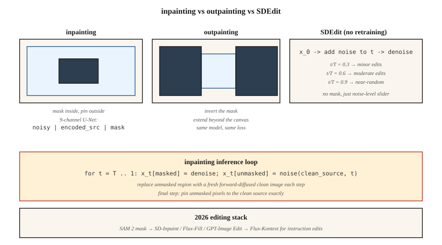

# Inpainting、Outpainting 与图像编辑

> Text-to-image 会创造新东西。Inpainting 修补旧东西。在生产中，70% 可计费的图像工作其实是编辑：替换背景、移除 logo、扩展画布、重生成一只手。Inpainting 是 diffusion 真正值回票价的地方。

**Type:** Build
**Languages:** Python
**Prerequisites:** Phase 8 · 07 (Latent Diffusion), Phase 8 · 08 (ControlNet & LoRA)
**Time:** ~75 minutes

## 问题

客户发来一张近乎完美的产品照，但背景里有一个分散注意力的标牌。你想擦掉标牌，同时让其他像素保持完全一致。你不能从头跑 text-to-image，因为结果会有不同的颜色、不同的光照、不同的产品角度。你想只重生成 *被 mask 的区域*，并且希望重生成结果尊重周围上下文。

这就是 inpainting。它有几个变体：

- **Inpainting。** 在 mask 内重生成，保留 mask 外像素。
- **Outpainting。** 在 mask 外（或画布之外）重生成，保留 mask 内像素。
- **Image editing。** 重生成整张图，但保留原图的语义或结构一致性（SDEdit、InstructPix2Pix）。

到 2026 年，每条 diffusion pipeline 都会提供 inpainting 模式。Flux.1-Fill、Stable Diffusion Inpaint、SDXL-Inpaint、DALL-E 3 Edit。它们遵循同一个原则。

## 概念



### 天真的做法，以及为什么它错

带着 mask 跑标准 text-to-image。在每个 sampling step，用 clean image 的 forward-diffused 版本替换 noisy latent 中未被 mask 的区域。它确实能工作，但效果很差。边界 artifact 会渗出来，因为模型不知道 mask 区域里原本应该有什么。

### 正确的 inpainting 模型

训练一个改造后的 U-Net，它接收 9 个输入通道，而不是 4 个：

```text
input = concat([ noisy_latent (4ch), encoded_image (4ch), mask (1ch) ], dim=channel)
```

额外通道是一份 VAE-encoded 源图像副本，再加上一个单通道 mask。训练时，随机 mask 图像中的区域，让模型只 denoise 被 mask 的区域，而未被 mask 的区域作为干净的条件信号提供给模型。推理时，模型可以“看见”mask 周围的内容，因此能生成连贯的补全。

SD-Inpaint、SDXL-Inpaint、Flux-Fill 都使用这种 9-channel（或类似）输入。Diffusers 中对应 `StableDiffusionInpaintPipeline`、`FluxFillPipeline`。

### SDEdit（Meng et al., 2022）：免费编辑

把噪声加到源图像上，一直加到某个中间时间 `t`，然后用新的 prompt 从 `t` 沿 reverse chain 跑回 0。不需要重新训练。起始 `t` 的选择会在 fidelity 和 creative freedom 之间做权衡：

- `t/T = 0.3` → 几乎和源图一致，只做小的风格变化
- `t/T = 0.6` → 中等编辑，保留粗结构
- `t/T = 0.9` → 几乎从噪声开始生成，源图保留很少

### InstructPix2Pix（Brooks et al., 2023）

在 `(input_image, instruction, output_image)` 三元组上 fine-tune 一个 diffusion model。推理时，同时条件化输入图像和文本指令（“make it sunset”、“add a dragon”）。它有两个 CFG scales：image scale 和 text scale。

### RePaint（Lugmayr et al., 2022）

保留标准 unconditional diffusion model。每个 reverse step 都 resample：偶尔跳回更 noisy 的状态，然后重新生成。这样能减少边界 artifact。适用于你没有训练好的 inpainting model 的情况。

## 动手构建

`code/main.py` 在 5 维数据上实现了一个玩具版 1-D inpainting scheme。我们在 5-D mixture data 上训练一个 DDPM，每个样本是来自两个 clusters 之一的 5 个浮点数。推理时，我们“mask”掉 5 个维度中的 2 个，在每个 step 注入未 mask 三个维度的 noisy-forward 版本，只重生成被 mask 的维度。

### Step 1：5-D DDPM 数据

```python
def sample_data(rng):
    cluster = rng.choice([0, 1])
    center = [-1.0] * 5 if cluster == 0 else [1.0] * 5
    return [c + rng.gauss(0, 0.2) for c in center], cluster
```

### Step 2：在所有 5 个维度上训练 denoiser

标准 DDPM。网络输入 5-D noisy input，输出 5-D noise prediction。

### Step 3：推理时，mask-aware reverse

```python
def inpaint_step(x_t, mask, clean_image, alpha_bars, t, rng):
    # replace unmasked dims with a freshly noised version of the clean source
    a_bar = alpha_bars[t]
    for i in range(len(x_t)):
        if not mask[i]:
            x_t[i] = math.sqrt(a_bar) * clean_image[i] + math.sqrt(1 - a_bar) * rng.gauss(0, 1)
    # ...then run the normal reverse step on x_t
```

这是天真的做法，但在玩具 1-D 数据上可用。真实图像 inpainting 会使用 9-channel 输入，因为 texture coherence 更重要。

### Step 4：outpainting

Outpainting 就是反转 mask 的 inpainting：mask 新的（之前不存在的）画布区域，用原图填充其余部分。训练目标完全相同。

## 常见陷阱

- **Seams。** 天真的做法会留下可见边界，因为梯度信息无法跨过 mask 流动。修复方式：把 mask 膨胀 8-16 像素，或使用真正的 inpainting model。
- **Mask leakage。** 如果 conditioning image 的未 mask 区域质量低或有噪声，它会污染 mask 内的生成。可以先 denoise，或轻微 blur。
- **CFG 与 mask 大小相互作用。** 小 mask 上使用高 CFG，会得到过饱和 patch。小编辑应降低 CFG。
- **SDEdit fidelity cliff。** 从 `t/T = 0.5` 调到 `t/T = 0.6`，可能会丢掉主体身份。要 sweep 并 checkpoint。
- **Prompt mismatch。** Prompt 应该描述 *整张图*，而不只是新内容。写 “A cat sitting on a chair”，不要只写 “a cat”。

## 使用它

| Task | Pipeline |
|------|----------|
| 移除物体，小 mask | SD-Inpaint or Flux-Fill, standard prompt |
| 替换天空 | SD-Inpaint + "blue sky at sunset" |
| 扩展画布 | SDXL outpaint mode (8px feather) or Flux-Fill with outpaint mask |
| 重生成手 / 脸 | SD-Inpaint with prompt re-describing the subject + ControlNet-Openpose |
| 改变某个区域的风格 | SDEdit at `t/T=0.5` on masked region |
| “Make it sunset” | InstructPix2Pix or Flux-Kontext |
| 背景替换 | SAM mask → SD-Inpaint |
| Ultra-high-fidelity | Flux-Fill or GPT-Image (hosted) for hardest cases |

SAM（Meta 的 Segment Anything，2023）+ diffusion inpaint 是 2026 年的背景移除 pipeline。SAM 2（2024）支持视频。

## 交付它

保存 `outputs/skill-editing-pipeline.md`。这个 skill 接收原始图像、编辑描述、可选 mask（或 SAM prompt），然后输出：mask-generation approach、base model、CFG scales（image + text）、SDEdit-t 或 inpainting mode，以及 QA checklist。

## 练习

1. **Easy.** 在 `code/main.py` 中，把被 mask 维度的比例从 0.2 变到 0.8。在哪个比例上，inpaint quality（masked dims 的 residual）会等于 unconditional generation？
2. **Medium.** 实现 RePaint：每 10 个 reverse step，跳回 5 个 step（加噪），然后重新 denoise。测量它是否降低了 mask 边缘的 boundary residual。
3. **Hard.** 使用 Hugging Face diffusers 比较：SD 1.5 Inpaint + ControlNet-Openpose vs Flux.1-Fill，在 20 个 face-regeneration 任务上测试。分别给 pose adherence 和 identity preservation 打分。

## 关键术语

| Term | What people say | What it actually means |
|------|-----------------|-----------------------|
| Inpainting | “填洞” | 在 mask 内重生成；保留外部像素。 |
| Outpainting | “扩展画布” | 在画布外重生成；保留内部。 |
| 9-channel U-Net | “Proper inpainting model” | U-Net 以 `noisy \| encoded-source \| mask` 作为输入。 |
| SDEdit | “Img2img with noise level” | 加噪到时间 `t`，再用新 prompt denoise。 |
| InstructPix2Pix | “Text-only edits” | 在 (image, instruction, output) 三元组上 fine-tune 的 diffusion。 |
| RePaint | “No retraining” | 在 reverse 过程中周期性 re-noise，用来减少 seams。 |
| SAM | “Segment Anything” | 通过点击或 box 生成 mask；常与 inpaint 搭配。 |
| Flux-Kontext | “Edit with context” | 接收 reference image + instruction 进行编辑的 Flux 变体。 |

## 生产备注：编辑 pipeline 对 latency 很敏感

用户编辑图像时，期望往返时间低于 5 秒。一个 30-step 的 SDXL-Inpaint 在 L4 上跑 1024²，大约需要 3-4 秒，再加上 SAM mask generation（约 200 ms）和 VAE encode/decode（合计约 500 ms）。从生产视角看，这是 TTFT-bound，而不是 throughput-bound：batch 1、低并发、每个阶段都要压缩：

- **SAM-H 是慢的那个。** SAM-H 在 1024² 上约 200 ms；SAM-ViT-B 约 40 ms，只损失少量质量。SAM 2（video）会增加时间维度开销；不要用它处理单图编辑。
- **能跳过 encode 就跳过。** `pipe.image_processor.preprocess(img)` 会 encode 成 latents。如果你已经有上一次生成留下的 latents（迭代式编辑 UI 中很常见），可以直接通过 `latents=...` 传入，省掉一次 VAE encode。
- **Mask dilation 也影响吞吐。** 小 mask 意味着大多数 U-Net forward 都被浪费了（未 mask 像素反正会被 clamp）。`diffusers` 的 `StableDiffusionInpaintPipeline` 无论如何都会跑完整 U-Net；只有 9-channel proper-inpaint 变体能利用 masked compute。
- **Flux-Kontext 是 2025 年的答案。** 对 `(source_image, instruction)` 做单次 forward：没有单独 mask，没有 SDEdit noise sweep。在 H100 上，一次编辑约 1.5 秒。架构上的经验是：把阶段折叠起来。

## 延伸阅读

- [Lugmayr et al. (2022). RePaint: Inpainting using Denoising Diffusion Probabilistic Models](https://arxiv.org/abs/2201.09865)：training-free inpainting。
- [Meng et al. (2022). SDEdit: Guided Image Synthesis and Editing with Stochastic Differential Equations](https://arxiv.org/abs/2108.01073)：SDEdit。
- [Brooks, Holynski, Efros (2023). InstructPix2Pix](https://arxiv.org/abs/2211.09800)：text-instruction editing。
- [Kirillov et al. (2023). Segment Anything](https://arxiv.org/abs/2304.02643)：SAM，mask source。
- [Ravi et al. (2024). SAM 2: Segment Anything in Images and Videos](https://arxiv.org/abs/2408.00714)：video SAM。
- [Hertz et al. (2022). Prompt-to-Prompt Image Editing with Cross-Attention Control](https://arxiv.org/abs/2208.01626)：attention-level editing。
- [Black Forest Labs (2024). Flux.1-Fill and Flux.1-Kontext](https://blackforestlabs.ai/flux-1-tools/)：2024 tooling。
