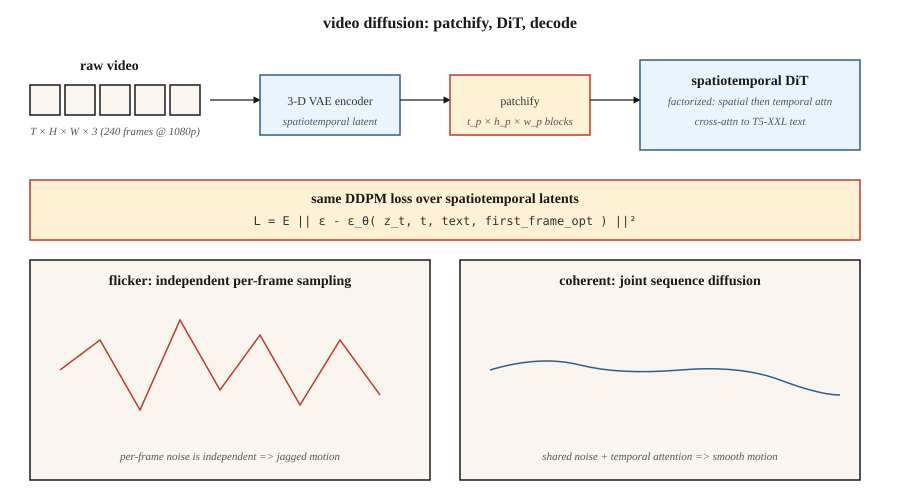

# 视频生成

> 图像是 2-D tensor。视频是 3-D tensor。理论一样，计算难度却高 10-100 倍。OpenAI 的 Sora（2024 年 2 月）证明了这件事可行。到 2026 年，Veo 2、Kling 1.5、Runway Gen-3、Pika 2.0 和 WAN 2.2 都能从文本生成 1080p 的生产级视频，而 open-weights stack（CogVideoX、HunyuanVideo、Mochi-1、WAN 2.2）大约落后 12 个月。

**Type:** Build
**Languages:** Python
**Prerequisites:** Phase 8 · 07 (Latent Diffusion), Phase 7 · 09 (ViT), Phase 8 · 06 (DDPM)
**Time:** ~45 minutes

## 问题

一个 10 秒、1080p、24fps 的视频有 240 帧，每帧是 `1920×1080×3` pixels。每个 clip 的 raw data 大约是 1.5 GB。Pixel-space diffusion 不现实。你需要：

1. **Spatiotemporal compression.** 一个能编码视频而不是单帧的 VAE，把视频压缩成 spatial-temporal patches 序列。
2. **Temporal coherence.** 多秒视频里的内容、光照和物体身份要保持一致。网络必须建模 motion。
3. **Compute budget.** 在相同模型规模下，视频训练比图像贵 10-100 倍。
4. **Conditioning.** Text、image（first-frame）、audio，或另一个 video。大多数生产模型四种都支持。

解决这个问题的架构是应用在 spatiotemporal patches 上的 **Diffusion Transformer (DiT)**，用巨大的 `(prompt, caption, video)` 数据集训练。Diffusion loss 和 Lesson 06 相同。

## 概念



### Patchify

先用 3D VAE 编码视频（学习到的 spatiotemporal compression）。Latent shape 是 `[T_latent, H_latent, W_latent, C_latent]`。再切成大小为 `[t_p, h_p, w_p]` 的 patches。对 Sora-style models，`t_p = 1`（per-frame patches）或 `t_p = 2`（每两帧一个 patch）。一个 10 秒 1080p 视频会被压缩成大约 20,000-100,000 个 patches。

### Spatiotemporal DiT

Transformer 处理 flatten 后的 patch sequence。每个 patch 都有 3D positional embedding（time + y + x）。Attention 通常会 factorize：

- **Spatial attention** 在每一帧内部的 patches 之间运行。
- **Temporal attention** 在相同 spatial location 的跨帧 patches 之间运行。
- **Full 3D attention** 贵 16-100 倍，只在低分辨率或研究环境里使用。

### Text conditioning

用大型 text encoder 做 cross-attention（Sora 使用 T5-XXL，CogVideoX-5B 也使用 T5-XXL）。Long prompts 很重要，Sora 训练集使用 GPT 生成的 dense re-captions，平均每个 clip 约 200 tokens。

### Training

在 spatiotemporal latents 上使用标准 diffusion loss（ε 或 v prediction）。数据：web video + 约 100M curated clips + synthetic text captions。Compute：即使是一个小型 research run 也需要 10,000+ GPU hours；Sora-scale 是 100,000+。

## 2026 年生产格局

| Model | Date | Max duration | Max res | Open weights? | Notable |
|-------|------|--------------|---------|---------------|---------|
| Sora (OpenAI) | 2024-02 | 60s | 1080p | No | 第一个在 scale 下展示 world simulator properties 的模型 |
| Sora Turbo | 2024-12 | 20s | 1080p | No | 生产版 Sora，inference 快 5 倍 |
| Veo 2 (Google) | 2024-12 | 8s | 4K | No | 2025 年最高质量 + physics |
| Veo 3 | 2025 Q3 | 15s | 4K | No | 原生 audio 和更强 camera control |
| Kling 1.5 / 2.1 (Kuaishou) | 2024-2025 | 10s | 1080p | No | 2025 Q1 最好的人体运动 |
| Runway Gen-3 Alpha | 2024-06 | 10s | 768p | No | 上层有专业视频工具 |
| Pika 2.0 | 2024-10 | 5s | 1080p | No | 最强 character consistency |
| CogVideoX (THUDM) | 2024 | 10s | 720p | Yes (2B, 5B) | 第一个 open 5B-scale video |
| HunyuanVideo (Tencent) | 2024-12 | 5s | 720p | Yes (13B) | 2024 年底 open SOTA |
| Mochi-1 (Genmo) | 2024-10 | 5.4s | 480p | Yes (10B) | 许可最宽松 |
| WAN 2.2 (Alibaba) | 2025-07 | 5s | 720p | Yes | 2025 年中最强 open model |

Open weights 正在比 image space 更快地追赶：到 2026 年中，HunyuanVideo + WAN 2.2 LoRAs 已经支撑了大部分 open-source workflows。

## 动手构建

`code/main.py` 模拟 spatiotemporal DiT 的核心思想：把一个小型 synthetic video patchify，给每个 patch 加 position embedding，再用 transformer-style attention over patches 对整段 sequence denoise。不用 numpy，纯 Python。我们会展示：即使在 1-D 中，只要相邻 frame patches 共享 denoiser 和 position embeddings，也会出现 temporal coherence。

### Step 1：patchify 一个 synthetic 1-D “video”

```python
def make_video(T_frames=8, rng=None):
    # a "video" is a sequence of 1-D values following a smooth trajectory
    base = rng.gauss(0, 1)
    return [base + 0.3 * t + rng.gauss(0, 0.1) for t in range(T_frames)]
```

### Step 2：每帧 position embedding

```python
def pos_embed(t, dim):
    return sinusoidal(t, dim)
```

### Step 3：denoiser 看到整段 sequence

我们的 tiny net 不会独立 denoise 每一帧，而是把所有 frame values + 它们的 position embeddings 拼接起来，并联合预测所有帧的 noise。

### Step 4：temporal coherence test

训练后 sample 一个视频。测量 frame-to-frame delta。如果模型学到了 temporal structure，deltas 会比独立采样每帧更小。

## 常见陷阱

- **Independent per-frame sampling = flicker.** 如果你对每帧单独运行 image diffusion，输出会闪烁，因为每帧的 noise 都是独立的。Video diffusion 通过 attention 或 shared noise 耦合帧来修复这个问题。
- **Naive 3D attention = OOM.** 在一个 10 秒 1080p latent 上做 full 3D attention 是数千亿次操作。要拆成 spatial + temporal。
- **Data captioning matters more than size.** Sora 相比前代工作的主要升级，是在训练中使用了详细约 10 倍的 captions（GPT-4 重新标注 clips）。OpenAI 的 technical report 对此说得很明确。
- **First-frame conditioning.** 大多数生产模型也能把 image 当作 first frame。这就是 “image-to-video” 模式；训练时也包含这个变体。
- **Physics drift.** 长 clip（>10s）会积累细微不一致。Sliding-window generation + keyframe anchoring 会有帮助。

## 使用它

| Use case | 2026 pick |
|----------|-----------|
| 最高质量 hosted text-to-video | Veo 3 或 Sora |
| Camera-controlled cinematic | Runway Gen-3 with motion brushes |
| 跨 clips 的 character consistency | Pika 2.0 或 Kling 2.1 |
| Open weights、快速 fine-tune | WAN 2.2 + LoRA |
| Image-to-video | WAN 2.2-I2V、Kling 2.1 I2V，或 Runway |
| Audio-to-video lip sync | Veo 3（native audio）或 dedicated lip-sync model |
| Video editing | Runway Act-Two、Kling Motion Brush、Flux-Kontext（still-frame） |

在质量相当的前提下，每秒视频成本从 2024 到 2026 年下降了 20 倍。

## 交付它

保存 `outputs/skill-video-brief.md`。这个 skill 接收一个 video brief（duration、aspect ratio、style、camera plan、subject consistency、audio），并输出：model + hosting、prompt scaffolding（camera language、subject description、motion descriptors）、seed + reproducibility protocol，以及 frame-level QA checklist。

## 练习

1. **Easy.** 在 `code/main.py` 中比较 frame-to-frame delta：(a) independent per-frame sampling，(b) joint sequence sampling。报告 deltas 的 mean 和 variance。
2. **Medium.** 添加 first-frame condition：把 frame 0 固定到一个给定值，再 sample 其余帧。测量 pinned value 如何传播。
3. **Hard.** 使用 HuggingFace diffusers 在本地 GPU 上运行 CogVideoX-2B。计时 720p、6 秒 clip 的 20 inference steps。Profile spatiotemporal attention，找出 bottleneck。

## 关键术语

| Term | What people say | What it actually means |
|------|-----------------|-----------------------|
| Video VAE | “3-D VAE” | 把 `(T, H, W, C)` 压缩成 spatiotemporal latent 的 encoder。 |
| Patches | “The tokens” | Latent 中固定大小的 3-D blocks；DiT 的输入。 |
| Factorized attention | “Spatial + temporal” | 先在空间上做 attention，再在时间上做 attention；跳过 full 3-D attention。 |
| Image-to-video (I2V) | “Animate this photo” | 模型接收 image + text，输出从这张图开始的视频。 |
| Keyframe conditioning | “Anchor frames” | 固定特定 frames 来控制视频弧线。 |
| Motion brush | “Directional hint” | 用户在图像上涂 motion vectors 的 UI 输入。 |
| Re-captioning | “Dense captions” | 用 LLM 为训练 clips 重新生成详细 prompts。 |
| Flicker | “Temporal artifact” | 帧与帧之间不一致；通过 coupled denoising 修复。 |

## 生产备注：video latents 是 memory-bandwidth 问题

一个 10 秒 1080p、24 fps 的 clip 是 240 frames × 1920 × 1080 × 3 ≈ 1.5 GB raw pixels。经过 4× video VAE compression（`2 × spatial × 2 × temporal`）后，每个请求的 latent 仍然约 100 MB。把它通过 spatiotemporal DiT 跑 30 steps、batch 1，相当于每步在 HBM 中移动约 3 GB；瓶颈是 memory bandwidth，不是 FLOPs。

三个生产旋钮，都直接来自 production-inference 文献的 inference chapter：

- **TP across the DiT.** Text-to-video models 通常 ≥10B params。4 个 H100 上 TP=4 是标准配置；405B-class models 使用 PP=2 × TP=2。Step latency 会随 TP 大致线性下降，直到撞上 all-reduce wall。
- **Frame batching = continuous batching.** 生成时，video 在概念上是一批由 attention 连接的 frames。Continuous batching（in-flight scheduling）适用：如果模型架构支持 sliding-window generation，可以在返回 frame `t-1` 时开始渲染 frame `t+1`。
- **Clip-level prefill cache.** 对 image-to-video，first-frame conditioning 类似 LLM 的 prompt prefill：计算一次，然后在 temporal decoder passes 中复用。这实际上就是 video 的 KV-cache。

## 延伸阅读

- [Brooks et al. (2024). Video generation models as world simulators](https://openai.com/index/video-generation-models-as-world-simulators/) — Sora technical report。
- [Yang et al. (2024). CogVideoX: Text-to-Video Diffusion Models with An Expert Transformer](https://arxiv.org/abs/2408.06072) — CogVideoX。
- [Kong et al. (2024). HunyuanVideo: A Systematic Framework for Large Video Generative Models](https://arxiv.org/abs/2412.03603) — HunyuanVideo。
- [Genmo (2024). Mochi-1 Technical Report](https://www.genmo.ai/blog/mochi) — Mochi-1。
- [Alibaba (2025). WAN 2.2](https://wanvideo.io/) — 2025 年中 open SOTA。
- [Ho, Salimans, Gritsenko et al. (2022). Video Diffusion Models](https://arxiv.org/abs/2204.03458) — 开创性 video diffusion 论文。
- [Blattmann et al. (2023). Align your Latents (Video LDM)](https://arxiv.org/abs/2304.08818) — Stable Video Diffusion 的前身。
