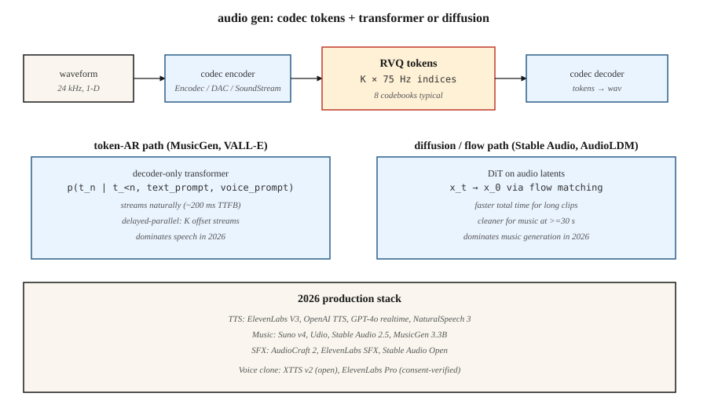

# 音频生成

> 音频是在 16-48 kHz 采样率下的一维信号。一个 5 秒片段就是 80-240k 个 samples。没有 transformer 会直接 attend 这么长的序列。2026 年所有生产级音频模型的解决方案都一样：用 neural codec（Encodec、SoundStream、DAC）把音频压缩成 50-75 Hz 的离散 tokens，再用 transformer 或 diffusion model 生成 tokens。

**Type:** Build
**Languages:** Python
**Prerequisites:** Phase 6 · 02（Audio Features），Phase 6 · 04（ASR），Phase 8 · 06（DDPM）
**Time:** ~45 minutes

## 问题

三个音频生成任务：

1. **Text-to-speech。** 给定文本，生成语音。干净语音是窄带信号，并且有强 phonetic structure，所以 transformer-over-tokens 已经解决得很好。代表系统包括 VALL-E（Microsoft）、NaturalSpeech 3、ElevenLabs、OpenAI TTS。
2. **Music generation。** 给定 prompt（文本、旋律、和弦走向、genre），生成音乐。分布宽得多。代表系统包括 MusicGen（Meta）、Stable Audio 2.5、Suno v4、Udio、Riffusion。
3. **Audio effects / sound design。** 给定 prompt，生成环境声或 Foley。代表系统包括 AudioGen、AudioLDM 2、Stable Audio Open。

三者都运行在同一个底座上：neural audio codec + token-AR 或 diffusion generator。

## 概念



### Neural audio codecs

Encodec（Meta，2022）、SoundStream（Google，2021）、Descript Audio Codec（DAC，2023）。一个 convolutional encoder 把 waveform 压缩成每个 timestep 一个向量；residual vector quantization（RVQ）把每个向量转换成 K 个 codebook indices 的级联。Decoder 执行反向过程。24 kHz audio 在 2 kbps 下，使用 8 个 RVQ codebooks、75 Hz，就是 600 tokens/sec。

```text
waveform (16000 samples/sec)
    └─ encoder conv ─┐
                     ├─ RVQ layer 1 → indices at 75 Hz
                     ├─ RVQ layer 2 → indices at 75 Hz
                     ├─ ...
                     └─ RVQ layer 8
```

### 上层的两种生成范式

**Token-autoregressive。** 把 RVQ tokens 展平成一个序列，运行 decoder-only transformer。MusicGen 使用 “delayed parallel”，带 per-stream offsets 地并行输出 K 个 codebook streams。VALL-E 根据 text prompt + 3 秒 voice sample 生成 speech tokens。

**Latent diffusion。** 把 codec tokens 打包成 continuous latents，或者用 categorical diffusion 建模它们。Stable Audio 2.5 在 continuous audio latents 上使用 flow matching。AudioLDM 2 使用 text-to-mel-to-audio diffusion。

2024-2026 年的趋势是：flow matching 正在赢得音乐生成（更快 inference、更干净 samples），而 token-AR 仍然主导语音，因为它天然 causal，并且很适合 streaming。

## 生产格局

| System | Task | Backbone | Latency |
|--------|------|----------|---------|
| ElevenLabs V3 | TTS | Token-AR + neural vocoder | ~300ms first token |
| OpenAI GPT-4o audio | Full-duplex speech | End-to-end multimodal AR | ~200ms |
| NaturalSpeech 3 | TTS | Latent flow matching | Non-streaming |
| Stable Audio 2.5 | Music / SFX | DiT + flow matching on audio latents | ~10s for 1-minute clip |
| Suno v4 | Full songs | Undisclosed; token-AR suspected | ~30s per song |
| Udio v1.5 | Full songs | Undisclosed | ~30s per song |
| MusicGen 3.3B | Music | Token-AR on Encodec 32kHz | Real-time |
| AudioCraft 2 | Music + SFX | Flow matching | ~5s for 5s clip |
| Riffusion v2 | Music | Spectrogram diffusion | ~10s |

## Build It

`code/main.py` 模拟核心想法：在 synthetic “audio token” sequences 上训练一个小型 next-token transformer。这些序列来自两种不同 “styles”（style A 是低 token 和高 token 交替，style B 是单调 ramp）。模型根据 style condition 采样。

### Step 1：synthetic audio tokens

```python
def make_tokens(style, length, vocab_size, rng):
    if style == 0:  # "speech-like": alternating
        return [i % vocab_size for i in range(length)]
    # "music-like": ramp
    return [(i * 3) % vocab_size for i in range(length)]
```

### Step 2：训练一个小型 token predictor

一个基于 style conditioning 的 bigram-style predictor。重点是模式：codec tokens → cross-entropy training → autoregressive sampling。

### Step 3：条件采样

给定 style token 和 starting token，从预测分布中 sample 下一个 token。持续 20-40 个 tokens。

## 常见陷阱

- **Codec quality 限制输出质量上限。** 如果 codec 不能忠实表示某种声音，再强的 generator 也无济于事。DAC 是当前最好的 open codec。
- **RVQ error accumulation。** 每个 RVQ layer 都在建模上一层的 residual。第 1 层的错误会向后传播。对更高层使用 temperature 0 sampling 会有帮助。
- **Musical structure。** 30 秒 tokens 在 75 Hz 下超过 20k tokens。对 transformers 很难。MusicGen 使用 sliding window + prompt continuation；Stable Audio 使用 shorter clips + crossfading。
- **边界 artifacts。** 生成片段之间的 crossfading 需要谨慎的 overlap-add。
- **对干净数据的胃口。** 音乐生成器需要数万小时授权音乐。Suno / Udio 的 RIAA lawsuit（2024）把这个问题摆到了台面上。
- **Voice cloning ethics。** 3 秒 sample 加 text prompt 就足够让 VALL-E / XTTS / ElevenLabs clone 一个声音。每个生产模型都需要 abuse detection + opt-out lists。

## Use It

| Task | 2026 stack |
|------|------------|
| Commercial TTS | ElevenLabs、OpenAI TTS 或 Azure Neural |
| Voice cloning（consent-verified） | XTTS v2（open）或 ElevenLabs Pro |
| Background music，fast | Stable Audio 2.5 API、Suno 或 Udio |
| Music with lyrics | Suno v4 或 Udio v1.5 |
| Sound effects / Foley | AudioCraft 2、ElevenLabs SFX 或 Stable Audio Open |
| Real-time voice agent | GPT-4o realtime 或 Gemini Live |
| Open-weights music research | MusicGen 3.3B、Stable Audio Open 1.0、AudioLDM 2 |
| Dubbing / translation | HeyGen、ElevenLabs Dubbing |

## Ship It

保存 `outputs/skill-audio-brief.md`。这个 skill 接收一个 audio brief（task、duration、style、voice、license），并输出：model + hosting、prompt format（genre tags、style descriptors、structural markers）、codec + generator + vocoder chain、seed protocol，以及 eval plan（MOS / CLAP score / TTS 的 CER / user A/B）。

## 练习

1. **Easy.** 运行 `code/main.py` 并显式设置 style。验证生成序列是否匹配该 style 的 pattern。
2. **Medium.** 添加 delayed parallel decoding：模拟 2 个 token streams，它们必须保持 1 step 的 offset。训练一个 joint predictor。
3. **Hard.** 使用 HuggingFace transformers 在本地运行 MusicGen-small。用三个不同 prompts 生成 10 秒片段；做 A/B，比较 style adherence。

## 关键术语

| 术语 | 大家常说 | 实际含义 |
|------|----------|----------|
| Codec | “Neural compression” | 音频 encoder / decoder；典型输出是 50-75 Hz tokens。 |
| RVQ | “Residual VQ” | K 个 quantizers 的级联；每个 quantizer 建模上一层 residual。 |
| Token | “One codec symbol” | Codebook 中的离散 index；常见大小是 1024 或 2048。 |
| Delayed parallel | “Offset codebooks” | 用 staggered offsets 输出 K 个 token streams，以减少序列长度。 |
| Flow matching | “The 2024 win for audio” | Diffusion 的 straight-path 替代方案；sampling 更快。 |
| Voice prompt | “3-second sample” | Speaker embedding 或 token prefix，用来控制 cloned voice。 |
| Mel spectrogram | “The visual” | Log-magnitude perceptual spectrogram；很多 TTS 系统使用它。 |
| Vocoder | “Mel to wave” | 把 mel spectrogram 转回 audio 的 neural component。 |

## Production note：音频是 streaming 问题

音频是用户期望“边生成边到达”的输出模态，而不是一次性全部返回。在生产术语中，这意味着 TPOT（Time Per Output Token）很重要，因为用户的收听速度就是目标吞吐量，而不是阅读速度。对于用 Encodec 以约 75 tokens/second tokenized 的 16kHz audio，服务器必须为每个用户生成 ≥75 tokens/sec，才能保持播放顺滑。

两个架构后果：

- **Flow-matching audio models 不能自然 streaming。** Stable Audio 2.5 和 AudioCraft 2 会一次性 render 固定长度的 clip。若要 streaming，你需要把 clip 分块并重叠边界，可以把它想成 sliding-window diffusion；相比 codec AR model，会额外增加 100-300ms latency overhead。

如果产品是 “live voice chat” 或 “real-time music continuation”，选择 codec AR 路线。如果产品是 “提交后渲染 30 秒片段”，flow-matching 在质量和 total latency 上胜出。

## 延伸阅读

- [Défossez et al. (2022). Encodec: High Fidelity Neural Audio Compression](https://arxiv.org/abs/2210.13438)：codec 标准。
- [Zeghidour et al. (2021). SoundStream](https://arxiv.org/abs/2107.03312)：第一个被广泛使用的 neural audio codec。
- [Kumar et al. (2023). High-Fidelity Audio Compression with Improved RVQGAN (DAC)](https://arxiv.org/abs/2306.06546)：DAC。
- [Wang et al. (2023). Neural Codec Language Models are Zero-Shot Text to Speech Synthesizers (VALL-E)](https://arxiv.org/abs/2301.02111)：VALL-E。
- [Copet et al. (2023). Simple and Controllable Music Generation (MusicGen)](https://arxiv.org/abs/2306.05284)：MusicGen。
- [Liu et al. (2023). AudioLDM 2: Learning Holistic Audio Generation with Self-supervised Pretraining](https://arxiv.org/abs/2308.05734)：AudioLDM 2。
- [Stability AI (2024). Stable Audio 2.5](https://stability.ai/news/introducing-stable-audio-2-5)：2025 text-to-music with flow matching。
