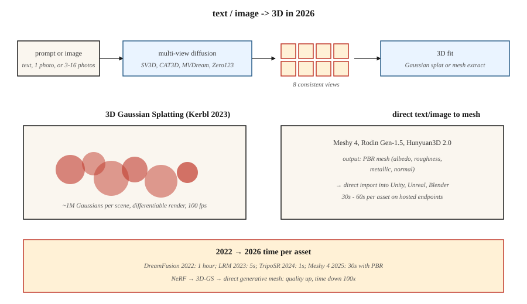

# 3D 生成

> 3D 是 2D-to-3D 杠杆最强的 modality。2023 年的突破是 3D Gaussian Splatting。2024-2026 年的生成式推进，是在它上面叠加 multi-view diffusion + 3D reconstruction，从一个 prompt 或一张照片生成 objects 和 scenes。

**Type:** Learn
**Languages:** Python
**Prerequisites:** Phase 4（Vision），Phase 8 · 07（Latent Diffusion）
**Time:** ~45 minutes

## 问题

3D 内容很难做：

- **Representation。** Meshes、point clouds、voxel grids、signed distance fields（SDFs）、neural radiance fields（NeRFs）、3D Gaussians。每种都有 trade-offs。
- **Data scarcity。** ImageNet 有 14M images。最大的干净 3D dataset（Objaverse-XL，2023）约有 10M objects，其中多数质量较低。
- **Memory。** 一个 512³ voxel grid 有 128M voxels；一个有用的 scene NeRF 每条 ray 需要 1M samples。Generation 比 reconstruction 更难。
- **Supervision。** 对 2D 图像来说，你有 pixels。对 3D 来说，通常只有少数 2D views，还必须把它们 lift 到 3D。

2026 年的 stack 会把两个问题分开。第一步，用 diffusion model 生成 **2D multi-view images**。第二步，把这些图像拟合成一种 **3D representation**，通常是 Gaussian splatting。

## 概念



### Representation：3D Gaussian Splatting（Kerbl et al., 2023）

把一个 scene 表示为约 1M 个 3D Gaussians 的云。每个 Gaussian 有 59 个参数：position（3）、covariance（6，或 quaternion 4 + scale 3）、opacity（1）、spherical-harmonics color（degree 3 时 48，degree 0 时 3）。

Rendering = projection + alpha-compositing。很快（4090 上 1080p 约 100 fps）。可微。用 gradient descent 对 ground-truth photos 拟合。一个 scene 可以在 consumer GPU 上 5-30 分钟内拟合完成。

2023-2024 年叠在它上面的两个创新：

- **Generative Gaussian splats。** LGM、LRM、InstantMesh 这类模型会从一张或几张 images 直接预测 Gaussian cloud。
- **4D Gaussian Splatting。** 带 per-frame offsets 的 Gaussians，用于 dynamic scenes。

### Multi-view diffusion

Fine-tune 一个 pretrained image diffusion model，让它从 text prompt 或 single image 生成同一个 object 的多个一致 views。Zero123（Liu et al., 2023）、MVDream（Shi et al., 2023）、SV3D（Stability, 2024）、CAT3D（Google, 2024）。通常输出物体周围的 4-16 个 views，再通过 Gaussian splatting 或 NeRF lift 到 3D。

### Text-to-3D pipelines

| Model | Input | Output | Time |
|-------|-------|--------|------|
| DreamFusion (2022) | text | NeRF via SDS | ~1 hour per asset |
| Magic3D | text | mesh + texture | ~40 min |
| Shap-E (OpenAI, 2023) | text | implicit 3D | ~1 min |
| SJC / ProlificDreamer | text | NeRF / mesh | ~30 min |
| LRM (Meta, 2023) | image | triplane | ~5 s |
| InstantMesh (2024) | image | mesh | ~10 s |
| SV3D (Stability, 2024) | image | novel views | ~2 min |
| CAT3D (Google, 2024) | 1-64 images | 3D NeRF | ~1 min |
| TripoSR (2024) | image | mesh | ~1 s |
| Meshy 4 (2025) | text + image | PBR mesh | ~30 s |
| Rodin Gen-1.5 (2025) | text + image | PBR mesh | ~60 s |
| Tencent Hunyuan3D 2.0 (2025) | image | mesh | ~30 s |

2025-2026 年的方向：直接生成适合 game engines 的、带 PBR materials 的 text-to-mesh models。对 general objects 来说，multi-view diffusion 这个 intermediate step 仍然是表现最好的 recipe。

### NeRF（背景）

Neural Radiance Field（Mildenhall et al., 2020）。一个 tiny MLP 接收 `(x, y, z, view direction)`，输出 `(color, density)`。通过沿 rays 积分来 render。质量上胜过 mesh-based novel-view synthesis，但 render 慢 100-1000 倍。对大多数 real-time use 来说已经被 Gaussian splatting 取代，但在研究中仍然占主导。

## Build It

`code/main.py` 实现一个玩具版 2D “Gaussian splatting” fit：把一个 synthetic target image（smooth gradient）表示为 2D Gaussian splats 的和。通过 gradient descent 优化 positions、colors 和 covariances 来匹配 target。你会看到两个核心操作：forward render（splat + alpha-composite）和通过 gradient descent 拟合。

### Step 1：2D Gaussian splat

```python
def gaussian_at(x, y, gaussian):
    px, py = gaussian["pos"]
    sigma = gaussian["sigma"]
    d2 = (x - px) ** 2 + (y - py) ** 2
    return math.exp(-d2 / (2 * sigma * sigma))
```

### Step 2：通过 summing splats 来 render

```python
def render(image_size, gaussians):
    img = [[0.0] * image_size for _ in range(image_size)]
    for g in gaussians:
        for y in range(image_size):
            for x in range(image_size):
                img[y][x] += g["color"] * gaussian_at(x, y, g)
    return img
```

真实的 3D Gaussian splatting 会按 depth 对 Gaussians 排序，并按顺序 alpha-composite。我们的 2D toy 只是求和。

### Step 3：通过 gradient descent 拟合

```python
for step in range(steps):
    pred = render(size, gaussians)
    loss = mse(pred, target)
    gradients = compute_grads(pred, target, gaussians)
    update(gaussians, gradients, lr)
```

## 常见坑

- **View inconsistency。** 如果你独立生成 4 个 views，而它们对 object structure 的看法不一致，3D fit 会变糊。修复：使用 shared attention 的 multi-view diffusion。
- **Back-side hallucination。** Single-image → 3D 必须发明不可见的背面。质量波动很大。
- **Gaussian splat explosion。** 无约束训练会增长到 10M splats 并 overfit。Densification + pruning heuristics（来自 3D-GS 原论文）是必需的。
- **Topology issues。** 从 implicit fields（SDFs）得到的 meshes 经常有 holes 或 self-intersections。交付前跑 remesher（例如 blender 的 voxel remesh）。
- **训练数据 license。** Objaverse 的 licenses 很混杂；商业使用限制会随模型而变。

## Use It

| Task | 2026 pick |
|------|-----------|
| Scene reconstruction from photos | Gaussian splatting（3DGS、Gsplat、Scaniverse） |
| Text-to-3D object for games | Meshy 4 或 Rodin Gen-1.5（PBR output） |
| Image-to-3D | Hunyuan3D 2.0、TripoSR、InstantMesh |
| Novel-view synthesis from few images | CAT3D、SV3D |
| Dynamic scene reconstruction | 4D Gaussian Splatting |
| Avatar / clothed human | Gaussian Avatar、HUGS |
| Research / SOTA | 上周刚发布的那个 |

如果你要在 game 或 e-commerce pipeline 中交付 production 3D：Meshy 4 或 Rodin Gen-1.5 会输出 PBR meshes，可以直接进入 Unity / Unreal。

## Ship It

保存 `outputs/skill-3d-pipeline.md`。这个 skill 接收一个 3D brief（input：text / one image / few images；output：mesh / splat / NeRF；usage：render / game / VR），并输出：pipeline（multi-view diffusion + fit，或 direct mesh model）、base model、iteration budget、topology post-processing，以及需要的 material channels。

## 练习

1. **Easy.** 用 4、16、64 个 Gaussians 运行 `code/main.py`。报告 final MSE vs target。
2. **Medium.** 扩展到 color Gaussians（RGB）。确认 reconstruction 匹配 target color pattern。
3. **Hard.** 使用 gsplat 或 Nerfstudio，从 50 张照片 capture 中重建一个真实 object。报告 fit time 和 held-out views 上的 final SSIM。

## 关键术语

| Term | What people say | What it actually means |
|------|-----------------|-----------------------|
| 3D Gaussian Splatting | “3DGS” | 把 scene 表示为 3D Gaussians 云；可微 alpha-composite render。 |
| NeRF | “Neural radiance field” | 在 3D point 输出 color + density 的 MLP；通过 ray integration render。 |
| Triplane | “Three 2-D planes” | 把 3D 分解成三个 2-D axis-aligned feature grids；比 volumetric 更便宜。 |
| SDS | “Score distillation sampling” | 使用 2D-diffusion score 作为 pseudo-gradient 来训练 3D model。 |
| Multi-view diffusion | “Many views at once” | 一次输出一批 consistent camera views 的 diffusion model。 |
| PBR | “Physically-based rendering” | 带 albedo、roughness、metallic、normal channels 的 material。 |
| Densification | “Grow splats” | 3DGS training heuristic：在 high-gradient regions 中 split / clone splats。 |

## 生产备注：3D 还没有统一底座

不像 image（latent diffusion + DiT）和 video（spatiotemporal DiT），3D 在 2026 年还没有单一 dominant runtime。Production decision tree 会按 representation 分叉：

- **NeRF / triplane。** Inference 是 ray-marching + 每个 sample 一次 MLP forward。一次 512² render 需要数百万次 MLP forwards。要积极 batch ray samples；SDPA/xformers 适用。
- **Multi-view diffusion + LRM reconstruction。** 两阶段 pipeline。Stage 1（multi-view DiT）是和 Lesson 07 一样的 diffusion server。Stage 2（LRM transformer）是在 views 上做的一次 one-shot forward pass。整体 latency profile 是 “diffusion + one-shot”，因此要按 stage 选择 serving primitives。
- **SDS / DreamFusion。** 这是 per-asset optimization，不是 inference。要构建 jobs，而不是 request handlers。

对大多数 2026 年的产品来说，正确答案是：“在 request 上运行 multi-view diffusion model，异步 reconstruct 到 3DGS，再把 3DGS 用于 real-time viewing”。这能把 workload 干净地拆成 GPU-inference server（快）和 offline optimizer（慢）。

## 延伸阅读

- [Mildenhall et al. (2020). NeRF: Representing Scenes as Neural Radiance Fields](https://arxiv.org/abs/2003.08934) — NeRF。
- [Kerbl et al. (2023). 3D Gaussian Splatting for Real-Time Radiance Field Rendering](https://arxiv.org/abs/2308.04079) — 3DGS。
- [Poole et al. (2022). DreamFusion: Text-to-3D using 2D Diffusion](https://arxiv.org/abs/2209.14988) — SDS。
- [Liu et al. (2023). Zero-1-to-3: Zero-shot One Image to 3D Object](https://arxiv.org/abs/2303.11328) — Zero123。
- [Shi et al. (2023). MVDream](https://arxiv.org/abs/2308.16512) — multi-view diffusion。
- [Hong et al. (2023). LRM: Large Reconstruction Model for Single Image to 3D](https://arxiv.org/abs/2311.04400) — LRM。
- [Gao et al. (2024). CAT3D: Create Anything in 3D with Multi-View Diffusion Models](https://arxiv.org/abs/2405.10314) — CAT3D。
- [Stability AI (2024). Stable Video 3D (SV3D)](https://stability.ai/research/sv3d) — SV3D。
