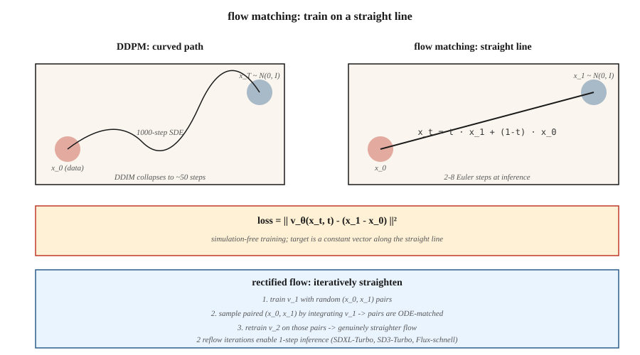

# Flow Matching 与 Rectified Flows

> Diffusion models 需要 20-50 个 sampling steps，因为它们从噪声走到数据时路径是弯的。Flow matching（Lipman et al., 2023）和 rectified flow（Liu et al., 2022）训练的是直线路径。路径越直，步骤越少，推理越快。Stable Diffusion 3、Flux.1 和 AudioCraft 2 都在 2024 年切换到了 flow matching。

**Type:** Build
**Languages:** Python
**Prerequisites:** Phase 8 · 06 (DDPM), Phase 1 · Calculus
**Time:** ~45 minutes

## 问题

DDPM 的 reverse process 是一个 1000-step stochastic walk，从 `N(0, I)` 走回 data distribution。DDIM 把它压缩成了 20-50 个 deterministic steps。你想要更少的 steps，最好一步完成。阻碍在于，求解 reverse process 的 ODE 很 stiff；路径是弯曲的。

如果你能训练模型，让从噪声到数据的路径是一条 *直线*，那么从 `t=1` 到 `t=0` 的单个 Euler step 就能工作。Flow matching 直接构造这件事：定义一条从 `x_1 ∼ N(0, I)` 到 `x_0 ∼ data` 的 straight-line interpolation，训练一个 vector field `v_θ(x, t)` 去匹配它的 time derivative，推理时积分。

Rectified flow（Liu 2022）更进一步：用 reflow procedure 迭代地拉直路径，产生一个越来越接近线性的 ODE。经过两轮 reflow 后，2-step sampler 就能匹配 50-step DDPM 的质量。

## 概念



### Straight-line flow

定义：

```text
x_t = t · x_1 + (1 - t) · x_0,   t ∈ [0, 1]
```

其中 `x_0 ~ data`，`x_1 ~ N(0, I)`。沿这条直线的 time derivative 是常量：

```text
dx_t / dt = x_1 - x_0
```

定义一个 neural vector field `v_θ(x_t, t)`，训练它匹配这个 derivative：

```text
L = E_{x_0, x_1, t} || v_θ(x_t, t) - (x_1 - x_0) ||²
```

这就是 **conditional flow matching** loss（Lipman 2023）。训练是 simulation-free 的：你从不展开 ODE。只需要采样 `(x_0, x_1, t)`，然后做回归。

### Sampling

推理时，沿时间 *反向* 积分 learned vector field：

```text
x_{t-Δt} = x_t - Δt · v_θ(x_t, t)
```

从 `x_1 ~ N(0, I)` 开始，用 Euler step 一路降到 `t=0`。

### Rectified flow（Liu 2022）

Straight-line flow 可以工作，但 learned paths *并不真的直*，它们会弯，因为很多 `x_0` 都可能映射到同一个 `x_1`。Rectified flow 的 reflow step：

1. 用随机配对训练 flow model v_1。
2. 通过把 v_1 从 `x_1` 积分到它落点 `x_0`，采样 N 对 `(x_1, x_0)`。
3. 在这些 paired examples 上训练 v_2。因为这些 pairs 现在是 “ODE-matched” 的，它们之间的 straight-line interpolant 会真正更平。
4. 重复。

实践中，2 次 reflow iterations 就足以接近线性，从而支持 2-4 step inference。SDXL-Turbo、SD3-Turbo、LCM 都是 distilled-from-flow-matching models。

### 为什么它在 2024 年赢得了图像生成

三个原因：

1. **Simulation-free training**：训练时不用展开 ODE，实现非常简单。
2. **更好的 loss geometry**：直线路径有一致的 signal-to-noise，而 DDPM ε-loss 在 schedule 边缘的 SNR 很差。
3. **更快的 inference**：4-8 steps 就能达到 SDXL-Turbo 级质量；配合 consistency distillation 可以 1 step。

## Flow matching vs DDPM：精确连接

使用 Gaussian-conditional path 的 flow matching，就是带有特定 noise schedule 的 diffusion。选择 `x_t = α(t) x_0 + σ(t) x_1` schedule 后，flow matching 会恢复 Stratonovich 形式重写的 diffusion，其中 `v = α'·x_0 - σ'·x_1`。对 Gaussian paths 来说，二者在代数上等价。

Flow matching 增加的是：target 的 *清晰性*（一个普通 velocity）、更干净的 loss，以及尝试 non-Gaussian interpolants 的自由度。

## 动手构建

`code/main.py` 在 two-mode Gaussian mixture 上实现了 1-D flow matching。Vector field `v_θ(x, t)` 是一个小型 MLP，用 straight-line target 训练。推理时，分别积分 1、2、4 和 20 个 Euler steps，并比较 sample quality。

### Step 1：training loss

```python
def train_step(x0, net, rng, lr):
    x1 = rng.gauss(0, 1)
    t = rng.random()
    x_t = t * x1 + (1 - t) * x0
    target = x1 - x0
    pred = net_forward(x_t, t)
    loss = (pred - target) ** 2
    # backprop + update
```

### Step 2：multi-step inference

```python
def sample(net, num_steps):
    x = rng.gauss(0, 1)
    for i in range(num_steps):
        t = 1.0 - i / num_steps
        dt = 1.0 / num_steps
        x -= dt * net_forward(x, t)
    return x
```

### Step 3：比较 step counts

预期 4-step sampler 已经能匹配 20-step quality，这对 latency 很重要。

## 常见陷阱

- **Time parameterization。** Flow matching 使用 `t ∈ [0, 1]`，其中 `t=0` 是 data，`t=1` 是 noise。DDPM 使用 `t ∈ [0, T]`，其中 `t=0` 是 data，`t=T` 是 noise。方向相同，尺度不同。论文经常把这里写错。
- **Schedule choice。** Rectified flow 的 straight line 是 “the” flow-matching schedule，但你可以使用 cosine 或 logit-normal t-sampling（SD3 这样做）来获得更好的 scale coverage。
- **Reflow cost。** 为 reflow 生成 paired dataset，需要对每个样本跑一次完整 inference pass。只有在真的需要 1-2 step inference 时才做 reflow。
- **Classifier-free guidance 仍然适用。** 只需要在线性组合里把 ε 换成 v：`v_cfg = (1+w) v_cond - w v_uncond`。

## 使用它

| Use case | 2026 stack |
|----------|-----------|
| Text-to-image，最佳质量 | Flow matching：SD3、Flux.1-dev |
| Text-to-image，1-4 steps | Distilled flow matching：Flux.1-schnell、SD3-Turbo、SDXL-Turbo |
| Real-time inference | 从 flow-matched base 做 consistency distillation（LCM、PCM） |
| Audio generation | Flow matching：Stable Audio 2.5、AudioCraft 2 |
| Video generation | Flow matching 混合 diffusion（Sora、Veo、Stable Video） |
| Science / physics（particle trajectories、molecules） | Flow matching + equivariant vector field |

2025-2026 年，只要一篇论文说 “faster than diffusion”，几乎总是 flow matching + distillation。

## 交付它

保存 `outputs/skill-fm-tuner.md`。这个 skill 接收 diffusion-style model spec，并把它转换成 flow-matching training config：schedule choice、time sampling distribution（uniform / logit-normal）、optimizer、reflow plan、target step count、eval protocol。

## 练习

1. **Easy.** 运行 `code/main.py`，比较 1-step 与 20-step 相对于真实 data distribution 的 MSE。
2. **Medium.** 从 uniform `t` sampling 切换到 logit-normal（把采样集中到 mid-t）。模型质量是否提升？
3. **Hard.** 实现一次 reflow iteration：通过积分第一个模型生成 paired `(x_0, x_1)`，在这些 pairs 上训练第二个模型，并比较 1-step sample quality。

## 关键术语

| Term | What people say | What it actually means |
|------|-----------------|-----------------------|
| Flow matching | “Straight-line diffusion” | 训练 `v_θ(x, t)`，让它沿 interpolant 匹配 `x_1 - x_0`。 |
| Rectified flow | “Reflow” | 迭代拉直 learned flows 的过程。 |
| Velocity field | “v_θ” | 模型输出，也就是 `x_t` 应该移动的方向。 |
| Straight-line interpolant | “The path” | `x_t = (1-t)·x_0 + t·x_1`；target derivative 很简单。 |
| Euler sampler | “1st order ODE solver” | 最简单的 integrator；当路径很直时效果很好。 |
| Logit-normal t | “SD3 sampling” | 把 `t` sampling 集中到 gradients 最强的中间值。 |
| Consistency distillation | “1-step sampler” | 训练 student，把任意 `x_t` 直接映射到 `x_0`。 |
| CFG with velocity | “v-CFG” | `v_cfg = (1+w) v_cond - w v_uncond`；同一个技巧，换了变量。 |

## 生产备注：Flux.1-schnell 是最快形态的 flow matching

Flow matching 在生产中的胜利代表是 Flux.1-schnell：一个 flow-matched DiT，被 distill 到 1-4 个 inference steps，同时保持 Flux-dev 级质量。Niels 的 “Run Flux on an 8GB machine” notebook 是参考部署 recipe：T5 + CLIP encode、quantized MMDiT denoise（schnell 4 steps，dev 50 steps）、VAE decode。成本账如下：

| Variant | Steps | Latency at 1024² on L4 | Total FLOPs (relative) |
|---------|-------|------------------------|------------------------|
| Flux.1-dev (raw) | 50 | ~15 s | 1.0× |
| Flux.1-schnell | 4 | ~1.2 s | 0.08× (12× faster) |
| SDXL-base | 30 | ~4 s | 0.25× |
| SDXL-Lightning 2-step | 2 | ~0.3 s | 0.03× |

生产规则：**flow-matched base + distillation = 2026 年快速 text-to-image 的默认方案。** 每个主要供应商都在发布这个组合：SD3-Turbo（SD3 + flow + distillation）、Flux-schnell（Flux-dev + rectified-flow straightening）、CogView-4-Flash。纯 diffusion base 只存在于 legacy checkpoints 里。

## 延伸阅读

- [Liu, Gong, Liu (2022). Flow Straight and Fast: Learning to Generate and Transfer Data with Rectified Flow](https://arxiv.org/abs/2209.03003) — rectified flow。
- [Lipman et al. (2023). Flow Matching for Generative Modeling](https://arxiv.org/abs/2210.02747) — flow matching。
- [Esser et al. (2024). Scaling Rectified Flow Transformers for High-Resolution Image Synthesis](https://arxiv.org/abs/2403.03206) — SD3，大规模 rectified flow。
- [Albergo, Vanden-Eijnden (2023). Stochastic Interpolants](https://arxiv.org/abs/2303.08797) — 覆盖 FM + diffusion 的通用框架。
- [Song et al. (2023). Consistency Models](https://arxiv.org/abs/2303.01469) — diffusion / flow 的 1-step distillation。
- [Sauer et al. (2023). Adversarial Diffusion Distillation (SDXL-Turbo)](https://arxiv.org/abs/2311.17042) — turbo variant。
- [Black Forest Labs (2024). Flux.1 models](https://blackforestlabs.ai/announcing-black-forest-labs/) — 生产中的 flow matching。
