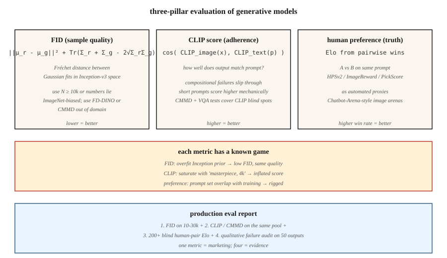

# 评估：FID、CLIP Score 与人类偏好

> 每个生成模型排行榜都会引用 FID、CLIP score，以及来自人类偏好 arena 的胜率。每个数字都有一种 failure mode，认真想刷榜的研究者都能钻。你如果不知道这些 failure modes，就分不清真正的改进和一次 gaming run。

**Type:** Build
**Languages:** Python
**Prerequisites:** Phase 8 · 01 (Taxonomy), Phase 2 · 04 (Evaluation Metrics)
**Time:** ~45 minutes

## 问题

生成模型通常按 *sample quality* 和 *conditioning adherence* 来评判。二者都没有闭式度量。你的模型必须渲染 10,000 张图；某个东西必须给这些图打分；你还必须相信这些数字能跨模型家族、跨分辨率、跨架构比较。2014-2026 年的大浪淘沙后，活下来的主要是三个指标：

- **FID（Fréchet Inception Distance）。** 在 Inception 网络的 feature space 中，计算真实分布和生成分布之间的距离。越低越好。
- **CLIP score。** 生成图像的 CLIP-image embedding 与 prompt 的 CLIP-text embedding 之间的 cosine similarity。越高越好。衡量 prompt adherence。
- **Human preference。** 对同一个 prompt，让两个模型 head-to-head 生成图像，由人类（或 GPT-4 级别模型）选择更好的一个，再聚合成 Elo 分数。

你还会看到：IS（inception score，基本已退役）、KID、CMMD、ImageReward、PickScore、HPSv2、MJHQ-30k。每个指标都在修补上一个指标的某个失败点。

## 概念



### FID：样本质量

Heusel et al.（2017）。步骤：

1. 对 N 张真实图像和 N 张生成图像提取 Inception-v3 features（2048-D）。
2. 对两个 feature 池分别拟合 Gaussian：计算均值 `μ_r, μ_g` 和协方差 `Σ_r, Σ_g`。
3. FID = `||μ_r - μ_g||² + Tr(Σ_r + Σ_g - 2 · (Σ_r · Σ_g)^0.5)`。

解释：它是在 feature space 中，对两个 multivariate Gaussians 计算 Fréchet distance。越低表示两个分布越相似。

Failure modes：

- **小 N 有偏。** FID 是 feature distribution 上的 mean-squared 度量；小 N 会低估 covariance，给出虚假的低 FID。始终使用 N ≥ 10,000。
- **依赖 Inception。** Inception-v3 训练在 ImageNet 上。远离 ImageNet 的领域（人脸、艺术、文字图像）会得到没有意义的 FID。应使用领域特定 feature extractor。
- **Gaming。** 过拟合 Inception prior 可以降低 FID，却不带来视觉质量改进。用 CMMD（见下）对抗它。

### CLIP score：prompt adherence

Radford et al.（2021）。对于一张生成图和 prompt：

```text
clip_score = cos_sim( CLIP_image(x_gen), CLIP_text(prompt) )
```

在 30k 张生成图上取平均，就得到一个可在模型之间比较的标量。

Failure modes：

- **CLIP 自己的盲点。** CLIP 的组合推理很弱（例如 “a red cube on a blue sphere” 经常失败）。模型可以在 CLIP score 上排名很高，却没有真正遵循复杂 prompt。
- **短 prompt 偏置。** 短 prompt 在真实世界里有更多 CLIP-image matches。长 prompt 的 CLIP score 会机械性降低。
- **Prompt gaming。** 在 prompt 里加入 “high quality, 4k, masterpiece” 会抬高 CLIP score，但不改善 image-text binding。

CMMD（Jayasumana et al., 2024）修补了其中一些问题：它使用 CLIP features 而不是 Inception，用 maximum-mean discrepancy 而不是 Fréchet。它更擅长检测细微的质量差异。

### Human preference：ground truth

选一组 prompts。让 model A 和 model B 都生成图像。把成对结果展示给人类（或强 LLM judge），聚合胜负为 Elo 或 Bradley-Terry 分数。常见 benchmarks：

- **PartiPrompts（Google）**：1,600 个多样 prompts，12 个类别。
- **HPSv2**：107k 条人类标注，常用作自动代理指标。
- **ImageReward**：137k 对 prompt-image preference pairs，MIT license。
- **PickScore**：在 Pick-a-Pic 2.6M preferences 上训练。
- **Chatbot-Arena-style image arenas**：https://imagearena.ai/ 以及其他 arena。

Failure modes：

- **Judge variance。** 非专家和专家的偏好不同。两者都要用。
- **Prompt distribution。** 精挑细选的 prompts 会偏向某个模型家族。必须记录 prompt 来源。
- **LLM-judge reward hacking。** GPT-4-judge 会被漂亮但错误的输出骗过。要用人类评审交叉确认。

## 一起使用

一份生产级 eval report 应包括：

1. 在 10-30k 样本上，相对 held-out real distribution 计算 FID（sample quality）。
2. 在同一批样本上，相对 prompts 计算 CLIP score / CMMD（adherence）。
3. 在 blinded arena 中，与上一版模型做 win rate（overall preference）。
4. Failure mode analysis：随机抽样 50 个输出，标注已知问题（手部解剖、文字渲染、稳定物体数量）。

任何单一指标都是谎言。三个互相印证的指标 + 定性 review，才算一个 claim。

## 动手构建

`code/main.py` 在合成 “feature vectors” 上实现了 FID、CLIP-score-like 指标和 Elo aggregation（我们用 4-D vectors 代替 Inception features）。你会看到：

- 小 N 和大 N 下的 FID 计算，也就是偏差。
- 把 feature pools 之间的 cosine similarity 当作 “CLIP score”。
- 从一串合成 preference stream 中更新 Elo。

### Step 1：四行实现 FID

```python
def fid(real_features, gen_features):
    mu_r, cov_r = mean_and_cov(real_features)
    mu_g, cov_g = mean_and_cov(gen_features)
    mean_diff = sum((a - b) ** 2 for a, b in zip(mu_r, mu_g))
    trace_term = trace(cov_r) + trace(cov_g) - 2 * sqrt_cov_product(cov_r, cov_g)
    return mean_diff + trace_term
```

### Step 2：CLIP-style cosine-similarity

```python
def clip_like(image_feat, text_feat):
    dot = sum(a * b for a, b in zip(image_feat, text_feat))
    norm = math.sqrt(dot_self(image_feat) * dot_self(text_feat))
    return dot / max(norm, 1e-8)
```

### Step 3：Elo aggregation

```python
def elo_update(r_a, r_b, winner, k=32):
    expected_a = 1 / (1 + 10 ** ((r_b - r_a) / 400))
    actual_a = 1.0 if winner == "a" else 0.0
    r_a_new = r_a + k * (actual_a - expected_a)
    r_b_new = r_b - k * (actual_a - expected_a)
    return r_a_new, r_b_new
```

## 常见陷阱

- **N=1000 的 FID。** N<10k 时 heuristic 不可靠。报告低 N FID 的论文，基本是在 gaming。
- **跨分辨率比较 FID。** Inception 的 `299×299` resize 会改变 feature distribution。只在匹配分辨率下比较。
- **只报告一个 seed。** 至少跑 3 个 seeds。报告标准差。
- **通过 negative prompts 抬高 CLIP score。** 一些 pipeline 会通过过拟合 prompt 来提升 CLIP。检查是否出现视觉过饱和。
- **Prompt overlap 导致 Elo 偏置。** 如果两个模型训练时都见过 benchmark prompt，Elo 就没有意义。使用 held-out prompt sets。
- **Human eval 的 paid-crowd skew。** Prolific、MTurk 标注者偏年轻、偏技术友好。要混入招募来的艺术/设计专家。

## 使用它

2026 年的生产评估协议：

| Pillar | Minimum | Recommended |
|--------|---------|-------------|
| Sample quality | FID on 10k vs held-out real | + CMMD on 5k + FID on subset per category |
| Prompt adherence | CLIP score on 30k | + HPSv2 + ImageReward + VQA-style question answering |
| Preference | 200 blinded pairs vs baseline | + 2000 paired human + LLM-judge + Chatbot Arena |
| Failure analysis | 50 hand-flagged | 500 hand-flagged + automated safety classifier |

四个支柱都在同一份报告里，才是 claim。任何一个单独拿出来，都是 marketing。

## 交付它

保存 `outputs/skill-eval-report.md`。这个 skill 接收一个新模型 checkpoint + baseline，然后输出完整 eval plan：sample sizes、metrics、failure-mode probes、sign-off criteria。

## 练习

1. **Easy.** 运行 `code/main.py`。在同一组合成分布上，比较 N=100 与 N=1000 时的 FID。报告 bias magnitude。
2. **Medium.** 用合成 CLIP-style features 实现 CMMD（公式见 Jayasumana et al., 2024）。比较它与 FID 对质量差异的敏感度。
3. **Hard.** 复现 HPSv2 设置：从 Pick-a-Pic 的一个子集中取 1000 个 image-prompt pairs，在 preferences 上 fine-tune 一个小型 CLIP-based scorer，并测量它与 held-out set 的一致性。

## 关键术语

| Term | What people say | What it actually means |
|------|-----------------|-----------------------|
| FID | “Fréchet Inception Distance” | 对 real vs gen Inception features 拟合 Gaussian 后计算 Fréchet distance。 |
| CLIP score | “Text-image similarity” | CLIP image embeddings 与 text embeddings 之间的 cosine similarity。 |
| CMMD | “FID's replacement” | CLIP-feature MMD；偏差更小，不需要 Gaussian assumption。 |
| IS | “Inception score” | `Exp KL(p(y\|x) || p(y))`；在现代模型上相关性很差，基本已退役。 |
| HPSv2 / ImageReward / PickScore | “Learned preference proxies” | 在人类偏好上训练的小模型，用作自动 judge。 |
| Elo | “Chess rating” | 对 pairwise wins 做 Bradley-Terry aggregation。 |
| PartiPrompts | “The benchmark prompt set” | Google 策划的 1,600 个 prompts，覆盖 12 个类别。 |
| FD-DINO | “Self-sup replacement” | 使用 DINOv2 features 的 FD；对 ImageNet 外领域更好。 |

## 生产备注：evaluation 也是 inference workload

在 10k 样本上跑 FID，意味着要生成 10k 张图。对于一个 50-step、1024² 的 SDXL base，在单张 L4 上做单请求推理大约需要 11 小时。评估预算是真实存在的，而且它本质上是 offline-inference 场景（最大化 throughput，忽略 TTFT）：

- **尽可能 batch，忘掉 latency。** Offline eval = 在显存允许的最大 batch size 下做 static batching。在 80GB H100 上，用 `pipe(...).images` 加 `num_images_per_prompt=8`，wall-clock 会比单请求快 4-6 倍。
- **缓存 real features。** 真实 reference set 上的 Inception（FID）或 CLIP（CLIP-score、CMMD）feature extraction 只运行 *一次*，存成 `.npz`。不要每次 eval 都重算。

对于 CI / regression gates：每个 PR 在 500-sample subset 上跑 FID + CLIP score（约 30 分钟）；nightly 跑完整 10k FID + HPSv2 + Elo。

## 延伸阅读

- [Heusel et al. (2017). GANs Trained by a Two Time-Scale Update Rule Converge to a Local Nash Equilibrium (FID)](https://arxiv.org/abs/1706.08500)：FID 论文。
- [Jayasumana et al. (2024). Rethinking FID: Towards a Better Evaluation Metric for Image Generation (CMMD)](https://arxiv.org/abs/2401.09603)：CMMD。
- [Radford et al. (2021). Learning Transferable Visual Models from Natural Language Supervision (CLIP)](https://arxiv.org/abs/2103.00020)：CLIP。
- [Wu et al. (2023). HPSv2: A Comprehensive Human Preference Score](https://arxiv.org/abs/2306.09341)：HPSv2。
- [Xu et al. (2023). ImageReward: Learning and Evaluating Human Preferences for Text-to-Image Generation](https://arxiv.org/abs/2304.05977)：ImageReward。
- [Yu et al. (2023). Scaling Autoregressive Models for Content-Rich Text-to-Image Generation (Parti + PartiPrompts)](https://arxiv.org/abs/2206.10789)：PartiPrompts。
- [Stein et al. (2023). Exposing flaws of generative model evaluation metrics](https://arxiv.org/abs/2306.04675)：failure-mode survey。
