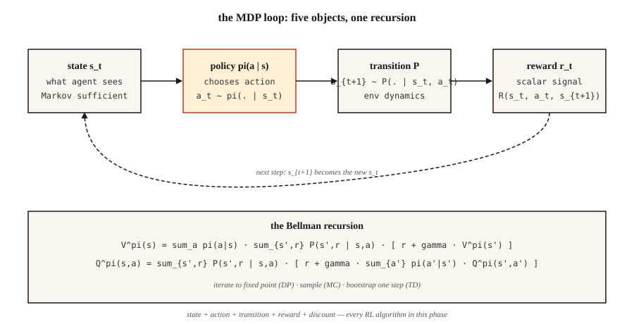

# MDP、状态、动作与奖励

> Markov Decision Process 由五样东西组成：states、actions、transitions、rewards、discount。RL 里的所有东西，包括 Q-learning、PPO、DPO、GRPO，都在这个形状上优化。学会一次，后面的 reinforcement learning 基本都能读懂。

**Type:** Learn
**Languages:** Python
**Prerequisites:** Phase 1 · 06（Probability & Distributions），Phase 2 · 01（ML Taxonomy）
**Time:** ~45 minutes

## 问题

你正在写一个 chess bot。或者一个 inventory planner。或者一个 trading agent。或者训练 reasoning model 的 PPO loop。四个不同领域，一个令人意外的事实：它们都可以折叠成同一个数学对象。

Supervised learning 给你 `(x, y)` 对，并要求你拟合一个函数。Reinforcement learning 没有 labels，只有一串 states、你采取的 actions，以及一个标量 reward。这个走法赢棋了吗？补货决策省钱了吗？这笔交易盈利了吗？LLM 刚生成的 token 是否让 judge 给出了更高 reward？

如果不先形式化，你无法从这串数据中学习。“我看到了什么”、“我做了什么”、“接下来发生了什么”、“这有多好”——每一项都必须变成可以推理的对象。这个形式化就是 Markov Decision Process。本阶段的每个 RL algorithm，包括最后的 RLHF 和 GRPO loops，都在这个形状上优化。

## 概念



**五个对象。**

- **States** `S`。Agent 决策所需的一切。在 GridWorld 中是格子；在 chess 中是棋盘；在 LLM 中是 context window 加上任何 memory。
- **Actions** `A`。可选行为。上/下/左/右移动。下一步棋。输出一个 token。
- **Transitions** `P(s' | s, a)`。给定 state `s` 和 action `a` 后，next state 的分布。Chess 中是 deterministic，inventory 中是 stochastic，LLM decoding 中几乎是 deterministic。
- **Rewards** `R(s, a, s')`。标量信号。胜利 = +1，失败 = -1。Revenue minus cost。GRPO 中的 log-likelihood ratio term。
- **Discount** `γ ∈ [0, 1)`。未来 reward 相对于当前 reward 的权重。`γ = 0.99` 买到约 100 steps 的 horizon；`γ = 0.9` 买到约 10 steps。

**Markov property**：`P(s_{t+1} | s_t, a_t) = P(s_{t+1} | s_0, a_0, …, s_t, a_t)`。未来只依赖当前 state。如果不满足，说明 state representation 不完整；这不是方法失败，而是 state 失败。

**Policies and returns。** Policy `π(a | s)` 把 states 映射到 action distributions。Return `G_t = r_t + γ r_{t+1} + γ² r_{t+2} + …` 是未来 rewards 的 discounted sum。Value `V^π(s) = E[G_t | s_t = s]` 是从 `s` 出发并遵循 policy `π` 的 expected return。Q-value `Q^π(s, a) = E[G_t | s_t = s, a_t = a]` 是从某个特定 action 开始时的 expected return。每个 RL algorithm 都在估计这两者之一，然后相应地改进 `π`。

**Bellman equations。** 本阶段所有算法都会用到的 fixed-point equations：

`V^π(s) = Σ_a π(a|s) Σ_{s', r} P(s', r | s, a) [r + γ V^π(s')]`
`Q^π(s, a) = Σ_{s', r} P(s', r | s, a) [r + γ Σ_{a'} π(a'|s') Q^π(s', a')]`

它们把 expected return 拆成“这一步的 reward”加上“落到下一个 state 后的 discounted value”。递归。本阶段每个 algorithm 要么把这个方程迭代到收敛（dynamic programming），要么从中采样（Monte Carlo），要么只 bootstrap 一步（temporal difference）。

```figure
discount-horizon
```

## Build It

### Step 1：一个极小的 deterministic MDP

一个 4×4 GridWorld。Agent 从左上角开始，右下角为 terminal，每走一步 reward 为 -1，actions 为 `{up, down, left, right}`。见 `code/main.py`。

```python
GRID = 4
TERMINAL = (3, 3)
ACTIONS = {"up": (-1, 0), "down": (1, 0), "left": (0, -1), "right": (0, 1)}

def step(state, action):
    if state == TERMINAL:
        return state, 0.0, True
    dr, dc = ACTIONS[action]
    r, c = state
    nr = min(max(r + dr, 0), GRID - 1)
    nc = min(max(c + dc, 0), GRID - 1)
    return (nr, nc), -1.0, (nr, nc) == TERMINAL
```

五行逻辑。这就是整个 environment。Deterministic transitions、constant step penalty、absorbing terminal state。

### Step 2：roll out 一个 policy

Policy 是从 state 到 action distribution 的函数。最简单的是 uniform random。

```python
def uniform_policy(state):
    return {a: 0.25 for a in ACTIONS}

def rollout(policy, max_steps=200):
    s, total, steps = (0, 0), 0.0, 0
    for _ in range(max_steps):
        a = sample(policy(s))
        s, r, done = step(s, a)
        total += r
        steps += 1
        if done:
            break
    return total, steps
```

把 random policy 跑 1000 次。对这个 4×4 board，average return 大约是 -60 到 -80。Optimal return 是 -6（沿直线向下、向右走）。缩小这个差距，就是 Phase 9 的全部内容。

### Step 3：通过 Bellman equation 精确计算 `V^π`

对小型 MDP 来说，Bellman equation 是一个 linear system。枚举 states，应用 expectation，并迭代到 values 停止变化。

```python
def policy_evaluation(policy, gamma=0.99, tol=1e-6):
    V = {s: 0.0 for s in all_states()}
    while True:
        delta = 0.0
        for s in all_states():
            if s == TERMINAL:
                continue
            v = 0.0
            for a, pi_a in policy(s).items():
                s_next, r, _ = step(s, a)
                v += pi_a * (r + gamma * V[s_next])
            delta = max(delta, abs(v - V[s]))
            V[s] = v
        if delta < tol:
            return V
```

这就是 iterative policy evaluation。它是 Sutton & Barto 里的第一个算法，也是后续每个 RL 方法的理论地基。

### Step 4：`γ` 是有物理意义的 hyperparameter

Effective horizon 大约是 `1 / (1 - γ)`。`γ = 0.9` → 10 steps。`γ = 0.99` → 100 steps。`γ = 0.999` → 1000 steps。

太低，agent 会短视。太高，credit assignment 会变得 noisy，因为许多早期 steps 都要为遥远未来的 reward 分担责任。LLM RLHF 通常使用 `γ = 1`，因为 episodes 短且有边界。Control tasks 使用 `0.95–0.99`。Long-horizon strategy games 使用 `0.999`。

## 常见陷阱

- **Non-Markovian state。** 如果你需要最近三次 observations 才能决策，那么 “state” 就不只是当前 observation。修复：stack frames（Atari 上的 DQN stack 4 帧）或使用 recurrent state（对 observations 跑 LSTM/GRU）。
- **Sparse rewards。** 只有 win-only rewards 时，在大 state spaces 中学习几乎不可能。使用 shaped rewards（中间信号）或用 imitation bootstrap（Phase 9 · 09）。
- **Reward hacking。** 优化 proxy reward 经常产生病态行为。OpenAI 的 boat-racing agent 会一直原地转圈收集 powerups，而不是完成比赛。Reward 必须从目标 outcome 定义，而不是从 proxy 定义。
- **Discount mis-spec。** 在 infinite-horizon task 上使用 `γ = 1` 会让每个 value 都变成 infinite。要么用 finite horizon，要么用 `γ < 1`。
- **Reward scale。** Rewards 为 {+100, -100} 和 {+1, -1} 会给出相同的 optimal policies，但 gradient magnitudes 完全不同。接入 PPO/DQN 之前，把 reward normalize 到接近 `[-1, 1]`。

## Use It

2026 年的 stack 会先把每个 RL pipeline 归约成 MDP，再开始写代码：

| Situation | State | Action | Reward | γ |
|-----------|-------|--------|--------|---|
| Control（locomotion, manipulation） | Joint angles + velocities | Continuous torques | Task-specific shaped | 0.99 |
| Games（chess, Go, poker） | Board + history | Legal move | Win=+1 / loss=-1 | 1.0（finite） |
| Inventory / pricing | Stock + demand | Order qty | Revenue - cost | 0.95 |
| RLHF for LLMs | Context tokens | Next token | Reward-model score at end | 1.0（episode ~200 tokens） |
| GRPO for reasoning | Prompt + partial response | Next token | Verifier 0/1 at end | 1.0 |

写任何 training loop 之前，先写出这五元组。大多数 “RL does not work” 的 bug report，最后都能追到一个在纸面上就坏掉的 MDP formulation。

## Ship It

保存为 `outputs/skill-mdp-modeler.md`：

```markdown
---
name: mdp-modeler
description: Given a task description, produce a Markov Decision Process spec and flag formulation risks before training.
version: 1.0.0
phase: 9
lesson: 1
tags: [rl, mdp, modeling]
---

Given a task (control / game / recommendation / LLM fine-tuning), output:

1. State. Exact feature vector or tensor spec. Justify Markov property.
2. Action. Discrete set or continuous range. Dimensionality.
3. Transition. Deterministic, stochastic-with-known-model, or sample-only.
4. Reward. Function and source. Sparse vs shaped. Terminal vs per-step.
5. Discount. Value and horizon justification.

Refuse to ship any MDP where the state is non-Markovian without explicit mention of frame-stacking or recurrent state. Refuse any reward that was not defined in terms of the target outcome. Flag any `γ ≥ 1.0` on an infinite-horizon task. Flag any reward range >100x the typical step reward as a likely gradient-explosion source.
```

## 练习

1. **Easy.** 在 `code/main.py` 中实现 4×4 GridWorld 和 random-policy rollout。运行 10,000 个 episodes。报告 return 的 mean 和 std。和 optimal return（-6）比较。
2. **Medium.** 对 uniform-random policy，使用 `γ ∈ {0.5, 0.9, 0.99}` 运行 `policy_evaluation`。把每个 `V` 打印成 4×4 grid。解释为什么 terminal 附近的 state values 会随着更大的 `γ` 增长更快。
3. **Hard.** 把 GridWorld 改成 stochastic：每个 action 以 `p = 0.1` 的概率 slip 到相邻方向。重新评估 uniform policy。`V[start]` 变好还是变差？为什么？

## 关键术语

| 术语 | 大家常说 | 实际含义 |
|------|----------|----------|
| MDP | “Reinforcement learning setup” | 满足 Markov property 的元组 `(S, A, P, R, γ)`。 |
| State | “What the agent sees” | 对所选 policy class 下未来 dynamics 的 sufficient statistic。 |
| Policy | “Agent's behavior” | Conditional distribution `π(a \| s)` 或 deterministic map `s → a`。 |
| Return | “Total reward” | 从当前 step 开始的 discounted sum `Σ γ^t r_t`。 |
| Value | “How good a state is” | 从 `s` 出发并遵循 `π` 的 expected return。 |
| Q-value | “How good an action is” | 从 `s` 出发且 first action 为 `a` 时，在 `π` 下的 expected return。 |
| Bellman equation | “Dynamic programming recursion” | 把 value / Q 分解为 one-step reward 加 discounted successor value 的 fixed-point decomposition。 |
| Discount `γ` | “Future vs present” | 对远未来 reward 的 geometric weight；effective horizon `~1/(1-γ)`。 |

## 延伸阅读

- [Sutton & Barto (2018). Reinforcement Learning: An Introduction, 2nd ed.](http://incompleteideas.net/book/RLbook2020.pdf)：经典教材。第 3 章介绍 MDP 和 Bellman equations；第 1 章解释 reward hypothesis，它支撑后续所有 lessons。
- [Bellman (1957). Dynamic Programming](https://press.princeton.edu/books/paperback/9780691146683/dynamic-programming)：Bellman equation 的源头。
- [OpenAI Spinning Up — Part 1: Key Concepts](https://spinningup.openai.com/en/latest/spinningup/rl_intro.html)：从 deep-RL 角度写的简明 MDP primer。
- [Puterman (2005). Markov Decision Processes](https://onlinelibrary.wiley.com/doi/book/10.1002/9780470316887)：MDP 和 exact solution methods 的 operations-research 参考书。
- [Littman (1996). Algorithms for Sequential Decision Making (PhD thesis)](https://www.cs.rutgers.edu/~mlittman/papers/thesis-main.pdf)：把 MDP 推导成 dynamic-programming specialization 的清晰论述。
