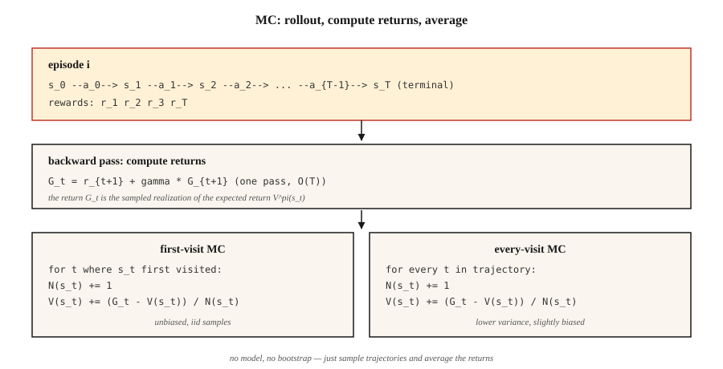

# Monte Carlo 方法：从完整 Episodes 中学习

> Dynamic programming 需要一个模型。Monte Carlo 除了 episodes 什么都不需要。运行 policy，观察 returns，取平均。RL 中最简单的想法，也是解锁后续一切算法的那一个。

**Type:** Build
**Languages:** Python
**Prerequisites:** Phase 9 · 01（MDPs），Phase 9 · 02（Dynamic Programming）
**Time:** ~75 minutes

## 问题

Dynamic programming 很优雅，但它假设你可以对每个 state 和 action 查询 `P(s' | s, a)`。真实世界里几乎没有东西这样运作。机器人无法解析地计算一个 joint torque 之后 camera pixels 的分布。Pricing algorithm 无法对每一种可能的 customer reaction 做积分。LLM 也无法枚举一个 token 之后所有可能的 continuations。

你需要一种只要求能从 environment 中 **采样** 的方法。运行 policy。得到一条 trajectory：`s_0, a_0, r_1, s_1, a_1, r_2, …, s_T`。用它估计 values。这就是 Monte Carlo。

从 DP 到 MC 的转变在哲学上很重要：我们从 **known model + exact backup** 转向 **sampled rollouts + averaged return**。Variance 会跳升，但适用范围会暴涨。这一课之后的每个 RL 算法：TD、Q-learning、REINFORCE、PPO、GRPO，本质上都是 Monte Carlo estimator，只是有时会在上面叠一层 bootstrapping。

## 概念



**核心思想，一行写完：** `V^π(s) = E_π[G_t | s_t = s] ≈ (1/N) Σ_i G^{(i)}(s)`，其中 `G^{(i)}(s)` 是在 policy `π` 下访问 `s` 之后观察到的 returns。

**First-visit vs every-visit MC。** 给定一个多次访问 state `s` 的 episode，first-visit MC 只计算第一次访问后的 return；every-visit MC 会计算所有访问。二者在极限中都是 unbiased。First-visit 更容易分析（iid samples）。Every-visit 每个 episode 使用更多数据，实践中通常收敛更快。

**Incremental mean。** 不存储所有 returns，而是更新 running average：

`V_n(s) = V_{n-1}(s) + (1/n) [G_n - V_{n-1}(s)]`

重新整理：`V_new = V_old + α · (target - V_old)`，其中 `α = 1/n`。把 `1/n` 换成常数 step-size `α ∈ (0, 1)`，你就得到一个能追踪 `π` 变化的 non-stationary MC estimator。从 MC 到 TD，再到每个现代 RL 算法，核心跳跃就是这一步。

**Exploration 现在成了问题。** DP 通过枚举触达每个 state。MC 只会看到 policy 实际访问的 states。如果 `π` 是 deterministic，state space 的整片区域永远不会被采样，它们的 value estimates 会永远停在 0。按历史顺序，有三个修复办法：

1. **Exploring starts。** 每个 episode 从随机 `(s, a)` pair 开始。保证 coverage；实践中不现实（你不能把机器人“reset”到任意 state）。
2. **ε-greedy。** 相对于当前 Q 采取 greedy action，但以概率 `ε` 随机选择 action。所有 state-action pairs 都会在渐近意义下被采样。
3. **Off-policy MC。** 在 behavior policy `μ` 下收集数据，通过 importance sampling 学习 target policy `π`。Variance 很高，但它是通向 DQN 这类 replay-buffer methods 的桥。

**Monte Carlo Control。** Evaluate → improve → evaluate，就像 policy iteration，只是 evaluation 基于采样：

1. 运行 `π`，得到一个 episode。
2. 用观察到的 returns 更新 `Q(s, a)`。
3. 让 `π` 相对于 `Q` 变成 ε-greedy。
4. 重复。

在温和条件下（每个 pair 被无限次访问，`α` 满足 Robbins-Monro），它以概率 1 收敛到 `Q*` 和 `π*`。

```text
epsilon-greedy
```

## Build It

### Step 1：rollout → (s, a, r) 列表

```python
def rollout(env, policy, max_steps=200):
    trajectory = []
    s = env.reset()
    for _ in range(max_steps):
        a = policy(s)
        s_next, r, done = env.step(s, a)
        trajectory.append((s, a, r))
        s = s_next
        if done:
            break
    return trajectory
```

没有 model，只有 `env.reset()` 和 `env.step(s, a)`。这和 gym environment 的接口一样，只是被剥到了最小。

### Step 2：compute returns（reverse sweep）

```python
def returns_from(trajectory, gamma):
    returns = []
    G = 0.0
    for _, _, r in reversed(trajectory):
        G = r + gamma * G
        returns.append(G)
    return list(reversed(returns))
```

单次 pass，`O(T)`。Backward recurrence `G_t = r_{t+1} + γ G_{t+1}` 避免了重复求和。

### Step 3：first-visit MC evaluation

```python
def mc_policy_evaluation(env, policy, episodes, gamma=0.99):
    V = defaultdict(float)
    counts = defaultdict(int)
    for _ in range(episodes):
        trajectory = rollout(env, policy)
        returns = returns_from(trajectory, gamma)
        seen = set()
        for t, ((s, _, _), G) in enumerate(zip(trajectory, returns)):
            if s in seen:
                continue
            seen.add(s)
            counts[s] += 1
            V[s] += (G - V[s]) / counts[s]
    return V
```

真正工作的就是三行：第一次访问时标记 state、递增 count、更新 running mean。

### Step 4：ε-greedy MC control（on-policy）

```python
def mc_control(env, episodes, gamma=0.99, epsilon=0.1):
    Q = defaultdict(lambda: {a: 0.0 for a in ACTIONS})
    counts = defaultdict(lambda: {a: 0 for a in ACTIONS})

    def policy(s):
        if random() < epsilon:
            return choice(ACTIONS)
        return max(Q[s], key=Q[s].get)

    for _ in range(episodes):
        trajectory = rollout(env, policy)
        returns = returns_from(trajectory, gamma)
        seen = set()
        for (s, a, _), G in zip(trajectory, returns):
            if (s, a) in seen:
                continue
            seen.add((s, a))
            counts[s][a] += 1
            Q[s][a] += (G - Q[s][a]) / counts[s][a]
    return Q, policy
```

### Step 5：和 DP gold standard 比较

随着 episodes → ∞，你对 `V^π` 的 MC estimate 应该和 Lesson 02 的 DP result 一致。实践中：在 4×4 GridWorld 上跑 50,000 episodes，可以让结果距离 DP answer 约 `~0.1` 以内。

## 常见坑

- **Infinite episodes。** MC 要求 episodes **终止**。如果你的 policy 可能永远 loop，就设置 `max_steps`，并把 cap 视为隐式 failure。GridWorld 中 random policy 经常 timeout，这是正常的，只要你正确计数。
- **Variance。** MC 使用 full returns。长 episodes 上 variance 很大，一个末尾的 unlucky reward 会等量影响 `V(s_0)`。TD methods（Lesson 04）通过 bootstrapping 降低它。
- **State coverage。** 新鲜 Q 上的 greedy MC 在 ties 下只会尝试一个 action。你 **必须** explore（ε-greedy、exploring starts、UCB）。
- **Non-stationary policies。** 如果 `π` 改变了（如 MC control），旧 returns 来自不同 policy。Constant-α MC 能处理这个问题；sample-average MC 不行。
- **Off-policy importance sampling。** 权重 `π(a|s)/μ(a|s)` 会沿 trajectory 相乘。Variance 会随 horizon 爆炸。用 per-decision weighted IS 截断，或者切到 TD。

## Use It

Monte Carlo methods 在 2026 年的角色：

| Use case | Why MC |
|----------|--------|
| Short-horizon games（blackjack、poker） | Episodes 自然终止；returns 干净。 |
| Logged policy 的 offline evaluation | 对 stored trajectories 上的 discounted returns 取平均。 |
| Monte Carlo Tree Search（AlphaZero） | 从 tree leaves 开始的 MC rollouts 指导 selection。 |
| LLM RL evaluation | 对给定 policy 的 sampled completions 计算 average reward。 |
| PPO 中的 baseline estimation | Advantage target `A_t = G_t - V(s_t)` 使用 MC `G_t`。 |
| Teaching RL | 真正能工作的最简单算法；去掉 bootstrapping 就能看见核心。 |

现代 deep-RL algorithms（PPO、SAC）通过 `n`-step returns 或 GAE，在 pure MC（full returns）和 pure TD（one-step bootstrap）之间插值。两个端点都是同一个 estimator 的实例。

## Ship It

保存为 `outputs/skill-mc-evaluator.md`：

```markdown
---
name: mc-evaluator
description: Evaluate a policy via Monte Carlo rollouts and produce a convergence report with DP-comparison if available.
version: 1.0.0
phase: 9
lesson: 3
tags: [rl, monte-carlo, evaluation]
---

Given an environment (episodic, with reset+step API) and a policy, output:

1. Method. First-visit vs every-visit MC. Reason.
2. Episode budget. Target number, variance diagnostic, expected standard error.
3. Exploration plan. ε schedule (if needed) or exploring starts.
4. Gold-standard comparison. DP-optimal V* if tabular; otherwise a bound from a Q-learning / PPO baseline.
5. Termination check. Max-step cap, timeouts, handling of non-terminating trajectories.

Refuse to run MC on non-episodic tasks without a finite horizon cap. Refuse to report V^π estimates from fewer than 100 episodes per state for tabular tasks. Flag any policy with zero-variance actions as an exploration risk.
```

## 练习

1. **Easy.** 在 4×4 GridWorld 上实现 uniform-random policy 的 first-visit MC evaluation。运行 10,000 episodes。把 `V(0,0)` 随 episode count 的变化和 DP answer 画在一起。
2. **Medium.** 实现 `ε ∈ {0.01, 0.1, 0.3}` 的 ε-greedy MC control。比较 20,000 episodes 后的 mean return。曲线长什么样？Bias-variance tradeoff 在哪里？
3. **Hard.** 用 importance sampling 实现 **off-policy** MC：在 uniform-random policy `μ` 下收集数据，估计 deterministic optimal policy `π` 的 `V^π`。比较 plain IS、per-decision IS、weighted IS。哪个 variance 最低？

## 关键术语

| Term | What people say | What it actually means |
|------|-----------------|-----------------------|
| Monte Carlo | “Random sampling” | 通过对来自分布的 iid samples 取平均来估计 expectations。 |
| Return `G_t` | “Future reward” | 从 step `t` 到 episode end 的 discounted rewards 之和：`Σ_{k≥0} γ^k r_{t+k+1}`。 |
| First-visit MC | “Count each state once” | 一个 episode 中只有第一次访问会贡献 value estimate。 |
| Every-visit MC | “Use all visits” | 每次访问都贡献；略有 bias，但 sample-efficient 更高。 |
| ε-greedy | “Exploration noise” | 以概率 `1-ε` 选择 greedy action；以概率 `ε` 选择 random action。 |
| Importance sampling | “Correcting for sampling from the wrong distribution” | 用 `π(a\|s)/μ(a\|s)` 的乘积重加权 returns，从 `μ` 数据估计 `V^π`。 |
| On-policy | “Learn from my own data” | Target policy = behavior policy。Vanilla MC、PPO、SARSA。 |
| Off-policy | “Learn from someone else's data” | Target policy ≠ behavior policy。Importance-sampled MC、Q-learning、DQN。 |

## 延伸阅读

- [Sutton & Barto (2018). Ch. 5 — Monte Carlo Methods](http://incompleteideas.net/book/RLbook2020.pdf) — canonical treatment。
- [Singh & Sutton (1996). Reinforcement Learning with Replacing Eligibility Traces](https://link.springer.com/article/10.1007/BF00114726) — first-visit vs every-visit analysis。
- [Precup, Sutton, Singh (2000). Eligibility Traces for Off-Policy Policy Evaluation](http://incompleteideas.net/papers/PSS-00.pdf) — off-policy MC and variance control。
- [Mahmood et al. (2014). Weighted Importance Sampling for Off-Policy Learning](https://arxiv.org/abs/1404.6362) — modern low-variance IS estimators。
- [Tesauro (1995). TD-Gammon, A Self-Teaching Backgammon Program](https://dl.acm.org/doi/10.1145/203330.203343) — 第一次大规模经验展示 MC/TD self-play 收敛到超人水平；也是本阶段后半部分每一课的概念前身。
