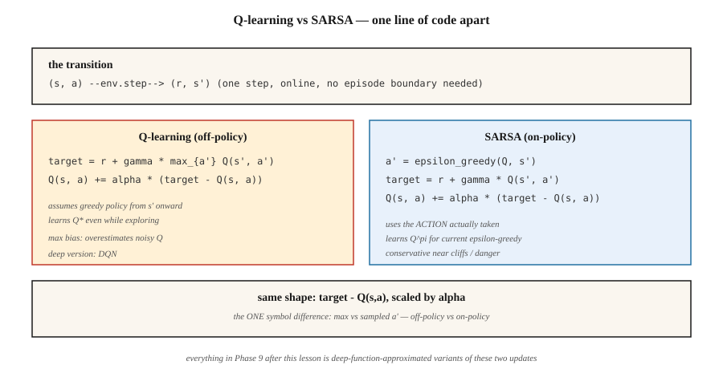

# Temporal Difference：Q-Learning 与 SARSA

> Monte Carlo 要等 episode 结束。TD 会通过 bootstrapping 下一个 value estimate，在每一步之后立即更新。Q-learning 是 off-policy 且乐观；SARSA 是 on-policy 且谨慎。二者都只是一行代码。二者也支撑着本阶段所有 deep-RL 方法。

**Type:** Build
**Languages:** Python
**Prerequisites:** Phase 9 · 01 (MDPs), Phase 9 · 02 (Dynamic Programming), Phase 9 · 03 (Monte Carlo)
**Time:** ~75 minutes

## 问题

Monte Carlo 有效，但它有两个昂贵要求。它需要会终止的 episodes，而且只有等最终 return 出来后才更新。如果你的 episode 有 1,000 steps，MC 就要等 1,000 steps 才能更新任何东西。它高方差、低偏差，但实践中很慢。

Dynamic programming 刚好相反：零方差的 bootstrapped backups，但要求你已知模型。

Temporal difference（TD）learning 折中了二者。从单个 transition `(s, a, r, s')` 出发，构造一个 one-step target `r + γ V(s')`，然后把 `V(s)` 往它挪一点。无需模型。无需完整 episodes。因为 RHS 使用了近似的 `V`，所以有 bias；但相比 MC，variance 大幅降低，而且从第一步开始就能 online update。

这正是现代 RL 的枢纽：DQN、A2C、PPO、SAC 都围着它转。Phase 9 后续内容基本都是在你本课手写的一步 TD update 上叠加 function approximation 和各种技巧。

## 概念



**V 的 TD(0) update：**

`V(s) ← V(s) + α [r + γ V(s') - V(s)]`

方括号里的量就是 TD error：`δ = r + γ V(s') - V(s)`。它是 MC 中 `G_t - V(s_t)` 的 online analog。收敛要求 `α` 满足 Robbins-Monro 条件（`Σ α = ∞`，`Σ α² < ∞`），并且所有 states 被无限次访问。

**Q-learning。** 用于 control 的 off-policy TD 方法：

`Q(s, a) ← Q(s, a) + α [r + γ max_{a'} Q(s', a') - Q(s, a)]`

这里的 `max` 假设从 `s'` 开始会遵循 *greedy* policy，不管 agent 实际上采取了什么 action。这种解耦让 Q-learning 能在 agent 用 ε-greedy 探索时学习 `Q*`。Mnih et al.（2015）把它变成了 Atari 上的 deep Q-learning（Lesson 05）。

**SARSA。** On-policy TD 方法：

`Q(s, a) ← Q(s, a) + α [r + γ Q(s', a') - Q(s, a)]`

这个名字来自 tuple `(s, a, r, s', a')`。SARSA 使用 agent 下一步 *实际* 会采取的 action `a'`，而不是 greedy `argmax`。它会收敛到当前 ε-greedy `π` 对应的 `Q^π`；当 `ε → 0` 时，极限变成 `Q*`。

**Cliff-walking 中的差异。** 在经典 cliff-walking 任务里（掉下悬崖 = reward -100），Q-learning 会学习沿着悬崖边缘走的最优路径，但在探索期间偶尔吃到惩罚。SARSA 会学习一条离悬崖远一步的安全路径，因为它把探索噪声也计入了 Q-value。随着训练进行，二者在 `ε → 0` 时都会到达最优。实践中这很重要：如果部署时仍然存在探索，SARSA 的行为更保守。

**Expected SARSA。** 用 `π` 下的期望值替换 `Q(s', a')`：

`Q(s, a) ← Q(s, a) + α [r + γ Σ_{a'} π(a'|s') Q(s', a') - Q(s, a)]`

它比 SARSA 方差更低（不采样 `a'`），但 target 仍然是 on-policy。现代教材里常把它作为默认选择。

**n-step TD 与 TD(λ)。** 通过等待 `n` 步再 bootstrap，在 TD(0) 和 MC 之间插值。`n=1` 是 TD，`n=∞` 是 MC。TD(λ) 用几何权重 `(1-λ)λ^{n-1}` 对所有 `n` 做平均。大多数 deep-RL 使用 3 到 20 之间的 `n`。

```figure
qlearning-gridworld
```

## 动手构建

### Step 1：在 ε-greedy policy 上实现 SARSA

```python
def sarsa(env, episodes, alpha=0.1, gamma=0.99, epsilon=0.1):
    Q = defaultdict(lambda: {a: 0.0 for a in ACTIONS})

    def choose(s):
        if random() < epsilon:
            return choice(ACTIONS)
        return max(Q[s], key=Q[s].get)

    for _ in range(episodes):
        s = env.reset()
        a = choose(s)
        while True:
            s_next, r, done = env.step(s, a)
            a_next = choose(s_next) if not done else None
            target = r + (gamma * Q[s_next][a_next] if not done else 0.0)
            Q[s][a] += alpha * (target - Q[s][a])
            if done:
                break
            s, a = s_next, a_next
    return Q
```

八行。它和 Q-learning 的 *唯一* 差异就是 target 那一行。

### Step 2：Q-learning

```python
def q_learning(env, episodes, alpha=0.1, gamma=0.99, epsilon=0.1):
    Q = defaultdict(lambda: {a: 0.0 for a in ACTIONS})
    for _ in range(episodes):
        s = env.reset()
        while True:
            a = choose(s, Q, epsilon)
            s_next, r, done = env.step(s, a)
            target = r + (gamma * max(Q[s_next].values()) if not done else 0.0)
            Q[s][a] += alpha * (target - Q[s][a])
            if done:
                break
            s = s_next
    return Q
```

`max` 把 target 和 behavior 解耦。这个符号就是 on-policy 与 off-policy 的分界线。

### Step 3：learning curves

追踪每 100 个 episodes 的 mean return。在简单 deterministic GridWorld 中，Q-learning 收敛更快；在 cliff-walking 中，SARSA 更保守。在 `code/main.py` 的 4×4 GridWorld 上，使用 `α=0.1, ε=0.1`，二者在约 2,000 episodes 后都接近最优。

### Step 4：与 DP 真值比较

运行 value iteration（Lesson 02）得到 `Q*`。检查 `max_{s,a} |Q_learned(s,a) - Q*(s,a)|`。一个健康的 tabular TD agent 在 4×4 GridWorld 上训练 10,000 episodes 后，应落在 `~0.5` 以内。

## 常见陷阱

- **Initial Q values 很重要。** Optimistic init（在负 reward 任务中令 `Q = 0`）会鼓励探索。Pessimistic init 可能让 greedy policy 永远卡住。
- **α schedule。** Constant `α` 对 non-stationary problems 没问题。递减的 `α_n = 1/n` 理论上收敛，但实践中太慢：把 `α` 固定在 `[0.05, 0.3]`，监控 learning curve。
- **ε schedule。** 从高值开始（`ε=1.0`），衰减到 `ε=0.05`。“GLIE”（greedy in the limit with infinite exploration）是收敛条件。
- **Q-learning 的 max bias。** 当 `Q` 有噪声时，`max` operator 会向上偏。结果是 overestimation。Hasselt 的 Double Q-learning（Lesson 05 中 DDQN 使用的修复）用两张 Q tables 解决这个问题。
- **Non-terminating episodes。** TD 可以在没有 terminal 的情况下学习，但你需要 cap steps，或在 cap 处正确 bootstrap。标准做法：把 cap 当作 non-terminal，继续 bootstrap。
- **State hashing。** 如果 states 是 tuples/tensors，要使用 hashable key（tuple，不是 list；float tuple 先 round，不要直接用 raw floats）。

## 使用它

2026 年的 TD landscape：

| Task | Method | Reason |
|------|--------|--------|
| 小型 tabular environments | Q-learning | 直接学习 optimal policy。 |
| On-policy safety-critical | SARSA / Expected SARSA | 探索期间更保守。 |
| High-dimensional state | DQN（Phase 9 · 05） | 带 replay 和 target net 的神经网络 Q-function。 |
| Continuous actions | SAC / TD3（Phase 9 · 07） | 在 Q-network 上做 TD update；policy net 输出 actions。 |
| LLM RL（reward-model-based） | PPO / GRPO（Phase 9 · 08, 12） | Actor-critic，使用 GAE 得到 TD-style advantage。 |
| Offline RL | CQL / IQL（Phase 9 · 08） | 带 conservative regularization 的 Q-learning。 |

2026 年论文里你读到的 “RL”，九成都只是 Q-learning 或 SARSA 的某种展开。读更深之前，先把 tabular update 写到手指里。

## 交付它

保存为 `outputs/skill-td-agent.md`：

```markdown
---
name: td-agent
description: Pick between Q-learning, SARSA, Expected SARSA for a tabular or small-feature RL task.
version: 1.0.0
phase: 9
lesson: 4
tags: [rl, td-learning, q-learning, sarsa]
---

Given a tabular or small-feature environment, output:

1. Algorithm. Q-learning / SARSA / Expected SARSA / n-step variant. One-sentence reason tied to on-policy vs off-policy and variance.
2. Hyperparameters. α, γ, ε, decay schedule.
3. Initialization. Q_0 value (optimistic vs zero) and justification.
4. Convergence diagnostic. Target learning curve, `|Q - Q*|` check if DP is possible.
5. Deployment caveat. How will exploration behave at inference? Is SARSA's conservatism needed?

Refuse to apply tabular TD to state spaces > 10⁶. Refuse to ship a Q-learning agent without a max-bias caveat. Flag any agent trained with ε held at 1.0 throughout (no exploitation phase).
```

## 练习

1. **Easy.** 在 4×4 GridWorld 上实现 Q-learning 和 SARSA。画出 2,000 episodes 的 learning curves（每 100 个 episodes 的 mean return）。谁收敛更快？
2. **Medium.** 构建一个 cliff-walking environment（4×12，最后一行是 cliff，reward -100 并 reset 到 start）。比较 Q-learning 和 SARSA 的最终 policies。截图二者走的路径。哪个更贴近悬崖？
3. **Hard.** 实现 Double Q-learning。在 noisy-reward GridWorld 中（每步 reward 加 Gaussian noise σ=5），展示 Q-learning 会明显高估 `V*(0,0)`，而 Double Q-learning 不会。

## 关键术语

| Term | What people say | What it actually means |
|------|-----------------|-----------------------|
| TD error | “The update signal” | `δ = r + γ V(s') - V(s)`，bootstrapped residual。 |
| TD(0) | “One-step TD” | 每个 transition 后更新，只使用 next state's estimate。 |
| Q-learning | “Off-policy RL 101” | 对 next-state actions 做 `max` 的 TD update；无论 behavior policy 如何都学习 `Q*`。 |
| SARSA | “On-policy Q-learning” | 使用 actual next action 的 TD update；为当前 ε-greedy π 学习 `Q^π`。 |
| Expected SARSA | “The low-variance SARSA” | 用 `π` 下的 expectation 替代 sampled `a'`。 |
| GLIE | “Correct exploration schedule” | Greedy in the Limit with Infinite Exploration；Q-learning 收敛需要它。 |
| Bootstrapping | “Using current estimate in the target” | 区分 TD 和 MC 的关键。它带来 bias，但大幅降低 variance。 |
| Maximization bias | “Q-learning overestimates” | 对 noisy estimates 取 `max` 会向上偏；Double Q-learning 用来修复。 |

## 延伸阅读

- [Watkins & Dayan (1992). Q-learning](https://link.springer.com/article/10.1007/BF00992698)：原始论文和收敛证明。
- [Sutton & Barto (2018). Ch. 6 — Temporal-Difference Learning](http://incompleteideas.net/book/RLbook2020.pdf)：TD(0)、SARSA、Q-learning、Expected SARSA。
- [Hasselt (2010). Double Q-learning](https://papers.nips.cc/paper_files/paper/2010/hash/091d584fced301b442654dd8c23b3fc9-Abstract.html)：maximization bias 的修复。
- [Seijen, Hasselt, Whiteson, Wiering (2009). A Theoretical and Empirical Analysis of Expected SARSA](https://ieeexplore.ieee.org/document/4927542)：expected SARSA 的动机。
- [Rummery & Niranjan (1994). On-line Q-learning using connectionist systems](https://www.researchgate.net/publication/2500611_On-Line_Q-Learning_Using_Connectionist_Systems)：提出 SARSA 名称的论文（当时叫 “modified connectionist Q-learning”）。
- [Sutton & Barto (2018). Ch. 7 — n-step Bootstrapping](http://incompleteideas.net/book/RLbook2020.pdf)：把 TD(0) 泛化到 TD(n)，从 Q-learning 走向 eligibility traces，以及后来 PPO 中的 GAE。
