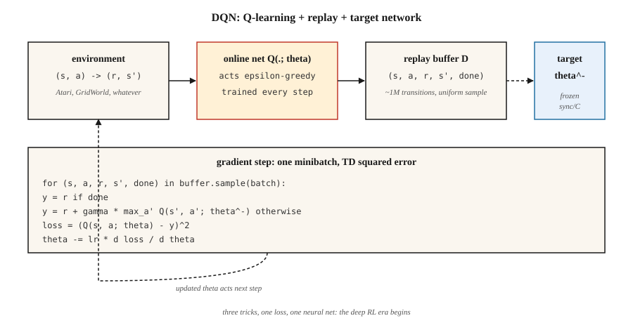

# Deep Q-Networks (DQN)

> 2013 年：Mnih 在 raw pixels 上训练了一个 Q-learning network，并在七个 Atari games 上击败所有 classical RL agents。2015 年：扩展到 49 个 games，发表在 Nature，点燃 deep-RL 时代。DQN 就是 Q-learning 加上三个让 function approximation 稳定下来的技巧。

**Type:** Build
**Languages:** Python
**Prerequisites:** Phase 3 · 03（Backpropagation），Phase 9 · 04（Q-learning, SARSA）
**Time:** ~75 minutes

## 问题

Tabular Q-learning 需要为每个 `(state, action)` pair 存一个单独的 Q-value。一个 chess board 大约有 10⁴³ 个 states。一个 Atari frame 是 210×160×3 = 100,800 个 features。Tabular RL 在几千个 states 时就会死掉，更别说几十亿个 states。

回头看，修复方法很明显：用 neural network 替换 Q-table，即 `Q(s, a; θ)`。但这个“回头看很明显”的想法花了几十年才稳定下来。Naive function approximation 加 Q-learning 会在 “deadly triad” 下发散：function approximation + bootstrapping + off-policy learning。Mnih et al.（2013, 2015）找到了三个稳定学习的工程技巧：

1. **Experience replay** 去相关 transitions。
2. **Target network** 冻结 bootstrap target。
3. **Reward clipping** 归一化 gradient magnitudes。

Atari 上的 DQN，是第一次用同一套 architecture 和同一组 hyperparameters，从 raw pixels 解决几十个 control problems。此后所有 “deep-RL” 工作，包括 DDQN、Rainbow、Dueling、Distributional、R2D2、Agent57，都叠在这个三技巧底座上。

## 概念



**目标。** DQN 在 neural Q-function 上最小化 one-step TD loss：

`L(θ) = E_{(s,a,r,s')~D} [ (r + γ max_{a'} Q(s', a'; θ^-) - Q(s, a; θ))² ]`

`θ` = online network，每一步用 gradient descent 更新。`θ^-` = target network，周期性地从 `θ` 拷贝（大约每 10,000 steps）。`D` = 存储历史 transitions 的 replay buffer。

**三个技巧，按重要性排序：**

**Experience replay。** 一个存储约 `10⁶` transitions 的 ring buffer。每个 training step 都从中 uniform random sample 一个 minibatch。它打破 temporal correlation（连续 frames 几乎相同），让 network 多次学习 rare rewarding transitions，并让连续 gradient updates 去相关。没有它，on-policy TD 加 neural net 会在 Atari 上发散。

**Target network。** 在 Bellman equation 两边都使用同一个网络 `Q(·; θ)`，会让 target 在每次 update 时移动，像是在“追自己的尾巴”。修复方法：保留第二个网络 `Q(·; θ^-)`，并冻结 weights。每隔 `C` steps，把 `θ → θ^-`。这会让 regression target 在数千个 gradient steps 内保持稳定。Soft updates `θ^- ← τ θ + (1-τ) θ^-`（DDPG、SAC 中使用）是更平滑的变体。

**Reward clipping。** Atari reward magnitudes 从 1 到 1000+ 不等。把它们 clip 到 `{-1, 0, +1}`，可以防止某个 game 独占 gradient。如果 reward magnitude 本身很重要，这样做是错的；但对 Atari 来说，reward sign 基本就够了。

**Double DQN。** Hasselt（2016）修复 maximization bias：用 online net *选择* action，用 target net *评估* action。

`target = r + γ Q(s', argmax_{a'} Q(s', a'; θ); θ^-)`

这是一个 drop-in replacement，并且稳定更好。默认应该使用它。

**其它改进（Rainbow, 2017）：** prioritized replay（更多 sample high-TD-error transitions）、dueling architecture（分离 `V(s)` 和 advantage heads）、noisy networks（learned exploration）、n-step returns、distributional Q（C51/QR-DQN）、multi-step bootstrapping。每个技巧都会增加几个百分点；收益大致可叠加。

## Build It

这里的代码是 stdlib-only、numpy-free：我们在一个 tiny continuous GridWorld 上使用手写的单隐藏层 MLP，所以每个 training step 都在 microseconds 内完成。算法和大规模 Atari DQN 完全相同。

### Step 1：replay buffer

```python
class ReplayBuffer:
    def __init__(self, capacity):
        self.buf = []
        self.capacity = capacity
    def push(self, s, a, r, s_next, done):
        if len(self.buf) == self.capacity:
            self.buf.pop(0)
        self.buf.append((s, a, r, s_next, done))
    def sample(self, batch, rng):
        return rng.sample(self.buf, batch)
```

Atari 大约使用 50,000 capacity；我们的 toy env 用 5,000 就够了。

### Step 2：一个 tiny Q-network（manual MLP）

```python
class QNet:
    def __init__(self, n_in, n_hidden, n_actions, rng):
        self.W1 = [[rng.gauss(0, 0.3) for _ in range(n_in)] for _ in range(n_hidden)]
        self.b1 = [0.0] * n_hidden
        self.W2 = [[rng.gauss(0, 0.3) for _ in range(n_hidden)] for _ in range(n_actions)]
        self.b2 = [0.0] * n_actions
    def forward(self, x):
        h = [max(0.0, sum(w * xi for w, xi in zip(row, x)) + b) for row, b in zip(self.W1, self.b1)]
        q = [sum(w * hi for w, hi in zip(row, h)) + b for row, b in zip(self.W2, self.b2)]
        return q, h
```

Forward pass：linear → ReLU → linear。这就是整个网络。

### Step 3：DQN update

```python
def train_step(online, target, batch, gamma, lr):
    grads = zeros_like(online)
    for s, a, r, s_next, done in batch:
        q, h = online.forward(s)
        if done:
            y = r
        else:
            q_next, _ = target.forward(s_next)
            y = r + gamma * max(q_next)
        td_error = q[a] - y
        accumulate_grads(grads, online, s, h, a, td_error)
    apply_sgd(online, grads, lr / len(batch))
```

它的形状就是 Lesson 04 的 Q-learning，只有两个区别：（a）我们对 differentiable `Q(·; θ)` 做 backprop，而不是索引 table；（b）target 使用 `Q(·; θ^-)`。

### Step 4：outer loop

每个 episode 中，按 `Q(·; θ)` 做 ε-greedy action，把 transitions push 到 buffer，sample 一个 minibatch，做一次 gradient step，并周期性同步 `θ^- ← θ`。模式如下：

```python
for episode in range(N):
    s = env.reset()
    while not done:
        a = epsilon_greedy(online, s, epsilon)
        s_next, r, done = env.step(s, a)
        buffer.push(s, a, r, s_next, done)
        if len(buffer) >= batch:
            train_step(online, target, buffer.sample(batch), gamma, lr)
        if steps % sync_every == 0:
            target = copy(online)
        s = s_next
```

在我们的 tiny GridWorld 中，使用 16-dim one-hot state，agent 大约 500 episodes 就能学到 near-optimal policy。在 Atari 上，把它扩展到 200M frames，并加入 CNN feature extractor。

## 常见陷阱

- **Deadly triad。** Function approximation + off-policy + bootstrapping 可能发散。DQN 用 target net + replay 缓解；不要移除任意一个。
- **Exploration。** ε 必须 decay，通常在训练前约 10% 的 steps 中从 1.0 降到 0.01。早期探索不够时，Q-net 会收敛到 local basin。
- **Overestimation。** 对 noisy Q 做 `max` 会有 upward bias。生产中始终使用 Double DQN。
- **Reward scale。** Clip 或 normalize rewards；gradient magnitude 与 reward magnitude 成正比。
- **Replay buffer coldstart。** Buffer 有几千条 transitions 前不要训练。在约 20 个 samples 上做早期 gradients 会 overfit。
- **Target sync frequency。** 太频繁 ≈ 没有 target net；太不频繁 ≈ targets stale。Atari DQN 使用 10,000 env steps。经验法则：每约 1/100 training horizon 同步一次。
- **Observation preprocessing。** Atari DQN stack 4 frames 来让 state 满足 Markov。任何带 velocity 信息的 env 都需要 frame-stacking 或 recurrent state。

## Use It

到 2026 年，DQN 很少是 state-of-the-art，但仍然是 reference off-policy algorithm：

| Task | Method of choice | Why not DQN? |
|------|------------------|--------------|
| Discrete-action Atari-like | Rainbow DQN 或 Muesli | 同一框架，更多技巧。 |
| Continuous control | SAC / TD3（Phase 9 · 07） | DQN 没有 policy network。 |
| On-policy / high-throughput | PPO（Phase 9 · 08） | 没有 replay buffer；更容易 scale。 |
| Offline RL | CQL / IQL / Decision Transformer | Conservative Q targets，避免 bootstrapping blowups。 |
| Large discrete action spaces（recommender） | DQN with action embedding，或 IMPALA | 可用；关键在工程装饰。 |
| LLM RL | PPO / GRPO | Sequence-level，不是 step-level；loss 不同。 |

这些 lessons 仍然可迁移。Replay 和 target networks 出现在 SAC、TD3、DDPG、SAC-X、AlphaZero 的 self-play buffer，以及每个 offline RL method 中。Reward clipping 作为 PPO 中的 advantage normalization 继续存在。这个 architecture 是蓝图。

## Ship It

保存为 `outputs/skill-dqn-trainer.md`：

```markdown
---
name: dqn-trainer
description: Produce a DQN training config (buffer, target sync, ε schedule, reward clipping) for a discrete-action RL task.
version: 1.0.0
phase: 9
lesson: 5
tags: [rl, dqn, deep-rl]
---

Given a discrete-action environment (observation shape, action count, horizon, reward scale), output:

1. Network. Architecture (MLP / CNN / Transformer), feature dim, depth.
2. Replay buffer. Capacity, minibatch size, warmup size.
3. Target network. Sync strategy (hard every C steps or soft τ).
4. Exploration. ε start / end / schedule length.
5. Loss. Huber vs MSE, gradient clip value, reward clipping rule.
6. Double DQN. On by default unless explicit reason to disable.

Refuse to ship a DQN with no target network, no replay buffer, or ε held at 1. Refuse continuous-action tasks (route to SAC / TD3). Flag any reward range > 10× per-step mean as needing clipping or scale normalization.
```

## 练习

1. **Easy.** 运行 `code/main.py`。画出 per-episode return curve。Running mean 超过 -10 需要多少 episodes？
2. **Medium.** 禁用 target network（Bellman target 两边都使用 online net）。测量 training instability：return 会 oscillate 还是 diverge？
3. **Hard.** 加入 Double DQN：用 online net 选择 `argmax a'`，用 target net 评估。对 noisy-reward GridWorld，在 1,000 episodes 后比较有无 Double DQN 时 `Q(s_0, best_a)` 相对 true `V*(s_0)` 的 bias。

## 关键术语

| 术语 | 大家常说 | 实际含义 |
|------|----------|----------|
| DQN | “Deep Q-learning” | 使用 neural Q-function、replay buffer 和 target network 的 Q-learning。 |
| Experience replay | “Shuffled transitions” | 每个 gradient step 从 ring buffer uniform sample；让数据去相关。 |
| Target network | “Frozen bootstrap” | 用于 Bellman target 的周期性 Q copy；稳定训练。 |
| Deadly triad | “Why RL diverges” | Function approximation + bootstrapping + off-policy = 没有 convergence guarantee。 |
| Double DQN | “Fix for maximization bias” | Online net 选择 action，target net 评估 action。 |
| Dueling DQN | “V and A heads” | 分解 Q = V + A - mean(A)；输出相同，gradient flow 更好。 |
| Rainbow | “All the tricks” | DDQN + PER + dueling + n-step + noisy + distributional 合在一起。 |
| PER | “Prioritized Replay” | 按 TD-error magnitude 比例 sample transitions。 |

## 延伸阅读

- [Mnih et al. (2013). Playing Atari with Deep Reinforcement Learning](https://arxiv.org/abs/1312.5602)：开启 deep RL 的 2013 NeurIPS workshop paper。
- [Mnih et al. (2015). Human-level control through deep reinforcement learning](https://www.nature.com/articles/nature14236)：Nature 论文，49-game DQN。
- [Hasselt, Guez, Silver (2016). Deep Reinforcement Learning with Double Q-learning](https://arxiv.org/abs/1509.06461)：DDQN。
- [Wang et al. (2016). Dueling Network Architectures](https://arxiv.org/abs/1511.06581)：dueling DQN。
- [Hessel et al. (2018). Rainbow: Combining Improvements in Deep RL](https://arxiv.org/abs/1710.02298)：stacked-tricks 论文。
- [OpenAI Spinning Up — DQN](https://spinningup.openai.com/en/latest/algorithms/dqn.html)：清晰的现代解释。
- [Sutton & Barto (2018). Ch. 9 — On-policy Prediction with Approximation](http://incompleteideas.net/book/RLbook2020.pdf)：教材中对 “deadly triad”（function approximation + bootstrapping + off-policy）的讨论；DQN 的 target network 和 replay buffer 正是为驯服它而设计。
- [CleanRL DQN implementation](https://docs.cleanrl.dev/rl-algorithms/dqn/)：常用于 ablation studies 的单文件 DQN reference implementation；适合和本 lesson 的 from-scratch version 对照阅读。
