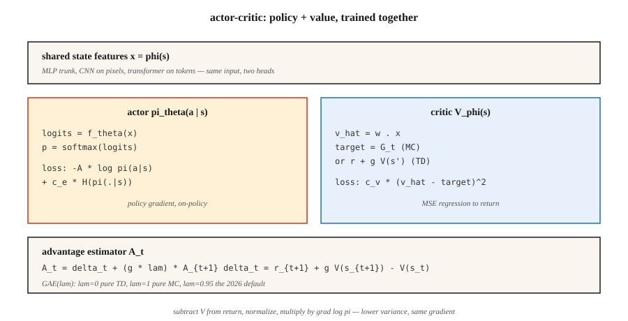

# Actor-Critic — A2C 与 A3C

> REINFORCE 很 noisy。加一个学习 `V̂(s)` 的 critic，从 return 中减掉它，你就得到一个 expectation 不变、variance 低得多的 advantage。这就是 actor-critic。A2C 同步运行它；A3C 在线程之间异步运行它。二者都是理解每个现代 deep-RL 方法的 mental model。

**Type:** Build
**Languages:** Python
**Prerequisites:** Phase 9 · 04 (TD Learning), Phase 9 · 06 (REINFORCE)
**Time:** ~75 minutes

## 问题

Vanilla REINFORCE 能工作，但 variance 糟糕。Monte Carlo returns `G_t` 在不同 episodes 之间可能相差 10 倍以上。把这种 noise 乘上 `∇ log π` 再取平均，会得到一个 gradient estimator：它需要几千个 episodes，才能把 policy 推到用少得多的 DQN updates 就能到达的位置。

Variance 来自直接使用 raw returns。如果你减去一个 baseline `b(s_t)`——任何 state 的函数，包括 learned value——expectation 不变，而 variance 会下降。最好的 tractable baseline 是 `V̂(s_t)`。现在乘在 `∇ log π` 前面的量就是 *advantage*：

`A(s, a) = G - V̂(s)`

如果某个 action 产生了高于平均的 return，它就是好 action；低于平均则是坏 action。带 learned critic 的 REINFORCE 就是 *actor-critic*。Critic 给 actor 提供一个低 variance 的 teacher。2015 年之后的每个 deep-policy method（A2C、A3C、PPO、SAC、IMPALA）都建立在这个形状上。

## 概念



**Two networks, one shared loss：**

- **Actor** `π_θ(a | s)`：policy。用来 sample action。通过 policy gradient 训练。
- **Critic** `V_φ(s)`：估计从 state 出发的 expected return。通过最小化 `(V_φ(s) - target)²` 训练。

**The advantage.** 两种标准形式：

- *MC advantage:* `A_t = G_t - V_φ(s_t)`。Unbiased，但 variance 更高。
- *TD advantage:* `A_t = r_{t+1} + γ V_φ(s_{t+1}) - V_φ(s_t)`。Biased（使用了 `V_φ`），但 variance 低得多。也叫 *TD residual* `δ_t`。

**n-step advantage.** 在两者之间插值：

`A_t^{(n)} = r_{t+1} + γ r_{t+2} + … + γ^{n-1} r_{t+n} + γ^n V_φ(s_{t+n}) - V_φ(s_t)`

`n = 1` 是 pure TD。`n = ∞` 是 MC。大多数实现中，Atari 使用 `n = 5`，MuJoCo 上的 PPO 使用 `n = 2048`。

**Generalized Advantage Estimation (GAE).** Schulman 等人（2016）提出对所有 n-step advantages 做 exponential weighted average：

`A_t^{GAE} = Σ_{l=0}^{∞} (γλ)^l δ_{t+l}`

其中 `λ ∈ [0, 1]`。`λ = 0` 是 TD（低 variance，高 bias）。`λ = 1` 是 MC（高 variance，unbiased）。`λ = 0.95` 是 2026 年默认值；调到 bias/variance 旋钮正好落在你想要的位置。

**A2C：synchronous advantage actor-critic.** 在 `N` 个 parallel environments 中收集 `T` steps。为每一步计算 advantages。在合并后的 batch 上更新 actor 和 critic。重复。它是 A3C 更简单、更 scalable 的 sibling。

**A3C：asynchronous advantage actor-critic.** Mnih 等人（2016）。启动 `N` 个 worker threads，每个线程运行一个 env。每个 worker 在自己的 rollout 上本地计算 gradients，然后异步 apply 到 shared parameter server。不需要 replay buffer，因为 workers 通过运行不同 trajectories 来 decorrelate。A3C 证明了你可以在 CPUs 上 scale 训练。到 2026 年，GPU-based A2C（batched parallel envs）占主导，因为 GPUs 想要 large batches。

**The combined loss.**

`L(θ, φ) = -E[ A_t · log π_θ(a_t | s_t) ]  +  c_v · E[(V_φ(s_t) - G_t)²]  -  c_e · E[H(π_θ(·|s_t))]`

三个项：policy-gradient loss、value regression、entropy bonus。`c_v ~ 0.5`、`c_e ~ 0.01` 是经典起点。

## 动手构建

### Step 1：一个 critic

Linear critic `V_φ(s) = w · features(s)`，用 MSE 更新：

```python
def critic_update(w, x, target, lr):
    v_hat = dot(w, x)
    err = target - v_hat
    for j in range(len(w)):
        w[j] += lr * err * x[j]
    return v_hat
```

在 tabular env 上，critic 会在几百个 episodes 内收敛。在 Atari 上，把 linear critic 换成 shared CNN trunk + value head。

### Step 2：n-step advantage

给定长度为 `T` 的 rollout，以及 bootstrapped final `V(s_T)`：

```python
def compute_advantages(rewards, values, gamma=0.99, lam=0.95, last_value=0.0):
    advantages = [0.0] * len(rewards)
    gae = 0.0
    for t in reversed(range(len(rewards))):
        next_v = values[t + 1] if t + 1 < len(values) else last_value
        delta = rewards[t] + gamma * next_v - values[t]
        gae = delta + gamma * lam * gae
        advantages[t] = gae
    returns = [a + v for a, v in zip(advantages, values)]
    return advantages, returns
```

`returns` 是 critic target。`advantages` 是乘在 `∇ log π` 前面的量。

### Step 3：combined update

```python
for step_i, (x, a, _r, probs) in enumerate(traj):
    adv = advantages[step_i]
    target_v = returns[step_i]

    # critic
    critic_update(w, x, target_v, lr_v)

    # actor
    for i in range(N_ACTIONS):
        grad_logpi = (1.0 if i == a else 0.0) - probs[i]
        for j in range(N_FEAT):
            theta[i][j] += lr_a * adv * grad_logpi * x[j]
```

On-policy，每次 update 使用一个 rollout，actor 和 critic 使用分开的 learning rates。

### Step 4：parallelization（A3C vs A2C）

- **A3C：** 启动 `N` 个 threads。每个运行自己的 env 和自己的 forward pass。周期性把 gradient updates 推到 shared master。Master 上不加锁也可以，race 只是额外加一点 noise。
- **A2C：** 在单进程中运行 `N` 个 env instances，把 observations stack 成 `[N, obs_dim]` batch，做 batched forward pass 和 batched backward pass。GPU utilization 更高，deterministic，也更容易推理。2026 年默认选它。

我们的 toy code 为了清晰保持 single-threaded；改成 batched A2C 只需要三行 numpy。

## 常见陷阱

- **Critic bias before actor gradient.** 如果 critic 是 random 的，它的 baseline 没有信息量，你就在纯 noise 上训练。先 warm up critic 几百步，再打开 policy gradient；或者把 actor learning rate 设慢。
- **Advantage normalization.** 对每个 batch，把 advantages normalize 到 zero-mean/unit-std。几乎零成本，却能极大稳定训练。
- **Shared trunk.** 对 image inputs，actor 和 critic 使用 shared feature extractor，分开 heads。Shared features 可以同时从两个 losses 中受益。
- **On-policy contract.** A2C 对数据只复用一次。再多复用，gradient 就会 biased（PPO 加入的 clipped importance-sampling correction 正是为了解决这个问题）。
- **Entropy collapse.** 没有 `c_e > 0`，policy 会在几百次 updates 内接近 deterministic，然后停止探索。
- **Reward scale.** Advantage magnitudes 依赖 reward scale。Normalize rewards（例如除以 running std），让不同任务的 gradient magnitudes 更一致。

## 使用它

A2C/A3C 在 2026 年很少是最终选择，但它们是后续所有方法 refine 的基础架构：

| Method | Relation to A2C |
|--------|----------------|
| PPO | A2C + clipped importance ratio，用于 multi-epoch updates |
| IMPALA | A3C + V-trace off-policy correction |
| SAC (Phase 9 · 07) | Off-policy A2C，带 soft-value critic（下一课） |
| GRPO (Phase 9 · 12) | 没有 critic 的 A2C，使用 group-relative advantage |
| DPO | A2C 折叠成 preference-ranking loss，不采样 |
| AlphaStar / OpenAI Five | A2C + league training + imitation pre-training |

如果你在 2026 年的论文里看到 “advantage”，就应该想到 actor-critic。

## 交付它

保存为 `outputs/skill-actor-critic-trainer.md`：

```markdown
---
name: actor-critic-trainer
description: Produce an A2C / A3C / GAE configuration for a given environment, with advantage estimation and loss weights specified.
version: 1.0.0
phase: 9
lesson: 7
tags: [rl, actor-critic, gae]
---

Given an environment and compute budget, output:

1. Parallelism. A2C (GPU batched) vs A3C (CPU async) and the number of workers.
2. Rollout length T. Steps per env per update.
3. Advantage estimator. n-step or GAE(λ); specify λ.
4. Loss weights. `c_v` (value), `c_e` (entropy), gradient clip.
5. Learning rates. Actor and critic (separate if using).

Refuse single-worker A2C on environments with horizon > 1000 (too on-policy, too slow). Refuse to ship without advantage normalization. Flag any run with `c_e = 0` and observed entropy < 0.1 as entropy-collapsed.
```

## 练习

1. **Easy.** 在 4×4 GridWorld 上用 MC advantage（`G_t - V(s_t)`）训练 actor-critic。和 Lesson 06 中带 running-mean baseline 的 REINFORCE 比较 sample efficiency。
2. **Medium.** 切换到 TD-residual advantage（`r + γ V(s') - V(s)`）。测量 advantage batches 的 variance。它下降了多少？
3. **Hard.** 实现 GAE(λ)。Sweep `λ ∈ {0, 0.5, 0.9, 0.95, 1.0}`。画出 final return vs sample efficiency。这个任务的 bias/variance sweet spot 在哪里？

## 关键术语

| Term | What people say | What it actually means |
|------|-----------------|-----------------------|
| Actor | “The policy net” | `π_θ(a\|s)`，通过 policy gradient 更新。 |
| Critic | “The value net” | `V_φ(s)`，通过对 returns / TD targets 做 MSE regression 更新。 |
| Advantage | “How much better than average” | `A(s, a) = Q(s, a) - V(s)` 或它的估计器；`∇ log π` 的 multiplier。 |
| TD residual | “δ” | `δ_t = r + γ V(s') - V(s)`；one-step advantage estimate。 |
| GAE | “The interpolation knob” | n-step advantages 的 exponentially weighted sum，由 `λ` 参数化。 |
| A2C | “Synchronous actor-critic” | 跨 envs batching；每个 rollout 做一次 gradient step。 |
| A3C | “Async actor-critic” | Worker threads 把 gradients 推到 shared param server。原始论文方法；2026 年少见。 |
| Bootstrap | “Use V at the horizon” | 截断 rollout，用 `γ^n V(s_{t+n})` 补上尾部求和。 |

## 延伸阅读

- [Mnih et al. (2016). Asynchronous Methods for Deep Reinforcement Learning](https://arxiv.org/abs/1602.01783) — A3C，原始 async actor-critic 论文。
- [Schulman et al. (2016). High-Dimensional Continuous Control Using Generalized Advantage Estimation](https://arxiv.org/abs/1506.02438) — GAE。
- [Sutton & Barto (2018). Ch. 13 — Actor-Critic Methods](http://incompleteideas.net/book/RLbook2020.pdf) — 基础内容；当 critic 是 neural net 时，配合第 9 章 function approximation 一起读。
- [Espeholt et al. (2018). IMPALA](https://arxiv.org/abs/1802.01561) — 带 V-trace off-policy correction 的 scalable distributed actor-critic。
- [OpenAI Baselines / Stable-Baselines3](https://stable-baselines3.readthedocs.io/) — 值得阅读的 production A2C/PPO implementations。
- [Konda & Tsitsiklis (2000). Actor-Critic Algorithms](https://papers.nips.cc/paper/1786-actor-critic-algorithms) — two-timescale actor-critic decomposition 的基础收敛结果。
