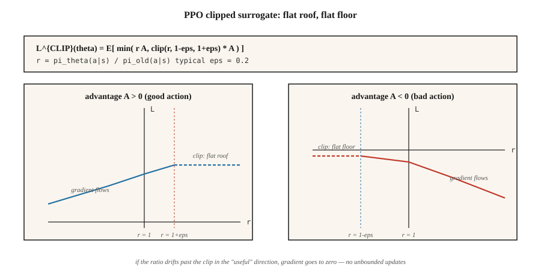

# Proximal Policy Optimization（PPO）

> A2C 在一次 update 后就丢掉每条 rollout。PPO 用 clipped importance ratio 包住 policy gradient，让你可以在同一批数据上跑 10+ epochs，而不会让 policy 爆炸。Schulman et al.（2017）。到 2026 年，它仍然是默认的 policy-gradient algorithm。

**Type:** Build
**Languages:** Python
**Prerequisites:** Phase 9 · 06（REINFORCE），Phase 9 · 07（Actor-Critic）
**Time:** ~75 minutes

## 问题

A2C（Lesson 07）是 on-policy：gradient `E_{π_θ}[A · ∇ log π_θ]` 要求数据来自 **当前** 的 `π_θ`。做一次 update 后，`π_θ` 就变了；你刚用过的数据现在已经 off-policy。重复使用它，gradient 就会有 bias。

Rollouts 很贵。在 Atari 上，8 个 envs × 128 steps 的一次 rollout = 1024 transitions，加上十几秒 environment time。做完一个 gradient step 就扔掉它很浪费。

Trust Region Policy Optimization（TRPO，Schulman 2015）是第一个修复：约束每次 update，使 old policy 和 new policy 之间的 KL divergence 保持在 `δ` 以下。理论上干净，但每次 update 都要做一次 conjugate-gradient solve。2026 年没人再跑 TRPO。

PPO（Schulman et al. 2017）用一个简单的 clipped objective 取代 hard trust-region constraint。多一行代码。每个 rollout 跑十个 epochs。不需要 conjugate gradients。理论保证足够好。九年后，它仍然是默认的 policy-gradient algorithm，从 MuJoCo 到 RLHF 都在用。

## 概念



**Importance ratio。**

`r_t(θ) = π_θ(a_t | s_t) / π_{θ_old}(a_t | s_t)`

这是 new policy 和收集数据的 old policy 之间的 likelihood ratio。`r_t = 1` 表示没有变化。`r_t = 2` 表示 new policy 采取 `a_t` 的概率是 old policy 的两倍。

**Clipped surrogate。**

`L^{CLIP}(θ) = E_t [ min( r_t(θ) A_t, clip(r_t(θ), 1-ε, 1+ε) A_t ) ]`

两个项：

- 如果 advantage `A_t > 0`，并且 ratio 试图增长超过 `1 + ε`，clip 会把 gradient 压平：不要把一个好 action 推到比 old probability 高 `+ε` 以上。
- 如果 advantage `A_t < 0`，并且 ratio 试图超过 `1 - ε`（意味着我们会让一个坏 action 相比其 clipped reduction 更可能发生），clip 会限制 gradient：不要把一个坏 action 推到低于 `-ε`。

`min` 处理另一个方向：如果 ratio 已经朝 **有益** 的方向移动，你仍然得到 gradient（不会在会伤害你的那一侧 clipping）。

典型 `ε = 0.2`。把 objective 画成 `r_t` 的函数：它是 piecewise-linear，在 “good side” 有平屋顶，在 “bad side” 有平地板。

**完整 PPO loss。**

`L(θ, φ) = L^{CLIP}(θ) - c_v · (V_φ(s_t) - V_t^{target})² + c_e · H(π_θ(·|s_t))`

和 A2C 一样是 actor-critic 结构。三个系数通常是 `c_v = 0.5`、`c_e = 0.01`、`ε = 0.2`。

**Training loop。**

1. 在 `N` 个 parallel envs 上各收集 `T` steps，总共得到 `N × T` transitions。
2. 计算 advantages（GAE），并把它们 freeze 为 constants。
3. 把 `π_{θ_old}` freeze 成当前 `π_θ` 的 snapshot。
4. 对每个 minibatch `(s, a, A, V_target, log π_old(a|s))`，跑 `K` 个 epochs：
   - 计算 `r_t(θ) = exp(log π_θ(a|s) - log π_old(a|s))`。
   - 应用 `L^{CLIP}` + value loss + entropy。
   - 做 gradient step。
5. 丢弃 rollout。回到 step 1。

`K = 10`、minibatch size 64 是一组标准 hyperparameters。PPO 很 robust：精确数字在 ±50% 范围内通常影响不大。

**KL-penalty variant。** 原论文还提出了另一种 adaptive KL penalty：`L = L^{PG} - β · KL(π_θ || π_old)`，其中 `β` 根据 observed KL 调整。Clipping version 成为主流；KL variant 仍然活在 RLHF 中（因为 KL to reference policy 本来就是你始终想要的约束）。

## Build It

### Step 1：在 rollout 时捕获 `log π_old(a | s)`

```python
for step in range(T):
    probs = softmax(logits(theta, state_features(s)))
    a = sample(probs, rng)
    s_next, r, done = env.step(s, a)
    buffer.append({
        "s": s, "a": a, "r": r, "done": done,
        "v_old": value(w, state_features(s)),
        "log_pi_old": log(probs[a] + 1e-12),
    })
    s = s_next
```

Snapshot 在 rollout 时获取一次。在 update epochs 期间它不会变化。

### Step 2：计算 GAE advantages（Lesson 07）

和 A2C 一样。Across batch 做 normalize。

### Step 3：clipped surrogate update

```python
for _ in range(K_EPOCHS):
    for mb in minibatches(buffer, size=64):
        for rec in mb:
            x = state_features(rec["s"])
            probs = softmax(logits(theta, x))
            logp = log(probs[rec["a"]] + 1e-12)
            ratio = exp(logp - rec["log_pi_old"])
            adv = rec["advantage"]
            surrogate = min(
                ratio * adv,
                clamp(ratio, 1 - EPS, 1 + EPS) * adv,
            )
            # backprop -surrogate, add value loss, subtract entropy
            grad_logpi = onehot(rec["a"]) - probs
            if (adv > 0 and ratio >= 1 + EPS) or (adv < 0 and ratio <= 1 - EPS):
                pg_grad = 0.0  # clipped
            else:
                pg_grad = ratio * adv
            for i in range(N_ACTIONS):
                for j in range(N_FEAT):
                    theta[i][j] += LR * pg_grad * grad_logpi[i] * x[j]
```

“clipped → zero gradient” 这个模式就是 PPO 的核心。如果 new policy 已经在有益方向上 drift 得太远，update 会停止。

### Step 4：value 和 entropy

给 critic target 加标准 MSE，给 actor 加 entropy bonus，和 A2C 一样。

### Step 5：diagnostics

每次 update 都要看三件事：

- **Mean KL** `E[log π_old - log π_θ]`。应该保持在 `[0, 0.02]`。如果冲过 `0.1`，降低 `K_EPOCHS` 或 `LR`。
- **Clip fraction**：ratio 落在 `[1-ε, 1+ε]` 之外的 samples 比例。应该是 `~0.1-0.3`。如果接近 `~0`，说明 clip 从不触发，提升 `LR` 或 `K_EPOCHS`。如果 `~0.5+`，说明你在 over-fitting rollout，降低它们。
- **Explained variance** `1 - Var(V_target - V_pred) / Var(V_target)`。Critic quality metric。Critic 学会后应该朝 1 上升。

## 常见坑

- **Clip coefficient 调错。** `ε = 0.2` 是事实标准。调到 `0.1` 会让 update 太胆小；`0.3+` 会招来不稳定。
- **Epochs 太多。** `K > 20` 经常 destabilize，因为 policy 会远离 `π_old`。限制 epochs，尤其是大网络。
- **没有 reward normalization。** 大 reward scales 会吞掉 clip range。计算 advantages 前先 normalize rewards（running std）。
- **忘记 advantage normalization。** Per-batch zero-mean/unit-std normalization 是标准做法。跳过它会毁掉多数 benchmarks 上的 PPO。
- **Learning rate 没有 decay。** PPO 受益于线性 LR decay 到 0。Constant LR 往往更差。
- **Importance ratio 数学写错。** 为了数值稳定，始终写 `exp(log_new - log_old)`，而不是 `new / old`。
- **Gradient sign 错。** Maximize surrogate = **minimize** `-L^{CLIP}`。符号翻转是最常见的 PPO bug。

## Use It

PPO 是 2026 年许多领域的默认 RL algorithm：

| Use case | PPO variant |
|----------|-------------|
| MuJoCo / robotics control | PPO with Gaussian policy, GAE(0.95) |
| Atari / discrete games | PPO with categorical policy, rolling 128-step rollouts |
| RLHF for LLMs | PPO with KL penalty to reference model, reward from RM at end of response |
| Large-scale game agents | IMPALA + PPO（AlphaStar, OpenAI Five） |
| Reasoning LLMs | GRPO（Lesson 12）— 没有 critic 的 PPO variant |
| Preference-only data | DPO — PPO+KL 的 closed-form collapsing，没有 online sampling |

PPO 的 **loss shape**：clipped surrogate + value + entropy，是 DPO、GRPO 和几乎每条 RLHF pipeline 的 scaffolding。

## Ship It

保存为 `outputs/skill-ppo-trainer.md`：

```markdown
---
name: ppo-trainer
description: Produce a PPO training config and a diagnostic plan for a given environment.
version: 1.0.0
phase: 9
lesson: 8
tags: [rl, ppo, policy-gradient]
---

Given an environment and training budget, output:

1. Rollout size. `N` envs × `T` steps.
2. Update schedule. `K` epochs, minibatch size, LR schedule.
3. Surrogate params. `ε` (clip), `c_v`, `c_e`, advantage normalization on.
4. Advantage. GAE(`λ`) with explicit `γ` and `λ`.
5. Diagnostics plan. KL, clip fraction, explained variance thresholds with alerts.

Refuse `K > 30` or `ε > 0.3` (unsafe trust region). Refuse any PPO run without advantage normalization or KL/clip monitoring. Flag clip fraction sustained above 0.4 as drift.
```

## 练习

1. **Easy.** 在 4×4 GridWorld 上用 `ε=0.2, K=4` 运行 PPO。在 matched env steps 下，把 sample efficiency 和 A2C（每个 rollout 一个 epoch）比较。
2. **Medium.** Sweep `K ∈ {1, 4, 10, 30}`。画出 return vs env steps，并追踪每次 update 的 mean KL。这个任务上 `K` 到多少时 KL 会爆炸？
3. **Hard.** 用 adaptive KL penalty 替换 clipped surrogate（如果 `KL > 2·target`，`β` 翻倍；如果 `KL < target/2`，`β` 减半）。比较 final return、stability 和 clip-free-ness。

## 关键术语

| Term | What people say | What it actually means |
|------|-----------------|-----------------------|
| Importance ratio | “r_t(θ)” | `π_θ(a\|s) / π_old(a\|s)`；偏离收集数据的 policy 的程度。 |
| Clipped surrogate | “PPO's main trick” | `min(r·A, clip(r, 1-ε, 1+ε)·A)`；在 beneficial side 超过 clip 后 gradient 变平。 |
| Trust region | “TRPO / PPO intent” | 限制每次 update 的 KL，以保证 monotone improvement。 |
| KL penalty | “Soft trust region” | Alternative PPO：`L - β · KL(π_θ \|\| π_old)`。Adaptive `β`。 |
| Clip fraction | “How often clipping triggers” | Diagnostic，应该是 0.1-0.3；超出表示 mistuned。 |
| Multi-epoch training | “Data reuse” | 每个 rollout 上跑 K epochs；用 variance cost 换 sample efficiency。 |
| On-policy-ish | “Mostly on-policy” | PPO 名义上是 on-policy，但 K>1 epochs 会安全地使用 slightly-off-policy data。 |
| PPO-KL | “The other PPO” | KL-penalty variant；用于 RLHF，因为 KL-to-reference 本来就是约束。 |

## 延伸阅读

- [Schulman et al. (2017). Proximal Policy Optimization Algorithms](https://arxiv.org/abs/1707.06347) — PPO 论文。
- [Schulman et al. (2015). Trust Region Policy Optimization](https://arxiv.org/abs/1502.05477) — TRPO，PPO 的前身。
- [Andrychowicz et al. (2021). What Matters In On-Policy RL? A Large-Scale Empirical Study](https://arxiv.org/abs/2006.05990) — 对每个 PPO hyperparameter 做 ablation。
- [Ouyang et al. (2022). Training language models to follow instructions with human feedback](https://arxiv.org/abs/2203.02155) — InstructGPT；RLHF 中 PPO recipe。
- [OpenAI Spinning Up — PPO](https://spinningup.openai.com/en/latest/algorithms/ppo.html) — 干净的现代讲解，带 PyTorch。
- [CleanRL PPO implementation](https://github.com/vwxyzjn/cleanrl) — 很多论文使用的 single-file PPO reference。
- [Hugging Face TRL — PPOTrainer](https://huggingface.co/docs/trl/main/en/ppo_trainer) — language models 上 PPO 的 production recipe；和 Lesson 09（RLHF）一起读。
- [Engstrom et al. (2020). Implementation Matters in Deep Policy Gradients](https://arxiv.org/abs/2005.12729) — “37 code-level optimizations” 论文；区分哪些 PPO tricks 是 load-bearing，哪些只是 folklore。
