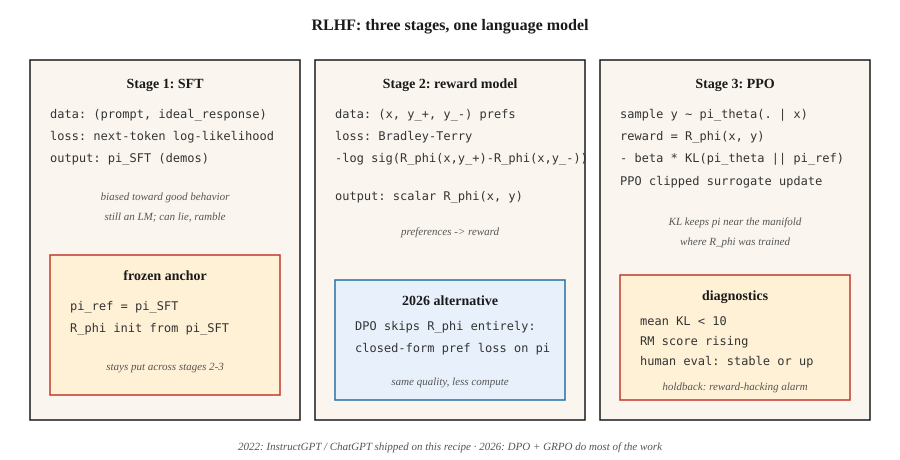

# Reward Modeling 与 RLHF

> 人类无法手写一个衡量“好 assistant response”的 reward function，但可以比较两个回答并选出更好的那个。把这些比较拟合成 reward model，再用 RL 优化 language model。Christiano 2017。InstructGPT 2022。这个配方把 GPT-3 变成了 ChatGPT。到 2026 年，它大多被 DPO 替代了，但 mental model 仍然保留。

**Type:** Build
**Languages:** Python
**Prerequisites:** Phase 5 · 05 (Sentiment), Phase 9 · 08 (PPO)
**Time:** ~45 minutes

## 问题

你用 next-token-prediction objective 训练了一个语言模型。它能写出合乎语法的英文。它也会撒谎、啰嗦、该拒绝时不拒绝。你不能靠更多 pretraining 修好它，因为 web text 本身就是问题，不是解药。

你想要一个 *scalar reward*，用来判断“对于 instruction X，response A 是否比 response B 更好”。手写这个 reward function 是不可能的。“Helpfulness” 不是一个关于 tokens 的闭式表达。但人类可以比较两个输出，并标记偏好。这种数据可以相对便宜地大规模收集。

RLHF（Christiano et al. 2017；Ouyang et al. 2022）把 preferences 转成 reward model，然后用 PPO 根据这个 reward 优化 LM。三步：SFT → RM → PPO。这是 ChatGPT、Claude、Gemini 以及 2023-2025 年几乎所有 aligned-LLM 上线时使用的配方。

到 2026 年，PPO 这一步大多被 DPO（Phase 10 · 08）取代了，因为 DPO 更便宜，而且在 alignment tuning 上几乎同样好。但 *reward model* 这个组件仍然支撑着每个 Best-of-N sampler、每条 RL-from-verifiable-rewards pipeline，以及每个使用 process reward model 的 reasoning model。理解 RLHF，就理解了整条 alignment stack。

## 概念



**Stage 1：Supervised Fine-Tuning（SFT）。** 从 pretrained base model 开始。在人类写出的目标行为 demonstrations 上 fine-tune（instruction-following responses、helpful replies 等）。结果是一个 `π_SFT`，它 *偏向好行为*，但 action space 仍然无界。

**Stage 2：Reward Model training。**

- 收集 prompts `x` 对应的响应对 `(y_+, y_-)`，由人类标注 “y_+ is preferred over y_-”。
- 训练 reward model `R_φ(x, y)`，让它给 `y_+` 更高分。
- Loss：**Bradley-Terry pairwise logistic**：

  `L(φ) = -E[ log σ(R_φ(x, y_+) - R_φ(x, y_-)) ]`

  σ 是 sigmoid。reward 差值隐含 preference 的 log-odds。BT 自 1952 年（Bradley-Terry）以来就是标准方法，也是现代 RLHF 中的主流选择。

- `R_φ` 通常从 SFT model 初始化，并在顶部加一个 scalar head。同一个 transformer backbone；一个线性层输出 reward。

**Stage 3：带 KL penalty、面向 RM 的 PPO。**

- 从 `π_SFT` 初始化可训练 policy `π_θ`。保留一个冻结的 *reference*：`π_ref = π_SFT`。
- 对完整 response `y` 的最终 reward：

  `r_total(x, y) = R_φ(x, y) - β · KL(π_θ(·|x) || π_ref(·|x))`

  KL penalty 阻止 `π_θ` 任意漂离 `π_SFT`。它是一个 *regularizer*，不是硬 trust region。`β` 通常为 `0.01`-`0.05`。
- 用这个 reward 跑 PPO（Lesson 08）。Advantages 在 token-level trajectory 上计算，但 RM 只给完整 response 打分。

**为什么需要 KL？** 没有它，PPO 会很乐意找到 reward-hacking 策略。RM 只在 in-distribution completions 上训练过；out-of-distribution response 可能比任何人类写过的回答分数都高。KL 让 `π_θ` 留在 RM 训练时见过的 manifold 附近。它是 RLHF 中最重要的旋钮。

**2026 状态：**

- **DPO**（Rafailov 2023）：通过闭式代数把 Stage 2+3 折叠成一个 preference data 上的 supervised loss。没有 RM，没有 PPO。alignment benchmarks 上质量相近，compute 只需一小部分。Phase 10 · 08 会覆盖。
- **GRPO**（DeepSeek 2024-2025）：PPO 的变体，用 group-relative baseline 代替 critic，reward 来自 *verifier*（代码能跑 / 数学答案匹配），而不是人类训练的 RM。reasoning models 的主流做法。Phase 9 · 12 会覆盖。
- **Process reward models（PRMs）：** 给 partial solutions（每个 reasoning step）打分，同时用于 RLHF 和 reasoning 场景的 GRPO 变体。
- **Constitutional AI / RLAIF：** 用 aligned LLM 生成 preferences，而不是让人类标注。这样可以放大 preference budget。

## 动手构建

本课使用很小的合成 “prompts” 和 “responses”，都表示为字符串。RM 是 bag-of-tokens representation 上的线性 scorer。没有真正的 LLM；重要的是 pipeline 的 *形状*，不是规模。见 `code/main.py`。

### Step 1：合成 preference data

```python
PROMPTS = ["help me", "answer me", "explain this"]
GOOD_WORDS = {"clear", "specific", "kind", "thorough"}
BAD_WORDS = {"vague", "rude", "wrong", "short"}

def make_pair(rng):
    x = rng.choice(PROMPTS)
    y_good = rng.choice(list(GOOD_WORDS)) + " " + rng.choice(list(GOOD_WORDS))
    y_bad = rng.choice(list(BAD_WORDS)) + " " + rng.choice(list(BAD_WORDS))
    return (x, y_good, y_bad)
```

真实 RLHF 中，这一步会换成人类标注者。形状相同：`(prompt, preferred_response, rejected_response)`。

### Step 2：Bradley-Terry reward model

线性分数：`R(x, y) = w · bag(y)`。训练目标是最小化 BT pairwise log-loss：

```python
def rm_train_step(w, x, y_pos, y_neg, lr):
    r_pos = dot(w, bag(y_pos))
    r_neg = dot(w, bag(y_neg))
    p = sigmoid(r_pos - r_neg)
    for tok, cnt in bag(y_pos).items():
        w[tok] += lr * (1 - p) * cnt
    for tok, cnt in bag(y_neg).items():
        w[tok] -= lr * (1 - p) * cnt
```

几百次更新后，`w` 会给 good-word tokens 正权重，给 bad-word tokens 负权重。

### Step 3：叠在 RM 上的 PPO-like policy

我们的玩具 policy 会从词表中生成一个 token。我们用 RM 给 token 打分，计算 `log π_θ(token | prompt)`，加上到 reference 的 KL penalty，然后应用 clipped PPO surrogate。

```python
def rlhf_step(theta, ref, w, prompt, rng, eps=0.2, beta=0.1, lr=0.05):
    logits_theta = policy_logits(theta, prompt)
    probs = softmax(logits_theta)
    token = sample(probs, rng)
    logits_ref = policy_logits(ref, prompt)
    probs_ref = softmax(logits_ref)
    reward = dot(w, bag([token])) - beta * kl(probs, probs_ref)
    # ppo-style update on theta, treating reward as the return
    ...
```

### Step 4：监控 KL

每次 update 都追踪 mean `KL(π_θ || π_ref)`。如果它爬到 `~5-10` 以上，说明 policy 已经漂离 `π_SFT` 很远：要么 `β` 太低，要么 reward hacking 开始了。这是真实 RLHF 中最重要的诊断指标。

### Step 5：使用 TRL 的生产配方

理解玩具 pipeline 后，下面是真实 library user 会写的同一个 loop。Hugging Face 的 [TRL](https://huggingface.co/docs/trl) 是参考实现：Stage 2 用 `RewardTrainer`，Stage 3 用 `PPOTrainer`（内置 KL-to-reference）。

```python
# Stage 2: reward model from pairwise preferences
from trl import RewardTrainer, RewardConfig
from transformers import AutoModelForSequenceClassification, AutoTokenizer

tok = AutoTokenizer.from_pretrained("meta-llama/Llama-3.1-8B-Instruct")
rm = AutoModelForSequenceClassification.from_pretrained(
    "meta-llama/Llama-3.1-8B-Instruct", num_labels=1
)

# dataset rows: {"prompt", "chosen", "rejected"} — Bradley-Terry format
trainer = RewardTrainer(
    model=rm,
    tokenizer=tok,
    train_dataset=preference_data,
    args=RewardConfig(output_dir="./rm", num_train_epochs=1, learning_rate=1e-5),
)
trainer.train()
```

```python
# Stage 3: PPO against the RM with KL penalty to the SFT reference
from trl import PPOTrainer, PPOConfig, AutoModelForCausalLMWithValueHead

policy = AutoModelForCausalLMWithValueHead.from_pretrained("./sft-checkpoint")
ref    = AutoModelForCausalLMWithValueHead.from_pretrained("./sft-checkpoint")  # frozen

ppo = PPOTrainer(
    config=PPOConfig(learning_rate=1.41e-5, batch_size=64, init_kl_coef=0.05,
                     target_kl=6.0, adap_kl_ctrl=True),
    model=policy, ref_model=ref, tokenizer=tok,
)

for batch in dataloader:
    responses = ppo.generate(batch["query_ids"], max_new_tokens=128)
    rewards   = rm(torch.cat([batch["query_ids"], responses], dim=-1)).logits[:, 0]
    stats     = ppo.step(batch["query_ids"], responses, rewards)
    # stats includes: mean_kl, clip_frac, value_loss — the three PPO diagnostics
```

库会替你处理三件事。`adap_kl_ctrl=True` 实现 adaptive-β schedule：如果 observed KL 超过 `target_kl`，β 翻倍；如果低于一半，β 减半。Reference model 按约定冻结，你不能意外地让它和 `policy` 共享参数。Value head 和 policy 位于同一个 backbone 上（`AutoModelForCausalLMWithValueHead` 会附加一个 scalar MLP head），所以 TRL 会分别报告 `policy/kl` 和 `value/loss`。

## 常见陷阱

- **Over-optimization / reward hacking。** RM 不完美；`π_θ` 会找到高分但糟糕的 adversarial completions。症状：reward 无限上升，而 human eval score 持平或下降。修复：early stop、提高 `β`、扩大 RM training data。
- **Length hacking。** 在 helpful responses 上训练的 RM 往往隐式奖励长度。Policy 会学会填充回答。修复：length-normalized reward，或使用 length-aware RM 做 RLAIF。
- **RM 太小。** RM 至少需要和 policy 一样大。太小的 RM 无法忠实评估 policy 的输出。
- **KL tuning。** β 太低 → drift 和 reward hacking。β 太高 → policy 几乎不变。标准技巧是使用 *adaptive* β，瞄准固定的每步 KL。
- **Preference-data noise。** 大约 30% 的人类标签有噪声或歧义。可以用 agreement-filtered data 训练 RM，或在 BT 上使用 temperature 做校准。
- **Off-policy problems。** PPO 数据在第一个 epoch 后会有一点 off-policy。像 Lesson 08 一样监控 clip fraction。

## 使用它

2026 年的 RLHF 是分层的：

| Layer | Target | Method |
|-------|--------|--------|
| Instruction following、helpfulness、harmlessness | Alignment | DPO（Phase 10 · 08）优先于 RLHF-PPO。 |
| Reasoning correctness（math, code） | Capability | 使用 verifier reward 的 GRPO（Phase 9 · 12）。 |
| Long-horizon multi-step tasks | Agentic | PPO / GRPO，并在 steps 上使用 process reward models。 |
| Safety / refusal behavior | Safety | 使用单独 safety RM 的 RLHF-PPO，或 Constitutional AI。 |
| Best-of-N at inference | Fast alignment | 解码时使用 RM；不需要 policy training。 |
| Reward distillation | Inference compute | 在 frozen LM 顶部训练一个小型 “reward head”。 |

RLHF 是 2022-2024 年的 *核心方法*。到 2026 年，生产 alignment pipeline 通常 DPO-first，只在 RM-intensive 或 safety-critical 步骤中使用 PPO。

## 交付它

保存为 `outputs/skill-rlhf-architect.md`：

```markdown
---
name: rlhf-architect
description: Design an RLHF / DPO / GRPO alignment pipeline for a language model, including RM, KL, and data strategy.
version: 1.0.0
phase: 9
lesson: 9
tags: [rl, rlhf, alignment, llm]
---

Given a base LM, a target behavior (alignment / reasoning / refusal / agent), and a preference or verifier budget, output:

1. Stage. SFT? RM? DPO? GRPO? With justification.
2. Preference or verifier source. Humans, AI feedback, rule-based, unit-test-pass, or reward distillation.
3. KL strategy. Fixed β, adaptive β, or DPO (implicit KL).
4. Diagnostics. Mean KL, reward stability, over-optimization guard (holdout human eval).
5. Safety gate. Red-team set, refusal rate, safety RM separate from helpfulness RM.

Refuse to ship RLHF-PPO without a KL monitor. Refuse to use an RM smaller than the target policy. Refuse length-only rewards. Flag any pipeline that does not hold back a blind human-eval set as lacking over-optimization protection.
```

## 练习

1. **Easy.** 在 `code/main.py` 中，用 500 个合成 preference pairs 训练 Bradley-Terry reward model。在 held-out 100 pairs 上测 pairwise accuracy。应超过 90%。
2. **Medium.** 使用 `β ∈ {0.0, 0.1, 1.0}` 运行玩具 PPO-RLHF loop。对每个 β，画出更新过程中的 RM score vs KL-to-reference。哪些设置出现了 reward-hack？
3. **Hard.** 在同一份 preference data 上实现 DPO（闭式 preference-likelihood loss），并与 RLHF-PPO pipeline 比较所用 compute 和最终达到的 RM score。

## 关键术语

| Term | What people say | What it actually means |
|------|-----------------|-----------------------|
| RLHF | “Alignment RL” | 三阶段 SFT + RM + PPO pipeline（Christiano 2017，Ouyang 2022）。 |
| Reward Model (RM) | “The scoring net” | 通过 Bradley-Terry 拟合 pairwise preferences 得到的 learned scalar function。 |
| Bradley-Terry | “Pairwise logistic loss” | `P(y_+ ≻ y_-) = σ(R(y_+) - R(y_-))`；标准 RM objective。 |
| KL penalty | “Stay near the reference” | reward 中的 `β · KL(π_θ \|\| π_ref)`；防 reward-hacking 的 regularizer。 |
| Reward hacking | “Goodhart's law” | Policy 利用 RM 缺陷；症状是 reward 上升，human eval 持平。 |
| RLAIF | “AI-labeled preferences” | labels 来自另一个 LM，而不是人类的 RLHF。 |
| PRM | “Process Reward Model” | 给 partial reasoning steps 打分；用于 reasoning pipelines。 |
| Constitutional AI | “Anthropic's method” | 由显式规则引导的 AI-generated preferences。 |

## 延伸阅读

- [Christiano et al. (2017). Deep Reinforcement Learning from Human Preferences](https://arxiv.org/abs/1706.03741)：开启 RLHF 的论文。
- [Ouyang et al. (2022). InstructGPT — Training language models to follow instructions with human feedback](https://arxiv.org/abs/2203.02155)：ChatGPT 背后的配方。
- [Stiennon et al. (2020). Learning to summarize with human feedback](https://arxiv.org/abs/2009.01325)：更早用于 summarization 的 RLHF。
- [Rafailov et al. (2023). Direct Preference Optimization](https://arxiv.org/abs/2305.18290)：DPO；2026 年后 RLHF 的默认替代方案。
- [Bai et al. (2022). Constitutional AI: Harmlessness from AI Feedback](https://arxiv.org/abs/2212.08073)：RLAIF 和 self-critique loop。
- [Anthropic RLHF paper (Bai et al. 2022). Training a Helpful and Harmless Assistant](https://arxiv.org/abs/2204.05862)：HH 论文。
- [Hugging Face TRL library](https://huggingface.co/docs/trl)：生产级 `RewardTrainer` 和 `PPOTrainer`。阅读 trainer source，理解 adaptive-KL 与 value-head 细节。
- [Hugging Face — Illustrating Reinforcement Learning from Human Feedback](https://huggingface.co/blog/rlhf)，作者 Lambert、Castricato、von Werra、Havrilla：带图讲解三阶段 pipeline 的经典 walkthrough。
- [von Werra et al. (2020). TRL: Transformer Reinforcement Learning](https://github.com/huggingface/trl)：TRL 库；`examples/` 中有 Llama、Mistral 和 Qwen 的端到端 RLHF scripts。
- [Sutton & Barto (2018). Ch. 17.4 — Designing Reward Signals](http://incompleteideas.net/book/RLbook2020.pdf)：reward-hypothesis 视角；思考 reward hacking 的必要前置知识。
