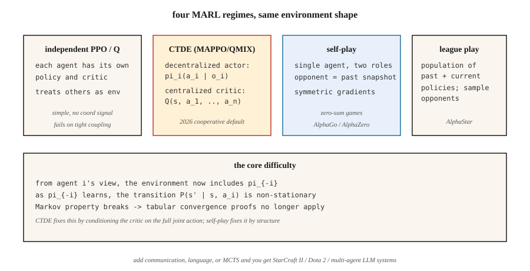

# Multi-Agent RL

> Single-agent RL 假设环境是 stationary 的。把两个正在学习的 agents 放进同一个世界，这个假设就会破掉：每个 agent 都是另一个 agent 的环境的一部分，而且二者都在变化。Multi-agent RL 是一组技巧，用来在 Markov assumption 不再成立时仍然让学习收敛。

**Type:** Build
**Languages:** Python
**Prerequisites:** Phase 9 · 04（Q-learning），Phase 9 · 06（REINFORCE），Phase 9 · 07（Actor-Critic）
**Time:** ~45 minutes

## 问题

一个机器人学习在房间里导航，是 single-agent RL problem。一个足球队不是。AlphaStar 对抗 StarCraft opponents 不是。一个 bidding agents 组成的 marketplace 不是。两辆车协商四向停车路口通行顺序也不是。许多 many-on-many 的现实问题都不是。

在每个 multi-agent setting 中，从任意一个 agent 的视角看，其他 agents *就是* environment 的一部分。随着它们学习并改变行为，environment 变成 non-stationary。Markov property——“next state 只依赖 current state 和我的 action”——被破坏了，因为 next state 还依赖 *其他* agents 选择了什么，而它们的 policies 是 moving targets。

这会破坏 tabular convergence proofs（Q-learning 的保证假设 stationary environment）。它也会破坏 naive deep RL：agents 互相追逐，形成循环，永远不收敛到稳定 policy。你需要 multi-agent-specific techniques：centralized training / decentralized execution、counterfactual baselines、league play、self-play。

2026 年的应用包括 robot swarms、traffic routing、autonomous vehicle fleets、market simulators、multi-agent LLM systems（Phase 16），以及任何有多个智能玩家的 game。

## 概念



**形式化：Markov Game。** MDP 的推广：states `S`、joint action `a = (a_1, …, a_n)`、transition `P(s' | s, a)`，以及每个 agent 的 rewards `R_i(s, a, s')`。每个 agent `i` 都在自己的 policy `π_i` 下最大化自己的 return。如果 rewards 完全相同，就是 **fully cooperative**。如果是 zero-sum，就是 **adversarial**。如果混合，就是 **general-sum**。

**核心挑战：**

- **Non-stationarity。** 从 agent `i` 的视角看，`P(s' | s, a_i)` 依赖正在变化的 `π_{-i}`。
- **Credit assignment。** 在 shared reward 下，哪一个 agent 导致了结果？
- **Exploration coordination。** Agents 必须探索互补策略，而不是重复探索同一片 state。
- **Scalability。** Joint action space 会随着 `n` 指数级增长。
- **Partial observability。** 每个 agent 只能看到自己的 observation；global state 是隐藏的。

**四种主流范式：**

**1. Independent Q-learning / independent PPO（IQL, IPPO）。** 每个 agent 学自己的 Q 或 policy，把其他 agents 当作 environment 的一部分。简单，有时有效（尤其是 experience replay 像一个平滑的 agent-modeling trick 时）。理论收敛性：没有。实践上：适合 loosely-coupled tasks，不适合 tightly-coupled tasks。

**2. Centralized training, decentralized execution（CTDE）。** 现代最常见范式。每个 agent 都有自己的 *policy* `π_i`，它只 condition on local observation `o_i`，也就是部署时标准的 decentralized execution。在 *training* 时，一个 centralized critic `Q(s, a_1, …, a_n)` 会 condition on 完整 global state 和 joint action。例子：
- **MADDPG**（Lowe et al. 2017）：每个 agent 一个 centralized critic 的 DDPG。
- **COMA**（Foerster et al. 2017）：counterfactual baseline，也就是问“如果我当时采取 action `a'`，我的 reward 会是多少？”从而隔离我的贡献。
- **MAPPO** / **IPPO** with shared critic（Yu et al. 2022）：带 centralized value function 的 PPO。到 2026 年，这是 cooperative MARL 的主流。
- **QMIX**（Rashid et al. 2018）：value decomposition，也就是 `Q_tot(s, a) = f(Q_1(s, a_1), …, Q_n(s, a_n))`，并使用 monotonic mixing。

**3. Self-play。** 同一个 agent 的两个 copies 互相对局。Opponent 的 policy 是我自己过去某个 snapshot 的 policy。AlphaGo / AlphaZero / MuZero、OpenAI Five 都属于这一类。它最适合 zero-sum games，因为 training signal 是对称的。

**4. League play。** Self-play 向 general-sum / adversarial environments 的扩展：保留一个 past and current policies 的 population，从 league 中 sample opponent 并训练。加入 exploiters（专门击败当前最佳 policy）和 main exploiters（专门击败 exploiters）。AlphaStar（StarCraft II）使用了这一套。当 game 存在 “rock-paper-scissors” strategy cycles 时，这很必要。

**Communication。** 允许 agents 互相发送 learned messages `m_i`。它在 cooperative settings 中有效。Foerster et al.（2016）展示了 differentiable inter-agent communication 可以端到端训练。今天的 LLM-based multi-agent systems（Phase 16）本质上是在用自然语言通信。

## Build It

本课使用一个 6×6 GridWorld，其中有两个 cooperative agents。它们从相反角落出发，必须到达同一个 shared goal。Shared reward：只要还有 agent 在移动，每步 `-1`；二者都到达时 `+10`。见 `code/main.py`。

### Step 1：multi-agent env

```python
class CoopGridWorld:
    def __init__(self):
        self.size = 6
        self.goal = (5, 5)

    def reset(self):
        return ((0, 0), (5, 0))  # two agents

    def step(self, state, actions):
        a1, a2 = state
        new1 = move(a1, actions[0])
        new2 = move(a2, actions[1])
        done = (new1 == self.goal) and (new2 == self.goal)
        reward = 10.0 if done else -1.0
        return (new1, new2), reward, done
```

*Joint* action space 是 `|A|² = 16`。Global state 是两个位置。

### Step 2：independent Q-learning

每个 agent 运行自己的 Q-table，key 是 joint state。每一步：二者都选择 ε-greedy actions，收集 joint transition，每个 agent 都用 shared reward 更新自己的 Q。

```python
def independent_q(env, episodes, alpha, gamma, epsilon):
    Q1, Q2 = defaultdict(default_q), defaultdict(default_q)
    for _ in range(episodes):
        s = env.reset()
        while not done:
            a1 = epsilon_greedy(Q1, s, epsilon)
            a2 = epsilon_greedy(Q2, s, epsilon)
            s_next, r, done = env.step(s, (a1, a2))
            target1 = r + gamma * max(Q1[s_next].values())
            target2 = r + gamma * max(Q2[s_next].values())
            Q1[s][a1] += alpha * (target1 - Q1[s][a1])
            Q2[s][a2] += alpha * (target2 - Q2[s][a2])
            s = s_next
```

这个任务里它能工作，因为 rewards dense 且 aligned。它会在 tightly-coupled tasks 上失败，例如某个 agent 必须 *等待* 另一个 agent 的任务。

### Step 3：centralized Q with decomposed-value update

使用一个覆盖 joint actions 的 Q：`Q(s, a_1, a_2)`。从 shared reward 更新。执行时通过 marginalizing 去中心化：`π_i(s) = argmax_{a_i} max_{a_{-i}} Q(s, a_1, a_2)`。它用指数级的 joint action space 换来一个 *正确* 的 global view。

### Step 4：simple self-play（adversarial 2-agent）

同一个 agent，两个 roles。训练 agent A 对抗 agent B；每过 `K` episodes，把 A 的 weights copy 到 B。对称训练，进展一致。这是 AlphaZero recipe 的迷你版。

## 常见陷阱

- **Non-stationary replay。** Independent agents 使用 experience replay 比 single-agent 更糟，因为旧 transitions 是由现在已经过时的 opponents 生成的。修复：relabel，或按 recency 加权。
- **Credit assignment ambiguity。** 长 episode 结束后才有 shared reward，却没有清晰方式判断哪个 agent 做出了贡献。修复：counterfactual baselines（COMA），或为每个 agent 做 reward shaping。
- **Policy drift / chasing。** 每个 agent 的 best response 都会随着对方 update 而变化。修复：centralized critic、较慢 learning rates，或一次 freeze 一个 agent。
- **Reward hacking via coordination。** Agents 会找到 designer 没预料到的 coordinated exploits。Auction agents 会收敛到 bid zero。修复：仔细设计 reward 和 behavioral constraints。
- **Exploration redundancy。** 两个 agents 探索同样的 state-action pairs。修复：per-agent entropy bonuses，或 role-conditioning。
- **League cycles。** 纯 self-play 可能卡在 dominance cycle。修复：使用包含多样 opponents 的 league play。
- **Sample explosion。** `n` 个 agents × state space × joint actions。用 function approximation 近似；用 factored action spaces（每个 agent 一个 policy output head）降低复杂度。

## Use It

2026 年的 MARL 应用地图：

| Domain | Method | Notes |
|--------|--------|-------|
| Cooperative navigation / manipulation | MAPPO / QMIX | CTDE；shared critic + decentralized actors。 |
| Two-player games（chess, Go, poker） | Self-play with MCTS（AlphaZero） | Zero-sum；symmetric training。 |
| Complex multiplayer（Dota, StarCraft） | League play + imitation pretraining | OpenAI Five、AlphaStar。 |
| Autonomous-vehicle fleets | CTDE MAPPO / PPO with attention | Partial obs；variable team sizes。 |
| Auction markets | Game-theoretic equilibrium + RL | 当 `n` → ∞ 时用 mean-field RL。 |
| LLM multi-agent systems（Phase 16） | Natural-language comm + role conditioning | RL loop 位于 agent-planning layer。 |

到 2026 年，MARL 增长最快的区域是 LLM-based：一群 language-model agents 进行协商、辩论、构建软件。RL 出现在 *trajectory-level* outputs 的 preference optimization 中，而不是 token-level（Phase 16 · 03）。

## Ship It

保存为 `outputs/skill-marl-architect.md`：

```markdown
---
name: marl-architect
description: Pick the right multi-agent RL regime (IPPO, CTDE, self-play, league) for a given task.
version: 1.0.0
phase: 9
lesson: 10
tags: [rl, multi-agent, marl, self-play]
---

Given a task with `n` agents, output:

1. Regime classification. Cooperative / adversarial / general-sum. Justify.
2. Algorithm. IPPO / MAPPO / QMIX / self-play / league. Reason tied to coupling tightness and reward structure.
3. Information access. Centralized training (what global info goes to the critic)? Decentralized execution?
4. Credit assignment. Counterfactual baseline, value decomposition, or reward shaping.
5. Exploration plan. Per-agent entropy, population-based training, or league.

Refuse independent Q-learning on tightly-coupled cooperative tasks. Refuse to recommend self-play for general-sum with cycle risks. Flag any MARL pipeline without a fixed-opponent eval (cherry-picked self-play numbers are common).
```

## 练习

1. **Easy.** 在 2-agent cooperative GridWorld 上训练 independent Q-learning。Mean return > 0 需要多少 episodes？画出 joint learning curve。
2. **Medium.** 加入一个 “coordination” task：只有两个 agents 在同一 turn 踩到 goal 上，才算到达。Independent Q 还会收敛吗？哪里坏了？
3. **Hard.** 为 MAPPO-style training 实现 centralized critic，并在 coordination task 上和 independent PPO 比较 convergence speed。

## 关键术语

| 术语 | 大家常说 | 实际含义 |
|------|----------|----------|
| Markov game | “Multi-agent MDP” | `(S, A_1, …, A_n, P, R_1, …, R_n)`；每个 agent 都有自己的 reward。 |
| CTDE | “Centralized training, decentralized execution” | Training time 使用 joint critic；每个 agent 的 policy 只使用 local obs。 |
| IPPO | “Independent PPO” | 每个 agent 分别运行 PPO。简单 baseline；常被低估。 |
| MAPPO | “Multi-agent PPO” | 带 centralized value function 的 PPO，该 value function condition on global state。 |
| QMIX | “Monotonic value decomposition” | `Q_tot = f_monotone(Q_1, …, Q_n)`，允许 decentralized argmax。 |
| COMA | “Counterfactual multi-agent” | Advantage = 我的 Q 减去对我的 action 做 marginalizing 后的 expected Q。 |
| Self-play | “Agent vs past self” | 单个 agent、两个 roles；zero-sum games 的标准做法。 |
| League play | “Population training” | 缓存 past policies，从池子里 sample opponents；处理 strategy cycles。 |

## 延伸阅读

- [Lowe et al. (2017). Multi-Agent Actor-Critic for Mixed Cooperative-Competitive Environments (MADDPG)](https://arxiv.org/abs/1706.02275)：带 centralized critic 的 CTDE。
- [Foerster et al. (2017). Counterfactual Multi-Agent Policy Gradients (COMA)](https://arxiv.org/abs/1705.08926)：用于 credit assignment 的 counterfactual baselines。
- [Rashid et al. (2018). QMIX: Monotonic Value Function Factorisation](https://arxiv.org/abs/1803.11485)：带 monotonicity 的 value decomposition。
- [Yu et al. (2022). The Surprising Effectiveness of PPO in Cooperative Multi-Agent Games (MAPPO)](https://arxiv.org/abs/2103.01955)：PPO 在 MARL 中意外地强。
- [Vinyals et al. (2019). Grandmaster level in StarCraft II using multi-agent reinforcement learning (AlphaStar)](https://www.nature.com/articles/s41586-019-1724-z)：大规模 league play。
- [Silver et al. (2017). Mastering the game of Go without human knowledge (AlphaGo Zero)](https://www.nature.com/articles/nature24270)：zero-sum games 中的纯 self-play。
- [Sutton & Barto (2018). Ch. 15 — Neuroscience & Ch. 17 — Frontiers](http://incompleteideas.net/book/RLbook2020.pdf)：包含教材对 multi-agent settings 和 non-stationarity problem 的简短讨论；CTDE 正是为解决它而设计。
- [Zhang, Yang & Başar (2021). Multi-Agent Reinforcement Learning: A Selective Overview](https://arxiv.org/abs/1911.10635)：覆盖 cooperative、competitive、mixed MARL 以及 convergence results 的综述。
