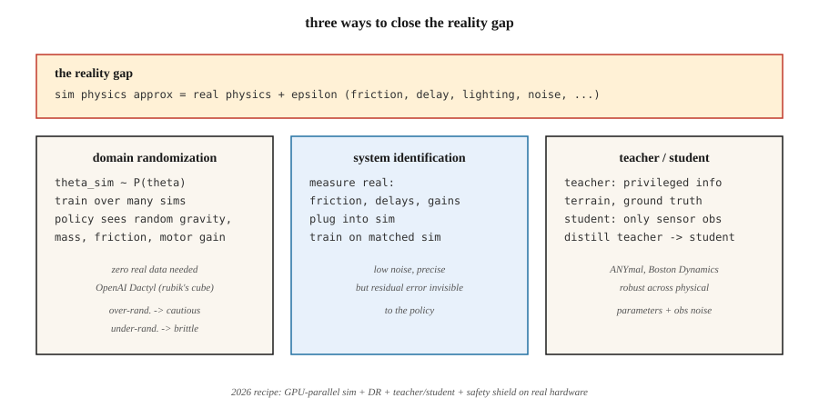

# Sim-to-Real Transfer

> 在 simulator 中训练出来却在 hardware 上失败的 policy，本质上只是记住了 simulator。Domain randomization、domain adaptation 和 system identification，是让 learned controllers 跨过 reality gap 的三件工具。

**Type:** Learn
**Languages:** Python
**Prerequisites:** Phase 9 · 08 (PPO), Phase 2 · 10 (Bias/Variance)
**Time:** ~45 minutes

## 问题

训练真实机器人很慢、危险，而且昂贵。一个双足机器人要学会走路，需要数百万个 training episodes；真实双足机器人只要摔倒一次，就可能损坏硬件。Simulation 给你无限 resets、deterministic reproducibility、parallel environments，而且不会造成物理损坏。

但 simulators 是错的。轴承摩擦比 MuJoCo models 里更大。摄像头有 simulator 没建模的 lens distortion。电机有 delays、backlash 和 saturation，而 99% 的 sim models 都跳过了它们。风、灰尘和可变光照会破坏在 sterile rendering 上训练出的 policy。**Reality gap**，也就是 sim distribution 和 real distribution 之间的系统性差异，是 robotics 中 deployed RL 的核心问题。

你需要一个 *robust to sim-to-real distribution shift* 的 policy。历史上有三条路线：随机化 simulator（domain randomization），用少量真实数据适配 policy（domain adaptation / fine-tuning），或识别真实系统参数并让 simulator 匹配它们（system identification）。到 2026 年，主流配方会把三者结合起来，并配合 massive parallel simulation（Isaac Sim、Isaac Lab、GPU 上的 Mujoco MJX）。

## 概念



**Domain Randomization（DR）。** Tobin et al. 2017，Peng et al. 2018。训练期间，把真实机器人上可能不同的每个 sim parameter 都随机化：masses、friction coefficients、motor PD gains、sensor noise、camera position、lighting、textures、contact models。Policy 会学习一个关于 “今天它处在哪个 sim 中” 的条件分布，并在整个范围内泛化。如果真实机器人落在 training envelope 内，policy 就能工作。

- **优点：** 不需要真实数据。一个 recipe，可以用于许多机器人。
- **缺点：** 过度随机化的训练会产生一个 “universal” 但过于保守的 policy。太多噪声 ≈ 太多 regularization。

**System Identification（SI）。** 在训练前，把 simulator 的参数拟合到真实世界数据。如果你能在真实机器人上测量 arm-joint friction，就把它填进 sim。然后训练一个预期这些数值的 policy。它需要访问真实系统，但会直接缩小 reality gap。

- **优点：** 精确、低噪声的训练目标。
- **缺点：** 残余 model error 对 policy 是不可见的；很小的未识别影响（例如 motor deadband）仍然会破坏部署。

**Domain Adaptation。** 先在 sim 中训练，再用少量真实数据 fine-tune。有两种形式：

- **Real2Sim2Real：** 用真实 rollouts 学一个 residual simulator `f(s, a, z) - f_sim(s, a)`，再在修正后的 sim 中训练。用很少真实数据就能缩小 gap。
- **Observation adaptation：** 训练一个 policy，通过 learned feature extractor（例如 GAN pixel-to-pixel）把 real obs → sim-like obs。Controller 仍然留在 sim 中。

**Privileged learning / teacher-student。** Miki et al. 2022（ANYmal quadruped）。在 simulation 中训练一个 *teacher*，它可以访问 privileged information（ground truth friction、terrain height、IMU drift）。然后蒸馏出一个只看真实传感器 observations 的 *student*。Student 学会从 history 中推断 privileged features，并在物理参数变化时保持 robust。

**Massively parallel simulation。** 2024-2026。Isaac Lab、Mujoco MJX、Brax 都能在单个 GPU 上运行数千个 parallel robots。PPO 配 4,096 个 parallel humanoids，可以在几小时内收集相当于数年的经验。随着 training distribution 变宽，reality gap 会缩小；当这 4,096 个 envs 中每个都有不同的 randomized parameters 时，DR 几乎是免费的。

**2026 年真实世界 recipe（以四足行走为例）：**

1. Massive parallel sim，并 domain-randomize gravity、friction、motor gains、payload。
2. 使用 privileged info（terrain map、body velocity ground truth）训练 teacher policy。
3. 只用 proprioception（leg joint encoders）把 student policy 从 teacher 蒸馏出来。
4. 可选：在真实 IMU 上用 autoencoder 做 observation adaptation。
5. 部署。Zero-shot 到 10+ environments。如果失败，用 safety-constrained PPO 做几分钟真实世界 fine-tuning。

## 动手构建

本课代码是在一个带 *noisy* transitions 的 GridWorld 上做 domain randomization 的微型演示。我们训练一个 policy，让它在 “sim” 中经历 randomized slip probabilities，再在一个训练时从未见过的 slip level 上的 “real” 环境中评估。这个形状可以直接映射到 MuJoCo-to-hardware transfer。

### Step 1：parameterized sim

```python
def step(state, action, slip):
    if rng.random() < slip:
        action = random_perpendicular(action)
    ...
```

`slip` 是 simulator 暴露的一个参数。在真实 robotics 中，它可以是 friction、mass、motor gain，也就是任何会在 sim 和 real 之间偏移的东西。

### Step 2：用 DR 训练

在每个 episode 开始时，采样 `slip ~ Uniform[0.0, 0.4]`。训练 PPO / Q-learning / 任何算法。重复许多 episodes。

### Step 3：在 “real” slips 上 zero-shot 评估

在 `slip ∈ {0.0, 0.1, 0.2, 0.3, 0.5, 0.7}` 上评估。前四个在 training support 内，`0.5` 和 `0.7` 在 support 外。DR-trained policy 应该在 support 内接近 optimal，在 support 外 graceful degradation。Fixed-slip-trained policy 会在训练 slip 外非常脆弱。

### Step 4：与 narrow training 比较

训练第二个只用 `slip = 0.0` 的 policy。在同一组 `slip` sweep 上评估。你应该会看到，一旦 real slip > 0，性能就会 catastrophic drop。

## 常见陷阱

- **Too much randomization。** 在 `slip ∈ [0, 0.9]` 上训练，policy 会变得过度 risk-averse，甚至不敢走 optimal path。匹配 *expected* real-world distribution，而不是 “任何事都可能发生”。
- **Too little randomization。** 在很窄的 slice 上训练，policy 完全无法泛化。使用 adaptive curriculum（Automatic Domain Randomization），随着 policy 改进逐步扩大 distribution。
- **Misidentified parameter space。** 随机化了错误的东西（真实 gap 是 motor delay，你却随机 camera hue），DR 不会有帮助。先 profile 真实机器人。
- **Privileged info leakage。** 如果 teacher 用 global state 做 actions，而不只是用 observations，它可能产生一个 student 无法追上的目标。确保 teacher 的 policy 在给定 observation history 时对 student 是可实现的。
- **Sim-to-sim transfer failure。** 如果 policy 对更难的 sim variant 都不 robust，它也不会对真实世界 robust。部署前始终在 held-out sim variant 上测试。
- **没有 real-world safety envelope。** 一个在 sim 中工作、也 “能在 real 中工作” 的 policy，如果没有 low-level safety shield，仍然会损坏硬件。把 rate limits、torque limits、joint limits 放进 non-learned controller。

## 使用它

2026 年的 sim-to-real 技术栈：

| Domain | Stack |
|--------|-------|
| Legged locomotion（ANYmal、Spot、humanoid） | Isaac Lab + DR + privileged teacher / student |
| Manipulation（dexterous hands、pick-and-place） | Isaac Lab + DR + DR-GAN for vision |
| Autonomous driving | CARLA / NVIDIA DRIVE Sim + DR + real fine-tune |
| Drone racing | RotorS / Flightmare + DR + online adaptation |
| Finger/in-hand manipulation | OpenAI Dactyl（大规模 DR） |
| Industrial arms | MuJoCo-Warp + SI + small real fine-tune |

对所有规模的控制任务，workflow 都一致：尽力拟合 sim，随机化你拟合不了的部分，训练巨大的 policies，蒸馏，然后带 safety shield 部署。

## 交付它

保存为 `outputs/skill-sim2real-planner.md`：

```markdown
---
name: sim2real-planner
description: Plan a sim-to-real transfer pipeline for a given robot + task, covering DR, SI, and safety.
version: 1.0.0
phase: 9
lesson: 11
tags: [rl, sim2real, robotics, domain-randomization]
---

Given a robot platform, a task, and access to real hardware time, output:

1. Reality gap inventory. Suspected sources ranked by expected impact (contact, sensing, actuation delay, vision).
2. DR parameters. Exact list, ranges, distribution. Justify each range against real measurements.
3. SI steps. Which parameters to measure; measurement method.
4. Teacher/student split. What privileged info the teacher uses; what obs the student uses.
5. Safety envelope. Low-level limits, emergency stops, backup controller.

Refuse to deploy without (a) a zero-shot sim-variant test, (b) a safety shield, (c) a rollback plan. Flag any DR range wider than 3× measured real variability as likely over-randomized.
```

## 练习

1. **Easy.** 在 fixed-slip GridWorld（slip=0.0）上训练 Q-learning agent。在 slip ∈ {0.0, 0.1, 0.3, 0.5} 上评估。绘制 return vs slip。
2. **Medium.** 训练一个 DR Q-learning agent，采样 `slip ~ Uniform[0, 0.3]`。评估同一组 sweep。在 slip=0.5（out-of-distribution）上，DR 带来了多少收益？
3. **Hard.** 实现一个 curriculum：从 slip=0.0 开始，每当 policy 达到 optimal 的 90% 时，就扩大 DR range。测量达到 slip=0.3 zero-shot 所需的 total environment steps，并和 fixed DR baseline 比较。

## 关键术语

| Term | What people say | What it actually means |
|------|-----------------|-----------------------|
| Reality gap | “Sim-to-real difference” | 训练和部署时 physics/sensing 之间的 distribution shift。 |
| Domain randomization（DR） | “Train across random sims” | 训练期间随机化 sim parameters，让 policy 泛化。 |
| System identification（SI） | “Measure real and fit sim” | 估计真实物理参数，并设置 sim 与之匹配。 |
| Domain adaptation | “Fine-tune on real data” | Sim training 后用少量真实世界数据 fine-tune；可能适配 observations 或 dynamics。 |
| Privileged info | “Ground truth for teacher” | 只有 sim 拥有的信息；student 必须从 observation history 中推断它。 |
| Teacher/student | “Distill privileged -> observable” | Teacher 用 shortcuts 训练；student 学会在没有 shortcuts 的情况下模仿。 |
| ADR | “Automatic Domain Randomization” | 随着 policy 改进而扩大 DR ranges 的 curriculum。 |
| Real2Sim | “Close the gap with real data” | 学一个 residual，让 sim 模仿真实 rollouts。 |

## 延伸阅读

- [Tobin et al. (2017). Domain Randomization for Transferring Deep Neural Networks from Simulation to the Real World](https://arxiv.org/abs/1703.06907) — 原始 DR 论文（robotics vision）。
- [Peng et al. (2018). Sim-to-Real Transfer of Robotic Control with Dynamics Randomization](https://arxiv.org/abs/1710.06537) — dynamics 上的 DR，quadruped locomotion。
- [OpenAI et al. (2019). Solving Rubik's Cube with a Robot Hand](https://arxiv.org/abs/1910.07113) — Dactyl，大规模 ADR。
- [Miki et al. (2022). Learning robust perceptive locomotion for quadrupedal robots in the wild](https://www.science.org/doi/10.1126/scirobotics.abk2822) — ANYmal 的 teacher-student。
- [Makoviychuk et al. (2021). Isaac Gym: High Performance GPU Based Physics Simulation for Robot Learning](https://arxiv.org/abs/2108.10470) — 推动 2025-2026 部署的 massively parallel sim。
- [Akkaya et al. (2019). Automatic Domain Randomization](https://arxiv.org/abs/1910.07113) — ADR curriculum method。
- [Sutton & Barto (2018). Ch. 8 — Planning and Learning with Tabular Methods](http://incompleteideas.net/book/RLbook2020.pdf) — Dyna framing（用 model 做 planning + rollouts），是现代 sim-to-real pipelines 的基础。
- [Zhao, Queralta & Westerlund (2020). Sim-to-Real Transfer in Deep Reinforcement Learning for Robotics: a Survey](https://arxiv.org/abs/2009.13303) — sim-to-real methods 的 taxonomy 和 benchmark results。
