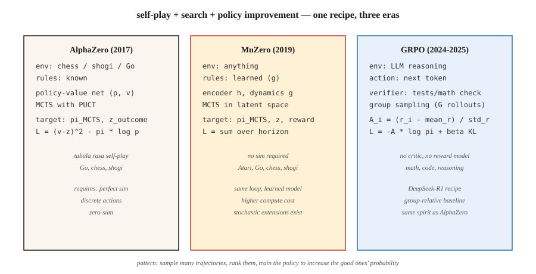

# 游戏中的 RL：AlphaZero、MuZero 与 LLM 推理时代

> 1992：TD-Gammon 用纯 TD 在西洋双陆棋上击败人类冠军。2016：AlphaGo 击败李世石。2017：AlphaZero 从零开始统治 chess、shogi 和 Go。2024：DeepSeek-R1 证明同一套 recipe，把 PPO 换成 GRPO 后，也适用于 reasoning。Games 是推动本阶段每一次突破的 benchmark。

**Type:** Build
**Languages:** Python
**Prerequisites:** Phase 9 · 05（DQN），Phase 9 · 08（PPO），Phase 9 · 09（RLHF），Phase 9 · 10（MARL）
**Time:** ~120 minutes

## 问题

Games 拥有 RL 想要的一切。干净的 reward（win/loss）。无限 episodes（self-play reset）。完美 simulation（game 本身就是 simulator）。离散或小规模连续 action spaces。Multi-agent 结构会强迫 adversarial robustness。

而且，几乎每个重大 RL 突破都是在 games 上测试的。TD-Gammon（backgammon，1992）。Atari-DQN（2013）。AlphaGo（2016）。AlphaZero（2017）。OpenAI Five（Dota 2，2019）。AlphaStar（StarCraft II，2019）。MuZero（learned model，2019）。AlphaTensor（matrix multiplication，2022）。AlphaDev（sorting algorithms，2023）。DeepSeek-R1（math reasoning，2025）：最新一次展示 game-RL techniques 可以迁移到 text。

这个 capstone 会用一个统一视角梳理三座 landmark architectures：AlphaZero、MuZero 和 GRPO。这个视角是：**self-play + search + policy improvement**。每个架构都是前一个的泛化；尤其是 GRPO，本质上是把 AlphaZero 的 recipe 应用到 LLM reasoning，其中 tokens 是 actions，mathematical verification 是 win signal。

## 概念



**统一循环。**

```python
while True:
    trajectory = self_play(current_policy, search)     # play game against self
    policy_target = search.improved_policy(trajectory) # search improves raw policy
    policy_net.update(policy_target, value_target)     # supervised on search output
```

**AlphaZero（2017）。** Silver et al. 给定一个规则已知的 game（chess、shogi、Go）：

- Policy-value network：一个 tower `f_θ(s) → (p, v)`。`p` 是 legal moves 上的 prior。`v` 是 expected game outcome。
- Monte Carlo Tree Search（MCTS）：每一步展开可能 continuations 的 tree。用 `(p, v)` 作为 prior + bootstrap。用 UCB（PUCT）选择 nodes：`a* = argmax Q(s, a) + c · p(a|s) · √N(s) / (1 + N(s, a))`。
- Self-play：agent-vs-agent 地下棋。在 move `t`，MCTS visit distribution `π_t` 成为 policy training target。
- Loss：`L = (v - z)² - π · log p + c · ||θ||²`。`z` 是 game outcome（+1 / 0 / -1）。

没有 human knowledge。没有 handcrafted heuristics。一套 recipe，在各自几千万局 self-play games 后掌握 chess、shogi 和 Go。

**MuZero（2019）。** Schrittwieser et al. 去掉“规则已知”这个要求。

- 不再依赖固定 environment，而是学习一个 **latent dynamics model** `(h, g, f)`：
  - `h(s)`：把 observation encode 成 latent state。
  - `g(s_latent, a)`：预测 next latent state + reward。
  - `f(s_latent)`：预测 policy prior + value。
- MCTS 在 **learned latent space** 中运行。同样的 search，同样的 training loop。
- 可以用于 Go、chess、shogi **以及** Atari：一个 algorithm，不需要规则知识。

**Stochastic MuZero（2022）。** 加入 stochastic dynamics 和 chance nodes，扩展到 backgammon 这类 games。

**Muesli、Gumbel MuZero（2022-2024）。** 改进 sample efficiency 和 deterministic search。

**GRPO（2024-2025）。** DeepSeek-R1 recipe。同一个 AlphaZero-shaped loop，应用到 language-model reasoning：

- “Game”：回答 math / coding / reasoning problem。“Win” = verifier（test case passes、numerical answer matches）返回 1。
- Policy：LLM。Actions：tokens。State：prompt + response-so-far。
- 没有 critic（PPO-style `V_φ`）。取而代之的是：对每个 prompt，从 policy 采样 `G` 个 completions。计算每个 completion 的 reward。使用 **group-relative advantage** `A_i = (r_i - mean_r) / std_r` 作为 REINFORCE-style update 的信号。
- 对 reference policy 加 KL penalty，防止 drift（像 RLHF 一样）。
- 完整 loss：

  `L_GRPO(θ) = -E_{q, {o_i}} [ (1/G) Σ_i A_i · log π_θ(o_i | q) ] + β · KL(π_θ || π_ref)`

没有 reward model，没有 critic，没有 MCTS。Group-relative baseline 替代了三者。在 reasoning benchmarks 上，它用少得多的 compute 匹配或超过 PPO-RLHF 质量。

**完整 R1 recipe。** DeepSeek-R1（DeepSeek 2025）一篇论文里包含两个模型：

- **R1-Zero。** 从 DeepSeek-V3 base model 开始。没有 SFT。直接用两个 reward components 做 GRPO：**accuracy reward**（rule-based：final answer 是否能 parse 到正确数字 / code 是否通过 unit tests）和 **format reward**（completion 是否把 chain-of-thought 包在 `<think>…</think>` tags 里）。经过数千 steps，average response length 从约 100 增长到约 10,000 tokens，math benchmark scores 爬到接近 o1-preview 的水平。模型从零学会 reasoning。缺点是：chains of thought 经常不可读、混合语言、缺少 stylistic polish。
- **R1。** 用四阶段 pipeline 修复 R1-Zero 的可读性问题：
  1. **Cold-start SFT。** 收集几千条格式干净的 long-CoT demonstrations。对 base model 做 supervised-finetune。它提供一个可读的起点。
  2. **Reasoning-oriented GRPO。** 用 accuracy+format rewards 加上 **language-consistency** reward 做 GRPO，防止 code-switching。
  3. **Rejection sampling + SFT round 2。** 从 RL checkpoint 采样约 600K reasoning trajectories，只保留 final answers 正确且 CoT 可读的样本，再和约 200K non-reasoning SFT examples（writing、QA、self-cognition）合并。再次 fine-tune base。
  4. **Full-spectrum GRPO。** 再做一轮 RL，覆盖 reasoning（rule-based rewards）和 general alignment（helpfulness/harmlessness preference-based rewards）。

结果是在 open weights 下匹配 o1 在 AIME 和 MATH-500 上的表现，而且足够小，可以 distill。同一篇论文还发布了六个 distilled dense models（从 Qwen-1.5B 到 Llama-70B），做法是在 R1 的 reasoning traces 上做 SFT，student 不做 RL。强 RL teacher 的 distillation，在 student scale 上持续优于从零做 RL。

**为什么 reasoning 用 GRPO 而不是 PPO。** DeepSeekMath paper（2024 年 2 月）给了三个理由：(1) 不需要训练 value network，memory 减半；(2) group baseline 天然适配 reasoning tasks 的 sparse end-of-trajectory reward；(3) per-prompt normalization 让不同难度 problem 的 advantages 可比，而 PPO 的 single critic 做不到这一点。

**Search-free vs search-based。** Games 已经分叉：

- **长 horizon 的 perfect-information games**（Go、chess）：仍然 search-based。AlphaZero / MuZero 占主导。
- **LLM reasoning**：production 里还没有 MCTS；训练用 full rollouts 上的 GRPO，inference compute 用 best-of-N。Process reward models（PRMs）暗示 step-level search 会被加回来。

## Build It

`code/main.py` 实现了 **微型 GRPO**：一个带多组 samples 的 bandit。Algorithm 和 LLM 上的完全一样，只是 policy 和 environment 更简单。它教学的是 **loss** 和 **group-relative advantage**，也就是 2025 年的创新点。

### Step 1：tiny verifier environment

```python
QUESTIONS = [
    {"prompt": "q1", "correct": 3},
    {"prompt": "q2", "correct": 1},
]

def verify(prompt_idx, answer_token):
    return 1.0 if answer_token == QUESTIONS[prompt_idx]["correct"] else 0.0
```

真实 GRPO 中，verifier 会运行 unit tests 或检查数学等价性。

### Step 2：policy：每个 prompt 上 K 个 answer tokens 的 softmax

```python
def policy_probs(theta, p_idx):
    return softmax(theta[p_idx])
```

等价于 LLM 在 prompt 条件下的 final-layer output。

### Step 3：group sampling 和 group-relative advantage

```python
def grpo_step(theta, p_idx, G=8, beta=0.01, lr=0.1, rng=None):
    probs = policy_probs(theta, p_idx)
    samples = [sample(probs, rng) for _ in range(G)]
    rewards = [verify(p_idx, s) for s in samples]
    mean_r = sum(rewards) / G
    std_r = stddev(rewards) + 1e-8
    advs = [(r - mean_r) / std_r for r in rewards]

    for a, A in zip(samples, advs):
        grad = onehot(a) - probs
        for i in range(len(probs)):
            theta[p_idx][i] += lr * A * grad[i]
    # KL penalty: pull theta toward reference
    for i in range(len(probs)):
        theta[p_idx][i] -= beta * (theta[p_idx][i] - reference[p_idx][i])
```

Group-relative advantage 是 2024 年 DeepSeek trick。无需 critic。“baseline” 是 group mean，normalization 用 group std。

### Step 4：和 REINFORCE baseline（value-free）比较

同样 setup，同样 compute，普通 REINFORCE。GRPO 收敛更快，也更稳定。

### Step 5：观察 entropy 和 KL

和 RLHF 一样的 diagnostics：mean KL to reference、policy entropy、reward-over-time。这些稳定后，training 就完成了。

## 常见坑

- **Reward hacking via verifier gaming。** GRPO 继承了 RLHF 的风险：如果 verifier 错了或可被利用，LLM 会找到 exploit。Robust verifiers（多个 test cases、formal proofs）很重要。
- **Group size 太小。** Group baseline 的 variance 近似按 `1/√G` 下降。低于 `G = 4` 时，advantage signal 很 noisy；标准选择是 `G = 8` 到 `64`。
- **Length bias。** 不同长度的 LLM completions 有不同 log-probabilities。按 token count normalize，或使用 sequence-level log-prob，或 truncate 到 max length。
- **Pure self-play cycles。** AlphaZero-style training 在 general-sum games 中可能卡进 dominance loops。用 diverse opponent pools（league play，Lesson 10）缓解。
- **Search-policy mismatch。** AlphaZero 会训练 policy 去模仿 search output。如果 policy net 太小，无法表示 search 的 distribution，training 会停滞。
- **Compute floor。** MuZero / AlphaZero 需要 massive compute。一次 ablation 往往就是数百 GPU-hours。学习用 miniature demos（例如 Connect Four 上的 AlphaZero）就够了。
- **Verifier coverage。** 会让 buggy solution 通过的 unit tests 会强化 bug。设计能抓住 edge cases 的 verifiers。

## Use It

2026 年的 game-RL landscape，按 domain 划分：

| Domain | Dominant method |
|--------|-----------------|
| Two-player zero-sum board games（Go、chess、shogi） | AlphaZero / MuZero / KataGo |
| Imperfect info card games（poker） | CFR + deep learning（DeepStack、Libratus、Pluribus） |
| Atari / pixel games | Muesli / MuZero / IMPALA-PPO |
| Large multiplayer strategy（Dota、StarCraft） | PPO + self-play + league（OpenAI Five、AlphaStar） |
| LLM math/code reasoning | GRPO（DeepSeek-R1、Qwen-RL、open replications） |
| LLM alignment | DPO / RLHF-PPO（不是 GRPO；verifier 是 preference 而不是 verifiable） |
| Robotics | PPO + DR（不是 game-RL，但使用同样的 policy-gradient tools） |
| Combinatorial problems | AlphaZero variants（AlphaTensor、AlphaDev） |

这套 **recipe**：self-play、search-augmented improvement、policy distillation，横跨 text、pixels 和 physical control。GRPO 是最年轻的实例；更多还会出现。

## Ship It

保存为 `outputs/skill-game-rl-designer.md`：

```markdown
---
name: game-rl-designer
description: Design a game-RL or reasoning-RL training pipeline (AlphaZero / MuZero / GRPO) for a given domain.
version: 1.0.0
phase: 9
lesson: 12
tags: [rl, alphazero, muzero, grpo, self-play]
---

Given a target (perfect-info game / imperfect-info / Atari / LLM reasoning / combinatorial), output:

1. Environment fit. Known rules? Markov? Stochastic? Multi-agent? Informs AlphaZero vs MuZero vs GRPO.
2. Search strategy. MCTS (PUCT with learned prior), Gumbel-sampled, best-of-N, or none.
3. Self-play plan. Symmetric self-play / league / offline data / verifier-generated.
4. Target signal. Game outcome / verifier reward / preference / learned model. Include robustness plan.
5. Diagnostics. Win rate vs baseline, ELO curve, verifier pass rate, KL to reference.

Refuse AlphaZero on imperfect-info games (route to CFR). Refuse GRPO without a trusted verifier. Refuse any game-RL pipeline without a fixed baseline opponent set (self-play ELO is uncalibrated otherwise).
```

## 练习

1. **Easy.** 在 `code/main.py` 中实现 GRPO bandit。在 2 prompts × 每个 4 answer tokens 上训练。用 `G=8` 在 < 1,000 updates 内收敛。
2. **Medium.** 接入 PPO（clipped）和 vanilla REINFORCE。在同一个 bandit 上，把 sample efficiency 和 reward variance 与 GRPO 比较。
3. **Hard.** 扩展到一个长度为 2 的 “reasoning chain”：agent 输出两个 tokens，verifier 奖励这个 pair。测量 GRPO 如何处理 two-step sequences 的 credit assignment。（提示：对 **完整 sequence** 计算 group advantage，并传播到两个 token positions。）

## 关键术语

| Term | What people say | What it actually means |
|------|-----------------|-----------------------|
| MCTS | “Tree search with learned net” | Monte Carlo Tree Search；用 learned `(p, v)` priors 做 UCB1/PUCT selection。 |
| AlphaZero | “Self-play + MCTS” | 训练 policy-value net 去匹配 MCTS visits 和 game outcome。 |
| MuZero | “Learned-model AlphaZero” | 同样循环，但通过 learned dynamics 在 latent space 中运行。 |
| GRPO | “Critic-free PPO” | Group Relative Policy Optimization；带 group-mean baseline + KL 的 REINFORCE。 |
| PUCT | “AlphaZero's UCB” | `Q + c · p · √N / (1 + N_a)`，平衡 value estimate 和 prior。 |
| Self-play | “Agent vs past self” | Zero-sum 的标准做法；提供 symmetric training signal。 |
| League play | “Population-based self-play” | 把 past + current + exploiters 作为 opponents 采样。 |
| Verifier reward | “Verifiable RL” | Reward 来自 deterministic checker（tests pass、answer matches）。 |
| Process reward | “PRM” | 给每个 reasoning step 打分，而不只看 final answer。 |

## 延伸阅读

- [Silver et al. (2017). Mastering the game of Go without human knowledge (AlphaGo Zero)](https://www.nature.com/articles/nature24270)。
- [Silver et al. (2018). A general reinforcement learning algorithm that masters chess, shogi, and Go through self-play (AlphaZero)](https://www.science.org/doi/10.1126/science.aar6404)。
- [Schrittwieser et al. (2020). Mastering Atari, Go, chess and shogi by planning with a learned model (MuZero)](https://www.nature.com/articles/s41586-020-03051-4)。
- [Vinyals et al. (2019). Grandmaster level in StarCraft II (AlphaStar)](https://www.nature.com/articles/s41586-019-1724-z)。
- [DeepSeek-AI (2024). DeepSeekMath: Pushing the Limits of Mathematical Reasoning in Open Language Models (GRPO)](https://arxiv.org/abs/2402.03300) — 引入 GRPO 和 group-relative baseline 的论文。
- [DeepSeek-AI (2025). DeepSeek-R1: Incentivizing Reasoning Capability in LLMs via Reinforcement Learning](https://arxiv.org/abs/2501.12948) — 完整四阶段 R1 recipe，以及 R1-Zero ablation。
- [Brown et al. (2019). Superhuman AI for multiplayer poker (Pluribus)](https://www.science.org/doi/10.1126/science.aay2400) — CFR + deep-learning at scale。
- [Tesauro (1995). Temporal Difference Learning and TD-Gammon](https://dl.acm.org/doi/10.1145/203330.203343) — 开端之作。
- [Hugging Face TRL — GRPOTrainer](https://huggingface.co/docs/trl/main/en/grpo_trainer) — 使用 custom reward functions 应用 GRPO 的 production reference。
- [Qwen Team (2024). Qwen2.5-Math — GRPO replication](https://github.com/QwenLM/Qwen2.5-Math) — 多个 scales 上的 R1 recipe open replication。
- [Sutton & Barto (2018). Ch. 17 — Frontiers of Reinforcement Learning](http://incompleteideas.net/book/RLbook2020.pdf) — 对 self-play、search 和 “designed reward” 的 textbook framing；R1 在 LLM scale 上实例化了这些概念。
