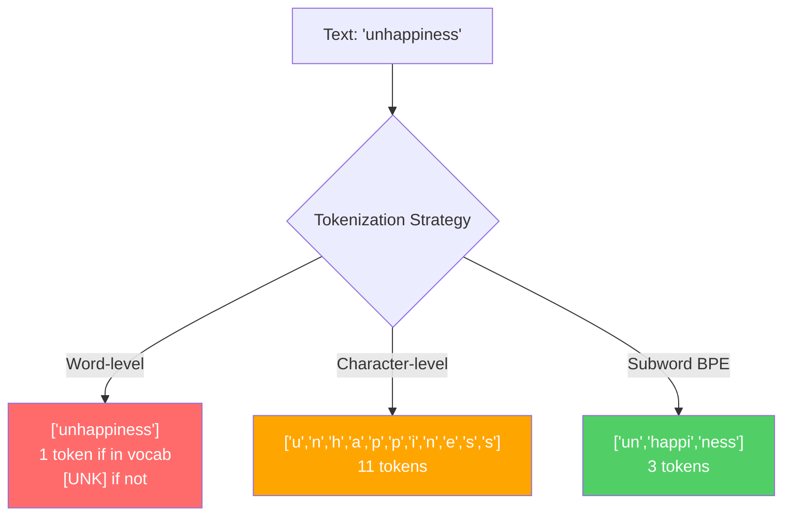
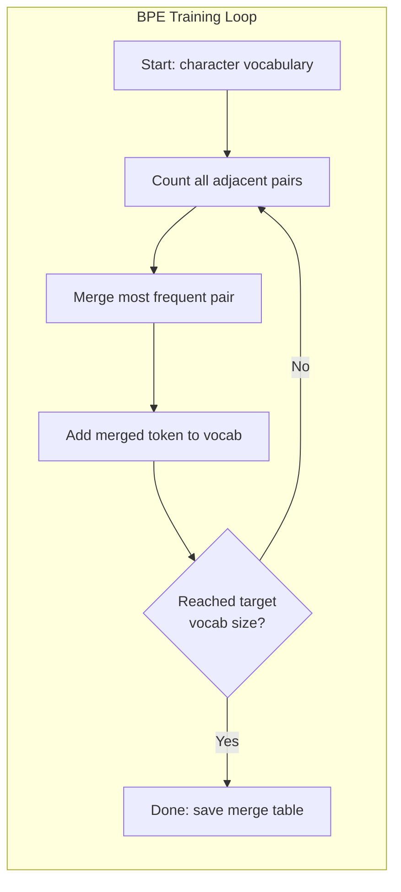
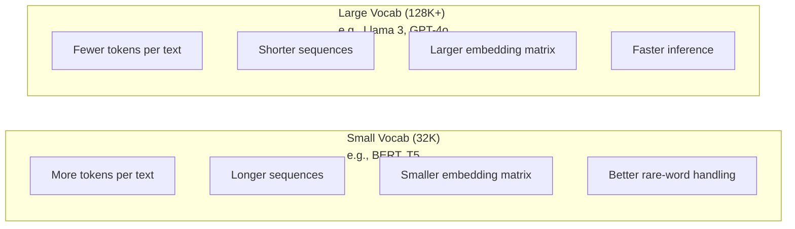

# 分词器：BPE、WordPiece、SentencePiece

> 你的 LLM 读不懂英文。它读的是整数。分词器决定这些整数是在承载意义，还是在浪费上下文。

**Type:** Build
**Languages:** Python
**Prerequisites:** Phase 05 (NLP Foundations)
**Time:** ~90 minutes

## 学习目标

- 从零实现 BPE、WordPiece 和 Unigram 分词算法，并比较它们的合并策略
- 解释 vocabulary size 如何影响模型效率：过小会制造长序列，过大则浪费 embedding 参数
- 分析不同语言和代码中的分词瑕疵，识别具体 tokenizer 会在哪些地方失效
- 使用 tiktoken 和 sentencepiece 库对文本分词，并检查生成的 token IDs

## 问题

你的 LLM 不读英文。它也不读任何自然语言。它读数字。

从 `"Hello, world!"` 到 `[15496, 11, 995, 0]` 之间的那道缝，就是分词器。每个词、每个空格、每个标点都必须先转换成整数，模型才能处理。这种转换并不中立。它会把一些假设烘进模型里，而且之后无法撤销。

如果做错了，模型会浪费容量，用多个 tokens 编码常见词。`"unfortunately"` 可能变成四个 tokens，而不是一个。你以为有 128K context window；碰到多音节词密集的文本，它实际缩水了 75%。如果做对了，同样的 context window 可以承载两倍的意义。一个模型是“擅长处理代码”还是“碰到 Python 就卡住”，很多时候取决于 tokenizer 是怎么训练的。

你对 GPT-4 或 Claude 发出的每个 API call 都按 token 计价。模型生成的每个 token 都要消耗 compute。表示同样输出所需的 tokens 越少，端到端 inference 越快。Tokenization 不是预处理。它就是架构的一部分。

## 概念

### 三种失败的方法，和一种胜出的折中

把文本转换成数字，有三种显而易见的方法。其中两种无法规模化。

**Word-level tokenization** 按空格和标点切分。`"The cat sat"` 变成 `["The", "cat", "sat"]`。简单。但 `"tokenization"` 呢？`"GPT-4o"` 呢？像 `"Geschwindigkeitsbegrenzung"` 这样的德语复合词呢？Word-level 需要一个巨大的 vocabulary，才能覆盖每种语言里的每个词。漏掉一个词，就会得到可怕的 `[UNK]` token，也就是模型在说：“我完全不知道这是什么。” 仅英语就有超过一百万种词形。再加上代码、URL、科学计数法和上百种语言，你会需要一个无限 vocabulary。

**Character-level tokenization** 走向另一个极端。`"hello"` 变成 `["h", "e", "l", "l", "o"]`。Vocabulary 很小，只有几百个字符。永远没有 unknown token。但序列会变得极长。一个句子用 word-level 可能是 10 个 tokens，用 character-level 可能是 50 个 tokens。模型必须学会 `"t"`、`"h"`、`"e"` 合在一起表示 `"the"`，把 attention capacity 烧在三岁孩子已经学会的事情上。

**Subword tokenization** 找到了甜点区。常见词保持完整：`"the"` 是一个 token。罕见词拆成有意义的片段：`"unhappiness"` 变成 `["un", "happi", "ness"]`。Vocabulary 仍然可控，通常是 30K 到 128K tokens。序列仍然短。Unknown tokens 基本消失，因为任何词都可以由 subword pieces 拼出来。

每个现代 LLM 都使用 subword tokenization。GPT-2、GPT-4、BERT、Llama 3、Claude 全都是。真正的问题是：用哪种算法。



### BPE：Byte Pair Encoding

BPE 是一种贪心压缩算法，后来被改造成分词算法。核心想法简单到可以写在索引卡片上。

从单个字符开始。统计训练语料中每一对相邻 token。把最常出现的一对合并成一个新 token。重复这个过程，直到达到目标 vocabulary size。

```figure
tokenizer-bpe
```

下面是在一个很小的 corpus 上运行 BPE，里面只有 `"lower"`、`"lowest"` 和 `"newest"`：

```text
Corpus (with word frequencies):
  "lower"  x5
  "lowest" x2
  "newest" x6

Step 0 -- Start with characters:
  l o w e r       (x5)
  l o w e s t     (x2)
  n e w e s t     (x6)

Step 1 -- Count adjacent pairs:
  (e,s): 8    (s,t): 8    (l,o): 7    (o,w): 7
  (w,e): 13   (e,r): 5    (n,e): 6    ...

Step 2 -- Merge most frequent pair (w,e) -> "we":
  l o we r        (x5)
  l o we s t      (x2)
  n e we s t      (x6)

Step 3 -- Recount and merge (e,s) -> "es":
  l o we r        (x5)
  l o we s t      (x2)    <- 'es' only forms from 'e'+'s', not 'we'+'s'
  n e we s t      (x6)    <- wait, the 'e' before 'we' and 's' after 'we'

Actually tracking this precisely:
  After "we" merge, remaining pairs:
  (l,o): 7   (o,we): 7   (we,r): 5   (we,s): 8
  (s,t): 8   (n,e): 6    (e,we): 6

Step 3 -- Merge (we,s) -> "wes" or (s,t) -> "st" (tied at 8, pick first):
  Merge (we,s) -> "wes":
  l o we r        (x5)
  l o wes t       (x2)
  n e wes t       (x6)

Step 4 -- Merge (wes,t) -> "west":
  l o we r        (x5)
  l o west        (x2)
  n e west        (x6)

...continue until target vocab size reached.
```

Merge table 就是 tokenizer。编码新文本时，按学习到的顺序应用 merges。训练语料决定哪些 merges 会存在，而这个选择会永久塑造模型看到的输入。



### Byte-Level BPE（GPT-2、GPT-3、GPT-4）

标准 BPE 在 Unicode 字符上运行。Byte-level BPE 在原始 bytes（0-255）上运行。这给你一个正好 256 个 token 的基础 vocabulary，可以处理任何语言或编码，并且永远不会产生 unknown token。

GPT-2 引入了这种方法。基础 vocabulary 覆盖每一种可能的 byte，BPE merges 再叠在它上面。OpenAI 的 tiktoken 库实现了 byte-level BPE，并使用这些 vocabulary sizes：

- GPT-2：50,257 tokens
- GPT-3.5/GPT-4：约 100,256 tokens（cl100k_base encoding）
- GPT-4o：200,019 tokens（o200k_base encoding）

### WordPiece（BERT）

WordPiece 看起来和 BPE 相似，但选择 merge 的方式不同。它不是看原始频率，而是最大化训练数据的似然：

```text
BPE merge criterion:      count(A, B)
WordPiece merge criterion: count(AB) / (count(A) * count(B))
```

BPE 问的是：“哪一对出现得最多？” WordPiece 问的是：“哪一对共同出现的频率，超过偶然水平最多？” 这个细微差别会生成不同的 vocabularies。WordPiece 偏爱共同出现很“意外”的 merges，而不是单纯频繁的 merges。

WordPiece 还用 `"##"` 前缀标记 continuation subwords：

```text
"unhappiness" -> ["un", "##happi", "##ness"]
"embedding"   -> ["em", "##bed", "##ding"]
```

`"##"` 前缀告诉你：这个片段延续前一个 token。BERT 使用 30,522 个 token 的 WordPiece vocabulary。每个 BERT 变体也是如此。DistilBERT 是 WordPiece；RoBERTa 的 tokenizer 实际上是 BPE，但 BERT 本身是 WordPiece。

### SentencePiece（Llama、T5）

SentencePiece 把输入当作原始 Unicode 字符流来处理，包括 whitespace。不需要 pre-tokenization step，也不需要关于 word boundaries 的语言特定规则。这让它真正 language-agnostic：它适用于中文、日文、泰文，以及其他不用空格分词的语言。

SentencePiece 支持两种算法：

- **BPE mode**：和标准 BPE 相同的 merge 逻辑，只是应用在原始字符序列上
- **Unigram mode**：从一个大型 vocabulary 开始，迭代删除那些对整体 likelihood 影响最小的 tokens。它是 BPE 的反向过程：不是 merge，而是 prune。

Llama 2 使用 vocabulary size 为 32,000 的 SentencePiece BPE。T5 使用 32,000 tokens 的 SentencePiece Unigram。注意：Llama 3 切换到了基于 tiktoken 的 byte-level BPE tokenizer，拥有 128,256 tokens。

### Vocabulary Size 的取舍

这是一个真实的工程决策，而且后果可以测量。



具体数字：一个 128K vocabulary 搭配 4,096 维 embeddings，仅 embedding matrix 就是 128,000 x 4,096 = 5.24 亿参数。32K vocabulary 则是 1.31 亿参数。仅 tokenizer choice 就造成了 4 亿参数的差异。

但更大的 vocabularies 会更激进地压缩文本。同一段英文，用 32K vocabulary 可能要 100 tokens，用 128K vocabulary 可能只要 70 tokens。这意味着生成时少做 30% 的 forward passes。对服务数百万请求的模型来说，这是直接的 compute cost reduction。

趋势很清楚：vocabulary sizes 正在增长。GPT-2 是 50,257。GPT-4 约 100K。Llama 3 是 128K。GPT-4o 是 200K。

| Model | Vocab Size | Tokenizer Type | Avg Tokens per English Word |
|-------|-----------|----------------|---------------------------|
| BERT | 30,522 | WordPiece | ~1.4 |
| GPT-2 | 50,257 | Byte-level BPE | ~1.3 |
| Llama 2 | 32,000 | SentencePiece BPE | ~1.4 |
| GPT-4 | ~100,256 | Byte-level BPE | ~1.2 |
| Llama 3 | 128,256 | Byte-level BPE (tiktoken) | ~1.1 |
| GPT-4o | 200,019 | Byte-level BPE | ~1.0 |

### 多语言税

主要用英文训练的 tokenizers 对其他语言非常残酷。韩文文本在 GPT-2 tokenizer 里平均每个词要 2 到 3 个 tokens。中文可能更糟。这意味着韩国用户实际上只有英文用户一半大小的 context window，却付着同样的价格，得到更低的信息密度。

这就是 Llama 3 把 vocabulary 从 32K 扩到 128K 的原因。给非英语文字分配更多 tokens，意味着不同语言之间的压缩更公平。

```figure
tokenizer-tradeoff
```

## 动手构建

### Step 1：Character-Level Tokenizer

从基础开始。Character-level tokenizer 把每个字符映射到它的 Unicode code point。不需要训练。没有 unknown tokens。只是直接映射。

```python
class CharTokenizer:
    def encode(self, text):
        return [ord(c) for c in text]

    def decode(self, tokens):
        return "".join(chr(t) for t in tokens)
```

`"hello"` 变成 `[104, 101, 108, 108, 111]`。每个字符都是自己的 token。这是我们要改进的 baseline。

### Step 2：从零实现 BPE Tokenizer

真正的实现来了。我们在 raw bytes 上训练，就像 GPT-2 一样；统计 pairs，合并最频繁的一对，并按顺序记录每一次 merge。Merge table 就是 tokenizer。

```python
from collections import Counter

class BPETokenizer:
    def __init__(self):
        self.merges = {}
        self.vocab = {}

    def _get_pairs(self, tokens):
        pairs = Counter()
        for i in range(len(tokens) - 1):
            pairs[(tokens[i], tokens[i + 1])] += 1
        return pairs

    def _merge_pair(self, tokens, pair, new_token):
        merged = []
        i = 0
        while i < len(tokens):
            if i < len(tokens) - 1 and tokens[i] == pair[0] and tokens[i + 1] == pair[1]:
                merged.append(new_token)
                i += 2
            else:
                merged.append(tokens[i])
                i += 1
        return merged

    def train(self, text, num_merges):
        tokens = list(text.encode("utf-8"))
        self.vocab = {i: bytes([i]) for i in range(256)}

        for i in range(num_merges):
            pairs = self._get_pairs(tokens)
            if not pairs:
                break
            best_pair = max(pairs, key=pairs.get)
            new_token = 256 + i
            tokens = self._merge_pair(tokens, best_pair, new_token)
            self.merges[best_pair] = new_token
            self.vocab[new_token] = self.vocab[best_pair[0]] + self.vocab[best_pair[1]]

        return self

    def encode(self, text):
        tokens = list(text.encode("utf-8"))
        for pair, new_token in self.merges.items():
            tokens = self._merge_pair(tokens, pair, new_token)
        return tokens

    def decode(self, tokens):
        byte_sequence = b"".join(self.vocab[t] for t in tokens)
        return byte_sequence.decode("utf-8", errors="replace")
```

训练循环是 BPE 的核心：统计 pairs，合并赢家，重复。每一次 merge 都会减少总 token count。经过 `num_merges` 轮之后，vocabulary 会从 256 个基础 bytes 增长到 256 + num_merges。

Encoding 会按学习到的精确顺序应用 merges。这一点很重要。如果 merge 1 创建了 `"th"`，merge 5 创建了 `"the"`，那么 encoding 必须先应用 merge 1，才能在 merge 5 中由 `"th"` + `"e"` 形成 `"the"`。

Decoding 是反向过程：在 vocabulary 中查找每个 token ID，把 bytes 串起来，再 decode 成 UTF-8。

### Step 3：Encode 和 Decode Roundtrip

```python
corpus = (
    "The cat sat on the mat. The cat ate the rat. "
    "The dog sat on the log. The dog ate the frog. "
    "Natural language processing is the study of how computers "
    "understand and generate human language. "
    "Tokenization is the first step in any NLP pipeline."
)

tokenizer = BPETokenizer()
tokenizer.train(corpus, num_merges=40)

test_sentences = [
    "The cat sat on the mat.",
    "Natural language processing",
    "tokenization pipeline",
    "unhappiness",
]

for sentence in test_sentences:
    encoded = tokenizer.encode(sentence)
    decoded = tokenizer.decode(encoded)
    raw_bytes = len(sentence.encode("utf-8"))
    ratio = len(encoded) / raw_bytes
    print(f"'{sentence}'")
    print(f"  Tokens: {len(encoded)} (from {raw_bytes} bytes) -- ratio: {ratio:.2f}")
    print(f"  Roundtrip: {'PASS' if decoded == sentence else 'FAIL'}")
```

Compression ratio 告诉你 tokenizer 有多有效。Ratio 为 0.50 表示 tokenizer 把文本压缩到了 raw bytes 的一半 token 数。越低越好。在训练语料上，ratio 会很好。在 `"unhappiness"` 这种 out-of-distribution 文本上，ratio 会更差，因为它没有出现在 corpus 里；tokenizer 会回退到 character-level encoding 来处理未见过的模式。

### Step 4：和 tiktoken 比较

```python
import tiktoken

enc = tiktoken.get_encoding("cl100k_base")

texts = [
    "The cat sat on the mat.",
    "unhappiness",
    "Hello, world!",
    "def fibonacci(n): return n if n < 2 else fibonacci(n-1) + fibonacci(n-2)",
    "Geschwindigkeitsbegrenzung",
]

for text in texts:
    our_tokens = tokenizer.encode(text)
    tiktoken_tokens = enc.encode(text)
    tiktoken_pieces = [enc.decode([t]) for t in tiktoken_tokens]
    print(f"'{text}'")
    print(f"  Our BPE:   {len(our_tokens)} tokens")
    print(f"  tiktoken:  {len(tiktoken_tokens)} tokens -> {tiktoken_pieces}")
```

tiktoken 使用完全相同的算法，只是它在数百 GB 文本上训练，并拥有 100,000 merges。算法一样。差异在训练数据和 merge 数量。你这个在一段文字上训练、只有 40 merges 的 tokenizer，当然无法在大型 corpus 上训练且有 100K merges 的 tiktoken 竞争。但机制相同。

### Step 5：Vocabulary Analysis

```python
def analyze_vocabulary(tokenizer, test_texts):
    total_tokens = 0
    total_chars = 0
    token_usage = Counter()

    for text in test_texts:
        encoded = tokenizer.encode(text)
        total_tokens += len(encoded)
        total_chars += len(text)
        for t in encoded:
            token_usage[t] += 1

    print(f"Vocabulary size: {len(tokenizer.vocab)}")
    print(f"Total tokens across all texts: {total_tokens}")
    print(f"Total characters: {total_chars}")
    print(f"Avg tokens per character: {total_tokens / total_chars:.2f}")

    print(f"\nMost used tokens:")
    for token_id, count in token_usage.most_common(10):
        token_bytes = tokenizer.vocab[token_id]
        display = token_bytes.decode("utf-8", errors="replace")
        print(f"  Token {token_id:4d}: '{display}' (used {count} times)")

    unused = [t for t in tokenizer.vocab if t not in token_usage]
    print(f"\nUnused tokens: {len(unused)} out of {len(tokenizer.vocab)}")
```

这会揭示 vocabulary 中的 Zipf distribution。少数 tokens 占据主导地位，比如空格、`"the"`、`"e"`。大多数 tokens 很少被使用。生产级 tokenizers 会针对这种分布优化：常见模式得到短 token IDs，罕见模式得到更长的表示。

## 使用它

你的 scratch BPE 已经能工作了。现在看看生产工具是什么样子。

### tiktoken（OpenAI）

```python
import tiktoken

enc = tiktoken.get_encoding("cl100k_base")

text = "Tokenizers convert text to integers"
tokens = enc.encode(text)
print(f"Tokens: {tokens}")
print(f"Pieces: {[enc.decode([t]) for t in tokens]}")
print(f"Roundtrip: {enc.decode(tokens)}")
```

tiktoken 用 Rust 编写，并提供 Python bindings。它每秒能编码数百万 tokens。同样的 BPE 算法，工业级实现。

### Hugging Face tokenizers

```python
from tokenizers import Tokenizer
from tokenizers.models import BPE
from tokenizers.trainers import BpeTrainer
from tokenizers.pre_tokenizers import ByteLevel

tokenizer = Tokenizer(BPE())
tokenizer.pre_tokenizer = ByteLevel()

trainer = BpeTrainer(vocab_size=1000, special_tokens=["<pad>", "<eos>", "<unk>"])
tokenizer.train(["corpus.txt"], trainer)

output = tokenizer.encode("The cat sat on the mat.")
print(f"Tokens: {output.tokens}")
print(f"IDs: {output.ids}")
```

Hugging Face tokenizers 库底层也是 Rust。它能在几秒内对 GB 级 corpora 训练 BPE。如果你要训练自己的模型，这就是你会用的工具。

### Loading Llama's Tokenizer

```python
from transformers import AutoTokenizer

tokenizer = AutoTokenizer.from_pretrained("meta-llama/Llama-3.1-8B")

text = "Tokenizers are the unsung heroes of LLMs"
tokens = tokenizer.encode(text)
print(f"Token IDs: {tokens}")
print(f"Tokens: {tokenizer.convert_ids_to_tokens(tokens)}")
print(f"Vocab size: {tokenizer.vocab_size}")

multilingual = ["Hello world", "Hola mundo", "Bonjour le monde"]
for text in multilingual:
    ids = tokenizer.encode(text)
    print(f"'{text}' -> {len(ids)} tokens")
```

Llama 3 的 128K vocabulary 对非英文文本的压缩显著好于 GPT-2 的 50K vocabulary。你可以自己验证：用多种语言编码同一句话，然后统计 tokens 数。

## 交付它

本课会产出 `outputs/prompt-tokenizer-analyzer.md`，这是一个可复用 prompt，用来分析任意文本和模型组合的 tokenization efficiency。给它一段文本样本，它会告诉你哪个模型的 tokenizer 处理得最好。

## 练习

1. 修改 BPE tokenizer，让它在每个 merge step 打印 vocabulary。观察 `"t"` + `"h"` 如何变成 `"th"`，再看 `"th"` + `"e"` 如何变成 `"the"`。追踪常见英文词如何被一步步组装起来。

2. 给 BPE tokenizer 添加 special tokens（`<pad>`、`<eos>`、`<unk>`）。给它们分配 IDs 0、1、2，并相应后移其他 tokens。实现一个 pre-tokenization step，在运行 BPE 前先按 whitespace 切分。

3. 实现 WordPiece merge criterion，也就是用 likelihood ratio 而不是 frequency。在同一个 corpus 上，用相同 merge 数量分别训练 BPE 和 WordPiece。比较生成的 vocabularies：哪一个产生了更有语言学意义的 subwords？

4. 构建一个 multilingual tokenizer efficiency benchmark。取英语、西班牙语、中文、韩语和阿拉伯语各 10 个句子。用 tiktoken（cl100k_base）对它们分词，并测量平均 tokens per character。量化每种语言的“多语言税”。

5. 在更大的 corpus 上训练你的 BPE tokenizer，比如下载一篇 Wikipedia article。调整 merge 数量，使它在同一文本上的 compression ratio 距离 tiktoken 不超过 10%。这会迫使你理解 corpus size、merge count 和 compression quality 之间的关系。

## 关键术语

| Term | What people say | What it actually means |
|------|----------------|----------------------|
| Token | “一个词” | 模型 vocabulary 中的一个单位，可以是字符、subword、word，或多词片段 |
| BPE | “某种压缩东西” | Byte Pair Encoding：迭代合并最频繁的相邻 token pair，直到达到目标 vocabulary size |
| WordPiece | “BERT 的 tokenizer” | 类似 BPE，但 merge 依据是 likelihood ratio `count(AB)/(count(A)*count(B))`，而不是原始频率 |
| SentencePiece | “一个 tokenizer 库” | 一种 language-agnostic tokenizer，直接在 raw Unicode 上运行，不做 pre-tokenization，支持 BPE 和 Unigram 算法 |
| Vocabulary size | “它认识多少词” | unique tokens 的总数：GPT-2 有 50,257，BERT 有 30,522，Llama 3 有 128,256 |
| Fertility | “听起来不像 tokenizer 术语” | 平均每个词对应多少 tokens，用于衡量不同语言下 tokenizer 的效率；1.0 最理想，3.0 表示模型要多做三倍工作 |
| Byte-level BPE | “GPT 的 tokenizer” | 在 raw bytes（0-255）上运行的 BPE，而不是 Unicode 字符；保证任何输入都不会产生 unknown token |
| Merge table | “tokenizer 文件” | 训练期间学习到的有序 pair merges 列表。这就是 tokenizer，而且顺序很重要 |
| Pre-tokenization | “按空格切分” | 在 subword tokenization 之前应用的规则：whitespace splitting、digit separation、punctuation handling |
| Compression ratio | “tokenizer 有多高效” | 生成 token 数除以输入 bytes 数。越低表示压缩越好，inference 越快 |

## 延伸阅读

- [Sennrich et al., 2016 -- "Neural Machine Translation of Rare Words with Subword Units"](https://arxiv.org/abs/1508.07909) -- 将 BPE 引入 NLP 的论文，把 1994 年的压缩算法变成现代 tokenization 的基础
- [Kudo & Richardson, 2018 -- "SentencePiece: A simple and language independent subword tokenizer"](https://arxiv.org/abs/1808.06226) -- 让 multilingual models 变得实用的 language-agnostic tokenization
- [OpenAI tiktoken repository](https://github.com/openai/tiktoken) -- 用 Rust 编写并提供 Python bindings 的生产级 BPE 实现，被 GPT-3.5/4/4o 使用
- [Hugging Face Tokenizers documentation](https://huggingface.co/docs/tokenizers) -- 具备 Rust 性能的生产级 tokenizer training
