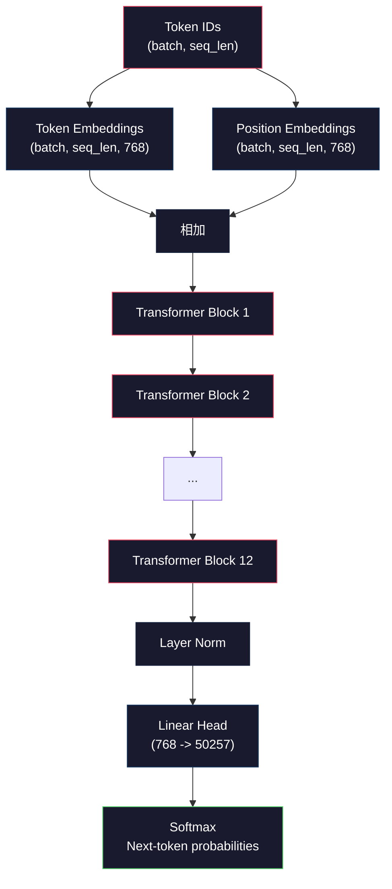
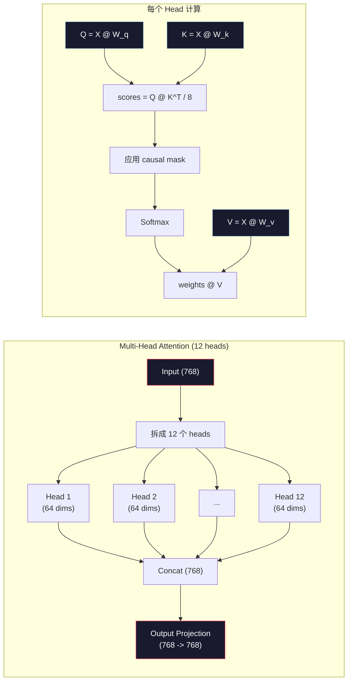
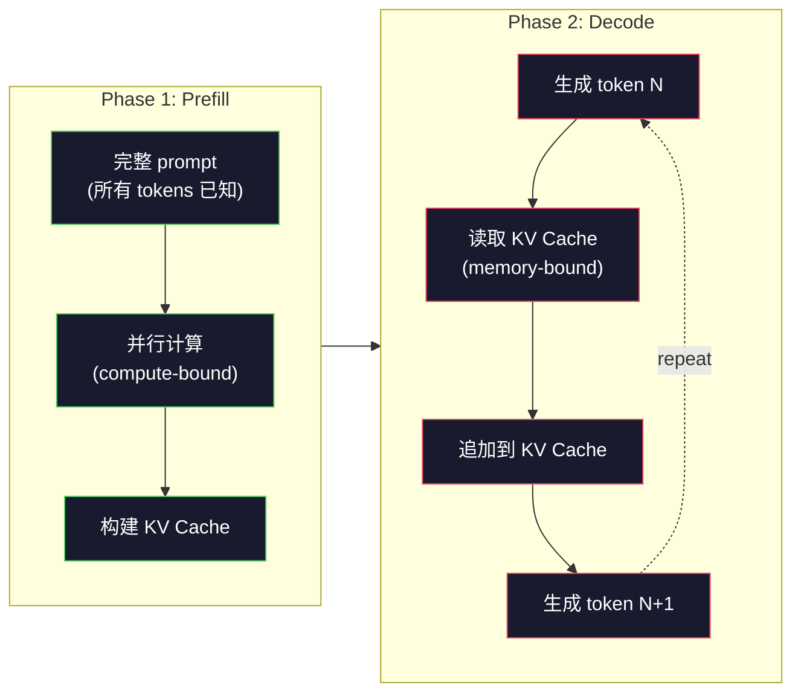

# 预训练一个 Mini GPT（1.24 亿参数）

> GPT-2 Small 有 1.24 亿个参数：12 个 transformer 层、12 个 attention heads，以及 768 维 embeddings。你可以在单张 GPU 上用几个小时从零训练它。大多数人从来不会这么做。他们直接使用预训练 checkpoint。但如果你没有亲手训练过一个模型，你其实并不了解自己正在构建产品的那个模型内部发生了什么。

**Type:** Build
**Languages:** Python (with numpy)
**Prerequisites:** Phase 10, Lessons 01-03 (Tokenizers, Building a Tokenizer, Data Pipelines)
**Time:** ~120 minutes

## 学习目标

- 从零实现完整的 GPT-2 架构（1.24 亿参数）：token embeddings、position embeddings、transformer blocks 和 language model head
- 使用 next-token prediction 和 cross-entropy loss 在文本语料上训练 GPT 模型
- 实现带 temperature sampling、top-k/top-p filtering 的 autoregressive text generation
- 监控 training loss curves，并验证模型确实学到了连贯的语言模式

## 问题

你知道 transformer 是什么。你读过那些图。你能背出 "attention is all you need"，也能在白板上画出标着 "Multi-Head Attention" 的方框。

这些都不代表你理解了模型生成文本时到底发生了什么。

GPT-2 Small（使用 weight tying）里有 124,438,272 个参数。每一个参数都是训练循环设置出来的：forward pass、计算 loss、backward pass、更新权重。12 个 transformer blocks。每个 block 里有 12 个 attention heads。768 维 embedding space。50,257 个 token 的词表。模型每生成一个 token，所有 1.24 亿个参数都会参与一条矩阵乘法链：它把一串 token IDs 变成下一个 token 的 probability distribution。

如果你从来没有亲手构建过它，你面对的就是一个黑盒。你可以调用 API。你可以 fine-tune。但当事情出错时，比如模型 hallucinate、重复自己、拒绝遵循 instructions，你没有一个能解释 *为什么* 的 mental model。

这一课从零构建 GPT-2 Small。不是用 PyTorch，而是用 numpy。每一次矩阵乘法都看得见。每一个 gradient 都由你的代码计算。你会亲眼看到 1.24 亿个数字如何合力预测下一个词。

## 概念

### GPT 架构

GPT 是 autoregressive language model。"Autoregressive" 的意思是：一次生成一个 token，每个 token 都以之前所有 token 为条件。这个架构是一叠 transformer decoder blocks。

从 token IDs 到 next-token probabilities 的完整 computation graph 如下：

1. Token IDs 输入。Shape: (batch_size, seq_len)。
2. Token embedding lookup。每个 ID 映射到一个 768 维向量。Shape: (batch_size, seq_len, 768)。
3. Position embedding lookup。每个位置（0, 1, 2, ...）映射到一个 768 维向量。Shape 相同。
4. 将 token embeddings 与 position embeddings 相加。
5. 通过 12 个 transformer blocks。
6. 最后的 layer normalization。
7. 线性投影到词表大小。Shape: (batch_size, seq_len, vocab_size)。
8. Softmax 得到概率。

这就是整个模型。没有 convolutions。没有 recurrence。只有 embeddings、attention、feedforward networks 和 layer norms，叠了 12 次。



### Transformer Block

12 个 block 都遵循同一个 pattern。它是 pre-norm architecture（GPT-2 使用 pre-norm，不是原始 transformer 的 post-norm）：

1. LayerNorm
2. Multi-Head Self-Attention
3. Residual connection（把输入加回来）
4. LayerNorm
5. Feed-Forward Network（MLP）
6. Residual connection（把输入加回来）

Residual connections 非常关键。没有它们，backpropagation 时 gradient 到达第 1 个 block 前就会消失。有了它们，gradient 可以通过 "skip" path 直接从 loss 流向任意 layer。这就是你能堆 12、32，甚至 96 个 blocks 的原因（传闻 GPT-4 使用了 120 个）。

### Attention：核心机制

Self-attention 允许每个 token 看向之前的每个 token，并决定应该对每一个关注多少。数学如下。

对每个 token position，从输入中计算三个向量：

- **Query (Q)**："我在找什么？"
- **Key (K)**："我包含什么？"
- **Value (V)**："我携带什么信息？"

```text
Q = input @ W_q    (768 -> 768)
K = input @ W_k    (768 -> 768)
V = input @ W_v    (768 -> 768)

attention_scores = Q @ K^T / sqrt(d_k)
attention_scores = mask(attention_scores)   # causal mask：未来位置为 -inf
attention_weights = softmax(attention_scores)
output = attention_weights @ V
```

Causal mask 让 GPT 成为 autoregressive model。位置 5 可以 attend to 位置 0-5，但不能看位置 6、7、8，依此类推。这可以防止模型在训练时通过偷看未来 token 来 "cheat"。

**Multi-head attention** 会把 768 维空间拆成 12 个 heads，每个 head 64 维。每个 head 学到一种不同的 attention pattern。一个 head 可能追踪 syntactic relationships（主谓一致）。另一个可能追踪 semantic similarity（同义关系）。另一个可能追踪 positional proximity（邻近词）。12 个 heads 的输出会 concat 起来，再投影回 768 维。



除以 sqrt(d_k)，也就是 sqrt(64) = 8，是 scaling。没有它，高维向量的 dot products 会变得很大，把 softmax 推到 gradient 几乎为 0 的区域。这是原始 "Attention Is All You Need" 论文里的关键洞见之一。

### KV Cache：为什么推理可以快起来

训练时，你一次处理整段 sequence。推理时，你一次生成一个 token。如果没有优化，生成第 N 个 token 需要重新计算前 N-1 个 token 的 attention。对每个生成 token 来说这是 O(N^2)，对长度为 N 的整段 sequence 来说总计 O(N^3)。

KV Cache 解决这个问题。为每个 token 计算出 K 和 V 后，把它们存起来。生成第 N+1 个 token 时，只需要为新 token 计算 Q，然后查出之前所有 token 缓存的 K 和 V。这样 K/V 计算的 per-token cost 从 O(N) 降到 O(1)。Attention score calculation 仍然是 O(N)，因为你仍要 attend to 所有之前的位置，但你避免了对输入做重复的矩阵乘法。

对 12 layers、12 heads 的 GPT-2 来说，KV cache 每个 token 要存储 2（K + V）x 12 layers x 12 heads x 64 dims = 18,432 个值。1024-token sequence 在 FP32 下大约是 75MB。对 128 layers 的 Llama 3 405B，单个 sequence 的 KV cache 可以超过 10GB。这就是为什么 long-context inference 是 memory-bound。

### Prefill vs Decode：推理的两个阶段

当你把 prompt 发给 LLM 时，推理会分成两个阶段。

**Prefill** 会并行处理整个 prompt。所有 token 已知，所以模型可以同时计算所有位置的 attention。这个阶段是 compute-bound，也就是 GPU 正在以满吞吐做矩阵乘法。在 A100 上，1000-token prompt 的 prefill 大约需要 20-50ms。

**Decode** 一次生成一个 token。每个新 token 都依赖之前所有 token。这个阶段是 memory-bound，也就是说瓶颈不是矩阵数学本身，而是从 GPU memory 读取模型权重和 KV cache。GPU compute cores 大多在等待 memory reads。对 GPT-2 来说，每个 decode step 的时间与 matmul 需要多少 FLOPs 关系不大，因为约束来自 memory bandwidth。

这个区别对 production systems 很重要。Prefill throughput 随 GPU compute 扩展（更多 FLOPS = 更快 prefill）。Decode throughput 随 memory bandwidth 扩展（更快 memory = 更快 decode）。这也是 NVIDIA H100 相比 A100 重点提升 memory bandwidth 的原因之一，它会直接加速 token generation。



### Training Loop

训练 LLM 就是 next-token prediction。给定 tokens [0, 1, 2, ..., N-1]，预测 tokens [1, 2, 3, ..., N]。Loss function 是模型预测的 probability distribution 与真实 next token 之间的 cross-entropy。

一次 training step：

1. **Forward pass**：让 batch 通过全部 12 个 blocks。得到每个位置的 logits（softmax 前的 scores）。
2. **Compute loss**：计算 logits 与 target tokens（input 向后平移一位）之间的 cross-entropy。
3. **Backward pass**：用 backpropagation 为全部 1.24 亿个参数计算 gradients。
4. **Optimizer step**：更新 weights。GPT-2 使用 Adam，并配合 learning rate warmup 和 cosine decay。

Learning rate schedule 的重要性可能比你想象得更高。GPT-2 在前 2,000 steps 中从 0 warm up 到 peak learning rate，然后按 cosine curve 衰减。一开始就使用很高的 learning rate 会让模型 diverge。后期一直保持高 learning rate 会导致 oscillation。Warmup-then-decay 这个 pattern 被所有主流 LLM 使用。

### GPT-2 Small：数字拆解

| Component | Shape | Parameters |
|-----------|-------|------------|
| Token embeddings | (50257, 768) | 38,597,376 |
| Position embeddings | (1024, 768) | 786,432 |
| Per-block attention (W_q, W_k, W_v, W_out) | 4 x (768, 768) | 2,359,296 |
| Per-block FFN (up + down) | (768, 3072) + (3072, 768) | 4,718,592 |
| Per-block LayerNorms (2x) | 2 x 768 x 2 | 3,072 |
| Final LayerNorm | 768 x 2 | 1,536 |
| **Total per block** | | **7,080,960** |
| **Total (12 blocks)** | | **85,054,464 + 39,383,808 = 124,438,272** |

Output projection（logits head）与 token embedding matrix 共享权重。这叫 weight tying。它减少了 3800 万个参数，也会提升性能，因为它迫使模型用同一个 representation space 来表示输入和输出。

## Build It

### Step 1：Embedding Layer

Token embeddings 把 50,257 个可能 token 中的每一个映射为一个 768 维向量。Position embeddings 增加每个 token 在 sequence 中位置的信息。两者相加。

```python
import numpy as np

class Embedding:
    def __init__(self, vocab_size, embed_dim, max_seq_len):
        self.token_embed = np.random.randn(vocab_size, embed_dim) * 0.02
        self.pos_embed = np.random.randn(max_seq_len, embed_dim) * 0.02

    def forward(self, token_ids):
        seq_len = token_ids.shape[-1]
        tok_emb = self.token_embed[token_ids]
        pos_emb = self.pos_embed[:seq_len]
        return tok_emb + pos_emb
```

初始化时使用 0.02 的 standard deviation 来自 GPT-2 paper。太大，初始 forward passes 会产生极端值，让训练不稳定。太小，所有输入的初始输出几乎相同，早期 gradient signals 会变得没用。

### Step 2：带 Causal Mask 的 Self-Attention

先做 single-head attention。Causal mask 会在 softmax 前把未来位置设为负无穷，确保每个位置只能 attend to 自己和更早的位置。

```python
def attention(Q, K, V, mask=None):
    d_k = Q.shape[-1]
    scores = Q @ K.transpose(0, -1, -2 if Q.ndim == 4 else 1) / np.sqrt(d_k)
    if mask is not None:
        scores = scores + mask
    weights = np.exp(scores - scores.max(axis=-1, keepdims=True))
    weights = weights / weights.sum(axis=-1, keepdims=True)
    return weights @ V
```

这个 softmax 实现会在 exponentiating 前减去最大值。没有这一步，exp(large_number) 会 overflow 到 infinity。这是一个 numerical stability 技巧，不会改变输出，因为对任何常数 c 都有 softmax(x - c) = softmax(x)。

### Step 3：Multi-Head Attention

把 768 维输入拆成 12 个 heads，每个 head 64 维。每个 head 独立计算 attention。把结果 concat 起来，再投影回 768 维。

```python
class MultiHeadAttention:
    def __init__(self, embed_dim, num_heads):
        self.num_heads = num_heads
        self.head_dim = embed_dim // num_heads
        self.W_q = np.random.randn(embed_dim, embed_dim) * 0.02
        self.W_k = np.random.randn(embed_dim, embed_dim) * 0.02
        self.W_v = np.random.randn(embed_dim, embed_dim) * 0.02
        self.W_out = np.random.randn(embed_dim, embed_dim) * 0.02

    def forward(self, x, mask=None):
        batch, seq_len, d = x.shape
        Q = (x @ self.W_q).reshape(batch, seq_len, self.num_heads, self.head_dim).transpose(0, 2, 1, 3)
        K = (x @ self.W_k).reshape(batch, seq_len, self.num_heads, self.head_dim).transpose(0, 2, 1, 3)
        V = (x @ self.W_v).reshape(batch, seq_len, self.num_heads, self.head_dim).transpose(0, 2, 1, 3)

        scores = Q @ K.transpose(0, 1, 3, 2) / np.sqrt(self.head_dim)
        if mask is not None:
            scores = scores + mask
        weights = np.exp(scores - scores.max(axis=-1, keepdims=True))
        weights = weights / weights.sum(axis=-1, keepdims=True)
        attn_out = weights @ V

        attn_out = attn_out.transpose(0, 2, 1, 3).reshape(batch, seq_len, d)
        return attn_out @ self.W_out
```

reshape-transpose-reshape 这段舞步是 multi-head attention 最容易让人困惑的地方。过程是这样的：(batch, seq_len, 768) tensor 先变成 (batch, seq_len, 12, 64)，再变成 (batch, 12, seq_len, 64)。现在 12 个 heads 各自都有一个 (seq_len, 64) matrix 来运行 attention。Attention 结束后，反向还原：(batch, 12, seq_len, 64) 变成 (batch, seq_len, 12, 64)，再变成 (batch, seq_len, 768)。

### Step 4：Transformer Block

一个完整 transformer block：LayerNorm、带 residual 的 multi-head attention、LayerNorm、带 residual 的 feedforward。

```python
class LayerNorm:
    def __init__(self, dim, eps=1e-5):
        self.gamma = np.ones(dim)
        self.beta = np.zeros(dim)
        self.eps = eps

    def forward(self, x):
        mean = x.mean(axis=-1, keepdims=True)
        var = x.var(axis=-1, keepdims=True)
        return self.gamma * (x - mean) / np.sqrt(var + self.eps) + self.beta


class FeedForward:
    def __init__(self, embed_dim, ff_dim):
        self.W1 = np.random.randn(embed_dim, ff_dim) * 0.02
        self.b1 = np.zeros(ff_dim)
        self.W2 = np.random.randn(ff_dim, embed_dim) * 0.02
        self.b2 = np.zeros(embed_dim)

    def forward(self, x):
        h = x @ self.W1 + self.b1
        h = np.maximum(0, h)  # GELU approximation: ReLU for simplicity
        return h @ self.W2 + self.b2


class TransformerBlock:
    def __init__(self, embed_dim, num_heads, ff_dim):
        self.ln1 = LayerNorm(embed_dim)
        self.attn = MultiHeadAttention(embed_dim, num_heads)
        self.ln2 = LayerNorm(embed_dim)
        self.ffn = FeedForward(embed_dim, ff_dim)

    def forward(self, x, mask=None):
        x = x + self.attn.forward(self.ln1.forward(x), mask)
        x = x + self.ffn.forward(self.ln2.forward(x))
        return x
```

Feedforward network 会把 768 维输入扩展到 3,072 维（4x），应用 nonlinearity，再投影回 768 维。这种 expand-contract pattern 给模型在每个位置上提供了一个更 "宽" 的 internal representation。GPT-2 使用 GELU activation，但这里为了简单使用 ReLU。对理解架构来说，两者差别不大。

### Step 5：完整 GPT Model

堆叠 12 个 transformer blocks。在前面加 embedding layer，在后面加 output projection。

```python
class MiniGPT:
    def __init__(self, vocab_size=50257, embed_dim=768, num_heads=12,
                 num_layers=12, max_seq_len=1024, ff_dim=3072):
        self.embedding = Embedding(vocab_size, embed_dim, max_seq_len)
        self.blocks = [
            TransformerBlock(embed_dim, num_heads, ff_dim)
            for _ in range(num_layers)
        ]
        self.ln_f = LayerNorm(embed_dim)
        self.vocab_size = vocab_size
        self.embed_dim = embed_dim

    def forward(self, token_ids):
        seq_len = token_ids.shape[-1]
        mask = np.triu(np.full((seq_len, seq_len), -1e9), k=1)

        x = self.embedding.forward(token_ids)
        for block in self.blocks:
            x = block.forward(x, mask)
        x = self.ln_f.forward(x)

        logits = x @ self.embedding.token_embed.T
        return logits

    def count_parameters(self):
        total = 0
        total += self.embedding.token_embed.size
        total += self.embedding.pos_embed.size
        for block in self.blocks:
            total += block.attn.W_q.size + block.attn.W_k.size
            total += block.attn.W_v.size + block.attn.W_out.size
            total += block.ffn.W1.size + block.ffn.b1.size
            total += block.ffn.W2.size + block.ffn.b2.size
            total += block.ln1.gamma.size + block.ln1.beta.size
            total += block.ln2.gamma.size + block.ln2.beta.size
        total += self.ln_f.gamma.size + self.ln_f.beta.size
        return total
```

注意这里的 weight tying：`logits = x @ self.embedding.token_embed.T`。Output projection 复用了 token embedding matrix（转置后）。这不只是一个节省参数的小技巧。它意味着模型使用同一个 vector space 来理解 tokens（embeddings）并预测它们（output）。

### Step 6：Training Loop

如果真的要训练 1.24 亿参数，你需要 GPU 和 PyTorch。这里的 training loop 用一个可以在纯 numpy 中运行的小模型来展示机制。我们使用 tiny model（4 layers、4 heads、128 dims），让它可运行。

```python
def cross_entropy_loss(logits, targets):
    batch, seq_len, vocab_size = logits.shape
    logits_flat = logits.reshape(-1, vocab_size)
    targets_flat = targets.reshape(-1)

    max_logits = logits_flat.max(axis=-1, keepdims=True)
    log_softmax = logits_flat - max_logits - np.log(
        np.exp(logits_flat - max_logits).sum(axis=-1, keepdims=True)
    )

    loss = -log_softmax[np.arange(len(targets_flat)), targets_flat].mean()
    return loss


def train_mini_gpt(text, vocab_size=256, embed_dim=128, num_heads=4,
                   num_layers=4, seq_len=64, num_steps=200, lr=3e-4):
    tokens = np.array(list(text.encode("utf-8")[:2048]))
    model = MiniGPT(
        vocab_size=vocab_size, embed_dim=embed_dim, num_heads=num_heads,
        num_layers=num_layers, max_seq_len=seq_len, ff_dim=embed_dim * 4
    )

    print(f"Model parameters: {model.count_parameters():,}")
    print(f"Training tokens: {len(tokens):,}")
    print(f"Config: {num_layers} layers, {num_heads} heads, {embed_dim} dims")
    print()

    for step in range(num_steps):
        start_idx = np.random.randint(0, max(1, len(tokens) - seq_len - 1))
        batch_tokens = tokens[start_idx:start_idx + seq_len + 1]

        input_ids = batch_tokens[:-1].reshape(1, -1)
        target_ids = batch_tokens[1:].reshape(1, -1)

        logits = model.forward(input_ids)
        loss = cross_entropy_loss(logits, target_ids)

        if step % 20 == 0:
            print(f"Step {step:4d} | Loss: {loss:.4f}")

    return model
```

Loss 一开始接近 ln(vocab_size)。对 256-token byte-level vocabulary 来说，也就是 ln(256) = 5.55。Random model 会给每个 token 分配相同概率。随着训练推进，loss 会下降，因为模型学会预测常见 pattern：比如 "t" 后面的 "h"，句号后的空格，等等。

在 production 中，你会使用 Adam optimizer，并配合 gradient accumulation、learning rate warmup 和 gradient clipping。Forward-pass-loss-backward-update 这个 loop 完全相同，只是 optimizer 更复杂。

### Step 7：Text Generation

Generation 使用训练好的模型一次预测一个 token。每次 prediction 都从 output distribution 中采样（或者 greedily 取 argmax）。

```python
def generate(model, prompt_tokens, max_new_tokens=100, temperature=0.8):
    tokens = list(prompt_tokens)
    seq_len = model.embedding.pos_embed.shape[0]

    for _ in range(max_new_tokens):
        context = np.array(tokens[-seq_len:]).reshape(1, -1)
        logits = model.forward(context)
        next_logits = logits[0, -1, :]

        next_logits = next_logits / temperature
        probs = np.exp(next_logits - next_logits.max())
        probs = probs / probs.sum()

        next_token = np.random.choice(len(probs), p=probs)
        tokens.append(next_token)

    return tokens
```

Temperature 控制 randomness。Temperature 1.0 使用原始 distribution。Temperature 0.5 会让它更 sharp（更 deterministic，也就是模型更常选择 top choices）。Temperature 1.5 会让它更 flat（更 random，也就是 low-probability tokens 获得更大机会）。Temperature 0.0 是 greedy decoding（永远选择最高概率 token）。

`tokens[-seq_len:]` 这个窗口是必要的，因为模型有最大 context length（GPT-2 是 1024）。超过之后，你必须丢掉最老的 tokens。这就是大家常说的 "context window"。

```figure
sampling-decoder
```

## Use It

### 完整训练与生成 Demo

```python
corpus = """The transformer architecture has revolutionized natural language processing.
Attention mechanisms allow the model to focus on relevant parts of the input.
Self-attention computes relationships between all pairs of positions in a sequence.
Multi-head attention splits the representation into multiple subspaces.
Each attention head can learn different types of relationships.
The feedforward network provides nonlinear transformations at each position.
Residual connections enable gradient flow through deep networks.
Layer normalization stabilizes training by normalizing activations.
Position embeddings give the model information about token ordering.
The causal mask ensures autoregressive generation during training.
Pre-training on large text corpora teaches the model general language understanding.
Fine-tuning adapts the pre-trained model to specific downstream tasks."""

model = train_mini_gpt(corpus, num_steps=200)

prompt = list("The transformer".encode("utf-8"))
output_tokens = generate(model, prompt, max_new_tokens=100, temperature=0.8)
generated_text = bytes(output_tokens).decode("utf-8", errors="replace")
print(f"\nGenerated: {generated_text}")
```

在小语料和小模型上，生成文本最多只能算半连贯。它会从训练文本中学到一些 byte-level patterns，但无法像 GPT-2 那样，利用 40GB training data 和完整 1.24 亿参数架构进行泛化。重点不是输出质量。重点是你能追踪每一步：embedding lookup、attention computation、feedforward transformation、logit projection、softmax 和 sampling。每个操作都看得见。

## Ship It

这一课产出 `outputs/prompt-gpt-architecture-analyzer.md`：一个用于分析任意 GPT-style model 架构选择的 prompt。把 model card 或 technical report 交给它，它会拆解 parameter allocation、attention design 和 scaling decisions。

## 练习

1. 把模型改成 24 layers、16 heads，而不是 12/12。统计参数量。把 depth 翻倍与把 width（embedding dimension）翻倍相比，有什么差异？

2. 实现 GELU activation function（GELU(x) = x * 0.5 * (1 + erf(x / sqrt(2))))，并替换 feedforward network 里的 ReLU。每种 activation 都训练 500 steps，比较最终 loss。

3. 给 generation function 加 KV cache。第一次 forward pass 后，为每个 layer 存储 K 和 V tensors，并在后续 tokens 中复用它们。测量 speedup：分别在有 cache 和无 cache 的情况下生成 200 tokens，比较 wall-clock time。

4. 实现 top-k sampling（只考虑概率最高的 k 个 tokens）和 top-p sampling（nucleus sampling：考虑累计概率超过 p 的最小 token 集合）。在 temperature 0.8 下比较 top-k=50 与 top-p=0.95 的输出质量。

5. 构建 training loss curve plotter。训练模型 1000 steps，并绘制 loss vs step。识别三个阶段：快速初始下降（学习常见 bytes）、较慢的中间阶段（学习 byte patterns）和 plateau（在小语料上 overfitting）。无论你训练的是 128-dim model 还是 GPT-4，这条曲线的形状都相同。

## 关键术语

| Term | 大家常说 | 实际含义 |
|------|----------|----------|
| Autoregressive | "一次生成一个词" | 每个输出 token 都以之前所有 token 为条件：模型预测 P(token_n \| token_0, ..., token_{n-1}) |
| Causal mask | "它看不到未来" | 一个由负无穷值组成的 upper-triangular matrix，用于阻止训练时 attention 到未来位置 |
| Multi-head attention | "多种 attention patterns" | 把 Q、K、V 拆成并行 heads（例如 GPT-2 的 12 个 64 维 heads），让每个 head 学不同类型的关系 |
| KV Cache | "为了速度做缓存" | 存储之前 tokens 已计算的 Key 和 Value tensors，避免 autoregressive generation 中的重复计算 |
| Prefill | "处理 prompt" | 推理的第一个阶段，所有 prompt tokens 并行处理；在 GPU FLOPS 上 compute-bound |
| Decode | "生成 tokens" | 推理的第二个阶段，一次生成一个 token；在 GPU bandwidth 上 memory-bound |
| Weight tying | "共享 embeddings" | 对 input token embeddings 和 output projection head 使用同一个 matrix；GPT-2 中节省 3800 万参数 |
| Residual connection | "Skip connection" | 把输入直接加到 sublayer 的输出上（x + sublayer(x)）；让 deep networks 中的 gradient 能流动 |
| Layer normalization | "归一化 activations" | 沿 feature dimension 归一化到 mean 0、variance 1，并带有可学习 scale 与 bias parameters |
| Cross-entropy loss | "预测错得有多离谱" | -log(分配给正确 next token 的概率)，对所有位置取平均；标准 LLM training objective |

## 延伸阅读

- [Radford et al., 2019 -- "Language Models are Unsupervised Multitask Learners" (GPT-2)](https://cdn.openai.com/better-language-models/language_models_are_unsupervised_multitask_learners.pdf) -- 介绍 1.24 亿到 15 亿参数 GPT-2 family 的论文。
- [Vaswani et al., 2017 -- "Attention Is All You Need"](https://arxiv.org/abs/1706.03762) -- 原始 transformer 论文，提出 scaled dot-product attention 和 multi-head attention。
- [Llama 3 Technical Report](https://arxiv.org/abs/2407.21783) -- Meta 如何用 16K GPUs 把 GPT 架构扩展到 405B 参数。
- [Pope et al., 2022 -- "Efficiently Scaling Transformer Inference"](https://arxiv.org/abs/2211.05102) -- 形式化分析 prefill vs decode 和 KV cache 的论文。
