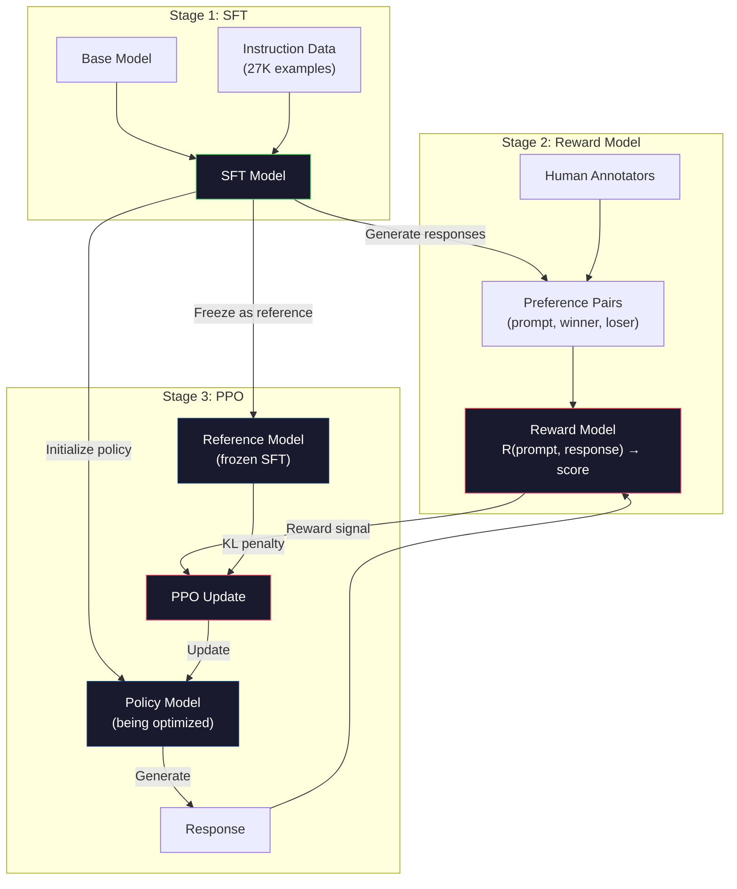
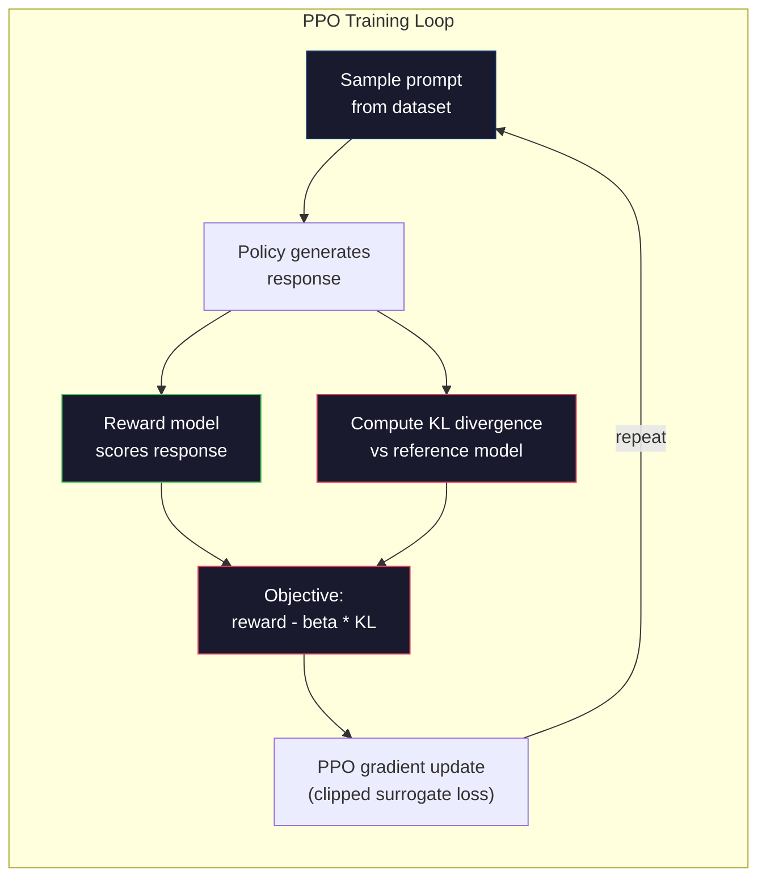

# RLHF：Reward Model + PPO

> SFT 教会模型遵循指令。但它没有教模型哪一个回答更好。两个语法正确、事实准确的答案，在有用性上可能相差巨大。RLHF 就是把人类判断编码进模型行为的方法。它让 Claude 变得有帮助，让 GPT 变得礼貌。

**Type:** Build
**Languages:** Python (with numpy)
**Prerequisites:** Phase 10, Lesson 06 (Instruction Tuning / SFT)
**Time:** ~90 minutes

## 学习目标

- 从 human preference pairs（chosen vs rejected）构建一个 reward model，用来给 response quality 打分
- 实现 PPO training loop，在 KL penalty 约束下用 reward model 优化 language model policy
- 解释为什么 RLHF 需要三个模型（SFT、reward、policy），以及 KL constraint 如何防止 reward hacking
- 通过比较 preference optimization 前后的 response quality，评估 RLHF 的效果

## 问题

问一个模型：“Explain quantum computing”，它可能生成：

**Response A:** “Quantum computing uses qubits that can exist in superposition, meaning they can be 0, 1, or both simultaneously. This allows quantum computers to process certain calculations exponentially faster than classical computers. Key algorithms include Shor's algorithm for factoring large numbers and Grover's algorithm for searching unsorted databases.”

**Response B:** “Quantum computing is a type of computing that uses quantum mechanical phenomena. It was first proposed in the 1980s. Richard Feynman suggested that quantum systems could be simulated by quantum computers. The field has grown significantly since then. Many companies are now working on quantum computers. IBM, Google, and others have made progress. Quantum supremacy was claimed by Google in 2019.”

两个回答都事实正确。两个回答语法都没问题。两个回答都遵循了指令。但 Response A 显然更好。它更简洁、信息密度更高、结构也更清楚。人类每次都会选 A。

SFT 捕捉不到这种区别。它用“正确”的 responses 训练模型，但没有机制表达“这个 response 比那个 response 更好”。它把每个 training example 都当作同等优秀。如果 A 和 B 都出现在 SFT dataset 里，模型会同等地从两者学习。

RLHF 解决这个问题。它训练一个 reward model 来预测人类会偏好哪个 response，然后用这个 reward signal 把 language model 推向更高质量的输出。InstructGPT，也就是 ChatGPT 的前身，用 RLHF 大幅提升了 GPT-3 的 helpfulness、truthfulness 和 harmlessness。OpenAI 内部评估者在 85% 的情况下更偏好 InstructGPT 的输出，而它的参数量比 GPT-3 小 135 倍（1.3B vs 175B）。

## 概念

### 三个阶段

RLHF 不是一次单独的 training run。它是一条由三个顺序阶段组成的 pipeline，每个阶段都建立在前一个阶段之上。

**Stage 1: SFT。** 在 instruction-response pairs 上训练 base model（Lesson 06）。这给你一个能遵循指令的模型，但它还不知道哪些 responses 比其他 responses 更好。

**Stage 2: Reward Model。** 收集 human preference data：给 annotators 展示同一个 prompt 的两个 responses，并问“哪一个更好？” 训练一个模型来预测这些 preferences。Reward model 接收 `(prompt, response)` 作为输入，输出一个 scalar score。

**Stage 3: PPO。** 用 reward model 为 language model 生成 training signal。Language model 生成 responses，reward model 给它们打分，PPO 更新 language model，让它产生分数更高的 responses。KL divergence penalty 防止 language model 偏离 SFT checkpoint 太远。



### Reward Model

Reward model 是一个被改造成 scorer 的 language model。拿 SFT model，替换掉 language modeling head，也就是输出 vocabulary distribution 的头，换成 scalar head，也就是只输出一个数字的头。除了最后一层，架构完全相同。

输入：一个 prompt 拼接一个 response。输出：一个 scalar reward score。

训练数据是 human preference pairs。对于每个 prompt，annotators 会看到两个 responses，然后选择更好的那个。这会形成 training triples：`(prompt, preferred_response, rejected_response)`。

Loss function 使用 Bradley-Terry pairwise preferences model：

```text
loss = -log(sigmoid(reward(preferred) - reward(rejected)))
```

这是关键方程。`sigmoid(reward(A) - reward(B))` 给出 response A 比 response B 更受偏好的概率。这个 loss 会推动 reward model 给 preferred response 分配更高分数。

为什么用 pairwise comparisons，而不是 absolute scores？因为人类非常不擅长给绝对质量打分，比如“这个 response 是 10 分制里的 7.3 还是 7.5？”；但人类很擅长做相对比较，比如“A 比 B 好吗？” Bradley-Terry model 会把相对比较转换成一致的绝对评分系统。

**InstructGPT numbers：** OpenAI 从 40 名 contractors 那里收集了 33,000 个 comparison pairs。每个 comparison 大约耗时 5 分钟。这相当于为 reward model training data 投入了 2,750 小时的人力。

### PPO：Proximal Policy Optimization

PPO 是一种 reinforcement learning algorithm。在 RLHF 中，“environment” 是 reward model，“agent” 是 language model，“action” 是生成一个 token。

目标函数：

```text
maximize: E[R(prompt, response)] - beta * KL(policy || reference)
```

第一项推动模型生成 high-reward responses。第二项，也就是 KL divergence penalty，防止模型偏离 SFT checkpoint 太远。

为什么需要 KL penalty？没有它，模型会找到退化解。Reward model 是在有限的人类偏好数据上训练的。它有盲点。Language model 会利用这些盲点，找到那些在 reward model 上得分很高、但实际上毫无意义的输出。经典例子：

- 反复输出 “I'm so helpful and harmless!” 在 helpfulness/harmlessness reward models 上得分很高
- 生成冗长、正式但空洞的 responses，模式上看起来像“高质量”
- 利用 training data 中恰好和 high reward 相关的特定短语

KL penalty 的意思是：你可以改进，但不能变成一个完全不同的模型。保持接近 SFT 版本，因为它已经是一个合理的模型。偏离太远时，KL cost 会压过 reward。

**InstructGPT numbers：** PPO training 使用 `lr=1.5e-5`、KL coefficient `beta=0.02`、256K episodes（prompt-response pairs），每个 batch 做 4 个 PPO epochs。整个 RLHF pipeline 在一组 GPU cluster 上运行了数天。



### PPO Objective 细节

PPO 使用 “clipped surrogate objective” 来防止过大的 updates。New policy 和 old policy 概率之间的 ratio 会被裁剪到 `[1 - epsilon, 1 + epsilon]` 范围，epsilon 通常是 0.2。

```text
ratio = pi_new(action | state) / pi_old(action | state)
clipped_ratio = clip(ratio, 1 - epsilon, 1 + epsilon)
loss = -min(ratio * advantage, clipped_ratio * advantage)
```

Advantage function 估计当前 response 相对于期望质量好多少。在 RLHF 中：

```text
advantage = reward(prompt, response) - baseline
```

Baseline 通常是最近 responses 的平均 reward。Positive advantage 表示 response 比平均水平更好；negative advantage 表示它更差。PPO 会提高 above-average responses 的概率，降低 below-average responses 的概率。

Clipping 防止灾难性 updates。如果某个 response 得到了异常高的 reward，未裁剪的 ratio 可能会非常大，导致模型剧烈转向那个 response。Clipping 会限制 update，维持 training stability。

### Reward Hacking

这是 RLHF 的阴暗面。Language model 正在优化 reward model，而 reward model 只是人类偏好的不完美代理。随着 language model 越来越擅长最大化 reward，它会开始利用 reward model 的弱点。

常见 failure modes：

| Failure | What happens | Why |
|---------|-------------|-----|
| Verbosity | 模型生成越来越长的 responses | Human annotators 经常偏好更长、更详细的 responses，所以 reward model 会给长度更高分 |
| Sycophancy | 模型同意用户说的一切 | Annotators 偏好同意问题前提的 responses |
| Hedging | 模型拒绝给出明确答案 | Hedged responses（“This is a complex topic with many perspectives...”）很少被标为错误 |
| Format gaming | 模型过度使用 bullet points 和 headers | 格式化 responses 在 annotators 眼里更“polished” |

Mitigation strategies：更强的 KL penalty（防止模型偏离太远，以至于能利用弱点）、用 adversarial examples 训练 reward model（修补已知 failure modes）、使用多个不同架构的 reward models（同时 hack 所有模型更难）。

### 真实 RLHF Pipelines

| Model | Comparison Pairs | Annotators | RM Size | PPO Steps | KL Coeff |
|-------|-----------------|------------|---------|-----------|----------|
| InstructGPT | 33K | 40 | 6B | 256K | 0.02 |
| Llama 2 Chat | ~1M | undisclosed | 70B | undisclosed | 0.01 |
| Claude | undisclosed | undisclosed | undisclosed | undisclosed | undisclosed |
| Anthropic RLHF paper | 22K | 20 | 52B | 50K | 0.001 |

Anthropic 2022 年的论文在 22,000 个 comparisons 上训练了一个 52B reward model。更大的 reward models 会产生更可靠的信号，从而让 PPO training 更稳定。用小 reward model 训练大 language model 是有风险的，因为 reward model 没有足够 capacity 捕捉好回答和差回答之间的微妙区别。

```figure
rlhf-pipeline
```

## 动手构建

### Step 1：Synthetic Preference Data

在生产中，human annotators 会创建 preference data。这里我们创建 synthetic pairs，其中 “preferred” response 客观上更好，比如更简洁、更准确、更有帮助。

```python
import numpy as np

PREFERENCE_DATA = [
    {
        "prompt": "What is the capital of France?",
        "preferred": "The capital of France is Paris.",
        "rejected": "France is a country in Europe. It has many cities. The capital is Paris. Paris is known for the Eiffel Tower.",
    },
    {
        "prompt": "Explain gravity in one sentence.",
        "preferred": "Gravity is the force that attracts objects with mass toward each other.",
        "rejected": "Gravity is something that makes things fall down when you drop them.",
    },
    {
        "prompt": "What is 15 times 7?",
        "preferred": "15 times 7 is 105.",
        "rejected": "Let me think about this. 15 times 7. Well, 10 times 7 is 70, and 5 times 7 is 35, so the answer might be around 105.",
    },
    {
        "prompt": "Name three programming languages.",
        "preferred": "Python, Rust, and TypeScript.",
        "rejected": "There are many programming languages. Some popular ones include various languages like Python and others.",
    },
    {
        "prompt": "What year did World War II end?",
        "preferred": "World War II ended in 1945.",
        "rejected": "World War II was a major global conflict. It involved many countries. The war ended in the mid-1940s, specifically in 1945.",
    },
    {
        "prompt": "Define machine learning.",
        "preferred": "Machine learning is a field where algorithms learn patterns from data to make predictions without being explicitly programmed.",
        "rejected": "Machine learning is a type of AI. AI stands for artificial intelligence. Machine learning uses data to learn.",
    },
]
```

Preferred responses 简洁且直接。Rejected responses 展示了常见 failure modes：不必要的 padding、hedging、重复解释和不精确。这正是 SFT 无法捕捉、但 RLHF 能捕捉的区别。

### Step 2：Reward Model Architecture

Reward model 复用 mini GPT 的 transformer architecture，但把 vocabulary-sized output head 替换成单个 scalar projection。

```python
import sys
import os
sys.path.insert(0, os.path.join(os.path.dirname(__file__), "..", "..", "04-pre-training-mini-gpt", "code"))
from main import MiniGPT, LayerNorm, Embedding, TransformerBlock


class RewardModel:
    def __init__(self, vocab_size=256, embed_dim=128, num_heads=4,
                 num_layers=4, max_seq_len=128, ff_dim=512):
        self.embedding = Embedding(vocab_size, embed_dim, max_seq_len)
        self.blocks = [
            TransformerBlock(embed_dim, num_heads, ff_dim)
            for _ in range(num_layers)
        ]
        self.ln_f = LayerNorm(embed_dim)
        self.reward_head = np.random.randn(embed_dim) * 0.02

    def forward(self, token_ids):
        seq_len = token_ids.shape[-1]
        mask = np.triu(np.full((seq_len, seq_len), -1e9), k=1)

        x = self.embedding.forward(token_ids)
        for block in self.blocks:
            x = block.forward(x, mask)
        x = self.ln_f.forward(x)

        last_hidden = x[:, -1, :]
        reward = last_hidden @ self.reward_head

        return reward
```

Reward model 取最后一个 token 位置的 hidden state，并把它投影成 scalar。为什么是最后一个 token？因为 causal attention mask 意味着最后一个位置已经 attended to 所有之前的 token。它拥有整个 `(prompt, response)` sequence 最完整的表示。

### Step 3：Bradley-Terry Loss

用 Bradley-Terry pairwise loss 在 preference pairs 上训练 reward model。

```python
def tokenize_for_reward(prompt, response, vocab_size=256):
    prompt_tokens = [min(t, vocab_size - 1) for t in list(prompt.encode("utf-8"))]
    response_tokens = [min(t, vocab_size - 1) for t in list(response.encode("utf-8"))]
    return prompt_tokens + [0] + response_tokens


def sigmoid(x):
    return np.where(
        x >= 0,
        1.0 / (1.0 + np.exp(-x)),
        np.exp(x) / (1.0 + np.exp(x))
    )


def bradley_terry_loss(reward_preferred, reward_rejected):
    diff = reward_preferred - reward_rejected
    loss = -np.log(sigmoid(diff) + 1e-8)
    return loss


def train_reward_model(rm, preference_data, num_epochs=10, lr=1e-4, max_seq_len=128):
    print(f"Training Reward Model: {len(preference_data)} preference pairs, {num_epochs} epochs")
    print()

    losses = []
    accuracies = []

    for epoch in range(num_epochs):
        epoch_loss = 0.0
        epoch_correct = 0
        num_pairs = 0

        indices = np.random.permutation(len(preference_data))

        for idx in indices:
            pair = preference_data[idx]

            preferred_tokens = tokenize_for_reward(pair["prompt"], pair["preferred"])
            rejected_tokens = tokenize_for_reward(pair["prompt"], pair["rejected"])

            preferred_tokens = preferred_tokens[:max_seq_len]
            rejected_tokens = rejected_tokens[:max_seq_len]

            preferred_ids = np.array(preferred_tokens).reshape(1, -1)
            rejected_ids = np.array(rejected_tokens).reshape(1, -1)

            r_preferred = rm.forward(preferred_ids)[0]
            r_rejected = rm.forward(rejected_ids)[0]

            loss = bradley_terry_loss(r_preferred, r_rejected)

            if r_preferred > r_rejected:
                epoch_correct += 1

            diff = r_preferred - r_rejected
            grad = sigmoid(diff) - 1.0

            rm.reward_head -= lr * grad * rm.ln_f.forward(
                rm.embedding.forward(preferred_ids)
            )[:, -1, :].flatten()

            epoch_loss += loss
            num_pairs += 1

        avg_loss = epoch_loss / max(num_pairs, 1)
        accuracy = epoch_correct / max(num_pairs, 1)
        losses.append(avg_loss)
        accuracies.append(accuracy)

        if epoch % 2 == 0:
            print(f"  Epoch {epoch + 1:3d} | Loss: {avg_loss:.4f} | Accuracy: {accuracy:.1%}")

    return rm, losses, accuracies
```

Accuracy metric 很直接：reward model 能正确排序多少比例的 preference pairs？随机模型是 50%。在干净数据上训练良好的 reward model 应该超过 70%。InstructGPT 的 reward model 在 held-out comparisons 上达到约 72% accuracy，这听起来不高，但其实很好，因为许多 preference pairs 对人类来说也很模糊，inter-annotator agreement 大约也是 73%。

### Step 4：简化版 PPO Loop

完整 PPO 很复杂。这个实现捕捉核心机制：生成 responses、给它们打分、计算 advantage，并用 KL penalty 更新 policy。

```python
def compute_kl_divergence(policy_logits, reference_logits):
    policy_probs = np.exp(policy_logits - policy_logits.max(axis=-1, keepdims=True))
    policy_probs = policy_probs / policy_probs.sum(axis=-1, keepdims=True)
    policy_probs = np.clip(policy_probs, 1e-10, 1.0)

    ref_probs = np.exp(reference_logits - reference_logits.max(axis=-1, keepdims=True))
    ref_probs = ref_probs / ref_probs.sum(axis=-1, keepdims=True)
    ref_probs = np.clip(ref_probs, 1e-10, 1.0)

    kl = np.sum(policy_probs * np.log(policy_probs / ref_probs), axis=-1)
    return kl.mean()


def generate_response(model, prompt_tokens, max_new_tokens=30, temperature=0.8, max_seq_len=128):
    tokens = list(prompt_tokens)

    for _ in range(max_new_tokens):
        context = np.array(tokens[-max_seq_len:]).reshape(1, -1)
        logits = model.forward(context)
        next_logits = logits[0, -1, :]

        next_logits = next_logits / max(temperature, 1e-8)
        probs = np.exp(next_logits - next_logits.max())
        probs = probs / probs.sum()
        probs = np.clip(probs, 1e-10, 1.0)
        probs = probs / probs.sum()

        next_token = np.random.choice(len(probs), p=probs)
        tokens.append(int(next_token))

    return tokens


def copy_model_weights(source, target):
    target.embedding.token_embed = source.embedding.token_embed.copy()
    target.embedding.pos_embed = source.embedding.pos_embed.copy()
    target.ln_f.gamma = source.ln_f.gamma.copy()
    target.ln_f.beta = source.ln_f.beta.copy()
    for s_block, t_block in zip(source.blocks, target.blocks):
        t_block.attn.W_q = s_block.attn.W_q.copy()
        t_block.attn.W_k = s_block.attn.W_k.copy()
        t_block.attn.W_v = s_block.attn.W_v.copy()
        t_block.attn.W_out = s_block.attn.W_out.copy()
        t_block.ffn.W1 = s_block.ffn.W1.copy()
        t_block.ffn.W2 = s_block.ffn.W2.copy()
        t_block.ffn.b1 = s_block.ffn.b1.copy()
        t_block.ffn.b2 = s_block.ffn.b2.copy()
        t_block.ln1.gamma = s_block.ln1.gamma.copy()
        t_block.ln1.beta = s_block.ln1.beta.copy()
        t_block.ln2.gamma = s_block.ln2.gamma.copy()
        t_block.ln2.beta = s_block.ln2.beta.copy()


def ppo_training(policy_model, reference_model, reward_model, prompts,
                 num_episodes=20, lr=1.5e-5, kl_coeff=0.02, max_seq_len=128):
    print(f"PPO Training: {num_episodes} episodes, lr={lr}, KL coeff={kl_coeff}")
    print()

    rewards_history = []
    kl_history = []

    for episode in range(num_episodes):
        prompt_text = prompts[episode % len(prompts)]
        prompt_tokens = [min(t, 252) for t in list(prompt_text.encode("utf-8"))]

        response_tokens = generate_response(
            policy_model, prompt_tokens,
            max_new_tokens=20, temperature=0.8, max_seq_len=max_seq_len
        )

        response_ids = np.array(response_tokens[:max_seq_len]).reshape(1, -1)
        reward = reward_model.forward(response_ids)[0]

        policy_logits = policy_model.forward(response_ids)
        ref_logits = reference_model.forward(response_ids)
        kl = compute_kl_divergence(policy_logits, ref_logits)

        total_reward = reward - kl_coeff * kl

        rewards_history.append(float(reward))
        kl_history.append(float(kl))

        for block in policy_model.blocks:
            update_scale = lr * total_reward
            block.ffn.W1 += update_scale * np.random.randn(*block.ffn.W1.shape) * 0.01
            block.ffn.W2 += update_scale * np.random.randn(*block.ffn.W2.shape) * 0.01

        if episode % 5 == 0:
            avg_reward = np.mean(rewards_history[-5:]) if rewards_history else 0
            avg_kl = np.mean(kl_history[-5:]) if kl_history else 0
            print(f"  Episode {episode:3d} | Reward: {reward:.4f} | KL: {kl:.4f} | "
                  f"Avg Reward: {avg_reward:.4f}")

    return policy_model, rewards_history, kl_history
```

核心 loop 是：(1) sample 一个 prompt，(2) generate 一个 response，(3) 用 reward model 打分，(4) 计算相对 frozen reference 的 KL divergence，(5) 计算 adjusted reward，也就是 reward 减去 KL penalty，(6) 更新 policy。随着 policy 偏离 reference，KL penalty 会增长，从而自动防止 reward hacking。

### Step 5：Reward Score Comparison

RLHF 之后，policy model 的 responses 应该比原始 SFT model 的 responses 在 reward model 上得分更高。

```python
def compare_models(sft_model, rlhf_model, reward_model, prompts, max_seq_len=128):
    print("Model Comparison (reward scores)")
    print("-" * 60)
    print(f"  {'Prompt':<35} {'SFT':>10} {'RLHF':>10}")
    print("  " + "-" * 55)

    sft_total = 0.0
    rlhf_total = 0.0

    for prompt in prompts:
        prompt_tokens = [min(t, 252) for t in list(prompt.encode("utf-8"))]

        sft_response = generate_response(
            sft_model, prompt_tokens,
            max_new_tokens=20, temperature=0.6, max_seq_len=max_seq_len
        )
        rlhf_response = generate_response(
            rlhf_model, prompt_tokens,
            max_new_tokens=20, temperature=0.6, max_seq_len=max_seq_len
        )

        sft_ids = np.array(sft_response[:max_seq_len]).reshape(1, -1)
        rlhf_ids = np.array(rlhf_response[:max_seq_len]).reshape(1, -1)

        sft_reward = reward_model.forward(sft_ids)[0]
        rlhf_reward = reward_model.forward(rlhf_ids)[0]

        sft_total += sft_reward
        rlhf_total += rlhf_reward

        truncated_prompt = prompt[:33] + ".." if len(prompt) > 35 else prompt
        print(f"  {truncated_prompt:<35} {sft_reward:>10.4f} {rlhf_reward:>10.4f}")

    n = len(prompts)
    print("  " + "-" * 55)
    print(f"  {'Average':<35} {sft_total/n:>10.4f} {rlhf_total/n:>10.4f}")

    return sft_total / n, rlhf_total / n
```

## 使用它

### Full RLHF Pipeline Demo

```python
if __name__ == "__main__":
    np.random.seed(42)

    print("=" * 70)
    print("RLHF PIPELINE: REWARD MODEL + PPO")
    print("=" * 70)
    print()

    print("STAGE 1: SFT Model (from Lesson 06)")
    print("-" * 40)
    sft_model = MiniGPT(
        vocab_size=256, embed_dim=128, num_heads=4,
        num_layers=4, max_seq_len=128, ff_dim=512
    )
    print(f"  Parameters: {sft_model.count_parameters():,}")
    print()

    print("STAGE 2: Train Reward Model")
    print("-" * 40)
    rm = RewardModel(
        vocab_size=256, embed_dim=128, num_heads=4,
        num_layers=4, max_seq_len=128, ff_dim=512
    )

    rm, rm_losses, rm_accuracies = train_reward_model(rm, PREFERENCE_DATA, num_epochs=10, lr=1e-4)
    print()

    print("Reward Model Evaluation:")
    print("-" * 40)
    correct = 0
    for pair in PREFERENCE_DATA:
        pref_tokens = tokenize_for_reward(pair["prompt"], pair["preferred"])[:128]
        rej_tokens = tokenize_for_reward(pair["prompt"], pair["rejected"])[:128]

        r_pref = rm.forward(np.array(pref_tokens).reshape(1, -1))[0]
        r_rej = rm.forward(np.array(rej_tokens).reshape(1, -1))[0]

        if r_pref > r_rej:
            correct += 1
        print(f"  Preferred: {r_pref:+.4f} | Rejected: {r_rej:+.4f} | {'Correct' if r_pref > r_rej else 'Wrong'}")

    print(f"\n  Accuracy: {correct}/{len(PREFERENCE_DATA)} = {correct/len(PREFERENCE_DATA):.1%}")
    print()

    print("STAGE 3: PPO Training")
    print("-" * 40)

    policy_model = MiniGPT(
        vocab_size=256, embed_dim=128, num_heads=4,
        num_layers=4, max_seq_len=128, ff_dim=512
    )
    reference_model = MiniGPT(
        vocab_size=256, embed_dim=128, num_heads=4,
        num_layers=4, max_seq_len=128, ff_dim=512
    )

    copy_model_weights(sft_model, policy_model)
    copy_model_weights(sft_model, reference_model)

    train_prompts = [pair["prompt"] for pair in PREFERENCE_DATA]

    policy_model, rewards, kls = ppo_training(
        policy_model, reference_model, rm,
        train_prompts, num_episodes=20, lr=1.5e-5, kl_coeff=0.02
    )
    print()

    print("=" * 70)
    print("COMPARISON: SFT vs RLHF")
    print("=" * 70)
    print()

    eval_prompts = [
        "What is the capital of France?",
        "Explain gravity.",
        "Name three programming languages.",
    ]

    sft_avg, rlhf_avg = compare_models(sft_model, policy_model, rm, eval_prompts)
    print()

    print("=" * 70)
    print("KL DIVERGENCE ANALYSIS")
    print("=" * 70)
    print()

    if kls:
        print(f"  Initial KL: {kls[0]:.4f}")
        print(f"  Final KL:   {kls[-1]:.4f}")
        print(f"  Max KL:     {max(kls):.4f}")
        kl_threshold = 0.1
        print(f"  KL > {kl_threshold}: {'Yes (model drifted significantly)' if max(kls) > kl_threshold else 'No (model stayed close to reference)'}")
```

## 交付它

本课会产出 `outputs/prompt-reward-model-designer.md`，这是一个用于设计 reward model training pipelines 的 prompt。给定一个目标行为，比如 helpfulness、coding ability 或 safety，它会生成 data collection protocol、annotator guidelines 和 reward model evaluation criteria。

## 练习

1. 修改 reward model，让它使用所有 hidden states 的 mean，而不是只使用最后一个位置。比较 accuracy。Mean pooling approach 会让每个 token 拥有同等权重，而 last-position approach 依赖 causal attention 来聚合信息。在 6 个 preference pairs 上测试，并报告哪种 approach accuracy 更高。

2. 实现 reward model calibration。训练后，把所有 preference pairs 输入 reward model，并计算：(a) preferred responses 的 average reward，(b) rejected responses 的 average reward，(c) margin（preferred minus rejected）。一个校准良好的模型应该有清晰 margin。然后新增 4 个 preference pairs，检查 margin 是否能在 unseen data 上保持。

3. 模拟 reward hacking。创建一个给长 responses 高分的 reward model（`reward = len(response) / 100`）。用这个有缺陷的 reward model 运行 PPO，并观察 policy model 生成越来越长、越来越重复的 outputs。然后添加 0.1 的 KL penalty，展示它能防止 degenerate behavior。

4. 实现 multi-objective reward。训练两个 reward models，一个用于 helpfulness，一个用于 conciseness。把它们组合为 `R = 0.7 * R_helpful + 0.3 * R_concise`。展示组合目标能产生既 helpful 又 concise 的 responses，避免单一 helpfulness reward 带来的 verbosity trap。

5. 比较不同 KL coefficients。分别用 `beta=0.001`（太低，reward hacking）、`beta=0.02`（标准）和 `beta=0.5`（太高，学不到东西）运行 PPO。为每次运行绘制 reward curve 和 KL curve。`beta=0.02` 的运行应该表现为 reward 稳定提升，同时 KL 有界。

## 关键术语

| Term | What people say | What it actually means |
|------|----------------|----------------------|
| RLHF | “用 human feedback 训练” | Reinforcement Learning from Human Feedback：一个三阶段 pipeline（SFT、reward model、PPO），用 human preference signals 优化 language model outputs |
| Reward model | “给 responses 打分的模型” | 一个带 scalar output head 的 transformer，使用 Bradley-Terry loss 在 pairwise human preferences 上训练 |
| Bradley-Terry | “比较模型” | 一个 probabilistic model，其中 `P(A > B) = sigmoid(score(A) - score(B))`，把 pairwise preferences 转换成一致的 scoring function |
| PPO | “那个 RL algorithm” | Proximal Policy Optimization：更新 policy 以最大化 reward，同时裁剪 update magnitude 来防止不稳定 |
| KL divergence | “两个 distributions 有多不同” | 衡量 policy model token distribution 和 reference model token distribution 差异的指标，用作 penalty 来防止 reward hacking |
| KL penalty | “拴住模型的绳子” | 从 reward signal 中减去的 `Beta * KL(policy \|\| reference)`，防止 policy 偏离 SFT checkpoint 太远 |
| Reward hacking | “钻 reward 的空子” | Policy 利用 reward model 的弱点，找到 degenerate high-reward outputs，而不是真正变好 |
| Preference pair | “A 和 B 哪个更好？” | 一个由 `(prompt, preferred_response, rejected_response)` 组成的 training example，是 RLHF training data 的基本单位 |
| Reference model | “冻结的 SFT checkpoint” | SFT model 的一个副本，weights 永不改变，用作 KL divergence computation 的锚点 |

## 延伸阅读

- [Ouyang et al., 2022 -- "Training language models to follow instructions with human feedback" (InstructGPT)](https://arxiv.org/abs/2203.02155) -- 让 RLHF 在 large language models 上变得实用的论文
- [Schulman et al., 2017 -- "Proximal Policy Optimization Algorithms"](https://arxiv.org/abs/1707.06347) -- OpenAI 的原始 PPO 论文
- [Bai et al., 2022 -- "Training a Helpful and Harmless Assistant with Reinforcement Learning from Human Feedback"](https://arxiv.org/abs/2204.05862) -- Anthropic 的 RLHF 论文，详细分析 reward hacking 和 KL penalty
- [Stiennon et al., 2020 -- "Learning to summarize with human feedback"](https://arxiv.org/abs/2009.01325) -- 把 RLHF 应用于 summarization，展示 reward models 能捕捉微妙的质量判断
- [Christiano et al., 2017 -- "Deep reinforcement learning from human preferences"](https://arxiv.org/abs/1706.03741) -- 从 human comparisons 学习 reward functions 的奠基性工作
