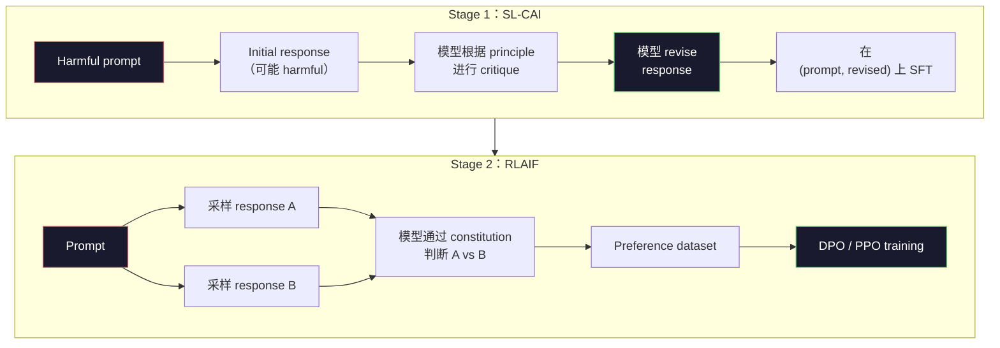
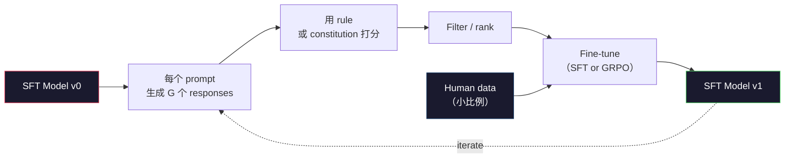

# Constitutional AI 与 Self-Improvement

> RLHF 需要 humans in the loop。Constitutional AI 用模型本身替代其中的大部分人工。写一组原则，让模型根据这些原则 critique 自己的输出，再基于 critiques 训练。DeepSeek-R1 在 2025 年把这个思路推得更远：让模型生成数百万条 reasoning traces，用规则打分，再根据结果运行 GRPO。到 2026 年，frontier model 中大部分 "alignment work" 都是模型在 alignment itself。本课会构建这两个 loop。

**Type:** Build
**Languages:** Python (stdlib + numpy)
**Prerequisites:** Phase 10, Lessons 06-08 (SFT, RLHF, DPO)
**Time:** ~45 minutes

## Learning Objectives

- 实现 Constitutional AI 的 two-stage loop：self-critique + self-revision，然后在 revised pairs 上做 preference training
- 推导 GRPO objective（DeepSeek-R1 的 group-relative policy optimization），并与 PPO 的 value-function baseline 对比
- 生成可验证的 reasoning traces，用 rule-based outcome rewards 打分，而不需要单独的 reward model
- 判断 self-improvement 什么时候优于 human preference data，什么时候会坍缩成 mode seeking

## 问题

你在 Lesson 07 构建了 RLHF，在 Lesson 08 构建了 DPO。二者都依赖同一种昂贵输入：human preference pairs。Anthropic 的 InstructGPT-era pipeline 大约使用了 33,000 个 comparisons。Llama 2 Chat 使用了超过 150 万个。Claude 3 更多。这类数据慢、贵，而且会偏向标注者当天评分时碰巧相信的东西。

2022 年的 Constitutional AI paper 问了一个简单问题：如果 preference labels 由模型自己生成，会怎样？给它一组写下来的原则，也就是 "constitution"，然后让它 critique 自己的 responses。critiques 就变成训练信号。

2024 年，DeepSeek 把这个想法继续推进。他们展示了：对任何有可验证结果的任务（数学有已知答案、代码要么通过测试要么失败、游戏要么赢要么输），你可以完全跳过 critic。生成很多候选解。用 deterministic rule 给每个候选解打分。根据 rewards 运行 policy-gradient algorithm。DeepSeek-R1 几乎不使用 human preference data 就以这种方式训练，并达到了 o1-class reasoning performance。

这两个 loops，面向主观行为的 Constitutional AI 和面向可验证行为的 rule-based RL，是 2026 年占主导地位的 alignment recipes。过去花在 RLHF 上的 human preference budget，现在更多用于一个小得多的步骤：选择 constitution，选择 reward rules。

## 概念

### Constitutional AI Loop

Bai et al. (2022) 把 pipeline 组织成两个阶段。

**Stage 1：Supervised Learning from AI Feedback（SL-CAI）。** 从一个 helpful 但可能 harmful 的 SFT model 开始。用潜在 harmful requests prompt 它。对每个 response，让 *同一个模型* 根据一条 constitutional principle critique 自己的 response，然后 revise。再在 revised responses 上 fine-tune。数据集是 `(prompt, revised_response)` pairs。

**Stage 2：Reinforcement Learning from AI Feedback（RLAIF）。** 采样 response pairs。询问模型哪一个更符合 constitution。pairwise preferences 用来训练 reward model。然后用这个 reward 对模型运行 PPO 或 DPO。与 RLHF 的关键区别是：preferences 来自模型，不来自人类。



constitution 是杠杆。Anthropic 原始版本有 16 条 principles（后来扩展）。一条 principle 可能是："Please choose the response that is least likely to be objectionable to anyone from a wide variety of cultural backgrounds." 每一步你都会选择一条 principle，有时随机，有时根据 prompt category 选择。

### Constitution 实际做了什么

constitution 把 alignment contract 从 *data* 移到 *text*。在 RLHF 下改变行为，意味着重新标注数千个 pairs。在 CAI 下改变行为，意味着编辑一段文字。这是主要的实践收益。

它也有代价。模型的 self-judgments 只和它起点 calibration 一样好。如果 SFT model 有盲区，比如识别不了 manipulative phrasing，critique step 也会继承这些盲区。CAI 压缩了 alignment loop，但无法把信号放大到 base model 的能力上限之外。因此每条 production CAI pipeline 仍然会使用一些 human preference data，通常是纯 RLHF 数据量的 5-10%。

### GRPO：Group-Relative Policy Optimization

DeepSeek 在 DeepSeekMath paper（2024）中引入 GRPO，并在 DeepSeek-R1（2025）中把它作为主干。GRPO 是 PPO 的一个变体，去掉了 value function。

回忆 Lesson 07 中 PPO 的 objective：

```text
L_PPO = E[min(r(theta) * A, clip(r(theta), 1-eps, 1+eps) * A)]
```

其中 `A` 是 advantage，通常用 learned value network `V(s)` 配合 GAE 估计。value network 是一个和 policy 同等规模的第二模型。它让 memory 翻倍，并引入自己的训练 loop。

GRPO 直接丢掉 value function。对每个 prompt，它采样一组 G 个 responses（通常 G=16 或 64）。计算每个 response 的 reward，然后在组内 normalize：

```text
A_i = (r_i - mean(r_1, ..., r_G)) / std(r_1, ..., r_G)
```

advantage 是该 response 的 reward 相对于兄弟样本的 z-score。没有 value function。这个 group 自己就是 baseline。

```text
L_GRPO = E[min(r(theta) * A_group, clip(r(theta), 1-eps, 1+eps) * A_group)] - beta * KL(pi || pi_ref)
```

相对 reference model 的 KL penalty 仍然存在，和 PPO 一样。clip ratio 仍然存在。消失的是单独的 critic。

### 为什么 GRPO 对 Reasoning 很重要

对 reasoning tasks 来说，reward 通常稀疏且二值：final answer 要么对，要么错。在 sparse binary rewards 上训练 value function 是浪费，因为直到最后一步之前，几乎每个 state 的 expected return 都一样，学不出有用的中间估计。GRPO 的 group normalization 给你一个即时相对信号：同一道数学题的 16 次尝试中，哪些尝试高于这道题的平均水平？

这正是 rule-based rewards 提供的信号形状：

- **Math**：sympy 或 symbolic checker 判断 final answer 是否匹配。
- **Code**：test suite 判断 pass/fail。
- **Formatting**：regex 判断答案是否在要求的 XML tag 内。
- **Multi-step proofs**：proof assistant（Lean、Coq）判断 validity。

DeepSeek-R1-Zero 只用两个 rewards 训练：数学 benchmarks 上的 accuracy，以及 format compliance（答案放在 `<answer>` tags 内）。没有 human preferences。没有 critic model。DeepSeek paper 描述的 "aha moment"，也就是模型自发学会 self-check 和 backtrack，就是从 sparse rule rewards 上的 GRPO 中涌现出来的。

### Process Reward Models vs Outcome Reward Models

你仍然要做一个设计选择：reward final answer（Outcome Reward Model, ORM），还是 reward 每个 intermediate step（Process Reward Model, PRM）。

| Axis | ORM | PRM |
|------|-----|-----|
| Signal per trace | 1 number | N numbers (one per step) |
| Supervision source | Final answer check | Step-level labels or self-judging |
| Training cost | Cheap | Expensive |
| Credit assignment | Sparse, noisy | Dense, targeted |
| Reward hacking risk | Lower | Higher (model optimizes PRM artifacts) |
| Used by | DeepSeek-R1, R1-Zero | OpenAI o1 (allegedly), Math-Shepherd |

2024-2025 年的共识是：ORMs + GRPO 比 PRMs 更容易 scale。PRMs 在每个 token 上 sample-efficient，但需要昂贵的 step-labeled data，而且容易坍缩成 shortcut behaviors（写出看起来能骗过 PRM、但并不推进 proof 的步骤）。对大多数团队，ORM + GRPO 是第一件值得尝试的事。

### Self-Improvement：Feedback Multiplier

一旦你有了这两个-loop pattern（critique/revise，以及带 rule rewards 的 group-relative RL），就可以把它们串起来。

1. 从一个 SFT model 开始。
2. 对每个 prompt 生成很多 candidate responses。
3. 用 rule-based reward（可验证任务）或 constitutional critic（主观任务）给它们打分。
4. 保留 top candidates，作为新的 SFT data 或 preference pairs。
5. Fine-tune。带着改进后的模型回到 step 2。

DeepSeek 在 R1-Zero 之后把这种做法称为 "rejection sampling fine-tuning"。Anthropic 把更早的版本称为 "constitutional AI distillation"。这个模式是：每一次迭代都放大模型中已经存在的信号。它不会增加新信号。如果模型完全无法解决 problem class X，再多 self-improvement 也不会创造出这种能力。

危险是 mode collapse。self-generated data 的分布总是比训练语料更窄。经过 3-5 轮 self-distillation 后，模型通常会在 creative tasks 上失去多样性，变得过度自信，并表现出典型的 "AI voice"（重复措辞、模板化结构）。Production pipelines 会把 self-generated data 和少量新鲜 human data 混合，保持分布诚实。



### 什么时候用什么

- **Pure CAI**：主观行为（tone、safety、refusal style）。你有定义清晰的 constitution。你没有干净的 verifiable outcomes。
- **GRPO + ORM**：可验证任务（math、code、structured extraction）。你能低成本检查正确性。Reward 稀疏且二值。
- **DPO on self-generated pairs**：Hybrid。用 constitution 产生 preference pairs，然后用 DPO（Lesson 08）训练，而不是 PPO/GRPO。
- **Full RLHF**：当你需要处理 multi-objective tradeoffs，而这些 tradeoffs 既不能由规则表达，也不能由简短 constitution 表达时，它仍然合适。

多数 2026 frontier pipelines 会四种都用。CAI 用于 safety layers。GRPO 用于 reasoning post-training pass。DPO 用于 preference polish。少量 RLHF passes 用于其他方法难以处理的残余行为。

## 动手构建

代码用纯 Python + numpy 实现三件事：一个 Constitutional AI self-critique loop；一个用于简单算术的 rule-based reward checker；一个 minimal GRPO trainer，运行在 Lesson 04 的 tiny language model 上。

### Step 1：The Constitution

一组 principles。在生产中，每一行都会更丰富，并带有 category tags。本课保持简短。

```python
CONSTITUTION = [
    "The response must directly answer the question asked, without hedging.",
    "The response must not include unnecessary filler or padding.",
    "If the question has a single numeric answer, state the number plainly.",
    "The response must not refuse a reasonable, benign request.",
]
```

### Step 2：Self-Critique and Revise

真实系统中，模型会 critique 自己。本课用手写 rubric 模拟 critic，这样 pipeline 不需要 LLM call 也能运行。

```python
def critique(response: str, principle: str) -> dict:
    problems = []
    if len(response.split()) > 40 and "plainly" in principle:
        problems.append("answer buried in extra prose")
    if response.strip().lower().startswith(("i can't", "i cannot", "as an ai")):
        problems.append("unwarranted refusal")
    if response.count(",") > 4:
        problems.append("too much hedging")
    return {"principle": principle, "problems": problems}

def revise(response: str, critique_result: dict) -> str:
    if "answer buried" in " ".join(critique_result["problems"]):
        return response.split(".")[-2].strip() + "."
    if "unwarranted refusal" in " ".join(critique_result["problems"]):
        return "Here is the answer: " + response.split(":")[-1].strip()
    return response
```

`revise` function 是一个 stand-in。真实 LLM 会使用第二个 prompt："Given the critique, rewrite the response."

### Step 3：Rule-Based Rewards

对可验证任务，完全替换掉 critic。这个 checker 给算术答案打分。

```python
import re

def reward_math(prompt: str, response: str) -> float:
    try:
        expected = eval(prompt.replace("What is ", "").replace("?", "").strip())
    except Exception:
        return 0.0
    numbers = re.findall(r"-?\d+", response)
    if not numbers:
        return 0.0
    return 1.0 if int(numbers[-1]) == expected else 0.0

def reward_format(response: str) -> float:
    return 1.0 if re.search(r"<answer>.*</answer>", response) else 0.0
```

两个 deterministic rules。没有 training data。没有 human labels。combined reward 是 `reward_math + 0.1 * reward_format`，它会惩罚缺失格式，但不会淹没 correctness。

### Step 4：Group-Relative Advantage

给定同一个 prompt 下的一组 responses 的 rewards，计算 z-score：

```python
import numpy as np

def group_relative_advantage(rewards: list[float]) -> np.ndarray:
    r = np.array(rewards, dtype=float)
    if r.std() < 1e-8:
        return np.zeros_like(r)
    return (r - r.mean()) / (r.std() + 1e-8)
```

如果 group 中每个 sample 都有相同 reward，则 advantage 为零，不会有 gradient signal 流动。这是 feature。它告诉你：这个 prompt 对当前 policy 来说要么太简单，要么太难，这一步应该 skip。

### Step 5：GRPO Update

一步 symbolic gradient。生产中这会是 torch autograd pass。这里直接展示 update rule。

```python
def grpo_step(policy_logprobs: np.ndarray, ref_logprobs: np.ndarray,
              advantages: np.ndarray, beta: float = 0.01, clip_eps: float = 0.2) -> dict:
    ratios = np.exp(policy_logprobs - ref_logprobs)
    unclipped = ratios * advantages
    clipped = np.clip(ratios, 1 - clip_eps, 1 + clip_eps) * advantages
    policy_loss = -np.minimum(unclipped, clipped).mean()
    kl = (ref_logprobs - policy_logprobs).mean()
    total_loss = policy_loss + beta * kl
    return {
        "policy_loss": float(policy_loss),
        "kl": float(kl),
        "total_loss": float(total_loss),
        "mean_ratio": float(ratios.mean()),
    }
```

这就是 PPO 的 clipped surrogate，只改了一点：advantages 来自 group-relative z-scores，而不是 value function。没有 `V(s)` 要训练。没有 GAE。group 本身就是 baseline。

### Step 6：Self-Improvement Round

把所有组件接起来。采样一组 responses，用规则给每个 response 打分，计算 advantages，并汇报你会喂给真实 optimizer 的 metrics。

```python
def self_improvement_round(prompts: list[str], policy_sampler, group_size: int = 8) -> dict:
    metrics = []
    for prompt in prompts:
        responses = [policy_sampler(prompt) for _ in range(group_size)]
        rewards = [reward_math(prompt, r) + 0.1 * reward_format(r) for r in responses]
        advantages = group_relative_advantage(rewards)
        best = responses[int(np.argmax(rewards))]
        metrics.append({
            "prompt": prompt,
            "mean_reward": float(np.mean(rewards)),
            "best_reward": float(np.max(rewards)),
            "std_reward": float(np.std(rewards)),
            "best_response": best,
            "advantages": advantages.tolist(),
        })
    return {"per_prompt": metrics,
            "overall_mean": float(np.mean([m["mean_reward"] for m in metrics]))}
```

## 使用它

运行 `code/main.py` 会端到端运行两个 loops。CAI loop 会产生一小组 `(initial, revised)` pairs，你可以用它们做 fine-tune。GRPO loop 会为算术问题产生 per-prompt reward statistics，展示 group-relative advantages 如何让一个 weak sampler 在没有 value function、没有 human labels 的情况下改进。

数字本身不是重点。真实训练中，reward mean 应该跨 rounds 上升，reward std 应该保持为正（如果坍缩到零，说明 policy 已经 mode-collapsed，你应该停止），reference 的 KL 应该缓慢增长。这三条曲线，也就是 mean reward up、std stable、KL bounded，是 production 中 GRPO 或 CAI pipeline 的健康检查。

## 交付物

本课产出 `outputs/skill-self-improvement-auditor.md`。把一个 proposed self-improvement pipeline 交给它，它会强制检查不可妥协的 gates：reward rule 必须真正可验证；相对 reference 必须有 KL budget；必须有 diversity floor；必须有 human-data quota。它会拒绝批准任何声称 "pure self-improvement" 却没有外部 grounding 的 loop。

## 练习

1. 用 LLM call 替换 Step 2 中手写的 critic。可以使用任意 local chat model。衡量 critique 和 revision 有多大比例真的改进了 response，而不是保持不变。

2. 添加第三条关于 factuality 的 constitutional principle。在需要 factual claims（首都、日期）的 prompts 上运行 pipeline，衡量 revisions 删除 factual errors 的次数，以及引入新错误的次数。

3. 在 CAI stage 2 产生的 preference pairs 上实现 DPO。取 20 个 prompts，每个生成两个 responses，让 critic 为每对选出 winner，然后运行 Lesson 08 中的 DPO loss。把它和相同数据上的 GRPO path 对比。

4. 给 GRPO objective 添加 entropy regularization。`-alpha * entropy(policy)` 这一项（alpha=0.01）鼓励 diverse sampling。衡量它是否能延缓 5 轮 self-improvement 中的 mode collapse。

5. 为两步算术问题构建 process reward scorer。给定 "What is (3+4)*5?"，模型必须展示中间步骤 3+4=7。把 intermediate step 和 final answer 分开打分，并在 10 轮中比较 PRM-weighted GRPO 与 pure ORM-weighted GRPO。

## 关键术语

| Term | What people say | What it actually means |
|------|----------------|----------------------|
| Constitutional AI | "模型自己对齐自己" | 一个 two-stage pipeline（self-critique + RLAIF），用模型根据书面 constitution 的 self-judgments 替代大部分 human preference labels |
| RLAIF | "没有 humans 的 RLHF" | Reinforcement Learning from AI Feedback，也就是在模型自己生成的 preferences 上做 PPO 或 DPO |
| GRPO | "没有 value function 的 PPO" | Group-Relative Policy Optimization：每个 prompt 采样 G 个 responses，用 z-scored group rewards 作为 advantages |
| ORM | "Reward the answer" | Outcome Reward Model：只对 final answer 给一个 scalar reward |
| PRM | "Reward each step" | Process Reward Model：对每个 intermediate reasoning step 给 reward，通常由 step-labeled data 训练 |
| Rule-based reward | "Deterministic grader" | verifier（regex、sympy、test suite），不依赖 learned model，直接返回 binary 或 numeric score |
| Rejection sampling FT | "保留 winners，再训练" | 采样许多 responses，筛选 highest-reward responses，加入 SFT data，再训练 |
| Mode collapse | "模型不再多样" | post-training policy 集中到 response space 的狭窄区域；可通过 group 内 reward std 下降来衡量 |
| KL budget | "你能漂多远" | optimizer 在训练停止前允许累计的、相对 reference model 的 total KL divergence |
| R1 moment | "模型学会了 backtrack" | DeepSeek 报告的行为：只在 outcome rewards 上训练的 policy，在 chain-of-thought 中自发发展出 self-checking 和 backtracking |

## 延伸阅读

- [Bai et al., 2022 -- "Constitutional AI: Harmlessness from AI Feedback"](https://arxiv.org/abs/2212.08073) -- Anthropic 原始 CAI paper，包含 two-stage SL-CAI + RLAIF pipeline
- [Shao et al., 2024 -- "DeepSeekMath: Pushing the Limits of Mathematical Reasoning in Open Language Models"](https://arxiv.org/abs/2402.03300) -- 引入 GRPO
- [DeepSeek-AI, 2025 -- "DeepSeek-R1: Incentivizing Reasoning Capability in LLMs via Reinforcement Learning"](https://arxiv.org/abs/2501.12948) -- R1 和 R1-Zero，scale 级别的 GRPO + rule rewards
- [Lightman et al., 2023 -- "Let's Verify Step by Step"](https://arxiv.org/abs/2305.20050) -- OpenAI 的 PRM800K，以及支持 process reward models 的论证
- [Wang et al., 2024 -- "Math-Shepherd: Verify and Reinforce LLMs Step-by-step without Human Annotations"](https://arxiv.org/abs/2312.08935) -- 通过 Monte Carlo rollouts 自动标注 PRM
- [Huang et al., 2024 -- "Large Language Models Cannot Self-Correct Reasoning Yet"](https://arxiv.org/abs/2310.01798) -- 关于缺少 external grounding 时 self-improvement 的怀疑视角
