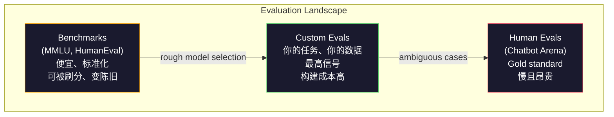
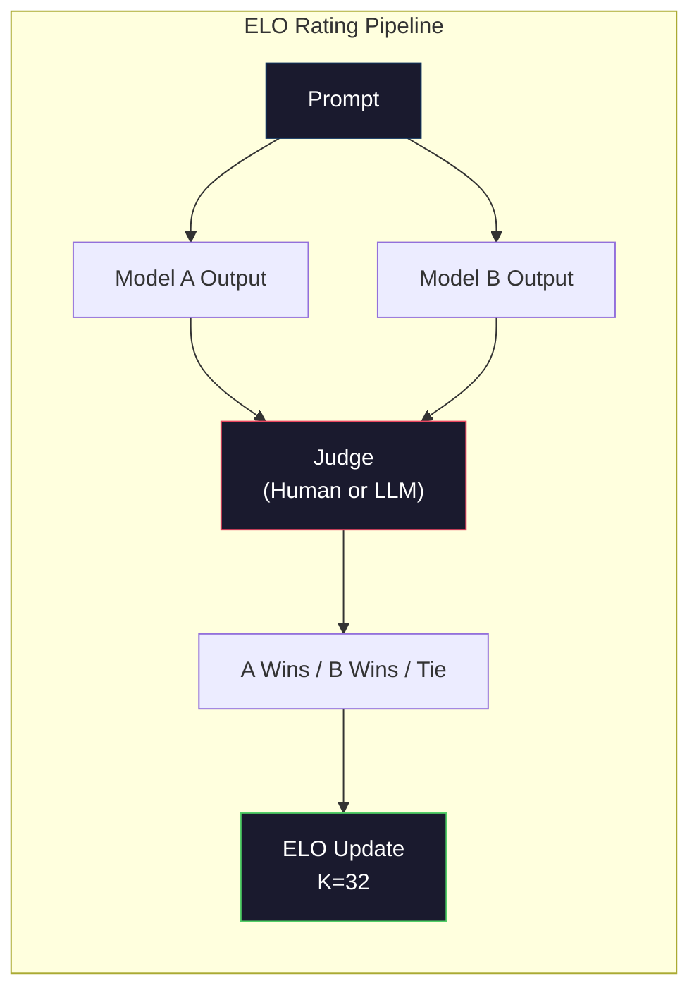

# 评估：Benchmarks、Evals、LM Harness

> Goodhart 定律：当一个指标变成目标，它就不再是好指标。每个 frontier lab 都会 gaming benchmarks。MMLU 分数越来越高，但模型仍然不能可靠数出 "strawberry" 里有几个 R。真正重要的 eval 只有你的 eval：在你的任务上，用你的数据。

**Type:** Build
**Languages:** Python
**Prerequisites:** Phase 10, Lessons 01-05 (LLMs from Scratch)
**Time:** ~90 minutes

## 学习目标

- 构建一个 custom evaluation harness，对语言模型运行 multiple-choice 和 open-ended benchmarks
- 解释为什么标准 benchmarks（MMLU、HumanEval）会 saturated，并且无法区分 frontier models
- 用合适的 metrics 实现 task-specific evals：exact match、F1、BLEU 和 LLM-as-judge scoring
- 设计面向你具体 use case 的 custom evaluation suite，而不是只依赖 public leaderboards

## 问题

MMLU 于 2020 年发布，包含 57 个学科的 15,908 道题。三年内，frontier models 就把它刷满了。GPT-4 得到 86.4%。Claude 3 Opus 得到 86.8%。Llama 3 405B 得到 88.6%。Leaderboard 被压缩到 3 个百分点范围内，其中差异更像 statistical noise，而不是真实 capability gaps。

与此同时，同样这些模型会在 10 岁小孩都不需要思考的任务上失败。Claude 3.5 Sonnet 在 MMLU 上得分 88.7%，但一开始数不清 "strawberry" 里有几个字母；这个任务不需要 world knowledge，也不需要 reasoning，只需要 character-level iteration。HumanEval 用 164 道题测试 code generation。模型在上面能拿 90%+，但仍然会生成一遇到边界情况就 crash 的代码，而这些边界情况任何 junior developer 都会抓到。

Benchmark performance 与 real-world reliability 之间的落差，是 LLM evaluation 的核心问题。Benchmarks 告诉你模型在 benchmark 上表现如何。它们几乎不会告诉你这个模型会如何处理你的具体任务、你的具体数据、你的具体 failure modes。如果你在构建 customer support bot，MMLU 基本无关。如果你在构建 code assistant，HumanEval 只覆盖 function-level generation，不说明模型能否跨文件 debugging、refactoring 或解释代码。

你需要 custom evals。不是因为 benchmarks 没用；它们对粗略 model selection 很有用。真正原因是，最终 evaluation 必须精确匹配你的 deployment conditions。

## 概念

### Eval Landscape

Evaluation 有三类，每一类的成本和信号质量不同。

**Benchmarks** 是标准化 test suites。MMLU、HumanEval、SWE-bench、MATH、ARC、HellaSwag。你让模型跑 benchmark，然后得到一个分数。优点是：所有人都用同一套测试，所以可以比较模型。缺点是：模型和训练数据越来越多地 contaminate 这些 benchmarks。Labs 会训练在包含 benchmark questions 的数据上。分数上升。Capability 不一定上升。

**Custom evals** 是你为具体 use case 构建的 test suites。你定义 inputs、expected outputs 和 scoring function。Legal document summarizer 就在 legal documents 上评估。SQL generator 就在你的 database schema 上评估。它们创建成本高，但它们是唯一能预测 production performance 的 evaluation。

**Human evals** 使用付费 annotators，从 helpfulness、correctness、fluency 和 safety 等维度判断模型输出。对自动评分失效的 open-ended tasks 来说，这是 gold standard。Chatbot Arena 已经收集了超过 200 万个人类 preference votes，覆盖 100+ models。缺点是成本（每次 judgment $0.10-$2.00）和速度（数小时到数天）。



### 为什么 Benchmarks 会失效

三种机制会让 benchmark scores 停止反映真实能力。

**Data contamination。** Training corpora 会抓取互联网。Benchmark questions 也在互联网上。模型在训练时见过答案。这不是传统意义上的 cheating，labs 并不是有意加入 benchmark data。但 web-scale scraping 让完全排除它几乎不可能。

**Teaching to the test。** Labs 会为 benchmark performance 优化 training mixtures。如果 5% 的 training mix 是 MMLU-style multiple choice，模型会学到格式和答案分布。MMLU 是 4 选 1。模型会学到 A/B/C/D 的答案分布大致均匀，即使模型不知道答案，这也会有帮助。

**Saturation。** 当每个 frontier model 在某个 benchmark 上都得 85-90%，这个 benchmark 就停止区分模型。剩下的 10-15% 题目可能模糊、标错，或需要冷僻 domain knowledge。MMLU 从 87% 提高到 89%，可能只是模型记住了多两道冷门题，而不是它变聪明了。

### Perplexity：快速健康检查

Perplexity 衡量模型对一串 tokens 有多 "surprised"。形式上，它是平均 negative log-likelihood 的指数：

```text
PPL = exp(-1/N * sum(log P(token_i | context)))
```

Perplexity 为 10，意味着模型在每个 token position 上平均像是在 10 个选项里均匀选择一样不确定。越低越好。GPT-2 在 WikiText-103 上 perplexity 约为 30。GPT-3 约为 20。Llama 3 8B 约为 7。

Perplexity 对在同一个 test set 上比较模型很有用，但它有盲点。一个模型可以通过很好地预测 common patterns 来获得低 perplexity，同时在 rare but important patterns 上很差。它也无法说明 instruction following、reasoning 或 factual accuracy。把它当 sanity check，不要当最终裁决。

### LLM-as-Judge

用强模型评估弱模型输出。思路很简单：让 GPT-4o 或 Claude Sonnet 按 1-5 分为 response 的 correctness、helpfulness 和 safety 打分。用 GPT-4o-mini 时每次 judgment 大约 $0.01，并且与 human judgments 的相关性出人意料地好，在多数任务上约有 80% agreement。

Scoring prompt 比 judge model 更重要。模糊 prompt（"Rate this response"）会产生 noisy scores。带 rubric 的 structured prompt（"如果答案事实正确并引用来源，给 5 分；如果正确但无来源，给 4 分；如果部分正确，给 3 分..."）会产生稳定、可复现的分数。

Failure modes：judge models 有 position bias（pairwise comparisons 中偏好第一个 response）、verbosity bias（偏好更长的 response）和 self-preference（GPT-4 会给 GPT-4 outputs 比等价 Claude outputs 更高的分）。Mitigations：随机化顺序、对长度归一化、使用与被评估模型不同的 judge。

### 来自 Pairwise Comparisons 的 ELO Ratings

这是 Chatbot Arena 的方法。给两个模型同一个 prompt 的两个 responses。人类（或 LLM judge）选择更好的一个。通过成千上万次 comparisons，为每个模型计算 ELO rating，也就是国际象棋里使用的同一套系统。

ELO 的优点：relative ranking 比 absolute scoring 更可靠，能优雅处理 ties，并且比独立给每个 output 打分更快收敛。截至 2026 年初，Chatbot Arena 排名显示 GPT-4o、Claude 3.5 Sonnet 和 Gemini 1.5 Pro 在榜首相差不到 20 个 ELO points。



### Eval Frameworks

**lm-evaluation-harness**（EleutherAI）：标准开源 eval framework。支持 200+ benchmarks。用一条命令就能让任意 Hugging Face model 跑 MMLU、HellaSwag、ARC 等任务。Open LLM Leaderboard 使用它。

**RAGAS**：专门用于 RAG pipelines 的 evaluation framework。衡量 faithfulness（答案是否符合 retrieved context？）、relevance（retrieved context 是否与问题相关？）和 answer correctness。

**promptfoo**：面向 prompt engineering 的 config-driven eval。用 YAML 定义 test cases，运行在多个模型上，得到 pass/fail report。适合做 prompt regression testing，也就是确认 prompt 变更不会破坏已有 test cases。

### 构建 Custom Evals

这是 production 中唯一真正重要的 eval。流程如下：

1. **Define the task。** 模型到底应该做什么？要精确。"Answer questions" 太模糊。"Given a customer complaint email, extract the product name, issue category, and sentiment" 才是可评估的任务。

2. **Create test cases。** Prototype eval 至少 50 条，production 200+ 条。每个 test case 是一个 (input, expected_output) pair。包含 edge cases：empty inputs、adversarial inputs、ambiguous inputs、其它语言输入。

3. **Define scoring。** Structured outputs 用 exact match。Text similarity 用 BLEU/ROUGE。Open-ended quality 用 LLM-as-judge。Extraction tasks 用 F1。用权重组合多个 metrics。

4. **Automate。** 每个 eval 都能一条命令运行。不能有 manual steps。用便于随时间比较的格式存储结果。

5. **Track over time。** 单独一个 eval score 没意义。你需要 trendline。上次 prompt 变更后分数是否提高？换模型后是否 regression？把 eval 和 prompts 一起 version。

| Eval Type | Cost per judgment | Agreement with humans | Best for |
|-----------|------------------|----------------------|----------|
| Exact match | ~$0 | 100%（适用时） | Structured output, classification |
| BLEU/ROUGE | ~$0 | ~60% | Translation, summarization |
| LLM-as-judge | ~$0.01 | ~80% | Open-ended generation |
| Human eval | $0.10-$2.00 | N/A（它就是 ground truth） | Ambiguous, high-stakes tasks |

```figure
perplexity-loss
```

## Build It

### Step 1：一个最小 Eval Framework

定义核心 abstractions。一个 eval case 有 input、expected output，以及可选 metadata dict。一个 scorer 接收 prediction 和 reference，返回 0 到 1 之间的分数。

```python
import json
from collections import Counter

class EvalCase:
    def __init__(self, input_text, expected, metadata=None):
        self.input_text = input_text
        self.expected = expected
        self.metadata = metadata or {}

class EvalSuite:
    def __init__(self, name, cases, scorers):
        self.name = name
        self.cases = cases
        self.scorers = scorers

    def run(self, model_fn):
        results = []
        for case in self.cases:
            prediction = model_fn(case.input_text)
            scores = {}
            for scorer_name, scorer_fn in self.scorers.items():
                scores[scorer_name] = scorer_fn(prediction, case.expected)
            results.append({
                "input": case.input_text,
                "expected": case.expected,
                "prediction": prediction,
                "scores": scores,
            })
        return results
```

### Step 2：Scoring Functions

构建 exact match、token F1 和一个 simulated LLM-as-judge scorer。

```python
def exact_match(prediction, expected):
    return 1.0 if prediction.strip().lower() == expected.strip().lower() else 0.0

def token_f1(prediction, expected):
    pred_tokens = set(prediction.lower().split())
    exp_tokens = set(expected.lower().split())
    if not pred_tokens or not exp_tokens:
        return 0.0
    common = pred_tokens & exp_tokens
    precision = len(common) / len(pred_tokens)
    recall = len(common) / len(exp_tokens)
    if precision + recall == 0:
        return 0.0
    return 2 * (precision * recall) / (precision + recall)

def llm_judge_simulated(prediction, expected):
    pred_words = set(prediction.lower().split())
    exp_words = set(expected.lower().split())
    if not exp_words:
        return 0.0
    overlap = len(pred_words & exp_words) / len(exp_words)
    length_penalty = min(1.0, len(prediction) / max(len(expected), 1))
    return round(overlap * 0.7 + length_penalty * 0.3, 3)
```

### Step 3：ELO Rating System

实现带 ELO updates 的 pairwise comparisons。这正是 Chatbot Arena 用来 rank models 的系统。

```python
class ELOTracker:
    def __init__(self, k=32, initial_rating=1500):
        self.ratings = {}
        self.k = k
        self.initial_rating = initial_rating
        self.history = []

    def _ensure_player(self, name):
        if name not in self.ratings:
            self.ratings[name] = self.initial_rating

    def expected_score(self, rating_a, rating_b):
        return 1 / (1 + 10 ** ((rating_b - rating_a) / 400))

    def record_match(self, player_a, player_b, outcome):
        self._ensure_player(player_a)
        self._ensure_player(player_b)

        ea = self.expected_score(self.ratings[player_a], self.ratings[player_b])
        eb = 1 - ea

        if outcome == "a":
            sa, sb = 1.0, 0.0
        elif outcome == "b":
            sa, sb = 0.0, 1.0
        else:
            sa, sb = 0.5, 0.5

        self.ratings[player_a] += self.k * (sa - ea)
        self.ratings[player_b] += self.k * (sb - eb)

        self.history.append({
            "a": player_a, "b": player_b,
            "outcome": outcome,
            "rating_a": round(self.ratings[player_a], 1),
            "rating_b": round(self.ratings[player_b], 1),
        })

    def leaderboard(self):
        return sorted(self.ratings.items(), key=lambda x: -x[1])
```

### Step 4：Perplexity Calculation

使用 token probabilities 计算 perplexity。实践中你会从模型 logits 得到这些值。这里用一个 probability distribution 来模拟。

```python
import numpy as np

def perplexity(log_probs):
    if not log_probs:
        return float("inf")
    avg_neg_log_prob = -np.mean(log_probs)
    return float(np.exp(avg_neg_log_prob))

def token_log_probs_simulated(text, model_quality=0.8):
    np.random.seed(hash(text) % 2**31)
    tokens = text.split()
    log_probs = []
    for i, token in enumerate(tokens):
        base_prob = model_quality
        if len(token) > 8:
            base_prob *= 0.6
        if i == 0:
            base_prob *= 0.7
        prob = np.clip(base_prob + np.random.normal(0, 0.1), 0.01, 0.99)
        log_probs.append(float(np.log(prob)))
    return log_probs
```

### Step 5：Aggregate Results

跨一次 eval run 计算 summary statistics：mean、median、某个 threshold 下的 pass rate，以及每个 metric 的 breakdown。

```python
def summarize_results(results, threshold=0.8):
    all_scores = {}
    for r in results:
        for metric, score in r["scores"].items():
            all_scores.setdefault(metric, []).append(score)

    summary = {}
    for metric, scores in all_scores.items():
        arr = np.array(scores)
        summary[metric] = {
            "mean": round(float(np.mean(arr)), 3),
            "median": round(float(np.median(arr)), 3),
            "std": round(float(np.std(arr)), 3),
            "min": round(float(np.min(arr)), 3),
            "max": round(float(np.max(arr)), 3),
            "pass_rate": round(float(np.mean(arr >= threshold)), 3),
            "n": len(scores),
        }
    return summary

def print_summary(summary, suite_name="Eval"):
    print(f"\n{'=' * 60}")
    print(f"  {suite_name} Summary")
    print(f"{'=' * 60}")
    for metric, stats in summary.items():
        print(f"\n  {metric}:")
        print(f"    Mean:      {stats['mean']:.3f}")
        print(f"    Median:    {stats['median']:.3f}")
        print(f"    Std:       {stats['std']:.3f}")
        print(f"    Range:     [{stats['min']:.3f}, {stats['max']:.3f}]")
        print(f"    Pass rate: {stats['pass_rate']:.1%} (threshold >= 0.8)")
        print(f"    N:         {stats['n']}")
```

### Step 6：运行完整 Pipeline

把所有部分接起来。定义一个 task，创建 test cases，模拟两个 models，运行 evals，从 pairwise comparisons 计算 ELO，并打印 leaderboard。

```python
def demo_model_good(prompt):
    responses = {
        "What is the capital of France?": "Paris",
        "What is 2 + 2?": "4",
        "Who wrote Hamlet?": "William Shakespeare",
        "What language is PyTorch written in?": "Python and C++",
        "What is the boiling point of water?": "100 degrees Celsius",
    }
    return responses.get(prompt, "I don't know")

def demo_model_bad(prompt):
    responses = {
        "What is the capital of France?": "Paris is the capital city of France",
        "What is 2 + 2?": "The answer is four",
        "Who wrote Hamlet?": "Shakespeare",
        "What language is PyTorch written in?": "Python",
        "What is the boiling point of water?": "212 Fahrenheit",
    }
    return responses.get(prompt, "Unknown")

cases = [
    EvalCase("What is the capital of France?", "Paris"),
    EvalCase("What is 2 + 2?", "4"),
    EvalCase("Who wrote Hamlet?", "William Shakespeare"),
    EvalCase("What language is PyTorch written in?", "Python and C++"),
    EvalCase("What is the boiling point of water?", "100 degrees Celsius"),
]

suite = EvalSuite(
    name="General Knowledge",
    cases=cases,
    scorers={
        "exact_match": exact_match,
        "token_f1": token_f1,
        "llm_judge": llm_judge_simulated,
    },
)

results_good = suite.run(demo_model_good)
results_bad = suite.run(demo_model_bad)

print_summary(summarize_results(results_good), "Model A (concise)")
print_summary(summarize_results(results_bad), "Model B (verbose)")
```

"Good" model 给出 exact answers。"Bad" model 给出 verbose paraphrases。Exact match 会严重惩罚 verbose model。Token F1 和 LLM-as-judge 更宽容。这说明 metric choice 为什么重要：同一个模型看起来很棒还是很糟，取决于你怎么打分。

### Step 7：ELO Tournament

在多个 rounds 中运行模型之间的 pairwise comparisons。

```python
elo = ELOTracker(k=32)

for case in cases:
    pred_a = demo_model_good(case.input_text)
    pred_b = demo_model_bad(case.input_text)

    score_a = token_f1(pred_a, case.expected)
    score_b = token_f1(pred_b, case.expected)

    if score_a > score_b:
        outcome = "a"
    elif score_b > score_a:
        outcome = "b"
    else:
        outcome = "tie"

    elo.record_match("model_a_concise", "model_b_verbose", outcome)

print("\nELO Leaderboard:")
for name, rating in elo.leaderboard():
    print(f"  {name}: {rating:.0f}")
```

### Step 8：Perplexity Comparison

比较不同 quality level 的 "models" 的 perplexity。

```python
test_text = "The quick brown fox jumps over the lazy dog in the garden"

for quality, label in [(0.9, "Strong model"), (0.7, "Medium model"), (0.4, "Weak model")]:
    log_probs = token_log_probs_simulated(test_text, model_quality=quality)
    ppl = perplexity(log_probs)
    print(f"  {label} (quality={quality}): perplexity = {ppl:.2f}")
```

## Use It

### lm-evaluation-harness（EleutherAI）

在任意模型上运行 benchmarks 的标准工具。

```python
# pip install lm-eval
# Command line:
# lm_eval --model hf --model_args pretrained=meta-llama/Llama-3.1-8B --tasks mmlu --batch_size 8

# Python API:
# import lm_eval
# results = lm_eval.simple_evaluate(
#     model="hf",
#     model_args="pretrained=meta-llama/Llama-3.1-8B",
#     tasks=["mmlu", "hellaswag", "arc_easy"],
#     batch_size=8,
# )
# print(results["results"])
```

### promptfoo

面向 prompt engineering 的 config-driven eval。用 YAML 定义 tests，并在多个 providers 上运行。

```yaml
# promptfoo.yaml
providers:
  - openai:gpt-4o-mini
  - anthropic:claude-3-haiku

prompts:
  - "Answer in one word: {{question}}"

tests:
  - vars:
      question: "What is the capital of France?"
    assert:
      - type: contains
        value: "Paris"
  - vars:
      question: "What is 2 + 2?"
    assert:
      - type: equals
        value: "4"
```

### 用 RAGAS 做 RAG evaluation

```python
# pip install ragas
# from ragas import evaluate
# from ragas.metrics import faithfulness, answer_relevancy, context_precision
#
# result = evaluate(
#     dataset,
#     metrics=[faithfulness, answer_relevancy, context_precision],
# )
# print(result)
```

RAGAS 衡量 generic evals 漏掉的东西：模型答案是否 grounded in retrieved context，而不只是抽象意义上是否 "correct"。

## Ship It

这一课产出 `outputs/prompt-eval-designer.md`：一个 reusable prompt，用来为任意任务设计 custom eval suites。给它一个 task description，它会生成 test cases、scoring functions，以及 pass/fail threshold 建议。

它还产出 `outputs/skill-llm-evaluation.md`：一个 decision framework，用于根据你的 task type、budget 和 latency requirements 选择正确的 evaluation strategy。

## 练习

1. 添加一个 "consistency" scorer：让同一个 input 通过模型 5 次，并衡量 outputs 有多少次一致。Deterministic inputs 上的不一致答案会暴露脆弱 prompts 或过高 temperature settings。

2. 扩展 ELO tracker，让它支持多个 judge functions（exact match、F1、LLM-as-judge）并加权。比较当你 heavily weight exact match 与 heavily weight F1 时，leaderboard 如何变化。

3. 为一个具体任务构建 eval suite：把 email classification 到 5 个 categories。创建 100 个 test cases，包含多样例子和 edge cases（可能属于多个 categories 的 emails、empty emails、其它语言 emails）。衡量不同 "models"（rule-based、keyword matching、simulated LLM）的表现。

4. 实现 contamination detection：给定一组 eval questions 和一个 training corpus，检查有多少比例的 eval questions（或 close paraphrases）出现在 training data 中。这就是 researchers 审计 benchmark validity 的方式。

5. 构建一个 "model diff" tool。给定两个 model versions 的 eval results，高亮哪些具体 test cases improved、哪些 regressed、哪些 stayed the same。这是 eval 版的 code diff，对理解一次变更到底有帮助还是有伤害至关重要。

## 关键术语

| Term | 大家常说 | 实际含义 |
|------|----------|----------|
| MMLU | "The benchmark" | Massive Multitask Language Understanding：覆盖 57 个学科的 15,908 道 multiple choice questions，到 2025 年 88% 以上已经 saturated |
| HumanEval | "Code eval" | OpenAI 的 164 道 Python function-completion problems，只测试 isolated function generation |
| SWE-bench | "Real coding eval" | 来自 12 个 Python repos 的 2,294 个 GitHub issues，衡量包括 test generation 在内的 end-to-end bug fixing |
| Perplexity | "模型有多困惑" | exp(-avg(log P(token_i given context)))；越低代表模型给真实 tokens 分配的概率越高 |
| ELO rating | "模型的国际象棋排名" | 从 pairwise win/loss records 计算出的 relative skill rating，Chatbot Arena 用它 rank 100+ models |
| LLM-as-judge | "用 AI 给 AI 打分" | 强模型根据 rubric 给弱模型 outputs 打分，与 human judges 约 80% agreement，成本约 $0.01/judgment |
| Data contamination | "模型见过测试题" | Training data 包含 benchmark questions，抬高分数但不提升真实能力 |
| Eval suite | "一堆 tests" | 一组 versioned (input, expected_output, scorer) triples，用于衡量某种具体能力 |
| Pass rate | "做对了多少百分比" | Eval cases 中分数超过 threshold 的比例；比 mean score 更 actionable，因为它衡量 reliability |
| Chatbot Arena | "模型排名网站" | LMSYS 平台，拥有 200 万+ human preference votes，通过 ELO ratings 产出最受信任的 LLM leaderboard |

## 延伸阅读

- [Hendrycks et al., 2021 -- "Measuring Massive Multitask Language Understanding"](https://arxiv.org/abs/2009.03300) -- MMLU 论文，虽然已经 saturated，但仍是引用最多的 LLM benchmark。
- [Chen et al., 2021 -- "Evaluating Large Language Models Trained on Code"](https://arxiv.org/abs/2107.03374) -- OpenAI 的 HumanEval 论文，建立了 code generation evaluation methodology。
- [Zheng et al., 2023 -- "Judging LLM-as-a-Judge"](https://arxiv.org/abs/2306.05685) -- 系统分析用 LLMs 评估 LLMs 的论文，包括 position bias 和 verbosity bias findings。
- [LMSYS Chatbot Arena](https://chat.lmsys.org/) -- 众包 model comparison 平台，拥有 200 万+ votes，是最受信任的 real-world LLM ranking。
