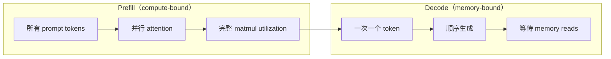
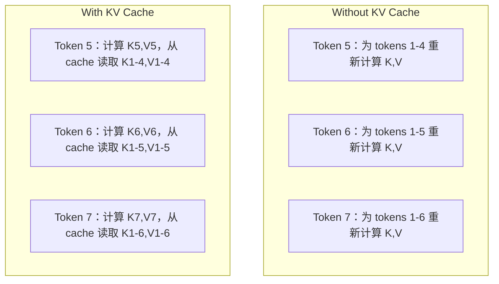
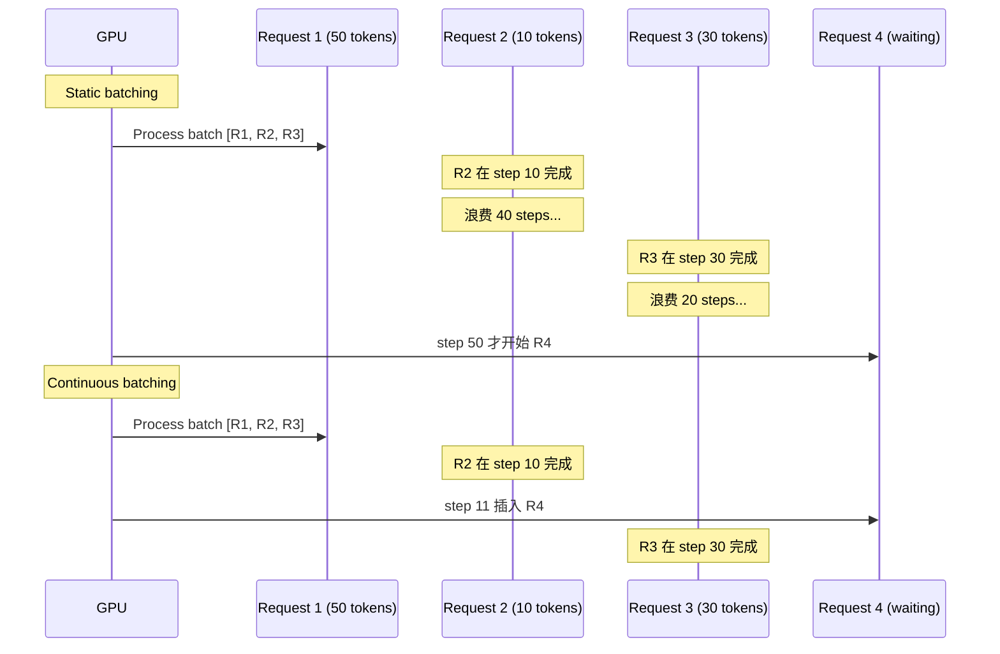
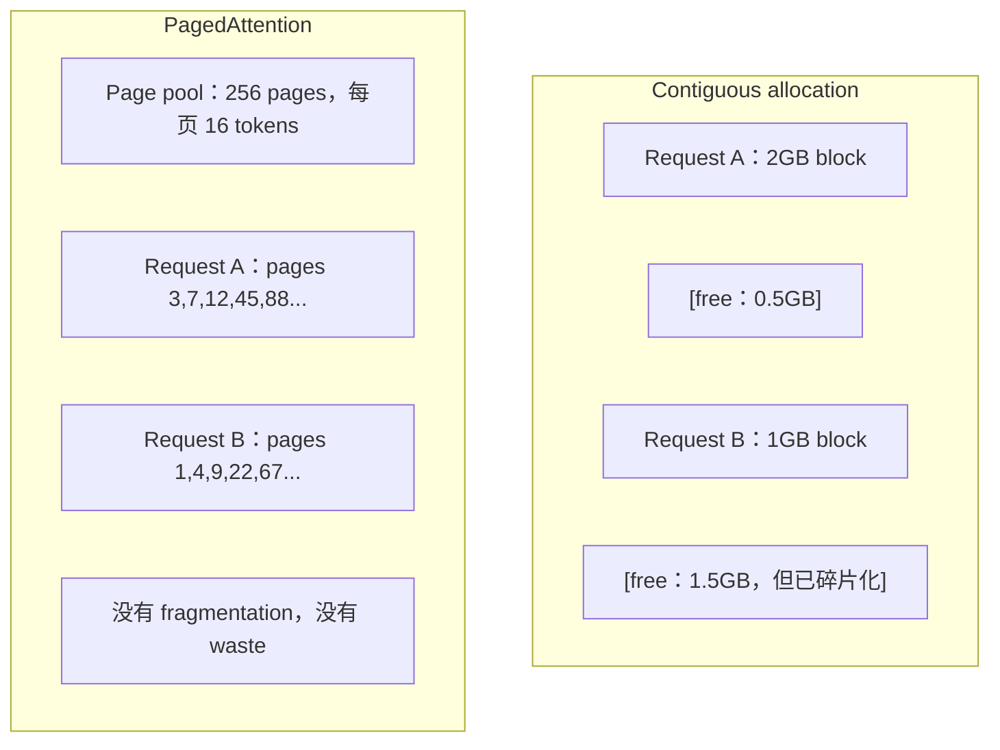
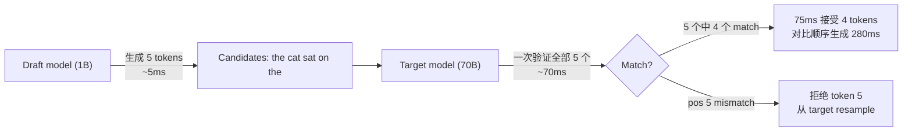

# Inference Optimization

> LLM inference 由两个阶段定义。Prefill 并行处理你的 prompt，是 compute-bound。Decode 一次生成一个 token，是 memory-bound。每一种优化都针对其中一个或两个阶段。

**Type:** Build
**Languages:** Python
**Prerequisites:** Phase 10, Lessons 01-08 (Transformer architecture, attention)
**Time:** ~120 minutes

## Learning Objectives

- 实现 KV-cache，消除 autoregressive token generation 中的重复计算
- 解释 LLM inference 的 prefill 与 decode 两个阶段，以及为什么二者有不同 bottlenecks（compute-bound vs memory-bound）
- 实现 continuous batching 和 PagedAttention concepts，在并发请求下最大化 GPU utilization
- 对比 inference optimization techniques（KV-cache、speculative decoding、flash attention）及其 throughput/latency tradeoffs

## 问题

你在 4xA100 GPUs 上部署 Llama 3 70B。单个用户可以得到约 50 tokens per second。感觉很快。然后 100 个用户同时打到 endpoint。吞吐下降到每用户 3 tokens/second。你每月 25,000 美元的 GPU bill，提供的 responses 比人类打字还慢。

从 1 个用户到 100 个用户，模型本身没有变化。同样的 weights，同样的 architecture，同样的 math。变化的是你如何 schedule work。naive inference 会浪费 90%+ 的可用 GPU compute。一个等待 token 47 的用户占着整个 batch slot，而 GPU memory bus 在 matmuls 之间空等。与此同时，一个新用户的 2,000-token prompt 本可以用有用的 compute 填满这些 dead time。

这不是 scaling problem。这是 scheduling problem。本课中的技术，KV caching、continuous batching、PagedAttention、speculative decoding、prefix caching，决定了同样 traffic 下 inference bill 是每月 25k 美元还是 5k 美元。

vLLM 在 4xA100-80GB 上 serving Llama 3 70B，低并发下可达到约 50 tokens/second/user，并通过 continuous batching 与 PagedAttention，在 100 concurrent requests 下维持 15-25 TPS/user。如果没有这些优化，同样硬件在这个并发下只能提供 5 TPS/user。同样 GPUs，同样 model，4x throughput。

## 概念

### Prefill vs Decode

每个 LLM inference request 都有两个不同阶段。

**Prefill** 处理完整 input prompt。所有 tokens 都已知，所以 attention 可以在完整 sequence 上并行计算。这是大型 matrix multiplication，GPU cores 会保持忙碌。bottleneck 是 compute：硬件每秒能提供多少 FLOPS。一张 A100 有 312 TFLOPS（BF16）。在 70B 模型上处理 4,096-token prompt 的 prefill，单张 A100 大约需要 400ms。

**Decode** 一次生成一个 output token。每个新 token 会 attend to 所有 previous tokens，但每次 forward pass 只产生一个 token。weight matrices 与 prefill 时大小相同，但你用一个 vector 而不是 matrix 去乘它们。GPU cores 会在微秒级完成，然后等待下一批 weights 从 memory 到达。bottleneck 是 memory bandwidth：你能多快把 model weights 从 HBM stream 到 compute units。一张 A100 有 2 TB/s bandwidth。70B 模型的 FP16 weights 是 140 GB。读完整模型一次需要 70ms，这就是单个 decode step 的下限。



**ops:byte ratio**（也叫 arithmetic intensity）描述这个 tradeoff。它衡量每从 memory 加载一个 byte，你执行多少 operations。

```text
ops:byte ratio = FLOPs per token / bytes read from memory
```

prefill 阶段，batch 有 4,096 tokens 时，每加载一次 weight，你执行约 4,096 次 multiply-accumulate operations。ratio 很高，所以 compute-bound。decode 阶段，batch size 为 1 时，每加载一次 weight，只执行约 1 次 operation。ratio 很低，所以 memory-bound。

根本洞察是：*decode 是 memory-bound，因为你为了产生单个 token 需要读取整个模型*。下面每一种优化，要么减少读取内容，要么增大每次读取所服务的 token batch，要么完全避免读取。

### KV Cache

attention 中，每个 token 的 query 会 attend to 所有 previous tokens 的 key 和 value vectors。如果没有 caching，生成 token N 时，需要为前 N-1 个 tokens 重新计算 key 和 value projections。token 1 在生成 token 2 时被投影一次，生成 token 3 时又被投影一次，生成 token 4 时又一次。到 token 1,000 时，你已经把 token 1 投影了 999 次。

KV cache 保存所有 previous tokens 的 key 和 value projections。生成 token N 时，你只计算 token N 的 key 和 value，然后把它们和 tokens 1 到 N-1 的 cached K/V concatenate 起来。



**KV cache 的 memory formula：**

```text
KV cache size = 2 * num_layers * num_kv_heads * head_dim * seq_len * bytes_per_param
```

对于 Llama 3 70B（80 layers、GQA 下 8 KV heads、head_dim=128、BF16）：

```text
per token: 2 * 80 * 8 * 128 * 2 bytes = 327,680 bytes = 320 KB
at 4,096 tokens: 320 KB * 4,096 = 1.28 GB
at 128K tokens: 320 KB * 131,072 = 40 GB
```

Llama 3 70B 的单个 128K-context conversation 会消耗 40 GB KV cache，也就是半张 A100 的显存。100 个 concurrent users、每人 4K tokens 时，仅 KV cache 就需要 128 GB。这就是为什么 KV cache management 是 inference optimization 的核心挑战。

### Continuous Batching

Static batching 会等到 N 个 requests 到达，把它们一起处理，并等待 *所有* requests 完成后才接收新的 requests。如果一个 request 需要 500 tokens，另一个只需要 10 tokens，那么短 request 完成后还要在 490 个 decode steps 中 idle。

Continuous batching（也叫 iteration-level batching）会在任意 request 完成时，立刻把新 request 插入 batch。batch 会在每个 decode step 重新评估。一个 10 tokens 后完成的 request 会马上被 waiting request 替换。



throughput improvement 取决于 output lengths 变化有多大。长度一致时，continuous batching 与 static batching 相同。长度变化大时（常见情况），continuous batching 可以提供 2-5x higher throughput，因为 GPU slots 永远不会空着。

### PagedAttention

每个 request 的 KV cache 都是一块 contiguous memory。requests 到来和离开时，memory 会 fragment，就像 operating systems 中的 RAM fragmentation。一个 4K-token request 需要 1.28 GB contiguous。即使你总共有 2 GB free，也可能没有 1.28 GB *contiguous*。你要么浪费 memory，要么拒绝 request。

PagedAttention（来自 vLLM）把 OS-style virtual memory 应用于 KV cache。它不为每个 request 分配一块 contiguous block，而是分配固定大小的 "pages"（通常每页 16 tokens）。pages 可以位于 physical GPU memory 的任意位置。page table 把每个 request 的 logical sequence positions 映射到 physical page locations。



PagedAttention 也支持 shared prefixes 的 **copy-on-write**。如果 50 个 requests 共享同一个 system prompt，那么这个 system prompt 的 KV cache pages 只存一次，被所有 50 个 requests 引用。只有当某个 request diverges（不同 user messages）时，它才获得自己的 pages。对于共享 system prompts 的应用，这会大幅降低 memory usage。

vLLM 报告说，通过 PagedAttention，memory waste 接近零（约 4%，相比 naive allocation 的 60-80%）。

### Speculative Decoding

Decode 慢是因为它是 sequential 的：生成一个 token，把它喂回去，再生成下一个。但如果你能便宜地猜出接下来的 5 个 tokens，然后一次性验证它们呢？

Speculative decoding 使用一个小而快的 **draft model** 生成 K 个 candidate tokens。大的 **target model** 再用单次 forward pass 处理全部 K 个 candidates（这看起来像 prefill，并行、compute-bound、高效）。如果 target model 同意 draft model 的预测，你就用一次 target forward pass 的时间接受全部 K 个 tokens。如果它在位置 j 不同意，你接受 tokens 1 到 j-1，丢弃剩余 tokens。



speedup 取决于 **acceptance rate**，也就是 draft model 的 predictions 有多频繁匹配 target。用 Llama 3 8B 为 Llama 3 70B drafting 时，自然语言中常见 acceptance rates 是 70-85%。这会转化为 2-3x decode speedup。

三种 speculative decoding approaches：

| Method | Draft source | Acceptance rate | Overhead |
|--------|-------------|-----------------|----------|
| Draft-target (Leviathan et al.) | Separate small model | 70-85% | Draft model memory |
| EAGLE (Li et al.) | Lightweight head on target | 75-90% | ~1% extra parameters |
| N-gram lookup | Token n-gram table | 40-60% | Negligible |

**EAGLE** 在 target model 的 hidden states 顶部训练一个小的 autoregressive head。它使用 target model 倒数第二层 features 预测 next token embedding。因为它操作的是 target model 自己的 representations，而不是另一个 separate model 的 representations，所以能以极小额外 memory 获得更高 acceptance rates。EAGLE-2 增加了 dynamic draft tree，会根据 context 调整 candidate count。

**N-gram speculative decoding** 维护一个 n-gram continuations table，来源可以是当前 context 或预建 corpus。如果 draft 匹配同一 conversation 中以前出现过的内容（重复模式、代码、structured output），它几乎零 neural network overhead 就能触发。平均 acceptance rates 较低，但每次 speculation 的成本基本为零。

Speculative decoding 在数学上是 *exact* 的，output distribution 与 target model 的 distribution 完全相同。它不是 approximation。verification step 确保每个 accepted token 都正好拥有 target model 本来会赋予的概率。

### Prefix Caching

许多 requests 共享同一个 prefix。聊天机器人 system prompt。RAG context block。few-shot example set。如果没有 prefix caching，每个 request 都要从头重新计算这些 shared tokens 的 KV cache。

Prefix caching 存储 common prefixes 的 KV cache，并跨 requests 复用。当新 request 带着已知 prefix 到达时，系统复制（或引用）cached KV entries，只计算 unique suffix 的 KV。

对于一个所有 requests 共享的 2,000-token system prompt，prefix caching 能消除每个 request 约 400ms prefill。100 requests/second 时，每秒节省 40 秒 GPU compute，也就是超过一张 GPU 的工作量。

SGLang 的 RadixAttention 用 radix tree（trie）实现 prefix caching，按 token content 索引 prefixes。任何匹配已存 prefix 的 request 都能免费获得对应 KV cache。tree 支持 partial prefix matches：如果你与某个 cached entry 共享 2,000 个 prefix tokens 中的 1,500 个，就复用这 1,500 个，只重算 500 个。

### Inference Engines

三个 engines 主导 production LLM serving：

| Engine | Key innovation | Best for |
|--------|---------------|----------|
| vLLM | PagedAttention, continuous batching | General-purpose serving, highest compatibility |
| SGLang | RadixAttention (prefix caching), structured generation | Multi-turn chatbots, constrained decoding |
| TensorRT-LLM | NVIDIA kernel fusion, FP8 quantization | Maximum single-GPU throughput on NVIDIA hardware |

**vLLM** 是默认起点。它支持最广泛的 models，可运行在任意 GPU vendor（NVIDIA、AMD、Intel）上，并通过 PagedAttention + continuous batching 获得强 throughput。OpenAI-compatible API 意味着你可以把它直接作为任意 OpenAI API call 的 replacement。

**SGLang** 建立在和 vLLM 相同的基础上，但增加了用于 prefix caching 的 RadixAttention，以及用于 structured LLM programs 的 domain-specific language。如果你的 workload 包含 multi-turn conversations、tool use 或 constrained decoding（JSON output、regex-guided generation），SGLang 往往能通过 prefix reuse 比 vLLM 快 2-5x。

**TensorRT-LLM** 把 models 编译成 optimized NVIDIA GPU kernels。它融合 operations（attention + linear + activation 放在一个 kernel 中）、在 H100 GPUs 上使用 FP8，并集成 NVIDIA Triton Inference Server 做 production deployment。它在 NVIDIA hardware 上获得最高 single-GPU throughput，但 setup 更复杂，也只支持 NVIDIA GPUs。

Llama 3 70B 的真实世界数字（4xA100-80GB，BF16）：

| Metric | vLLM | SGLang | TensorRT-LLM |
|--------|------|--------|---------------|
| Throughput (1 user) | ~50 TPS | ~55 TPS | ~65 TPS |
| Throughput (100 users) | ~2,500 total TPS | ~3,200 total TPS | ~3,000 total TPS |
| Time to first token | ~400ms | ~300ms (prefix hit) | ~350ms |
| Max context | 128K | 128K | 128K |

### Ops:Byte Framework

你无法优化没有测量的东西。ops:byte ratio 告诉你 workload 是 compute-bound 还是 memory-bound，从而决定哪些优化真的重要。

```text
Compute roof: peak FLOPS of the GPU
Memory roof:  peak bandwidth * ops:byte ratio
```

当 ops:byte 低时（decode、小 batches），你会撞到 memory bandwidth roof。增加更多 compute（更高 clock、更多 cores）没有帮助。你需要减少 memory reads（quantization、KV cache compression），或者增加 batch size，把 reads amortize 到更多有用工作上。

当 ops:byte 高时（prefill、大 batches），你会撞到 compute roof。memory bandwidth optimization 没有帮助。你需要更快的 GPUs、kernel fusion，或者 reduced precision 来挤出更多 FLOPS。

| Scenario | ops:byte | Bound | Optimize with |
|----------|----------|-------|---------------|
| Prefill, batch=1 | ~4,096 | Compute | Kernel fusion, FP8 |
| Decode, batch=1 | ~1 | Memory | Quantization, KV compression |
| Decode, batch=32 | ~32 | Memory | Larger batch, continuous batching |
| Decode, batch=256 | ~256 | Transitioning | Both matter |
| Decode, batch=1024 | ~1,024 | Compute | Kernel fusion, tensor parallelism |

A100 上的 crossover point 大约是 ops:byte = 156（312 TFLOPS / 2 TB/s）。低于 156 时，你是 memory-bound。高于 156 时，你是 compute-bound。Continuous batching 会通过每轮塞入更多 tokens，把 decode 推向这个 crossover。

```figure
context-window-slide
```

## 动手构建

### Step 1：从零构建 KV Cache

我们构建一个 multi-head KV cache，按 layer、head 存储 key 与 value projections，并展示 memory growth pattern。

```python
import numpy as np

class KVCache:
    def __init__(self, num_layers, num_heads, head_dim, max_seq_len, dtype=np.float16):
        self.num_layers = num_layers
        self.num_heads = num_heads
        self.head_dim = head_dim
        self.max_seq_len = max_seq_len
        self.dtype = dtype

        self.k_cache = np.zeros(
            (num_layers, num_heads, max_seq_len, head_dim), dtype=dtype
        )
        self.v_cache = np.zeros(
            (num_layers, num_heads, max_seq_len, head_dim), dtype=dtype
        )
        self.seq_len = 0

    def update(self, layer_idx, new_keys, new_values):
        num_new = new_keys.shape[1]
        end = self.seq_len + num_new
        self.k_cache[layer_idx, :, self.seq_len:end, :] = new_keys
        self.v_cache[layer_idx, :, self.seq_len:end, :] = new_values
        return (
            self.k_cache[layer_idx, :, :end, :],
            self.v_cache[layer_idx, :, :end, :]
        )

    def advance(self, num_tokens):
        self.seq_len += num_tokens

    def memory_bytes(self):
        return self.k_cache.nbytes + self.v_cache.nbytes

    def used_bytes(self):
        per_token = 2 * self.num_layers * self.num_heads * self.head_dim * np.dtype(self.dtype).itemsize
        return per_token * self.seq_len
```

### Step 2：使用 KV Cache 的 Attention

一个简化的 multi-head attention，在 decode steps 中使用 KV cache。

```python
def scaled_dot_product_attention(query, keys, values):
    head_dim = query.shape[-1]
    scores = np.matmul(query, keys.transpose(0, 1, 3, 2)) / np.sqrt(head_dim)
    seq_len_q = scores.shape[-2]
    seq_len_k = scores.shape[-1]
    if seq_len_q > 1:
        mask = np.triu(np.ones((seq_len_q, seq_len_k), dtype=np.float32), k=seq_len_k - seq_len_q + 1)
        scores = scores + mask * (-1e9)
    max_scores = np.max(scores, axis=-1, keepdims=True)
    exp_scores = np.exp(scores - max_scores)
    attn_weights = exp_scores / np.sum(exp_scores, axis=-1, keepdims=True)
    return np.matmul(attn_weights, values)


class MultiHeadAttention:
    def __init__(self, d_model, num_heads):
        self.num_heads = num_heads
        self.head_dim = d_model // num_heads
        scale = np.sqrt(2.0 / d_model)
        self.W_q = np.random.randn(d_model, d_model).astype(np.float32) * scale
        self.W_k = np.random.randn(d_model, d_model).astype(np.float32) * scale
        self.W_v = np.random.randn(d_model, d_model).astype(np.float32) * scale
        self.W_o = np.random.randn(d_model, d_model).astype(np.float32) * scale

    def forward(self, x, kv_cache=None, layer_idx=0):
        batch, seq_len, d_model = x.shape
        Q = np.matmul(x, self.W_q).reshape(batch, seq_len, self.num_heads, self.head_dim).transpose(0, 2, 1, 3)
        K = np.matmul(x, self.W_k).reshape(batch, seq_len, self.num_heads, self.head_dim).transpose(0, 2, 1, 3)
        V = np.matmul(x, self.W_v).reshape(batch, seq_len, self.num_heads, self.head_dim).transpose(0, 2, 1, 3)

        if kv_cache is not None:
            K_full, V_full = kv_cache.update(layer_idx, K[0], V[0])
            K = K_full[np.newaxis, :, :, :]
            V = V_full[np.newaxis, :, :, :]
            if seq_len == 1:
                kv_cache.advance(1)

        attn_out = scaled_dot_product_attention(Q, K, V)
        attn_out = attn_out.transpose(0, 2, 1, 3).reshape(batch, -1, d_model)
        return np.matmul(attn_out, self.W_o)
```

### Step 3：Continuous Batching Simulator

这段代码模拟 static batching 和 continuous batching 的 scheduling 差异。

```python
import heapq

class Request:
    def __init__(self, request_id, prompt_tokens, output_tokens, arrival_step):
        self.request_id = request_id
        self.prompt_tokens = prompt_tokens
        self.output_tokens = output_tokens
        self.arrival_step = arrival_step
        self.tokens_generated = 0
        self.start_step = None
        self.end_step = None

    def is_done(self):
        return self.tokens_generated >= self.output_tokens


def simulate_static_batching(requests, batch_size):
    step = 0
    completed = []
    queue = list(requests)
    queue.sort(key=lambda r: r.arrival_step)

    while queue:
        batch = []
        while queue and len(batch) < batch_size:
            r = queue.pop(0)
            r.start_step = max(step, r.arrival_step)
            batch.append(r)

        if batch:
            step = max(step, max(r.start_step for r in batch))
            max_output = max(r.output_tokens for r in batch)
            for r in batch:
                r.tokens_generated = r.output_tokens
                r.end_step = step + max_output
            step += max_output
            completed.extend(batch)

    return completed


def simulate_continuous_batching(requests, batch_size):
    step = 0
    completed = []
    queue = sorted(requests, key=lambda r: r.arrival_step)
    queue_idx = 0
    active = []
    waiting = []

    while queue_idx < len(queue) or active or waiting:
        while queue_idx < len(queue) and queue[queue_idx].arrival_step <= step:
            waiting.append(queue[queue_idx])
            queue_idx += 1

        while waiting and len(active) < batch_size:
            r = waiting.pop(0)
            r.start_step = step
            active.append(r)

        if not active:
            if waiting:
                step += 1
                continue
            elif queue_idx < len(queue):
                step = queue[queue_idx].arrival_step
                continue
            else:
                break

        for r in active:
            r.tokens_generated += 1

        done = [r for r in active if r.is_done()]
        for r in done:
            r.end_step = step + 1
            completed.append(r)
        active = [r for r in active if not r.is_done()]

        step += 1

    return completed


def batching_stats(completed):
    latencies = [r.end_step - r.arrival_step for r in completed]
    total_time = max(r.end_step for r in completed) - min(r.arrival_step for r in completed)
    total_tokens = sum(r.output_tokens for r in completed)
    return {
        "avg_latency": np.mean(latencies),
        "p50_latency": np.median(latencies),
        "p99_latency": np.percentile(latencies, 99),
        "total_time": total_time,
        "throughput": total_tokens / total_time if total_time > 0 else 0,
    }
```

### Step 4：Prefix Cache

一个 trie-based prefix cache，用于存储 shared prefixes 的 KV entries。

```python
class TrieNode:
    def __init__(self):
        self.children = {}
        self.kv_data = None
        self.hit_count = 0


class PrefixCache:
    def __init__(self, max_entries=1000):
        self.root = TrieNode()
        self.max_entries = max_entries
        self.total_entries = 0
        self.hits = 0
        self.misses = 0

    def _walk(self, token_ids):
        node = self.root
        depth = 0
        for tid in token_ids:
            if tid not in node.children:
                break
            node = node.children[tid]
            depth += 1
        return node, depth

    def lookup(self, token_ids):
        node, depth = self._walk(token_ids)
        if depth > 0:
            self.hits += 1
            current = self.root
            for tid in token_ids[:depth]:
                current = current.children[tid]
                current.hit_count += 1
            kv_entries = []
            current = self.root
            for tid in token_ids[:depth]:
                current = current.children[tid]
                if current.kv_data is not None:
                    kv_entries.append(current.kv_data)
            return depth, kv_entries
        self.misses += 1
        return 0, []

    def insert(self, token_ids, kv_per_token):
        node = self.root
        for i, tid in enumerate(token_ids):
            if tid not in node.children:
                if self.total_entries >= self.max_entries:
                    return i
                node.children[tid] = TrieNode()
                self.total_entries += 1
            node = node.children[tid]
            if i < len(kv_per_token):
                node.kv_data = kv_per_token[i]
        return len(token_ids)

    def hit_rate(self):
        total = self.hits + self.misses
        return self.hits / total if total > 0 else 0.0
```

### Step 5：Speculative Decoding Simulator

我们用可配置 acceptance rates 模拟 draft-target speculative decoding。

```python
class DraftModel:
    def __init__(self, vocab_size, acceptance_rate=0.8):
        self.vocab_size = vocab_size
        self.acceptance_rate = acceptance_rate

    def generate(self, context, num_tokens):
        tokens = np.random.randint(0, self.vocab_size, size=num_tokens)
        return tokens

    def get_probs(self, context, token):
        probs = np.random.dirichlet(np.ones(self.vocab_size))
        return probs


class TargetModel:
    def __init__(self, vocab_size):
        self.vocab_size = vocab_size

    def get_probs(self, context, tokens=None):
        if tokens is not None:
            return [np.random.dirichlet(np.ones(self.vocab_size)) for _ in tokens]
        return np.random.dirichlet(np.ones(self.vocab_size))


def speculative_decode(draft_model, target_model, context, num_speculative=5,
                       draft_cost=1.0, target_cost=10.0, verify_cost=12.0):
    total_tokens = 0
    total_cost = 0.0
    accepted_counts = []
    context = list(context)

    max_tokens = 100

    while total_tokens < max_tokens:
        draft_tokens = draft_model.generate(context, num_speculative)
        total_cost += draft_cost * num_speculative

        target_probs = target_model.get_probs(context, draft_tokens)
        total_cost += verify_cost

        accepted = 0
        for i, token in enumerate(draft_tokens):
            draft_p = draft_model.get_probs(context + list(draft_tokens[:i]), token)
            target_p = target_probs[i]

            r = np.random.random()
            acceptance_prob = min(1.0, target_p[token] / (draft_p[token] + 1e-10))

            if r < draft_model.acceptance_rate:
                accepted += 1
                context.append(token)
                total_tokens += 1
            else:
                new_token = np.random.choice(draft_model.vocab_size, p=target_p)
                context.append(new_token)
                total_tokens += 1
                break

        accepted_counts.append(accepted)

        if accepted == num_speculative:
            bonus_probs = target_model.get_probs(context)
            bonus_token = np.random.choice(draft_model.vocab_size, p=bonus_probs)
            context.append(bonus_token)
            total_tokens += 1

    sequential_cost = total_tokens * target_cost
    return {
        "total_tokens": total_tokens,
        "speculative_cost": total_cost,
        "sequential_cost": sequential_cost,
        "speedup": sequential_cost / total_cost if total_cost > 0 else 1.0,
        "avg_accepted": np.mean(accepted_counts),
        "acceptance_rate": np.mean(accepted_counts) / num_speculative,
    }


def compare_speculation_strategies(vocab_size=1000, num_trials=20):
    results = {}

    for name, acceptance_rate, spec_tokens in [
        ("Draft-target (8B->70B)", 0.78, 5),
        ("EAGLE", 0.85, 6),
        ("N-gram", 0.50, 4),
        ("No speculation", 0.0, 0),
    ]:
        if spec_tokens == 0:
            results[name] = {
                "speedup": 1.0,
                "acceptance_rate": 0.0,
                "avg_accepted": 0.0,
            }
            continue

        trial_results = []
        for _ in range(num_trials):
            draft = DraftModel(vocab_size, acceptance_rate=acceptance_rate)
            target = TargetModel(vocab_size)
            context = list(np.random.randint(0, vocab_size, size=10))
            result = speculative_decode(draft, target, context, num_speculative=spec_tokens)
            trial_results.append(result)

        results[name] = {
            "speedup": np.mean([r["speedup"] for r in trial_results]),
            "acceptance_rate": np.mean([r["acceptance_rate"] for r in trial_results]),
            "avg_accepted": np.mean([r["avg_accepted"] for r in trial_results]),
        }

    return results
```

### Step 6：KV Cache Memory Profiler

为真实 model configurations 计算 KV cache memory requirements。

```python
MODEL_CONFIGS = {
    "Llama-3-8B": {
        "num_layers": 32, "num_kv_heads": 8, "head_dim": 128,
        "model_params_b": 8, "gqa": True,
    },
    "Llama-3-70B": {
        "num_layers": 80, "num_kv_heads": 8, "head_dim": 128,
        "model_params_b": 70, "gqa": True,
    },
    "Llama-3-405B": {
        "num_layers": 126, "num_kv_heads": 8, "head_dim": 128,
        "model_params_b": 405, "gqa": True,
    },
    "Mistral-7B": {
        "num_layers": 32, "num_kv_heads": 8, "head_dim": 128,
        "model_params_b": 7, "gqa": True,
    },
    "GPT-4-est": {
        "num_layers": 120, "num_kv_heads": 96, "head_dim": 128,
        "model_params_b": 1800, "gqa": False,
    },
}


def kv_cache_memory(config, seq_len, dtype_bytes=2):
    per_token = 2 * config["num_layers"] * config["num_kv_heads"] * config["head_dim"] * dtype_bytes
    total = per_token * seq_len
    return {
        "per_token_bytes": per_token,
        "per_token_kb": per_token / 1024,
        "total_bytes": total,
        "total_mb": total / (1024 ** 2),
        "total_gb": total / (1024 ** 3),
    }


def memory_budget(config, gpu_memory_gb, model_dtype_bytes=2, kv_dtype_bytes=2):
    model_memory_gb = config["model_params_b"] * 1e9 * model_dtype_bytes / (1024 ** 3)
    overhead_gb = gpu_memory_gb * 0.1
    available_for_kv = gpu_memory_gb - model_memory_gb - overhead_gb

    if available_for_kv <= 0:
        return {"error": "Model does not fit in GPU memory", "model_memory_gb": model_memory_gb}

    per_token = 2 * config["num_layers"] * config["num_kv_heads"] * config["head_dim"] * kv_dtype_bytes
    max_tokens = int(available_for_kv * (1024 ** 3) / per_token)

    return {
        "gpu_memory_gb": gpu_memory_gb,
        "model_memory_gb": round(model_memory_gb, 1),
        "overhead_gb": round(overhead_gb, 1),
        "available_for_kv_gb": round(available_for_kv, 1),
        "max_total_tokens": max_tokens,
        "max_users_at_2k": max_tokens // 2048,
        "max_users_at_4k": max_tokens // 4096,
        "max_users_at_32k": max_tokens // 32768,
    }
```

## 使用它

使用 vLLM：

```python
from vllm import LLM, SamplingParams

llm = LLM(
    model="meta-llama/Llama-3-70B-Instruct",
    tensor_parallel_size=4,
    enable_prefix_caching=True,
    max_model_len=8192,
    gpu_memory_utilization=0.9,
)

params = SamplingParams(temperature=0.7, max_tokens=256)
outputs = llm.generate(["Explain inference optimization in one paragraph."], params)
```

使用 SGLang 做 prefix caching + structured output：

```python
import sglang as sgl

@sgl.function
def classify(s, text):
    s += sgl.system("You are a classifier. Output JSON only.")
    s += sgl.user(f"Classify this text: {text}")
    s += sgl.assistant(sgl.gen("result", regex=r'\{"label": "(positive|negative|neutral)"\}'))

runtime = sgl.Runtime(model_path="meta-llama/Llama-3-70B-Instruct", tp_size=4)
sgl.set_default_backend(runtime)

results = classify.run_batch([
    {"text": "This product is amazing!"},
    {"text": "Terrible experience."},
    {"text": "It was okay I guess."},
])
```

使用 TensorRT-LLM：

```python
import tensorrt_llm
from tensorrt_llm.runtime import ModelRunner

runner = ModelRunner.from_dir("./llama-70b-trt-engine/", rank=0)

outputs = runner.generate(
    batch_input_ids=[tokenizer.encode("Explain KV caching.")],
    max_new_tokens=256,
    temperature=0.7,
)
```

## 交付物

本课产出：
- `outputs/skill-inference-optimization.md` -- 一个用于诊断和优化 LLM inference serving 的 skill

## 练习

1. 修改 KV cache profiler，对比 FP16、FP8、INT4 KV cache quantization。对 4K context 的 Llama 3 70B，计算每种量化方式在 4xA100-80GB 上的最大 concurrent users。KV quantization 到 INT4 应该大约让用户容量提升 4x。

2. 扩展 continuous batching simulator，追踪 GPU utilization（每个 step 中 batch slots 被填满的比例）。用 50 个 requests 绘制 static 和 continuous batching 的 utilization over time，output lengths 服从 Pareto distribution（shape=1.5, scale=20）。Continuous batching 应该维持 >80% utilization。

3. 实现 grouped-query attention（GQA）版本的 KV cache，其中 `num_kv_heads < num_query_heads`。Llama 3 70B 使用 64 query heads，但只有 8 KV heads。计算与 full multi-head attention 相比的 memory savings（KV cache size 降低 8x）。

4. 构建一个使用 LRU eviction 的 prefix cache。设置 max_entries 为 500，并生成 1,000 个 requests，其中 60% 共享 5 个 common prefixes 之一。测量 hit rate，并与 unlimited cache 对比。好的 eviction 下，hit rate 应该保持在 55% 以上。

5. 扩展 speculative decoding simulator，实现 tree-based speculation（EAGLE-2 style）。不要使用 K 个 draft tokens 组成的一条 chain，而是生成 candidate tree（例如 3 层、每层 2 个 branches = 8 个 leaf candidates）。比较每个 verification round 接受的 total tokens 与 linear speculation 的差异。

## 关键术语

| Term | What people say | What it actually means |
|------|----------------|----------------------|
| Prefill | "Processing the prompt" | 并行计算所有 input tokens 上的 attention；因为完整 matrix multiplication 让 GPU cores 保持忙碌，所以是 compute-bound |
| Decode | "Generating tokens" | 每次 forward pass 产生一个 token，每次都读取完整 model weights；因为 compute 在下一批 weights 到来前就结束，所以是 memory-bound |
| KV cache | "Caching attention states" | 存储所有 previous tokens 的 key 和 value projections，避免每个 decode step 重算；用 memory 换 compute |
| Continuous batching | "Dynamic batching" | 任意 request 完成后立刻把新 request 插入运行中的 batch，在每次 decode iteration 重新评估，而不是等待整个 batch 结束 |
| PagedAttention | "Virtual memory for KV cache" | 用 fixed-size pages 而不是 contiguous blocks 分配 KV cache，消除 memory fragmentation，并为 shared prefixes 启用 copy-on-write |
| Speculative decoding | "Draft and verify" | 使用 fast draft model 提出多个 tokens，再用一次 target model forward pass 验证全部；数学上 exact，通常 2-3x speedup |
| EAGLE | "Self-speculative decoding" | speculative decoding 变体，在 target model 自己的 hidden states 上训练 lightweight head，比 separate draft model 获得更高 acceptance rates |
| Prefix caching | "Reusing system prompt KV" | 存储 common prefixes（system prompts、few-shot examples）的 KV cache entries，并跨 requests 复用，以跳过冗余 prefill |
| Ops:byte ratio | "Arithmetic intensity" | compute operations 与 memory bytes read 的比例；决定 workload 是 compute-bound（高 ratio）还是 memory-bound（低 ratio） |
| Time to first token | "TTFT" | 从收到 request 到产生第一个 output token 的 latency；long prompts 下主要由 prefill time 决定 |

## 延伸阅读

- Kwon et al., "Efficient Memory Management for Large Language Model Serving with PagedAttention" (2023) -- vLLM paper，引入 paged KV cache management，现在是 inference serving 的行业标准
- Leviathan et al., "Fast Inference from Transformers via Speculative Decoding" (2023) -- foundation paper，证明 draft-verify speculation 在保持 exact target model distributions 的同时能获得 2-3x speedup
- Li et al., "EAGLE: Speculative Sampling Requires Rethinking Feature Uncertainty" (2024) -- 通过在 target model 自己 features 上训练 head，而不是使用 separate draft model，获得更高 acceptance rates
- Zheng et al., "SGLang: Efficient Execution of Structured Language Model Programs" (2024) -- 引入 RadixAttention 做 prefix caching，并提供 multi-call LLM programs 的 programming model
- Williams et al., "Roofline: An Insightful Visual Performance Model for Multicore Architectures" (2009) -- 原始 roofline paper，形式化 ops:byte framework，用于推理 compute 与 memory bottlenecks
