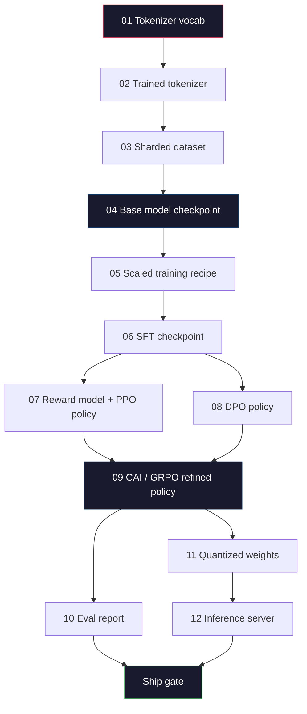
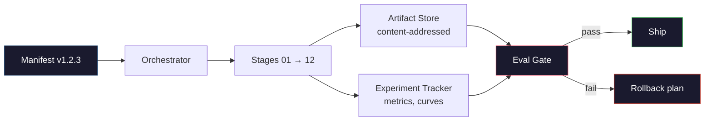

# 构建完整 LLM Pipeline

> Lessons 01 到 12 的所有内容，都是同一条 pipeline 的一个阶段。本课会搭起一个 scaffold，把这些阶段变成一次端到端运行：tokenize、pre-train、scale、SFT、align、evaluate、quantize、serve。你不会在笔记本电脑上训练一个 70B 模型。你会产出 orchestration layer、manifest、eval gate 和 rollback plan，也就是 2026 年 frontier team 用来决定什么能 ship 的那套东西。这是 capstone。

**Type:** Build
**Languages:** Python (stdlib)
**Prerequisites:** All Phase 10 lessons 01-12
**Time:** ~120 minutes

## 学习目标

- 把前面 lessons 的能力（tokenizer、data、pre-training、scaling、SFT、RLHF、DPO、CAI、eval、quantization、inference）组合成一个可复现的 pipeline spec
- 定义阶段之间的 artifact contract：每个 stage 消费什么、产出什么，以及下一阶段如何验证输入
- 构建一个 orchestrator，用来跟踪 experiments、hash artifacts，并基于 eval thresholds gate ship decisions
- 设计 rollback plan：哪些 artifacts 可以便宜地重跑，哪些很昂贵，以及一个损坏 checkpoint 的真实成本是什么

## 问题

前面的 lessons 每个都能工作。Tokenizer 训练好了。Tiny GPT 预训练好了。SFT dataset 组好了。Reward model 训练好了。DPO 跑过了。Evals 量过了。Quantized weights 导出了。Inference server 启动了。每一个都是一个 notebook。每一个都有自己的约定、自己的 output paths、自己的 seed。

Frontier training run 不是 notebook。Llama 3 405B 大约用了 54 天、3000 万 H100 hours。DeepSeek-V3 大约用了 280 万 H800 hours。在这段时间里，一个损坏 checkpoint、一次 data contamination、一次 eval regression，都可能让团队损失一周 wall-clock 和一个月 GPU budget。团队靠 pipeline hygiene 活下来：每个 stage 都有确定的输入、确定的输出、manifest、hash 和 gate。

这是 capstone。你不会在笔记本上端到端跑完整 pipeline。你会写出协调 stages 的 orchestrator、描述 run 的 manifest、gate ship decisions 的 verifier，以及让第三方可以从一个文件重跑你工作的 replay plan。代码很小；纪律很大。

这个 pattern 从 100M 到 1T 参数都不变。同样四个组件：manifest、orchestrator、eval gate、artifact store，既能跑 Llama 3，也能跑你的 hobby GPT。区别只是每个 stage config 里的数字大小，而不是 pipeline 的形状。

## 概念

### 十二个阶段

Phase 10 的每一课都是一个 stage。下面是完整 dependency graph。



Stages 07 和 08 可以并行运行。其他全部是硬依赖。Stage 02（tokenizer）的变化会让所有下游 artifact 失效。Stage 10（eval）的变化只会让 ship decision 失效。

### Manifest

Manifest 是一个单文件，它对一次 run 的描述要完整到足以 replay。Pipeline 产出的任何东西，都不应该依赖 manifest 之外的状态。字段很无聊，但必须存在。

```yaml
pipeline_version: 1.2.3
seed: 42
git_commit: a1b2c3d4
stages:
  01_tokenizer:
    recipe: bpe_32k
    input_hash: sha256:...
    output_hash: sha256:...
    wall_clock_sec: 3600
    cost_usd: 12
```

Stage N 的 output hash，就是 Stage N+1 的 input hash。任何偏差都会让 pipeline 停止。这就是早期捕捉 data corruption 的办法。它也让另一个大陆的队友可以验证：他们 replay 得到的 artifact 和你的是同一个。

实践中，团队通常使用一个小 YAML schema，再配一个 manifest checker，用来和上一次成功 run 做 diff。任何不在预期字段内的 delta（cost、wall clock 之外）都是 red flag。

### Artifact Typing

每个 stage 的输出都是 typed artifact。不是目录 blob，不是 pickle，而是一个有名字、有已知 schema 的类型。

| Stage | Artifact Type | Key Fields |
|-------|---------------|------------|
| 01-02 | Tokenizer | vocab.json, merges.txt, config.json, hash |
| 03 | Dataset | shards[], row count, token count, dedup stats |
| 04-05 | Checkpoint | weights.safetensors, config.json, optimizer state, step count |
| 06 | SFT Model | checkpoint + SFT recipe + data mix |
| 07 | Reward Model | RM checkpoint + preference data hash |
| 08-09 | Policy | checkpoint + reference hash + beta + KL budget consumed |
| 10 | Eval Report | benchmark scores + regression diffs + eval data hash |
| 11 | Quantized Model | quantized weights + calibration data + accuracy delta vs FP16 |
| 12 | Server Spec | endpoint + model hash + config + observability hooks |

Typing 可以防止最常见的 failure mode：把 stage 08 的输出当成 stage 06 的输入，把 DPO-trained model 走 SFT path ship 出去。Typed artifacts 和 typed stage signatures 会让这类错误变成 compile-time failures，而不是第 5 天才发现的 failures。

### Eval Gate

Shipping 不是 “training finished”。Shipping 是 “training finished and the eval gate passed”。Gate 必须在 run 开始前定义好。

```yaml
gates:
  mmlu:      ">= baseline + 0.5"   # no regression
  humaneval: ">= baseline + 1.0"
  truthfulqa: ">= baseline"        # no drop
  safety_refusal_rate: "<= 0.05"
  kl_from_reference: "<= 25.0"
  cost_total_usd: "<= 50000"
```

每个 gate 都是 numeric threshold。没有 “looks good” gate。没有 subjective sign-off。如果每个 gate 都通过，artifact 就被标记为 shippable。如果任何 gate 失败，这个 run 会被 hold，等待具名 reviewer 显式 override；这个 override 本身也会被写入 manifest。

两个 gates 能抓住大多数灾难。一个是 *regression* gate（新模型在核心 benchmarks 上至少不能比上一版差），用于捕捉 training bugs。另一个是 *KL budget* gate（aligned policy 不能比 reference 漂移超过 X），用于捕捉 alignment overcooking。每条生产 pipeline 都有这两者。

### Orchestrator

Orchestrator 是一小段代码：读取 manifest、dispatch stages、跟踪 artifacts，并在任何 contract violation 时停止。它不是 Airflow。它不是 Kubeflow。为了 pipeline hygiene，你需要的是一个你自己写的、无聊可靠的小东西。

Orchestrator 的职责很窄：

1. 从 manifest 解析 DAG。
2. 对每个 stage，检查预期输出是否已经以正确 hash 存在（存在就 skip）。
3. 运行 stage，捕获 stdout/stderr，测量 wall clock 和 cost。
4. 根据下游 stage 的 expected input hash 验证 output hash。
5. 失败时，写出一个 partial manifest，记录精确失败 stage，并以非零退出码结束。

这就是 200 行 Python。它会长得像本课的 `code/main.py`。真实 pipeline 底层会用 `torchrun` 或 `ray` 在 clusters 上执行单个 stages，但 orchestrator 本身跑在一台机器上。

### Experiment Tracking 与 Artifact Storage

两个外部系统会锚定 pipeline。

**Experiment tracker（wandb、neptune、mlflow）。** 按 stage 记录 loss curves、eval metrics 和 system telemetry。当你三周后需要比较 run A 和 run B 时，tracker 就是你去的地方。团队几乎总是使用 hosted tracker：自己写会浪费本该投入训练的时间。

**Artifact store（S3、R2、GCS）。** 用于 checkpoints、datasets、tokenizers、eval reports 的 immutable object store。Artifacts 通过 hash 寻址，而不是通过 filename。像 `latest.pt` 这样的文件名是事故入口；`ckpt-7b-step-20000-sha256:abc123.safetensors` 才是 contract。

Orchestrator 会写入两者。Tracker 服务于看 charts 的人。Artifact store 服务于查找输入的下一个 stage。

### Costing

Frontier run 一定带着美元数字。Budget discipline 发生在两个地方。

**Pre-run estimate。** 根据 manifest 计算 expected FLOPs（pre-training：6 x params x tokens）、expected GPU hours（FLOPs / peak throughput / utilization），以及按当前租赁价格计算 dollar cost。如果 estimate 超过 budget gate，pipeline 拒绝启动。

**In-run tracking。** 每个 stage 的 wall clock 和 cost 都会写进 manifest。每个 stage 之后检查 remaining budget。如果某个 stage 超支，下一个 stage 的 gate 会用新的 remaining budget 评估。你不会等到 VC 打电话时才发现钱没了。

Llama 3 报告的成本是 $61M。DeepSeek-V3 报告的 main pre-training run 是 $5.6M。这个比例主要来自 hardware efficiency 和 mixture-of-experts，但具体成本可见，是因为两个团队都按 stage 跟踪成本，而不是只按整个 run 跟踪。

### Reproducibility vs Determinism

这两者不是一回事。*Reproducible* 指同一个 manifest、同一份 code、同一套 infrastructure，会产生下游 metrics 等价的 checkpoint。*Deterministic* 指 bit-identical output。

现代 LLM training 是 reproducible，但不是 deterministic。Distributed training 的 reduce-order、GPU kernel non-determinism（cuBLAS、flash-attn）和 mixed precision rounding 会叠加起来，让两次运行之间的 floats 在 1e-5 级别不同。对最终 metrics 来说这没关系，它们不会明显变化。但如果你试图用 bit-level diffs debug，这会很致命。解决办法是记录每个 stage 的 input hash、output hash 和 headline metrics：如果这些匹配，这个 run 就是 “reproduced”，即使 weights 不是 bit-identical。



### Rollback Plan

Run 开始之前，要写清楚每个 stage 失败时发生什么。三类。

- **便宜，可以重跑**（小时级）：tokenizer、eval、quantization、inference server。直接重跑。
- **中等成本**（天级）：SFT、DPO、CAI。保留 base model，只重跑 alignment stages。
- **昂贵**（周级、百万美元级）：pre-training。这里的 rollback plan 不是 “re-run”。而是 “使用最后一个 good checkpoint，并用修正后的数据重跑更便宜的下游 stages”。

因为 stage dependencies 都 typed 且 hashed，orchestrator 可以自动计算 rollback set：使失败 stage 及所有 descendants 失效。Stage 06（SFT）失败会使 06、07、08、09、10、11、12 失效。Stage 11（quantization）失败只会使 11 和 12 失效。提前命名这些规则，可以避免团队在凌晨 4 点筋疲力尽时即兴决策。

### 2026 年观察到的生产配方

多数 frontier teams 已经收敛到同一套 skeleton。

- Tokenizer：128k BPE with byte fallback。在小而平衡的 multilingual slice 上训练。
- Pre-training：10-20T tokens，主要是 web、code 和 synthetic。Muon 或 AdamW optimizer。FSDP2 或 DeepSpeed ZeRO-3。Gradient checkpointing。BF16 weights，FP32 master。
- SFT：500k-2M instruction pairs，人类与 synthetic 混合，并且严格和 eval set 去重。
- Alignment：DPO 或 CAI + GRPO。只有当 preference signal 对 DPO 来说太 multidimensional 时才用 RLHF。
- Eval：MMLU-Pro、MATH、HumanEval+、GPQA、SWE-Bench Verified、LiveBench，加上一份公众永远看不到的 private held-out set。
- Quantization：Serving 用 4-bit GPTQ 或 AWQ；安全 eval 中 accuracy deltas 很重要时用 8-bit。
- Serving：vLLM、TensorRT-LLM 或 in-house。Continuous batching。Speculative decoding。KV cache eviction。

数字每六个月都会变。Skeleton 不会。

```figure
beam-search
```

## 动手构建

本课代码是 orchestrator 和 manifest checker，不是十二个 training scripts。每个 stage 都用 placeholder 模拟，产出形状和 hash 正确的 output artifact。在真正把 GPU 预算烧到真实 stages 之前，先端到端运行 orchestrator，证明 pipeline plumbing 可以工作。

完整实现见 `code/main.py`。关键部分：

- `Manifest` dataclass：pipeline version、seed、git commit、stages、gates。
- `Stage` dataclass：name、type、inputs（hashes）、output（hash）、wall clock、cost。
- `Orchestrator.run()`：解析 DAG、dispatch stages、验证 hashes、更新 manifest。
- `EvalGate.check()`：读取 thresholds，和最新 eval report 比较，返回 pass/fail。
- `ArtifactStore`（in-memory stub）：按 hash put/get，模拟 S3。
- `CostTracker`：按 stage 和累计成本跟踪，超过 cap 时 halt。

`main.py` 里的 pipeline 会运行十二个 placeholder stages，产出一个 manifest，并触发一次 failing eval gate，展示 held run 是什么样子。把每个 placeholder 换成对应 lesson 的真实 training script，你就拥有了一条真实 frontier pipeline 会用的 skeleton。

## 投入使用

标准 workflow 有三条命令。

```bash
python code/main.py plan    # validate manifest, compute cost estimate, print DAG
python code/main.py run     # execute stages, writing to manifest.out.yaml
python code/main.py gate    # read manifest.out.yaml, apply eval gates, ship-or-hold
```

每次都先运行 `plan`。大多数 pipeline bugs 会在 plan time 暴露：缺 gate thresholds、stale hashes、budget overruns。运行 `plan` 免费。运行 `run` 昂贵。把 bugs 抓在便宜的一侧，省钱。

`gate` 的输出要么是 `SHIP`，要么是 `HOLD: <reason>`。Held run 不是失败，而是一个决策点。具名 reviewer 要么 override（并且 override 会被记录），要么批准 rollback。

## 交付成果

本课会产出 `outputs/skill-llm-pipeline-reviewer.md`。把一个 proposed pipeline manifest 交给它，它会检查所有 contracts：stage typing、hash chain、gates、rollback plan、cost estimate。遇到缺失 eval gate、无上限 KL budget，或混用 eval 和 training data 的 run，它会拒绝批准。

## 练习

1. 扩展 orchestrator，让 stages 07 和 08 支持并行执行。使用 stdlib 的 `concurrent.futures` module。确认最终 manifest 记录了两个 stages 的 outputs，并且 stage 09 的 input hash 是两者的 deterministic combination。

2. 添加一个 “contamination check” gate。给定 eval dataset hash 和 training dataset shards，计算 overlap（精确字符串匹配或 13-gram match）。如果 overlap 超过 0.1%，gate 失败。喂给它一个 contaminated training set，确认 gate 会 hold 这个 run。

3. 从第一性原理实现 cost estimator。对 stage 04（pre-training），把 FLOPs 估为 6 x params x tokens，假设 H100 BF16 峰值 989 TFLOPs、40% MFU（model FLOPs utilization）、$2.50/GPU-hour。报告 7B model 在 2T tokens 上训练的 estimate，并和公开的 Llama 2 数字比较。

4. 构建 partial rollback。模拟 stage 09（CAI）失败，然后只重跑 stages 09 到 12，保持 01-08 cached。Orchestrator 应该能通过 hash 识别 cached artifacts 并跳过它们。测量相对完整重跑节省了多少 wall-clock。

5. 添加 observability。为每个 stage 发出 OpenTelemetry spans，attributes 包含 params、tokens seen、loss 和 cost。把 spans 输送到一个 local collector。重点不是 dashboard，而是每个 stage 的健康状况都能从同一个 trace ID 追踪。

## 关键术语

| Term | 人们常说 | 实际含义 |
|------|----------|----------|
| Manifest | “recipe file” | 描述 pipeline version、seed、per-stage config 和 gate thresholds 的 YAML 或 JSON，足以 replay 一次 run |
| Content-addressed | “按 hash，不按名字” | Artifacts 按内容的 SHA-256 存储，所以你永远不会把 version A 和 version B 混淆 |
| Eval gate | “ship criteria” | 对 benchmark metrics 和 safety scores 的 numeric thresholds，必须通过后 artifact 才会被标记为 shippable |
| KL budget | “alignment 漂移了多远” | 对 alignment stages 的累计 KL(policy \|\| reference) 设置上限，并作为 gate 强制执行 |
| MFU | “GPU 用了多少” | Model FLOPs Utilization：实际 FLOPs 除以理论峰值。70B 规模典型值约 40%，7B 约 55% |
| Rollback plan | “坏了怎么办” | 针对每个 stage failure 预先写好的动作集合：re-run、fall back、用修正输入重训 |
| Orchestrator | “conductor” | 读取 manifest、dispatch stages、验证 hashes，并在任何 contract violation 时停止的进程 |
| Artifact store | “给 weights 用的 versioned S3” | Immutable content-addressed object store，是 checkpoints、datasets、eval reports 的 single source of truth |
| Reproducible | “Replay 后 metrics 一样” | Weights 在 bit-level 上可能不同，但 downstream metrics 等价；这是 distributed LLM training 的现实目标 |
| Cost gate | “不能超过 X” | Pre-run cost estimate 加 in-run tracker；如果 estimate 超过 budget，pipeline 会拒绝启动 |

## 延伸阅读

- [Dubey et al., 2024 -- "The Llama 3 Herd of Models"](https://arxiv.org/abs/2407.21783) -- 公开资料中最详细的 frontier pipeline 描述之一，覆盖 data、training、alignment、eval
- [DeepSeek-AI, 2024 -- "DeepSeek-V3 Technical Report"](https://arxiv.org/abs/2412.19437) -- efficiency-first pipeline，成本约为 Llama 3 级别训练的十分之一
- [Kaplan et al., 2020 -- "Scaling Laws for Neural Language Models"](https://arxiv.org/abs/2001.08361) -- 最早的 compute-data-params scaling relationship
- [Hoffmann et al., 2022 -- "Training Compute-Optimal Large Language Models (Chinchilla)"](https://arxiv.org/abs/2203.15556) -- 对 Kaplan 的修正，重新校准了现代 data budgets
- [PyTorch FSDP2 documentation](https://pytorch.org/docs/stable/fsdp.html) -- PyTorch 2.4+ 中替代 FSDP1 的 distributed training primitive
- [Weights & Biases LLM Reports](https://wandb.ai/site/llms) -- 开源 LLM runs 的真实 manifests 和 experiment tracker output，可作为参考模板
