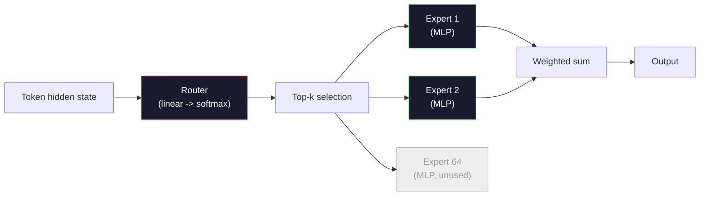

# 开源模型：架构走读

> 你已经在 Lesson 04 从零构建了一个 GPT-2 Small。2026 年的 frontier open models 和它属于同一家族，只是有五六个具体变化：RMSNorm 取代 LayerNorm，SwiGLU 取代 GELU，RoPE 取代 learned positions，GQA 或 MLA 取代 full MHA，大规模使用 Mixture-of-Experts。你已经掌握的数学覆盖了其中 95%。这一课会并排阅读 Llama 3、DeepSeek-V3、Mixtral、Qwen 和 Gemma，指出每个架构到底在哪一行开始分叉。

**Type:** Learn
**Languages:** Python (stdlib)
**Prerequisites:** Phase 10, Lessons 04, 05, 12 (Pre-training, Scaling, Inference)
**Time:** ~45 minutes

## 学习目标

- 阅读 Llama 3、Mistral、Mixtral、Gemma 2、Qwen 2.5 和 DeepSeek-V3 的 `config.json`，并解释每个字段
- 说出每个模型相对 GPT-2 Small 所做的具体架构变化，并从 first principles 解释理由
- 只凭 config 计算任意 open model 的 parameter count、KV cache size 和 activation memory
- 在给定 latency、memory 和 capability constraints 的部署目标下，选择合适的 open model

## 问题

在 Lesson 04 中，你写了 350 行 numpy，得到一个 GPT-2 形状的模型。Llama 3 405B 有一份 200 页的技术报告。你的直觉可能会说：它们是不同的物种。其实不是。那 200 页描述的是同一个对象，只是在五六处做了有充分动机的修改，再加上一千个关于 scaling 的实现细节。骨架没有变：embedding、transformer blocks、attention、MLP、norm、head。

这一课就是一份 diff。对于每个主要 open model family，我们会列出它相对 GPT-2 到底改了什么、为什么改、代价是什么。学完之后，你可以读一张新的 model card，并在脑子里把它翻译回 GPT-2 baseline。

实际收益是：当 Meta 发布 Llama 5，或者 DeepSeek 发布 V4 时，你不需要新的 mental model。你只要看 config，看到哪些熟悉 knobs 被拨动，就能知道下游影响。2026 年的模型架构是一套有限工具箱。每个新模型只是选择了不同子集。

## 概念

### 不变的核心

所有 autoregressive open models 都共享：

- Token embedding matrix（`vocab_size x hidden_dim`）。
- N 层 decoder blocks：norm、self-attention、residual、norm、MLP、residual。
- Final norm 和投影到 `vocab_size` 的 linear head，通常与 embeddings weight-tied。
- Causal mask，next-token cross-entropy loss。

这就是形状。剩下的都是 knobs。

### 真正会动的六个 Knobs

在 2024-2026 的每个 frontier open model 中，同样六个设计选择会反复出现：

1. **Normalization。** LayerNorm -> RMSNorm。
2. **Positional encoding。** Learned absolute -> RoPE，以及 YaRN、NTK 等变体。
3. **Activation。** GELU -> SwiGLU，或 GeGLU。
4. **Attention head sharing。** MHA -> GQA -> MQA -> MLA。
5. **Dense vs sparse MLP。** Dense -> Mixture-of-Experts。
6. **Pre-norm placement。** Pre-norm 保留。Post-norm 已经消失。

其他东西，比如 learning rate schedule、data mix、batch size、context length，都属于 training config，而不是 architecture。六个 knobs。

### Knob 1：RMSNorm

LayerNorm 会减去均值、除以标准差、缩放、平移。RMSNorm 只保留缩放：

```text
RMSNorm(x) = x / sqrt(mean(x^2) + eps) * gamma
```

没有 mean subtraction。没有 bias。每个 token 少一次 matmul。Zhang 和 Sennrich（2019）认为它在 machine translation 上能匹配 LayerNorm，同时快 10%。每个现代 open model 都在用它。

成本：无。收益：小幅 throughput 提升，代码更简单。

### Knob 2：RoPE

GPT-2 的 learned position embeddings 是一张 1024 槽位的 lookup table。Context 1025 会越过表尾。模型无法外推到训练长度之外。

Rotary Position Embedding（RoPE，Su et al. 2021）通过在 attention dot product 之前，把每个 Q 和 K vector 成对旋转来注入位置信息。旋转角度是 position 的 deterministic function，所以没有 learned 参数，也不会“用完”。借助 scaling tricks（NTK-aware interpolation、YaRN），一个在 8k context 上训练的模型可以在 inference 时拉伸到 128k，并且只损失适度 accuracy。

```text
q_rotated = rotate(q, angle(pos))
k_rotated = rotate(k, angle(pos))
score = q_rotated . k_rotated
```

每个 Llama、Mistral、Qwen、DeepSeek 和 Gemma 都使用 RoPE。Gemma 2 使用混合方案：多数 layers 上用 RoPE，另一些 layers 上用 local sliding-window attention。

### Knob 3：SwiGLU

GPT-2 的 MLP 是 `x -> gelu(xW1 + b1) -> (...)W2 + b2`。SwiGLU（Shazeer 2020）把 activation 换成 gated product：

```text
SwiGLU(x) = (xW1) * sigmoid(xW1) * xV
```

它是两个 parallel projections，而不是一个，并由 Swish activation 门控。经验上，它在 perplexity per parameter 上更强。Llama 2 采用之后，大家都跟上了。MLP 的 hidden size 通常会设置到让 total parameter count 接近原来的 dense MLP：如果 GPT-2 用 `ff_dim = 4 * hidden`，SwiGLU 会用 `ff_dim = (2/3) * 4 * hidden = 8/3 * hidden`。

### Knob 4：Attention Head Sharing

GPT-2 使用 **Multi-Head Attention (MHA)**：每个 head 都有自己的 Q、K、V projection。

**Multi-Query Attention (MQA, Shazeer 2019)** 让所有 heads 共享一个 K 和一个 V。KV cache 会按 `num_heads` 缩小，在典型模型上是 12x 到 32x 的减少。Accuracy 会在困难 benchmarks 上略微下降。

**Grouped-Query Attention (GQA, Ainslie et al. 2023)** 是折中方案：G 组 Q heads 共享一个 K 和一个 V。Llama 3 8B 使用 32 个 Q heads 和 8 个 KV heads 的 GQA（G=8），所以 KV cache 相比 full MHA 缩小 4x。

**Multi-Head Latent Attention (MLA, DeepSeek 2024)** 把 K 和 V 压缩成共享的 low-rank latent，再按 head 投影回去。它进一步降低 KV cache，同时保留 per-head expressiveness。DeepSeek-V2 和 V3 依赖它获得 long-context performance。

| Scheme | KV Heads | KV Cache | Accuracy |
|--------|----------|----------|----------|
| MHA    | num_heads | full | best |
| GQA    | num_groups (G < num_heads) | num_heads / G reduction | near-MHA |
| MQA    | 1 | num_heads reduction | small hit |
| MLA    | latent, per-head decompression | smaller than MQA | near-MHA |

对任何超过约 13B 参数的模型来说，GQA 或 MLA 实际上是必需的。Full MHA 在这种规模下会造成 KV cache disaster。

### Knob 5：Mixture of Experts

Dense MLP 会为每个 token 激活所有参数。MoE MLP 在每个 block 中有 K 个 experts，还有一个 router 为每个 token 选择 top-k experts，通常是 top-2。只有这些 experts 的 weights 会对该 token 做 forward pass。

```text
router_logits = xW_r
indices, weights = top_k(router_logits, k=2)
output = sum_i weights[i] * expert[indices[i]](x)
```

吸引力在于：你可以拥有 64 个 7B 大小的 experts，所以 total param count 非常大，但每个 token 只运行其中 2 个，所以 per-token compute 接近 dense 7B model。Mixtral 8x7B 总参数 47B，但每个 token 只激活 13B。DeepSeek-V3 总参数 671B，但每个 token 只激活 37B。



优点：相同 compute，更多 parameters，更强 capacity。缺点：expert memory 仍然必须放在某处，所以 serving 需要比 dense equivalent 更多 VRAM；router load-balancing 很难；alignment 阶段微调 router 本身就是研究课题。

### Knob 6：Pre-norm 保留

原始 transformer 在每个 sublayer 之后应用 layer norm。自 GPT-2 以来，每个 open model 都把它放在每个 sublayer 之前。Pre-norm 在深层模型上明显更容易训练。没什么可争的。

### 逐模型 Diff

下面这张表把所有内容具体化。

| Model | Year | Total Params | Active Params | Norm | Activation | Position | Attention | MoE | Context |
|-------|------|-------------|---------------|------|-----------|----------|-----------|-----|---------|
| GPT-2 Small | 2019 | 124M | 124M | LayerNorm | GELU | Learned | MHA (12 heads) | no | 1k |
| Llama 3 8B | 2024 | 8B | 8B | RMSNorm | SwiGLU | RoPE | GQA (32/8) | no | 128k |
| Llama 3 70B | 2024 | 70B | 70B | RMSNorm | SwiGLU | RoPE | GQA (64/8) | no | 128k |
| Llama 3 405B | 2024 | 405B | 405B | RMSNorm | SwiGLU | RoPE | GQA (128/16) | no | 128k |
| Mistral 7B | 2023 | 7.2B | 7.2B | RMSNorm | SwiGLU | RoPE | GQA | no | 32k |
| Mixtral 8x7B | 2023 | 47B | 13B | RMSNorm | SwiGLU | RoPE | GQA | yes (8 experts, top-2) | 32k |
| Gemma 2 9B | 2024 | 9B | 9B | RMSNorm (pre+post) | GeGLU | RoPE + sliding | GQA | no | 8k |
| Qwen 2.5 72B | 2024 | 72B | 72B | RMSNorm | SwiGLU | RoPE (YaRN) | GQA (64/8) | no | 128k |
| DeepSeek V2 236B | 2024 | 236B | 21B | RMSNorm | SwiGLU | RoPE | MLA | yes (160 experts, top-6) | 128k |
| DeepSeek V3 | 2024 | 671B | 37B | RMSNorm | SwiGLU | RoPE | MLA | yes (256 experts, top-8) | 128k |

扫一遍列。RMSNorm 是 universal。SwiGLU 或它的 GeGLU cousin 是 universal。RoPE 是 universal。7B 以上 GQA 是 universal，除非被 MLA 替代。MoE 是 top end 的差异化因素。

### 读取 config.json

Llama 3 8B config：

```json
{
  "hidden_size": 4096,
  "intermediate_size": 14336,
  "num_hidden_layers": 32,
  "num_attention_heads": 32,
  "num_key_value_heads": 8,
  "max_position_embeddings": 131072,
  "rope_theta": 500000.0,
  "rms_norm_eps": 1e-5,
  "vocab_size": 128256
}
```

每个字段都对应你已经实现过的东西。

- `hidden_size`：embedding dimension。
- `intermediate_size`：MLP hidden size，3.5x hidden，也就是 SwiGLU math。
- `num_hidden_layers`：stack depth。
- `num_attention_heads`：Q heads。
- `num_key_value_heads`：KV heads，也就是 GQA。
- `max_position_embeddings`：training context length。
- `rope_theta`：RoPE base frequency。Meta 为了 long-context extrapolation，把它从默认的 10k 缩放到 500k。
- `rms_norm_eps`：numerical stability。
- `vocab_size`：tokens。

仅凭这些，你就能计算 total parameters、KV cache 和 peak activation memory。精确公式见 `code/main.py`。

### Activation memory budget

在几 billion 参数以上的训练中，activations 会主导 training memory。Pre-training 的经验公式是，使用 gradient checkpointing 时：

```text
activation_mem ~ batch_size * seq_len * hidden_size * num_layers * bytes_per_element
```

对于 Llama 3 8B，batch 1、seq 8192、BF16、32 layers、hidden 4096：有 checkpointing 时仅 activations 就约 8 GB，没有 checkpointing 时约 40 GB。这就是 flash-attention 和 ring-attention 重要的原因：它们重写 attention computation，让 activations 放得下。

### KV Cache budget

在 max context inference 时：

```text
kv_cache = 2 * num_layers * num_kv_heads * head_dim * max_seq_len * bytes_per_element
```

Llama 3 8B 在 128k context、BF16 下，`head_dim = hidden / num_heads = 128`：
`2 * 32 * 8 * 128 * 131072 * 2 = 17.2 GB`，这是每条 sequence 的 KV cache。

8B weights 用 BF16 是 16 GB。单条 128k sequence 的 KV cache 比 weights 还大。这种 memory pressure 正是推动 GQA、MLA 和 KV cache quantization 研究的原因。

### 每个模型什么时候赢

- **单张 80GB GPU，不用 MoE**：Llama 3 8B、Mistral 7B、Gemma 2 9B。容易 serve，tooling 广泛。
- **单节点（8x80GB），大 capacity**：Llama 3 70B、Qwen 2.5 72B。最高 dense open capability。
- **追求最大 open capability，接受 MoE complexity**：DeepSeek V3、Mixtral 8x22B。每 active FLOP 的 capability 最好。
- **Long-context needs**：Llama 3（RoPE scaling 到 128k）、DeepSeek（MLA 优势）。
- **Low-latency serving**：Gemma 2 9B（sliding window 降低 long-context compute）。

```figure
rmsnorm-vs-layernorm
```

## 动手构建

本课代码是一个 calculator。给定任意 `config.json`，它会打印按组件拆分的 parameter count、max context 下的 KV cache、SwiGLU MLP ratio，以及一个架构简评（dense / GQA / MLA / MoE）。

```python
config = {
    "hidden_size": 4096, "intermediate_size": 14336,
    "num_hidden_layers": 32, "num_attention_heads": 32,
    "num_key_value_heads": 8, "vocab_size": 128256,
    "max_position_embeddings": 131072,
}
```

Script 会逐字段走读架构，计算 embedding、attention（包含 GQA reduction）、MLP（包含 SwiGLU expansion）、layernorms 和 head 的 param counts。然后它会根据给定 context length 计算 KV cache，并打印 summary。

实现见 `code/main.py`。

## 使用它

用脚本内置的 Llama 3 8B、Mistral 7B、Mixtral 8x7B 和 DeepSeek V3 configs 跑 calculator。比较 parameter breakdowns。注意 MoE models 的 total param count 远大于 dense models，但 active param count 往往更小。还要注意，DeepSeek V3 总参数更多，但 KV cache 比 Llama 3 405B 更小，这就是 MLA 在起作用。

然后把你本地任意模型的 config 填进去，读取 summary，判断它是否适合你的 GPU。

## 交付它

本课会产出 `outputs/skill-open-model-picker.md`。给定 deployment target（GPU type、VRAM、context length、latency budget）和 task profile（chat、code、reasoning、long-context），它会推荐一个 open model、一个 Lesson 11 中的 quantization scheme，以及 Lesson 12 中的 inference stack，并明确解释六个 architectural knobs。

## 练习

1. 从 HuggingFace 读取 Qwen 2.5 72B config。从零计算 total parameters。和 HF 报告的值比较，并识别任何差异来自哪里，比如 head dim rounding、KV sharing factor 等。

2. DeepSeek V3 使用 256 experts 和 top-8 routing。计算 activated experts 与 total experts 的比例，并和 Mixtral 8x7B 的 top-2 of 8 比较。从 25% 到 3% 的 active expert fraction 变化，对 capacity per FLOP 意味着什么？

3. 计算 Llama 3 405B 在 128k context 下的 FP8 和 BF16 KV cache。FP8 是 BF16 的一半。在单个 8xH100 node（每张 80GB，共 640GB，减去 weight memory）上，你能 serve 多少 parallel sequences？

4. Gemma 2 交替使用 full-attention 和 sliding-window-attention layers。写出当一半 layers 使用 4096-token sliding window 而不是 full context 时的 KV cache 公式。在 8k total context 下能节省多少 memory？

5. 找一个在本课写完之后发布的最新 frontier open model。识别它选择了六个 knobs 中的哪些，以及它是否引入了第七个 knob。课程会在新架构发布的那一刻显得过时；目标是在不重建 mental model 的情况下更新你的表格。

## 关键术语

| Term | What people say | What it actually means |
|------|----------------|----------------------|
| RMSNorm | “没有 mean 的 LayerNorm” | 只按 root mean square 做 normalize，并带 learned scale；更便宜，效果可与 LayerNorm 相比 |
| RoPE | “Rotary positions” | 根据 position 相关角度，把每个 Q 和 K vector 按 2D pairs 旋转；借助 scaling tricks 可外推到训练长度之外 |
| SwiGLU | “新的 MLP activation” | 带 Swish 的 gated linear unit：`(xW1) * sigmoid(xW1) * xV`；是每个 2024+ open model 的标准配置 |
| GQA | “折中 attention” | Grouped-Query Attention：G 组 Q heads 共享一个 K 和一个 V head；在没有 MQA accuracy hit 的情况下缩小 KV cache |
| MLA | “DeepSeek 的 attention” | Multi-Head Latent Attention：把 K/V 压缩成共享 low-rank latent，再按 head 解压；为大模型提供最小 KV cache |
| MoE | “Sparse experts” | Mixture of Experts：每个 block 有 N 个 MLPs，router 为每个 token 选择 top-k；total params 巨大，active params 很小 |
| Top-k routing | “每个 token 选 k 个 experts” | Router 为每个 expert 计算分数并激活最高的 k 个；典型 k 从 2（Mixtral）到 8（DeepSeek） |
| YaRN | “拉伸 RoPE” | Yet another RoPE extension；通过插值 rotary angles，在 inference 时把 context 从 8k 扩展到 128k+ |
| Sliding-window attention | “不要 attend to everything” | 每个 token 只 attend 最近 W 个 tokens；把 attention cost 限制为每 token O(W)，Gemma 2 和早期 Mistral 使用过 |
| Active params | “每个 token 实际运行的参数” | 对 MoE models 来说，每个 token forward pass 会经过的 parameter count，远小于 total params；决定 per-token FLOPs |

## 延伸阅读

- [Dubey et al., 2024 -- "The Llama 3 Herd of Models"](https://arxiv.org/abs/2407.21783) -- dense Llama 3 family 的架构和训练参考
- [DeepSeek-AI, 2024 -- "DeepSeek-V3 Technical Report"](https://arxiv.org/abs/2412.19437) -- MLA、auxiliary-loss-free load balancing 和 671B MoE
- [Jiang et al., 2024 -- "Mixtral of Experts"](https://arxiv.org/abs/2401.04088) -- canonical MoE open model paper
- [Su et al., 2021 -- "RoFormer: Enhanced Transformer with Rotary Position Embedding"](https://arxiv.org/abs/2104.09864) -- RoPE 论文
- [Shazeer, 2020 -- "GLU Variants Improve Transformer"](https://arxiv.org/abs/2002.05202) -- SwiGLU、GeGLU 等变体
- [Ainslie et al., 2023 -- "GQA: Training Generalized Multi-Query Transformer Models"](https://arxiv.org/abs/2305.13245) -- GQA 论文
- [Gemma 2 Team, 2024 -- "Gemma 2: Improving Open Language Models at a Practical Size"](https://arxiv.org/abs/2408.00118) -- hybrid full+sliding attention、pre+post-norm
- [Qwen Team, 2024 -- "Qwen 2.5 Technical Report"](https://arxiv.org/abs/2412.15115) -- YaRN context extension 和 long-context training recipes
