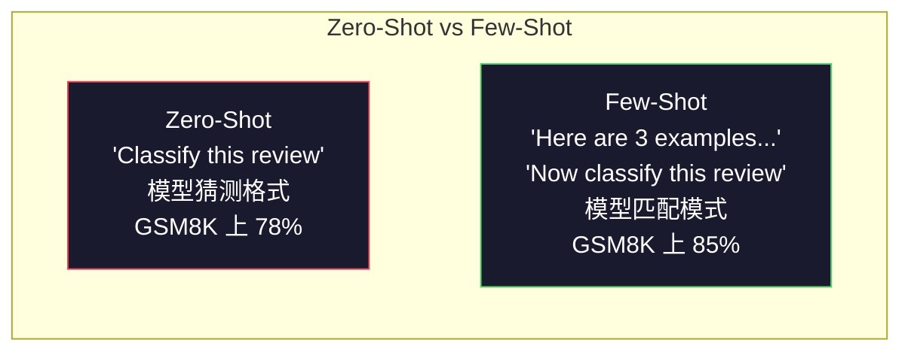
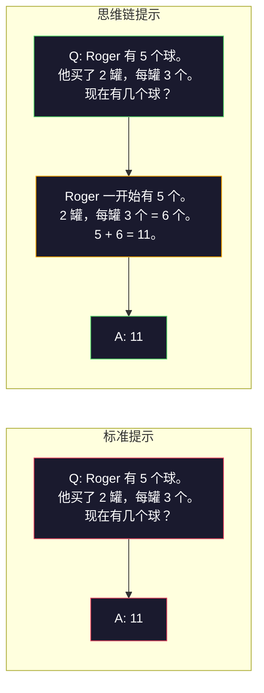
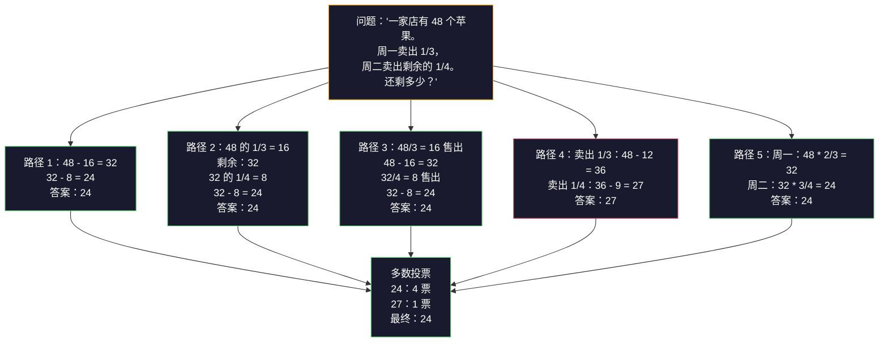
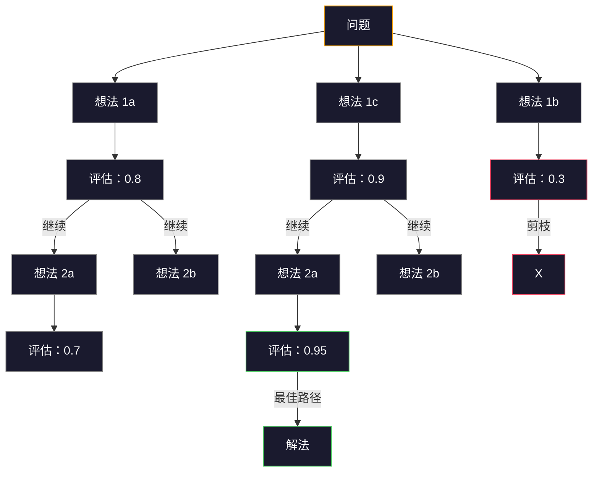

# 少样本、思维链与思维树

> 告诉模型要做什么，是提示词。展示模型如何思考，是工程。同一个模型、同一个任务、同一份数据，准确率从 78% 到 91% 的差距，不是更好的模型，而是更好的推理策略。

**Type:** Build
**Languages:** Python
**Prerequisites:** Lesson 11.01 (Prompt Engineering)
**Time:** ~45 minutes

## 学习目标

- 通过选择和格式化示例演示，实现能最大化任务准确率的少样本提示
- 应用思维链（CoT）推理，提高数学应用题等多步骤问题的准确率
- 构建思维树提示，让模型探索多条推理路径并选择最佳路径
- 在标准基准上衡量 zero-shot、few-shot 与 CoT 的准确率提升

## 问题

你正在构建一个数学辅导应用。提示词写着：“Solve this word problem.” 在 GSM8K 这个标准小学数学基准上，GPT-5 有 94% 的题能答对。你以为已经到顶了。并没有，思维链仍然还能增加 3 到 4 个百分点。

加上五个词：“Let's think step by step”，准确率就跃升到 91%。再加几个带解题过程的示例，可以达到 95%。同一个模型。同一个 temperature。同样的 API 成本。唯一的区别是：你给了模型一张草稿纸。

这不是黑魔法。推理本来就是这样工作的。人类不会用一次脑内跳跃解决多步骤问题，Transformer 也不会。当你迫使模型生成中间 token 时，这些 token 会成为下一个 token 的上下文。每一步推理都会喂给下一步。模型是真的在一步步计算出答案。

但“think step by step”只是起点，不是终点。如果你采样五条推理路径，再做多数投票会怎样？如果你让模型探索一棵可能性树，对分支进行评估和剪枝会怎样？如果把推理与工具调用交织起来会怎样？这些都不是假设，而是已经发表、经过测量能提升效果的技术。本课会把它们全部从零实现出来。

## 概念

### Zero-Shot vs Few-Shot：示例什么时候胜过指令

Zero-shot prompting 只给模型任务，不给其他东西。Few-shot prompting 会先给模型示例。

Wei 等人（2022）在 8 个基准上测量了这种差异。对情感分类这类简单任务，zero-shot 和 few-shot 的表现差距在 2% 以内。对多步骤算术和符号推理这类复杂任务，few-shot 能让准确率提升 10% 到 25%。

直觉是：示例是被压缩过的指令。你不是描述输出格式，而是展示格式。你不是解释推理过程，而是演示过程。模型匹配示例模式，通常比理解抽象指令更可靠。



**few-shot 适合的场景：** 对格式敏感的任务、分类、结构化抽取、领域术语，以及任何需要模型匹配特定模式的任务。

**zero-shot 适合的场景：** 简单事实问答、示例会限制创造力的创意任务，以及找到好示例比写好指令更困难的任务。

### 示例选择：相似样本胜过随机样本

不是所有示例都一样好。在分类任务中，选择与目标输入相似的示例，比随机选择能高出 5% 到 15%（Liu et al., 2022）。三个原则：

1. **语义相似性**：选择嵌入空间中离输入最近的示例
2. **标签多样性**：示例要覆盖所有输出类别
3. **难度匹配**：让示例复杂度与目标问题匹配

大多数任务的最佳示例数量是 3 到 5 个。少于 3 个，模型没有足够信号抽取模式。多于 5 个，收益递减，还会浪费上下文窗口 token。对于有很多标签的分类任务，每个标签放一个示例。

### 思维链：给模型草稿纸

思维链（Chain-of-Thought, CoT）提示由 Google Brain 的 Wei 等人（2022）提出。想法很简单：不要只要求模型给答案，而是要求它先展示推理步骤。



为什么这在机制上有效？Transformer 生成的每个 token 都会成为下一个 token 的上下文。没有 CoT 时，模型必须把全部推理压缩进一次前向传播的隐藏状态里。有了 CoT，模型会把中间计算外化成 token。每个推理 token 都会扩展有效计算深度。

**GSM8K 基准（小学数学，8.5K 道题）：**

| Model | Zero-Shot | Zero-Shot CoT | Few-Shot CoT |
|-------|-----------|---------------|--------------|
| GPT-4o | 78% | 91% | 95% |
| GPT-5 | 94% | 97% | 98% |
| o4-mini (reasoning) | 97% | — | — |
| Claude Opus 4.7 | 93% | 97% | 98% |
| Gemini 3 Pro | 92% | 96% | 98% |
| Llama 4 70B | 80% | 89% | 94% |
| DeepSeek-V3.1 | 89% | 94% | 96% |

**关于推理模型。** OpenAI o 系列（o3、o4-mini）和 DeepSeek-R1 这类模型，会在输出答案之前内部运行思维链。给推理模型再加“Let's think step by step”是重复的，有时还会适得其反，因为它们已经这么做了。

CoT 有两种形式：

**Zero-shot CoT**：在提示末尾追加“Let's think step by step”。不需要示例。Kojima 等人（2022）证明，这一句话能在算术、常识和符号推理任务上提升准确率。

**Few-shot CoT**：提供包含推理步骤的示例。它比 zero-shot CoT 更有效，因为模型能看到你期望的精确推理格式。

**CoT 会伤害效果的场景**：简单事实回忆（“法国首都是哪里？”）、单步分类、速度比准确率更重要的任务。CoT 每次查询会额外增加 50 到 200 个推理 token。对高吞吐、低复杂度任务来说，这就是浪费成本。

### 自洽性：采样多次，只投一次票

Wang 等人（2023）提出了 self-consistency。洞察是：单条 CoT 路径可能包含推理错误。但如果采样 N 条独立推理路径（使用 temperature > 0），再对最终答案做多数投票，错误会互相抵消。



在最初的 PaLM 540B 实验中，self-consistency 让 GSM8K 准确率从单条 CoT 的 56.5% 提升到 N=40 时的 74.4%。在 GPT-5 上提升很小（97% 到 98%），因为基础准确率已经接近饱和。这个技术最适合 CoT 基础准确率在 60% 到 85% 的模型：单路径错误经常出现，但还没有系统性错误。对推理模型（o 系列、R1）来说，self-consistency 已经被内置的内部采样吸收了。

代价是：N 次采样意味着 N 倍 API 成本和延迟。实践中，N=5 能覆盖大部分收益。N=3 是有意义投票的最低值。对多数任务而言，N > 10 收益递减。

### 思维树：分支式探索

Yao 等人（2023）提出了 Tree-of-Thought（ToT）。CoT 只沿着一条线性推理路径前进，而 ToT 会探索多个分支，并在继续之前评估哪些分支最有希望。



ToT 有三个组件：

1. **想法生成**：生成多个候选下一步
2. **状态评估**：给每个候选打分（可以用 LLM 自己当评估器）
3. **搜索算法**：用 BFS 或 DFS 遍历树，并剪掉低分分支

在 Game of 24 任务中（用 4 个数字和算术运算组合出 24），标准提示下 GPT-4 只能解出 7.3% 的题。使用 CoT 是 4.0%（CoT 在这里反而伤害效果，因为搜索空间很宽）。使用 ToT 是 74%。

ToT 很贵。树中的每个节点都需要一次 LLM 调用。分支因子 3、深度 3 的树，最多需要 39 次 LLM 调用。只在搜索空间很大但可评估的问题上使用它，例如规划、解谜、有约束的创意问题解决。

### ReAct：思考 + 行动

Yao 等人（2022）把推理轨迹与行动结合起来。模型在思考（生成推理）和行动（调用工具、搜索、计算）之间交替。

```mermaid
graph LR
    Q["问题：\n埃菲尔铁塔所在国家\n的人口是多少？"]
    T1["Thought：我需要找到\n埃菲尔铁塔在哪个国家"]
    A1["Action：搜索\n'Eiffel Tower location'"]
    O1["Observation：\nParis, France"]
    T2["Thought：现在需要\n法国人口"]
    A2["Action：搜索\n'France population 2024'"]
    O2["Observation：\n6840 万"]
    T3["Thought：我已经有答案"]
    F["Answer：\n6840 万"]

    Q --> T1 --> A1 --> O1 --> T2 --> A2 --> O2 --> T3 --> F

    style Q fill:#1a1a2e,stroke:#ffa500,color:#fff
    style T1 fill:#1a1a2e,stroke:#51cf66,color:#fff
    style A1 fill:#1a1a2e,stroke:#e94560,color:#fff
    style O1 fill:#1a1a2e,stroke:#808080,color:#fff
    style T2 fill:#1a1a2e,stroke:#51cf66,color:#fff
    style A2 fill:#1a1a2e,stroke:#e94560,color:#fff
    style O2 fill:#1a1a2e,stroke:#808080,color:#fff
    style T3 fill:#1a1a2e,stroke:#51cf66,color:#fff
    style F fill:#1a1a2e,stroke:#51cf66,color:#fff
```



在知识密集型任务上，ReAct 胜过纯 CoT，因为它能把推理建立在真实数据上。在 HotpotQA（多跳问答）上，GPT-4 的 ReAct 达到 35.1% 精确匹配，而单独 CoT 是 29.4%。真正的力量在于：观察结果会修正推理错误，模型可以在执行过程中更新计划。

ReAct 是现代 AI agent 的基础。每个 agent 框架（LangChain、CrewAI、AutoGen）都实现了某种 Thought-Action-Observation 循环。第 14 阶段会构建完整 agent。本课只覆盖提示模式。

### 结构化提示：XML 标签、分隔符、标题

随着提示越来越复杂，结构能防止模型混淆不同部分。三种方式：

**XML 标签**（Claude 上效果最好，其他模型也稳定）：

```text
<context>
You are reviewing a pull request.
The codebase uses TypeScript and React.
</context>

<task>
Review the following diff for bugs, security issues, and style violations.
</task>

<diff>
{diff_content}
</diff>

<output_format>
List each issue with: file, line, severity (critical/warning/info), description.
</output_format>
```

**Markdown 标题**（通用）：

```text
## Role
Senior security engineer at a fintech company.

## Task
Analyze this API endpoint for vulnerabilities.

## Input
{api_code}

## Rules
- Focus on OWASP Top 10
- Rate each finding: critical, high, medium, low
- Include remediation steps
```

**分隔符**（最小但有效）：

```text
---INPUT---
{user_text}
---END INPUT---

---INSTRUCTIONS---
Summarize the above in 3 bullet points.
---END INSTRUCTIONS---
```

### 提示链：顺序分解

有些任务过于复杂，无法用单个提示完成。提示链会把任务拆成多个步骤，一个提示的输出会变成下一个提示的输入。


提示链胜过单提示有三个原因：

1. **每一步更简单**：模型一次只处理一个聚焦任务，不需要同时兼顾全部内容
2. **中间输出可检查**：你可以在步骤之间验证和修正
3. **不同步骤可以使用不同模型**：抽取用便宜模型，推理用昂贵模型

### 性能对比

| Technique | Best For | GSM8K Accuracy (GPT-5) | API Calls | Token Overhead | Complexity |
|-----------|----------|------------------------|-----------|----------------|------------|
| Zero-Shot | 简单任务 | 94% | 1 | 无 | 极低 |
| Few-Shot | 格式匹配 | 96% | 1 | 200-500 tokens | 低 |
| Zero-Shot CoT | 快速提升推理 | 97% | 1 | 50-200 tokens | 极低 |
| Few-Shot CoT | 单次调用最高准确率 | 98% | 1 | 300-600 tokens | 低 |
| Self-Consistency (N=5) | 高风险推理 | 98.5% | 5 | 5x token 成本 | 中 |
| Reasoning model (o4-mini) | CoT 的即插即用替代 | 97% | 1 | 隐藏（2-10x 内部） | 极低 |
| Tree-of-Thought | 搜索/规划问题 | N/A（Game of 24 上 74%） | 10-40+ | 10-40x token 成本 | 高 |
| ReAct | 基于知识的推理 | N/A（HotpotQA 上 35.1%） | 3-10+ | 可变 | 高 |
| Prompt Chaining | 复杂多步骤任务 | 96%（pipeline） | 2-5 | 2-5x token 成本 | 中 |

选择哪种技术，取决于三个因素：准确率要求、延迟预算和成本容忍度。对大多数生产系统来说，few-shot CoT 加上 3 样本 self-consistency 兜底，可以覆盖 90% 的用例。

## Build It

我们会构建一个数学问题求解器，把少样本提示、思维链推理和 self-consistency 投票组合成一条流水线。然后再为困难问题加入思维树。

完整实现位于 `code/advanced_prompting.py`。下面是关键组件。

### 第 1 步：Few-Shot 示例库

第一个组件管理 few-shot 示例，并为给定问题选择最相关的示例。

```python
GSM8K_EXAMPLES = [
    {
        "question": "Janet's ducks lay 16 eggs per day. She eats three for breakfast every morning and bakes muffins for her friends every day with four. She sells every egg at the farmers' market for $2. How much does she make every day at the farmers' market?",
        "reasoning": "Janet's ducks lay 16 eggs per day. She eats 3 and bakes 4, using 3 + 4 = 7 eggs. So she has 16 - 7 = 9 eggs left. She sells each for $2, so she makes 9 * 2 = $18 per day.",
        "answer": "18"
    },
    ...
]
```

每个示例有三部分：问题、推理链和最终答案。推理链会把普通 few-shot 示例变成 CoT few-shot 示例。

### 第 2 步：Chain-of-Thought 提示构建器

提示构建器会把 system message、带推理链的 few-shot 示例，以及目标问题组装成一个提示。

```python
def build_cot_prompt(question, examples, num_examples=3):
    system = (
        "You are a math problem solver. "
        "For each problem, show your step-by-step reasoning, "
        "then give the final numerical answer on the last line "
        "in the format: 'The answer is [number]'."
    )

    example_text = ""
    for ex in examples[:num_examples]:
        example_text += f"Q: {ex['question']}\n"
        example_text += f"A: {ex['reasoning']} The answer is {ex['answer']}.\n\n"

    user = f"{example_text}Q: {question}\nA:"
    return system, user
```

格式约束（“The answer is [number]”）至关重要。没有它，self-consistency 就无法从不同样本中抽取并比较答案。

### 第 3 步：Self-Consistency 投票

采样 N 条推理路径，然后选择多数答案。

```python
def self_consistency_solve(question, examples, client, model, n_samples=5):
    system, user = build_cot_prompt(question, examples)

    answers = []
    reasonings = []
    for _ in range(n_samples):
        response = client.chat.completions.create(
            model=model,
            messages=[
                {"role": "system", "content": system},
                {"role": "user", "content": user}
            ],
            temperature=0.7
        )
        text = response.choices[0].message.content
        reasonings.append(text)
        answer = extract_answer(text)
        if answer is not None:
            answers.append(answer)

    vote_counts = Counter(answers)
    best_answer = vote_counts.most_common(1)[0][0] if vote_counts else None
    confidence = vote_counts[best_answer] / len(answers) if best_answer else 0

    return best_answer, confidence, reasonings, vote_counts
```

Temperature 0.7 很重要。如果 temperature 是 0.0，N 个样本都会完全相同，就失去了意义。你需要足够的随机性来产生多样推理路径，但又不能随机到模型开始胡言乱语。

### 第 4 步：Tree-of-Thought 求解器

对线性推理失败的问题，ToT 会探索多种方法，并评估哪个方向最有希望。

```python
def tree_of_thought_solve(question, client, model, breadth=3, depth=3):
    thoughts = generate_initial_thoughts(question, client, model, breadth)
    scored = [(t, evaluate_thought(t, question, client, model)) for t in thoughts]
    scored.sort(key=lambda x: x[1], reverse=True)

    for current_depth in range(1, depth):
        next_thoughts = []
        for thought, score in scored[:2]:
            extensions = extend_thought(thought, question, client, model, breadth)
            for ext in extensions:
                ext_score = evaluate_thought(ext, question, client, model)
                next_thoughts.append((ext, ext_score))
        scored = sorted(next_thoughts, key=lambda x: x[1], reverse=True)

    best_thought = scored[0][0] if scored else ""
    return extract_answer(best_thought), best_thought
```

评估器本身也是一次 LLM 调用。你会问模型：“从 0.0 到 1.0，这条推理路径对解决问题有多大希望？”这是 ToT 的关键洞察：模型会评估自己的部分解法。

### 第 5 步：完整流水线

流水线把所有技术组合起来，并加入升级策略。

```python
def solve_with_escalation(question, examples, client, model):
    system, user = build_cot_prompt(question, examples)
    single_response = call_llm(client, model, system, user, temperature=0.0)
    single_answer = extract_answer(single_response)

    sc_answer, confidence, _, _ = self_consistency_solve(
        question, examples, client, model, n_samples=5
    )

    if confidence >= 0.8:
        return sc_answer, "self_consistency", confidence

    tot_answer, _ = tree_of_thought_solve(question, client, model)
    return tot_answer, "tree_of_thought", None
```

升级逻辑：先尝试便宜方案（单次 CoT）。如果 self-consistency 置信度低于 0.8（5 个样本里少于 4 个一致），就升级到 ToT。这平衡了成本和准确率：大多数问题便宜地解决，难题得到更多计算。

## Use It

### 使用 LangChain

LangChain 内置了对提示模板和输出解析的支持，可以简化 few-shot 与 CoT 模式：

```python
from langchain_core.prompts import FewShotPromptTemplate, PromptTemplate
from langchain_openai import ChatOpenAI

example_prompt = PromptTemplate(
    input_variables=["question", "reasoning", "answer"],
    template="Q: {question}\nA: {reasoning} The answer is {answer}."
)

few_shot_prompt = FewShotPromptTemplate(
    examples=examples,
    example_prompt=example_prompt,
    suffix="Q: {input}\nA: Let's think step by step.",
    input_variables=["input"]
)

llm = ChatOpenAI(model="gpt-4o", temperature=0.7)
chain = few_shot_prompt | llm
result = chain.invoke({"input": "If a train travels 120 km in 2 hours..."})
```

LangChain 也提供用于语义相似性选择的 `ExampleSelector` 类：

```python
from langchain_core.example_selectors import SemanticSimilarityExampleSelector
from langchain_openai import OpenAIEmbeddings

selector = SemanticSimilarityExampleSelector.from_examples(
    examples,
    OpenAIEmbeddings(),
    k=3
)
```

### 使用 DSPy

DSPy 把提示策略视为可优化模块。你不需要手写 CoT 提示，而是定义一个签名，让 DSPy 优化提示：

```python
import dspy

dspy.configure(lm=dspy.LM("openai/gpt-4o", temperature=0.7))

class MathSolver(dspy.Module):
    def __init__(self):
        self.solve = dspy.ChainOfThought("question -> answer")

    def forward(self, question):
        return self.solve(question=question)

solver = MathSolver()
result = solver(question="Janet's ducks lay 16 eggs per day...")
```

DSPy 的 `ChainOfThought` 会自动加入推理轨迹。`dspy.majority` 会实现 self-consistency：

```python
result = dspy.majority(
    [solver(question=q) for _ in range(5)],
    field="answer"
)
```

### 对比：从零实现 vs 框架

| Feature | From-Scratch (this lesson) | LangChain | DSPy |
|---------|--------------------------|-----------|------|
| 对提示格式的控制 | 完全控制 | 基于模板 | 自动 |
| Self-consistency | 手写投票 | 手写 | 内置（`dspy.majority`） |
| 示例选择 | 自定义逻辑 | `ExampleSelector` | `dspy.BootstrapFewShot` |
| Tree-of-Thought | 自定义树搜索 | 社区 chain | 未内置 |
| 提示优化 | 手动迭代 | 手动 | 自动编译 |
| 最适合 | 学习、自定义流水线 | 标准工作流 | 研究、优化 |

## Ship It

本课产出两个 artifact。

**1. Reasoning Chain Prompt**（`outputs/prompt-reasoning-chain.md`）：一个可用于生产的 few-shot CoT + self-consistency 提示模板。把你的示例和问题领域填进去即可。

**2. CoT Pattern Selection Skill**（`outputs/skill-cot-patterns.md`）：一个决策框架，用任务类型、准确率要求和成本约束来选择合适的推理技术。

## 练习

1. **测量差距**：取 10 道 GSM8K 题。分别用 zero-shot、few-shot、zero-shot CoT 和 few-shot CoT 求解。记录每种方式的准确率。哪种技术在你的模型上带来最大提升？

2. **示例选择实验**：对同样 10 道题，比较随机选择示例与手工挑选相似示例。测量准确率差异。什么时候示例质量会比示例数量更重要？

3. **Self-consistency 成本曲线**：在 20 道 GSM8K 题上，用 N=1、3、5、7、10 运行 self-consistency。绘制准确率 vs 成本（总 token）的曲线。你的模型拐点在哪里？

4. **构建 ReAct 循环**：为流水线扩展一个计算器工具。当模型生成数学表达式时，用 Python 的 `eval()`（在沙箱中）执行它，并把结果喂回模型。测量基于工具的推理是否胜过纯 CoT。

5. **创意任务上的 ToT**：把 Tree-of-Thought 求解器改造成创意写作任务：“Write a 6-word story that is both funny and sad.” 用 LLM 当评估器。分支探索是否比单次生成产生更好的创意输出？

## 关键术语

| Term | 常见说法 | 实际含义 |
|------|----------|----------|
| Few-shot prompting | “给它一些示例” | 在提示中包含输入-输出演示，用来锚定模型的输出格式和行为 |
| Chain-of-Thought | “让它一步步思考” | 引出中间推理 token，在生成最终答案前扩展模型的有效计算 |
| Self-Consistency | “多跑几次” | 在 temperature > 0 时采样 N 条多样推理路径，并用多数投票选择最常见的最终答案 |
| Tree-of-Thought | “让它探索选项” | 对推理分支进行结构化搜索，评估每个部分解法，只扩展有希望的路径 |
| ReAct | “思考 + 工具使用” | 在 Thought-Action-Observation 循环中，把推理轨迹与外部行动（搜索、计算、API 调用）交织起来 |
| Prompt chaining | “拆成多个步骤” | 把复杂任务分解成连续提示，每一步输出都会成为下一步输入 |
| Zero-shot CoT | “只加一句 think step by step” | 在没有任何示例的情况下，把触发推理的短语追加到提示中，依赖模型潜在的推理能力 |

## 延伸阅读

- [Chain-of-Thought Prompting Elicits Reasoning in Large Language Models](https://arxiv.org/abs/2201.11903) -- Wei 等人，2022。Google Brain 的原始 CoT 论文。阅读第 2 到 3 节掌握核心结果。
- [Self-Consistency Improves Chain of Thought Reasoning in Language Models](https://arxiv.org/abs/2203.11171) -- Wang 等人，2023。Self-consistency 论文。表 1 包含你需要的所有数字。
- [Tree of Thoughts: Deliberate Problem Solving with Large Language Models](https://arxiv.org/abs/2305.10601) -- Yao 等人，2023。ToT 论文。第 4 节的 Game of 24 结果是重点。
- [ReAct: Synergizing Reasoning and Acting in Language Models](https://arxiv.org/abs/2210.03629) -- Yao 等人，2022。现代 AI agent 的基础。第 3 节解释 Thought-Action-Observation 循环。
- [Large Language Models are Zero-Shot Reasoners](https://arxiv.org/abs/2205.11916) -- Kojima 等人，2022。“Let's think step by step”论文。简单到惊人，却非常有效。
- [DSPy: Compiling Declarative Language Model Calls into Self-Improving Pipelines](https://arxiv.org/abs/2310.03714) -- Khattab 等人，2023。把提示视为编译问题。如果你想超越手动提示工程，可以阅读这篇。
- [OpenAI — Reasoning models guide](https://platform.openai.com/docs/guides/reasoning) -- 厂商指南，说明思维链何时从提示层技巧变成内部的、按 token 计费的“reasoning”模式。
- [Lightman et al., "Let's Verify Step by Step" (2023)](https://arxiv.org/abs/2305.20050) -- 过程奖励模型（PRM），会给链条中的每一步打分；这是比只奖励最终结果更成功的推理监督信号。
- [Snell et al., "Scaling LLM Test-Time Compute Optimally" (2024)](https://arxiv.org/abs/2408.03314) -- 系统研究 CoT 长度、self-consistency 采样和 MCTS；当准确率比延迟更重要时，“think step by step”会走向哪里。
