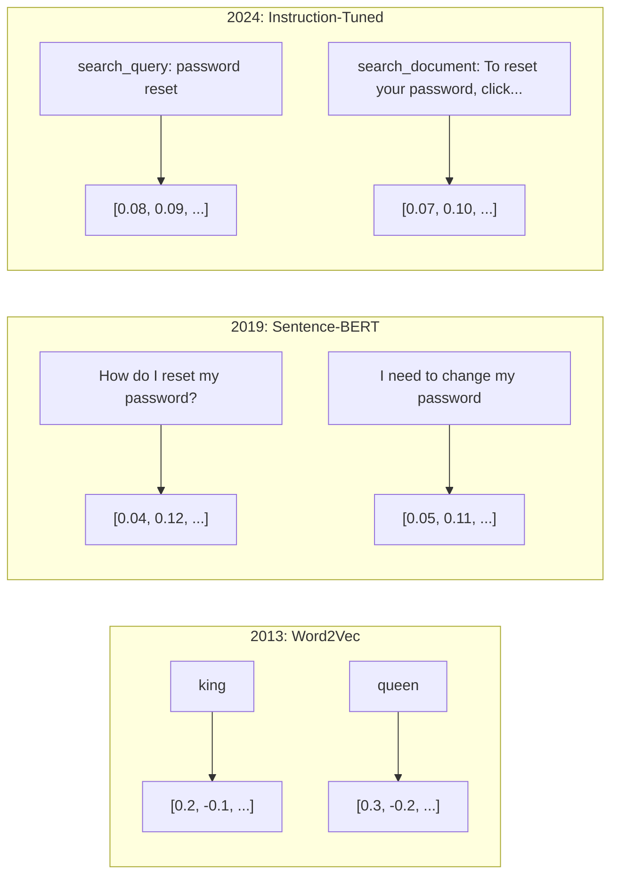
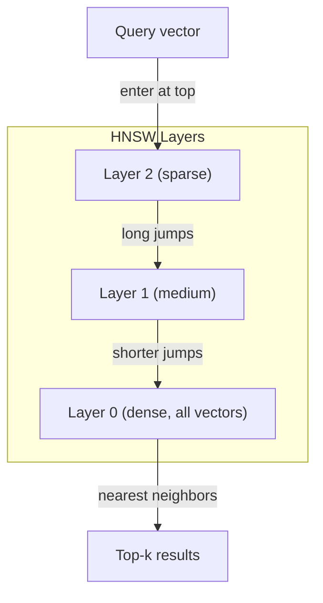
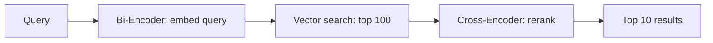

# Embeddings 与向量表示

> 文本是离散的。数学是连续的。每当你让 LLM 查找“相似”文档、比较含义，或做超越关键词的搜索时，你都在依赖连接这两个世界的一座桥。那座桥就是 embedding。如果你不理解 embeddings，就谈不上理解现代 AI。你只是会用它。

**Type:** Build
**Languages:** Python
**Prerequisites:** Phase 11, Lesson 01 (Prompt Engineering)
**Time:** ~75 minutes
**Related:** Phase 5 · 22 (Embedding Models Deep Dive) 讲 dense、sparse、multi-vector、Matryoshka truncation，以及按任务轴选择模型。本课聚焦生产流水线：vector DB、HNSW 和 similarity math。选模型前先读 Phase 5 · 22。

## 学习目标

- 使用 API provider 和开源模型生成文本 embeddings，并计算它们之间的 cosine similarity
- 解释 embeddings 为什么能解决 keyword search 无法处理的 vocabulary mismatch problem
- 构建一个 semantic search index，让系统按含义而不是精确关键词匹配来检索文档
- 用 retrieval benchmark（precision@k、recall）评估 embedding 质量，并为具体任务选择合适的 embedding model

## 问题

你有 10,000 张客服工单。客户写：“my payment didn't go through.” 你需要找到相似的历史工单。Keyword search 会找到包含 “payment” 和 “didn't go through” 的工单。它会漏掉 “transaction failed”、“charge was declined” 和 “billing error”。这些工单描述的是完全相同的问题，只是用了完全不同的词。

这就是 vocabulary mismatch problem。人类语言有几十种方式表达同一件事。Keyword search 把每个词当成互不相关、没有含义的符号。它不知道 “declined” 和 “didn't go through” 指的是同一个概念。

你需要一种文本表示，让相似性由含义决定，而不是由拼写决定。你需要把 “my payment didn't go through” 和 “transaction was declined” 放到某个数学空间里的近处，同时让 “my payment arrived on time” 远离它们，尽管这句话也共享了 “payment” 这个词。

这种表示就是 embedding。

## 概念

### 什么是 Embedding？

Embedding 是一个 dense vector，由 floating-point numbers 组成，用来表示文本的含义。“Dense” 很重要：每个维度都携带信息，不像 sparse representations（bag-of-words、TF-IDF）那样大多数维度都是 zero。

“The cat sat on the mat” 会变成类似 `[0.023, -0.041, 0.087, ..., 0.012]` 的东西，也就是一串数字，长度取决于模型，通常从 768 到 3072 不等。这些数字编码含义。你通常不会直接检查它们，而是比较它们。

### Word2Vec 的突破

2013 年，Google 的 Tomas Mikolov 和同事发表了 Word2Vec。核心洞察是：训练一个 neural network，让它根据邻近词预测某个词，或者根据某个词预测邻近词；训练完成后，hidden layer weights 会变成有意义的向量表示。

著名结果是：

```text
king - man + woman = queen
```

对 word embeddings 做 vector arithmetic 可以捕捉 semantic relationships。从 “man” 到 “woman” 的方向，大致等于从 “king” 到 “queen” 的方向。正是这一刻，研究者意识到 geometry 可以编码 meaning。

Word2Vec 生成 300-dimensional vectors。每个 word 不管上下文如何都只有一个 vector。“Bank” 在 “river bank” 和 “bank account” 里有同一个 embedding。这个限制推动了接下来十年的研究。

### 从词到句子

Word embeddings 表示单个 token。生产系统需要 embed 整个 sentence、paragraph 或 document。于是出现了四种方法：

**Averaging**：取句子中所有 word vectors 的平均值。便宜、有损，但对短文本意外地还不错。它会完全丢掉 word order，所以 “dog bites man” 和 “man bites dog” 会得到相同的 embeddings。

**CLS token**：transformer models（BERT, 2018）会输出一个特殊的 `[CLS]` token embedding，用它表示整个输入。它比 averaging 更好，但 `[CLS]` token 当初是为了 next-sentence prediction 训练的，不是为了 similarity。

**Contrastive learning**：显式训练模型，把相似样本对拉近，把不相似样本对推远。Sentence-BERT（Reimers & Gurevych, 2019）使用了这种方法，并成为现代 embedding models 的基础。给定 “How do I reset my password?” 和 “I need to change my password,” 模型会学到它们应该有几乎相同的 vectors。

**Instruction-tuned embeddings**：最新的方法。E5 和 GTE 这类模型接受 task prefix，比如 “search_query:” 和 “search_document:”，告诉模型要生成哪种 embedding。这让同一个模型能服务多个任务。



### 现代 Embedding Models

市场已经收敛到少数 production-grade options（MTEB 分数截至 2026 年初，MTEB v2）：

| Model | Provider | Dimensions | MTEB | Context | Cost / 1M tokens |
|-------|----------|-----------|------|---------|------------------|
| Gemini Embedding 2 | Google | 3072 (Matryoshka) | 67.7 (retrieval) | 8192 | $0.15 |
| embed-v4 | Cohere | 1024 (Matryoshka) | 65.2 | 128K | $0.12 |
| voyage-4 | Voyage AI | 1024/2048 (Matryoshka) | 66.8 | 32K | $0.12 |
| text-embedding-3-large | OpenAI | 3072 (Matryoshka) | 64.6 | 8192 | $0.13 |
| text-embedding-3-small | OpenAI | 1536 (Matryoshka) | 62.3 | 8192 | $0.02 |
| BGE-M3 | BAAI | 1024 (dense+sparse+ColBERT) | 63.0 multilingual | 8192 | Open-weight |
| Qwen3-Embedding | Alibaba | 4096 (Matryoshka) | 66.9 | 32K | Open-weight |
| Nomic-embed-v2 | Nomic | 768 (Matryoshka) | 63.1 | 8192 | Open-weight |

MTEB（Massive Text Embedding Benchmark）v2 覆盖 retrieval、classification、clustering、reranking、summarization 等 100+ tasks。分数越高越好。到 2026 年，open-weight models（Qwen3-Embedding、BGE-M3）在多数维度上已经追平或超过 closed hosted models。Gemini Embedding 2 在 pure retrieval 上领先；Voyage/Cohere 在特定领域（finance、law、code）领先。正式选型前，一定要用你自己的 queries 做 benchmark。

### Similarity Metrics

给定两个 embedding vectors，有三种常见方法衡量它们有多相似：

**Cosine similarity**：两个 vectors 夹角的 cosine。范围从 -1（方向相反）到 1（方向相同）。它忽略 magnitude，所以一个 10-word sentence 和一个 500-word document 只要指向同一方向，就可以得到 1.0。这是 90% 用例的默认选择。

```text
cosine_sim(a, b) = dot(a, b) / (||a|| * ||b||)
```

**Dot product**：两个 vectors 的 raw inner product。当 vectors 已经 normalized（unit length）时，它和 cosine similarity 完全等价。计算更快。OpenAI 的 embeddings 是 normalized 的，所以 dot product 和 cosine 会给出相同排序。

```text
dot(a, b) = sum(a_i * b_i)
```

**Euclidean (L2) distance**：vector space 中的直线距离。越小越相似。它对 magnitude differences 敏感。只有当空间中的绝对位置重要，而不仅仅是方向重要时，才使用它。

```text
L2(a, b) = sqrt(sum((a_i - b_i)^2))
```

什么时候用哪个：

| Metric | Use when | Avoid when |
|--------|----------|------------|
| Cosine similarity | 比较不同长度的文本；大多数 retrieval tasks | Magnitude 携带信息 |
| Dot product | Embeddings 已经 normalized；需要最大速度 | Vectors 的 magnitudes 不一致 |
| Euclidean distance | Clustering；空间 nearest-neighbor problems | 比较长度差异很大的 documents |

### Vector Databases 与 HNSW

Brute-force similarity search 会把 query 和每个已存 vector 都比较一遍。100 万个 vectors、每个 1536 dimensions，意味着每次 query 要做 15 亿次 multiply-add operations。太慢了。

Vector databases 用 Approximate Nearest Neighbor（ANN）算法解决这个问题。主流算法是 HNSW（Hierarchical Navigable Small World）：

1. 构建一个多层 vector graph
2. 顶层稀疏，用 long-range connections 连接较远 clusters
3. 底层密集，用 fine-grained connections 连接附近 vectors
4. Search 从顶层开始，greedy descending，逐层细化
5. 以 O(log n) 而不是 O(n) 的时间返回近似 top-k results

HNSW 用很小的 accuracy loss（通常 95-99% recall）换来巨大的 speed gains。1000 万个 vectors 时，brute force 需要数秒。HNSW 只需要 milliseconds。



Production options：

| Database | Type | Best for | Max scale |
|----------|------|----------|-----------|
| Pinecone | Managed SaaS | Zero-ops production | Billions |
| Weaviate | Open source | Self-hosted, hybrid search | 100M+ |
| Qdrant | Open source | High performance, filtering | 100M+ |
| ChromaDB | Embedded | Prototyping, local dev | 1M |
| pgvector | Postgres extension | Already using Postgres | 10M |
| FAISS | Library | In-process, research | 1B+ |

### Chunking Strategies

Documents 太长，不能作为单个 vector 来 embed。一个 50-page PDF 会覆盖几十个主题，它的 embedding 会变成所有内容的平均，结果和任何具体内容都不够相似。你需要把 documents 拆成 chunks，然后分别 embed 每个 chunk。

**Fixed-size chunking**：每 N 个 tokens 切一次，带 M-token overlap。简单、可预测。当 documents 没有清晰结构时很好用。512-token chunk 加 50-token overlap：chunk 1 是 tokens 0-511，chunk 2 是 tokens 462-973。

**Sentence-based chunking**：在 sentence boundaries 切分，把 sentences 聚合到 token limit。每个 chunk 至少是一个完整 sentence。它比 fixed-size 更好，因为不会把一个 thought 切成两半。

**Recursive chunking**：先尝试最大边界，比如 section headers。如果仍然太大，就尝试 paragraph boundaries。然后 sentence boundaries。最后 character limits。这就是 LangChain 的 `RecursiveCharacterTextSplitter`，对 mixed-format corpora 很有效。

**Semantic chunking**：embed 每个 sentence，然后把 embeddings 相似的连续 sentences 分到同一组。当 embedding similarity 低于阈值时，开始新 chunk。成本高，因为要单独 embed 每个 sentence，但产出的 chunks 最连贯。

| Strategy | Complexity | Quality | Best for |
|----------|-----------|---------|----------|
| Fixed-size | Low | Decent | Unstructured text, logs |
| Sentence-based | Low | Good | Articles, emails |
| Recursive | Medium | Good | Markdown, HTML, mixed docs |
| Semantic | High | Best | Critical retrieval quality |

大多数系统的 sweet spot：256-512 token chunks，带 50-token overlap。

### Bi-Encoders vs Cross-Encoders

Bi-encoder 会分别 embed query 和 documents，然后比较 vectors。它很快：query 只 embed 一次，再和预先计算好的 document embeddings 比较。这就是 retrieval 阶段使用的东西。

Cross-encoder 会把 query 和 document 作为一个输入，然后输出 relevance score。它很慢：每个 query-document pair 都要跑完整模型。但它准确得多，因为它能同时 attend query 和 document tokens。

生产模式是：bi-encoder 取回 top-100 candidates，cross-encoder 把它们 rerank 到 top-10。这就是 retrieve-then-rerank pipeline。



Reranking models：Cohere Rerank 3.5（每 1000 queries $2）、BGE-reranker-v2（免费，open source）、Jina Reranker v2（免费，open source）。

### Matryoshka Embeddings

传统 embeddings 是全有或全无。1536-dimensional vector 就要用 1536 个 floats。你不能在不重新训练的情况下把它截断到 256 dimensions。

Matryoshka Representation Learning（Kusupati et al., 2022）解决了这个问题。模型被训练成：前 N 个 dimensions 捕捉最重要的信息，像俄罗斯套娃一样。把一个 1536-d Matryoshka embedding 截断到 256 dimensions，会损失一些 accuracy，但仍然可用。

OpenAI 的 text-embedding-3-small 和 text-embedding-3-large 通过 `dimensions` 参数支持 Matryoshka truncation。请求 256 dimensions 而不是 1536 dimensions，可以让 storage 减少 6x，在 MTEB benchmarks 上大约损失 3-5% accuracy。

### Binary Quantization

一个 1536-dimensional embedding 如果用 float32 存储，需要 6,144 bytes。乘以 1000 万 documents：光 vectors 就要 61 GB。

Binary quantization 把每个 float 转成一个 bit：正值变成 1，负值变成 0。Storage 从 6,144 bytes 降到 192 bytes，也就是 32x reduction。Similarity 用 Hamming distance（统计不同 bits 的数量）计算，CPU 可以用单条指令完成。

Retrieval recall 上的 accuracy hit 大约是 5-10%。常见模式是：用 binary quantization 在数百万 vectors 上做 first-pass search，然后用 full-precision vectors 对 top-1000 rescore。这样可以用 32x 更少的 memory，拿到 95%+ 的 full-precision accuracy。

```figure
cosine-similarity
```

## Build It

我们从零构建一个 semantic search engine。不用 vector database。不用外部 embedding API。只用 Python 和 numpy 做数学。

### Step 1: Text Chunking

```python
def chunk_text(text, chunk_size=200, overlap=50):
    words = text.split()
    chunks = []
    start = 0
    while start < len(words):
        end = start + chunk_size
        chunk = " ".join(words[start:end])
        chunks.append(chunk)
        start += chunk_size - overlap
    return chunks


def chunk_by_sentences(text, max_chunk_tokens=200):
    sentences = text.replace("\n", " ").split(".")
    sentences = [s.strip() + "." for s in sentences if s.strip()]
    chunks = []
    current_chunk = []
    current_length = 0
    for sentence in sentences:
        sentence_length = len(sentence.split())
        if current_length + sentence_length > max_chunk_tokens and current_chunk:
            chunks.append(" ".join(current_chunk))
            current_chunk = []
            current_length = 0
        current_chunk.append(sentence)
        current_length += sentence_length
    if current_chunk:
        chunks.append(" ".join(current_chunk))
    return chunks
```

### Step 2: Building Embeddings from Scratch

我们用 TF-IDF 加 L2 normalization 实现一个简单的 dense embedding。这不是 neural embedding，但它遵守同一个 contract：输入文本，输出 fixed-size vector；相似文本产生相似 vectors。

```python
import math
import numpy as np
from collections import Counter

class SimpleEmbedder:
    def __init__(self):
        self.vocab = []
        self.idf = []
        self.word_to_idx = {}

    def fit(self, documents):
        vocab_set = set()
        for doc in documents:
            vocab_set.update(doc.lower().split())
        self.vocab = sorted(vocab_set)
        self.word_to_idx = {w: i for i, w in enumerate(self.vocab)}
        n = len(documents)
        self.idf = np.zeros(len(self.vocab))
        for i, word in enumerate(self.vocab):
            doc_count = sum(1 for doc in documents if word in doc.lower().split())
            self.idf[i] = math.log((n + 1) / (doc_count + 1)) + 1

    def embed(self, text):
        words = text.lower().split()
        count = Counter(words)
        total = len(words) if words else 1
        vec = np.zeros(len(self.vocab))
        for word, freq in count.items():
            if word in self.word_to_idx:
                tf = freq / total
                vec[self.word_to_idx[word]] = tf * self.idf[self.word_to_idx[word]]
        norm = np.linalg.norm(vec)
        if norm > 0:
            vec = vec / norm
        return vec
```

### Step 3: Similarity Functions

```python
def cosine_similarity(a, b):
    dot = np.dot(a, b)
    norm_a = np.linalg.norm(a)
    norm_b = np.linalg.norm(b)
    if norm_a == 0 or norm_b == 0:
        return 0.0
    return float(dot / (norm_a * norm_b))


def dot_product(a, b):
    return float(np.dot(a, b))


def euclidean_distance(a, b):
    return float(np.linalg.norm(a - b))
```

### Step 4: Vector Index with Brute-Force Search

```python
class VectorIndex:
    def __init__(self):
        self.vectors = []
        self.texts = []
        self.metadata = []

    def add(self, vector, text, meta=None):
        self.vectors.append(vector)
        self.texts.append(text)
        self.metadata.append(meta or {})

    def search(self, query_vector, top_k=5, metric="cosine"):
        scores = []
        for i, vec in enumerate(self.vectors):
            if metric == "cosine":
                score = cosine_similarity(query_vector, vec)
            elif metric == "dot":
                score = dot_product(query_vector, vec)
            elif metric == "euclidean":
                score = -euclidean_distance(query_vector, vec)
            else:
                raise ValueError(f"Unknown metric: {metric}")
            scores.append((i, score))
        scores.sort(key=lambda x: x[1], reverse=True)
        results = []
        for idx, score in scores[:top_k]:
            results.append({
                "text": self.texts[idx],
                "score": score,
                "metadata": self.metadata[idx],
                "index": idx
            })
        return results

    def size(self):
        return len(self.vectors)
```

### Step 5: The Semantic Search Engine

```python
class SemanticSearchEngine:
    def __init__(self, chunk_size=200, overlap=50):
        self.embedder = SimpleEmbedder()
        self.index = VectorIndex()
        self.chunk_size = chunk_size
        self.overlap = overlap

    def index_documents(self, documents, source_names=None):
        all_chunks = []
        all_sources = []
        for i, doc in enumerate(documents):
            chunks = chunk_text(doc, self.chunk_size, self.overlap)
            all_chunks.extend(chunks)
            name = source_names[i] if source_names else f"doc_{i}"
            all_sources.extend([name] * len(chunks))
        self.embedder.fit(all_chunks)
        for chunk, source in zip(all_chunks, all_sources):
            vec = self.embedder.embed(chunk)
            self.index.add(vec, chunk, {"source": source})
        return len(all_chunks)

    def search(self, query, top_k=5, metric="cosine"):
        query_vec = self.embedder.embed(query)
        return self.index.search(query_vec, top_k, metric)

    def search_with_scores(self, query, top_k=5):
        results = self.search(query, top_k)
        return [
            {
                "text": r["text"][:200],
                "source": r["metadata"].get("source", "unknown"),
                "score": round(r["score"], 4)
            }
            for r in results
        ]
```

### Step 6: Comparing Similarity Metrics

```python
def compare_metrics(engine, query, top_k=3):
    results = {}
    for metric in ["cosine", "dot", "euclidean"]:
        hits = engine.search(query, top_k=top_k, metric=metric)
        results[metric] = [
            {"score": round(h["score"], 4), "preview": h["text"][:80]}
            for h in hits
        ]
    return results
```

## Use It

使用 production embedding API 时，architecture 保持不变。只有 embedder 会换掉：

```python
from openai import OpenAI

client = OpenAI()

def openai_embed(texts, model="text-embedding-3-small", dimensions=None):
    kwargs = {"model": model, "input": texts}
    if dimensions:
        kwargs["dimensions"] = dimensions
    response = client.embeddings.create(**kwargs)
    return [item.embedding for item in response.data]
```

OpenAI 的 Matryoshka truncation：同一个模型，更少 dimensions，更低 storage：

```python
full = openai_embed(["semantic search query"], dimensions=1536)
compact = openai_embed(["semantic search query"], dimensions=256)
```

256-d vector 使用的 storage 少 6x。对于 1000 万 documents，也就是 10 GB vs 61 GB。标准 benchmarks 上的 accuracy loss 大约是 3-5%。

用 Cohere rerank：

```python
import cohere

co = cohere.ClientV2()

results = co.rerank(
    model="rerank-v3.5",
    query="What is the refund policy?",
    documents=["Full refund within 30 days...", "No refunds after 90 days..."],
    top_n=3
)
```

无 API dependency 的 local embeddings：

```python
from sentence_transformers import SentenceTransformer

model = SentenceTransformer("BAAI/bge-small-en-v1.5")
embeddings = model.encode(["semantic search query", "another document"])
```

我们在 Build It 里写的 `VectorIndex` class 可以配合任意一种方案使用。换掉 embedding function，保留 search logic。

## Ship It

本课产出：

- `outputs/prompt-embedding-advisor.md`：一个 prompt，用于按具体用例选择 embedding models 和策略
- `outputs/skill-embedding-patterns.md`：一个 skill，教 agents 如何在生产中有效使用 embeddings

## 练习

1. **Metric comparison**：对 sample documents 运行同样 5 个 queries，分别使用 cosine similarity、dot product 和 euclidean distance。记录每种 metric 的 top-3 results。哪些 queries 下 metrics 会产生分歧？为什么？

2. **Chunk size experiment**：用 50、100、200、500 words 的 chunk sizes 为 sample documents 建索引。每种配置运行 5 个 queries，并记录 top-1 similarity score。画出 chunk size 和 retrieval quality 的关系。找出更大 chunks 开始伤害质量的临界点。

3. **Matryoshka simulation**：构建一个生成 500-d vectors 的 `SimpleEmbedder`。截断到 50、100、200、500 dimensions。测量每种截断下 retrieval recall 如何下降。这可以模拟 Matryoshka behavior，而不需要真正的训练技巧。

4. **Binary quantization**：取 search engine 中的 embeddings，把它们转换成 binary（正值为 1，负值为 0），并实现 Hamming distance search。将 top-10 results 与 full-precision cosine similarity 比较，测量 overlap percentage。

5. **Sentence-based chunking**：用 `chunk_by_sentences` 替换 fixed-size chunking。运行同样的 queries，比较 retrieval scores。尊重 sentence boundaries 是否改善了结果？

## 关键术语

| Term | What people say | What it actually means |
|------|----------------|----------------------|
| Embedding | “Text to numbers” | 一个 dense vector，其中 geometric proximity 编码 semantic similarity |
| Word2Vec | “The OG embedding” | 2013 年通过预测 context words 学到 word vectors 的模型；证明 vector arithmetic 可以编码 meaning |
| Cosine similarity | “How similar are two vectors” | 两个 vectors 夹角的 cosine；1 = 方向相同，0 = 正交，-1 = 方向相反 |
| HNSW | “Fast vector search” | Hierarchical Navigable Small World graph；多层结构，让 approximate nearest neighbor search 接近 O(log n) |
| Bi-encoder | “Embed separately, compare fast” | 独立把 query 和 document 编码成 vectors；支持 pre-computation 和 fast retrieval |
| Cross-encoder | “Slow but accurate reranker” | 把 query-document pair 联合送入完整模型；准确率更高，但不能 pre-compute |
| Matryoshka embeddings | “Truncatable vectors” | 训练时让前 N 个 dimensions 捕捉最重要信息的 embeddings，支持 variable-size storage |
| Binary quantization | “1-bit embeddings” | 把 float vectors 转换成 binary（只保留 sign bit），用 Hamming distance search 换取 32x storage reduction |
| Chunking | “Split docs for embedding” | 把 documents 切成 256-512 token segments，让每段都能独立 embed 和 retrieve |
| Vector database | “Search engine for embeddings” | 为存储 vectors 和执行大规模 approximate nearest neighbor search 优化的数据存储 |
| Contrastive learning | “Train by comparison” | 把相似 pair embeddings 拉近、不相似 pair embeddings 推远的训练方法 |
| MTEB | “The embedding benchmark” | Massive Text Embedding Benchmark；覆盖 8 类任务、56 个 datasets 的 embedding model 对比标准 |

## 延伸阅读

- Mikolov et al., “Efficient Estimation of Word Representations in Vector Space” (2013)：开启 embedding 革命的 Word2Vec paper，包含 king-queen analogy
- Reimers & Gurevych, “Sentence-BERT: Sentence Embeddings using Siamese BERT-Networks” (2019)：如何训练 sentence-level similarity 的 bi-encoders，也是现代 embedding models 的基础
- Kusupati et al., “Matryoshka Representation Learning” (2022)：variable-dimension embeddings 背后的技术，OpenAI 的 text-embedding-3 采用了这一思路
- Malkov & Yashunin, “Efficient and Robust Approximate Nearest Neighbor using Hierarchical Navigable Small World Graphs” (2018)：HNSW paper，多数 production vector search 背后的算法
- OpenAI Embeddings Guide (platform.openai.com/docs/guides/embeddings)：text-embedding-3 models 的实践参考，包括 Matryoshka dimension reduction
- MTEB Leaderboard (huggingface.co/spaces/mteb/leaderboard)：跨任务和语言实时比较 embedding models 的 leaderboard
- [Muennighoff et al., “MTEB: Massive Text Embedding Benchmark” (EACL 2023)](https://arxiv.org/abs/2210.07316)：定义 8 类任务（classification、clustering、pair classification、reranking、retrieval、STS、summarization、bitext mining）的 benchmark；相信任何单一 MTEB 分数前都应该先读它。
- [Sentence Transformers documentation](https://www.sbert.net/)：bi-encoder vs cross-encoder、pooling strategies，以及本课实现的 ingest-split-embed-store RAG pipeline 的 canonical reference。
