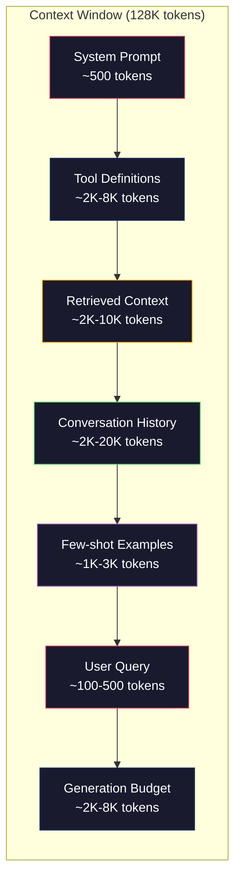
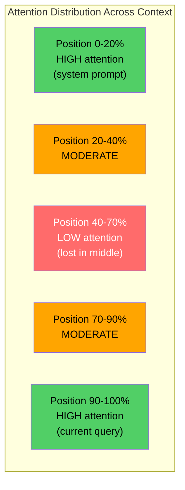
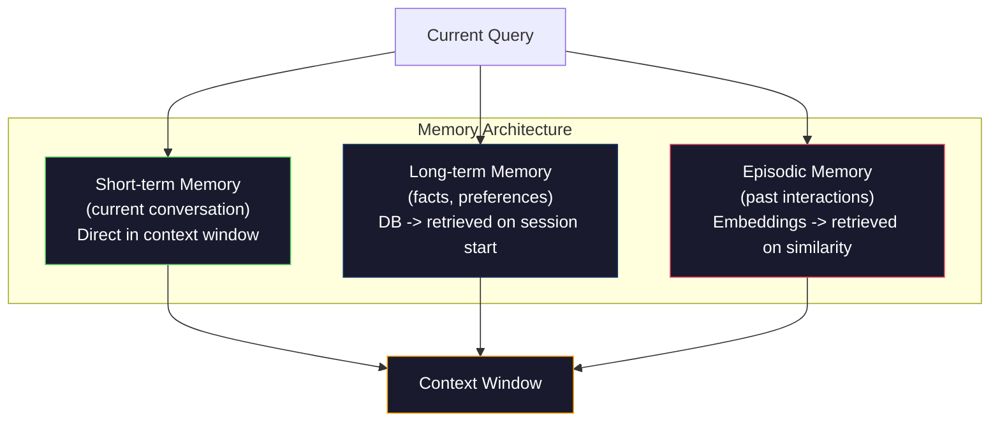

# 上下文工程：窗口、预算、记忆与检索

> Prompt engineering 只是其中一部分。Context engineering 才是完整战场。Prompt 是你输入的一段字符串；context 是进入模型窗口的一切：系统指令、检索到的文档、工具定义、对话历史、few-shot 示例，以及 prompt 本身。2026 年最优秀的 AI 工程师，都是上下文工程师。他们决定什么进入窗口、什么留在外面，以及它们以什么顺序出现。

**Type:** Build
**Languages:** Python
**Prerequisites:** Phase 10 (LLMs from Scratch), Phase 11 Lesson 01-02
**Time:** ~90 minutes
**Related:** Phase 11 · 15 (Prompt Caching) —— 对缓存友好的布局是上下文工程的延伸。Phase 5 · 28 (Long-Context Evaluation) 讲如何用 NIAH/RULER 度量 lost-in-the-middle。

## Learning Objectives

- 计算所有上下文窗口组件的 token 预算：系统 prompt、工具、历史记录、检索文档、生成预留空间
- 实现上下文窗口管理策略：截断、摘要，以及用于对话历史的滑动窗口
- 对上下文组件进行优先级排序和编排，让模型注意力尽可能集中在最相关的信息上
- 构建一个 context assembler，根据 query 类型和可用窗口空间动态分配 token

## 问题

Claude Opus 4.7 有 200K token 窗口（beta 版 1M）。GPT-5 有 400K。Gemini 3 Pro 有 2M。Llama 4 声称有 10M。这些数字听起来巨大，直到你真正把它们填满。

下面是一个真实 coding assistant 的拆分。System prompt：500 tokens。50 个工具的工具定义：8,000 tokens。检索到的文档：4,000 tokens。对话历史（10 轮）：6,000 tokens。当前用户 query：200 tokens。生成预算（max output）：4,000 tokens。总计：22,700 tokens。这只占 128K 窗口的 18%。

但注意力不会随着上下文长度线性扩展。128K tokens 的上下文在 vanilla transformer 中要付出二次 attention 成本（O(n^2)，虽然多数 production model 会使用高效 attention 变体）。更重要的是，检索准确率会下降。"Needle in a Haystack" 测试显示，模型很难找到放在长上下文中间的信息。Liu et al. (2023) 的研究表明，LLM 对长上下文开头和结尾的信息几乎能完美检索，但当信息放在中间时，准确率会下降 10-20%（上下文 40-70% 的位置）。这种 "lost-in-the-middle" 效应会随模型而变化，但影响当前所有架构。

实际教训是：有 200K tokens 可用，不代表使用 200K tokens 就有效。一个精心筛选的 10K token context，常常胜过随手倾倒进去的 100K token context。上下文工程就是在上下文窗口内最大化信噪比的纪律。

你放入窗口的每一个 token，都会挤掉另一个可能承载更多相关信息的 token。每个无关工具定义、每轮过期对话、每段不能回答问题的检索文本，都会让模型在任务上变得稍差一点。

## 概念

### 上下文窗口是稀缺资源

把上下文窗口想成 RAM，而不是磁盘。它速度快，可以被模型直接访问，但容量有限。你不能把所有东西都塞进去，必须做选择。



每个组件都在争夺空间。加入更多工具定义，就意味着对话历史的空间更少。加入更多检索上下文，就意味着 few-shot 示例的空间更少。上下文工程就是分配这份预算、最大化任务表现的艺术。

### Lost-in-the-Middle

这是上下文工程中最重要的经验发现。模型对上下文开头和结尾的信息注意得更好。中间的信息会得到更低的 attention score，更容易被忽略。

Liu et al. (2023) 系统测试了这个现象。他们把一个相关文档放在 20 个无关文档之间的不同位置，然后测量答案准确率。当相关文档排第一或最后时，准确率为 85-90%。当它位于中间（20 个文档中的第 10 个）时，准确率下降到 60-70%。

这会直接影响工程设计：

- 把最重要的信息放在最前面（system prompt、关键指令）
- 把当前 query 和最相关 context 放在最后（recency bias 有帮助）
- 把上下文中间视为最低优先级区域
- 如果必须把信息放在中间，就在末尾重复关键点



### 上下文组件

**System prompt**：设置 persona、约束和行为规则。它放在最前面，并且跨 turn 保持稳定。Claude Code 的 system prompt 约 6,000 tokens，其中包含工具定义和行为指令。保持紧凑。System prompt 中的每个词都会在每次 API call 中重复出现。

**Tool definitions**：每个工具会增加 50-200 tokens（名称、描述、参数 schema）。50 个工具每个 150 tokens，就是对话开始前已经消耗 7,500 tokens。动态工具选择，也就是只包含和当前 query 相关的工具，可以减少 60-80% 的开销。

**Retrieved context**：来自向量数据库的文档、搜索结果、文件内容。检索质量直接决定回答质量。糟糕的检索比没有检索更差，因为它会用噪声填满窗口，并主动误导模型。

**Conversation history**：每条历史用户消息和 assistant 回复。它随对话长度线性增长。50 轮对话、每轮 200 tokens，就是 10,000 tokens 的历史记录。其中大部分和当前 query 无关。

**Few-shot examples**：展示期望行为的输入/输出对。两到三个精心选择的示例，经常比上千 tokens 的指令更能提升输出质量。但它们也会占用空间。

**Generation budget**：为模型回答预留的 tokens。如果你把窗口填满，模型就没有空间回答。至少预留 2,000-4,000 tokens 用于生成。

### 上下文压缩策略

**History summarization**：不要逐字保留所有历史 turn，而是定期总结对话。"We discussed X, decided Y, and the user wants Z" 用 100 tokens 替换原本 2,000 tokens 的 10 轮对话。当历史超过阈值时运行摘要（例如 5,000 tokens）。

**Relevance filtering**：根据当前 query 对每个检索文档打分，丢弃低于阈值的文档。如果你检索到 10 个 chunk，但只有 3 个相关，就丢掉另外 7 个。3 个高度相关 chunk 胜过 10 个平庸 chunk。

**Tool pruning**：分类用户 query 的 intent，只包含与该 intent 相关的工具。代码问题不需要日历工具。排期问题不需要文件系统工具。这可以把工具定义从 8,000 tokens 降到 1,000。

**Recursive summarization**：对非常长的文档分阶段摘要。先总结每个 section，再总结这些摘要。一个 50 页文档可以变成 500-token digest，同时保留关键点。

### 记忆系统

上下文工程横跨三个时间尺度。

**Short-term memory**：当前对话。直接存储在上下文窗口里。随着每个 turn 增长。通过摘要和截断管理。

**Long-term memory**：跨对话持久保存的事实和偏好。"The user prefers TypeScript." "The project uses PostgreSQL." 存在数据库中，在 session 开始时检索。Claude Code 把这类信息存在 CLAUDE.md 文件中。ChatGPT 则存入 memory feature。

**Episodic memory**：可能相关的特定历史交互。"Last Tuesday, we debugged a similar issue in the auth module." 作为 embedding 存储，当当前对话与过去 episode 匹配时检索。



### 动态上下文组装

关键洞察是：不同 query 需要不同 context。静态 system prompt + 静态 tools + 静态 history 是浪费。最好的系统会为每个 query 动态组装 context。

1. 分类 query intent
2. 选择相关工具（不是所有工具）
3. 检索相关文档（不是固定集合）
4. 包含相关历史 turn（不是全部历史）
5. 添加匹配任务类型的 few-shot examples
6. 按重要性排序所有内容：关键内容在最前，重要内容在最后，可选内容放中间

这就是优秀 AI application 和顶级 AI application 的差异。模型是同一个，context 才是区分点。

## Build It

### Step 1: Token Counter

无法测量，就无法预算。先构建一个简单 token counter（用 whitespace splitting 近似，因为精确数量取决于 tokenizer）。

```python
import json
import numpy as np
from collections import OrderedDict

def count_tokens(text):
    if not text:
        return 0
    return int(len(text.split()) * 1.3)

def count_tokens_json(obj):
    return count_tokens(json.dumps(obj))
```

### Step 2: Context Budget Manager

核心抽象是 budget manager。它跟踪每个组件用了多少 tokens，并强制执行限制。

```python
class ContextBudget:
    def __init__(self, max_tokens=128000, generation_reserve=4000):
        self.max_tokens = max_tokens
        self.generation_reserve = generation_reserve
        self.available = max_tokens - generation_reserve
        self.allocations = OrderedDict()

    def allocate(self, component, content, max_tokens=None):
        tokens = count_tokens(content)
        if max_tokens and tokens > max_tokens:
            words = content.split()
            target_words = int(max_tokens / 1.3)
            content = " ".join(words[:target_words])
            tokens = count_tokens(content)

        used = sum(self.allocations.values())
        if used + tokens > self.available:
            allowed = self.available - used
            if allowed <= 0:
                return None, 0
            words = content.split()
            target_words = int(allowed / 1.3)
            content = " ".join(words[:target_words])
            tokens = count_tokens(content)

        self.allocations[component] = tokens
        return content, tokens

    def remaining(self):
        used = sum(self.allocations.values())
        return self.available - used

    def utilization(self):
        used = sum(self.allocations.values())
        return used / self.max_tokens

    def report(self):
        total_used = sum(self.allocations.values())
        lines = []
        lines.append(f"Context Budget Report ({self.max_tokens:,} token window)")
        lines.append("-" * 50)
        for component, tokens in self.allocations.items():
            pct = tokens / self.max_tokens * 100
            bar = "#" * int(pct / 2)
            lines.append(f"  {component:<25} {tokens:>6} tokens ({pct:>5.1f}%) {bar}")
        lines.append("-" * 50)
        lines.append(f"  {'Used':<25} {total_used:>6} tokens ({total_used/self.max_tokens*100:.1f}%)")
        lines.append(f"  {'Generation reserve':<25} {self.generation_reserve:>6} tokens")
        lines.append(f"  {'Remaining':<25} {self.remaining():>6} tokens")
        return "\n".join(lines)
```

### Step 3: Lost-in-the-Middle Reordering

实现重排序策略：最重要的 items 放到最前和最后，最不重要的放到中间。

```python
def reorder_lost_in_middle(items, scores):
    paired = sorted(zip(scores, items), reverse=True)
    sorted_items = [item for _, item in paired]

    if len(sorted_items) <= 2:
        return sorted_items

    first_half = sorted_items[::2]
    second_half = sorted_items[1::2]
    second_half.reverse()

    return first_half + second_half

def score_relevance(query, documents):
    query_words = set(query.lower().split())
    scores = []
    for doc in documents:
        doc_words = set(doc.lower().split())
        if not query_words:
            scores.append(0.0)
            continue
        overlap = len(query_words & doc_words) / len(query_words)
        scores.append(round(overlap, 3))
    return scores
```

### Step 4: Conversation History Compressor

把旧对话 turn 总结掉，回收 token 预算。

```python
class ConversationManager:
    def __init__(self, max_history_tokens=5000):
        self.turns = []
        self.summaries = []
        self.max_history_tokens = max_history_tokens

    def add_turn(self, role, content):
        self.turns.append({"role": role, "content": content})
        self._compress_if_needed()

    def _compress_if_needed(self):
        total = sum(count_tokens(t["content"]) for t in self.turns)
        if total <= self.max_history_tokens:
            return

        while total > self.max_history_tokens and len(self.turns) > 4:
            old_turns = self.turns[:2]
            summary = self._summarize_turns(old_turns)
            self.summaries.append(summary)
            self.turns = self.turns[2:]
            total = sum(count_tokens(t["content"]) for t in self.turns)

    def _summarize_turns(self, turns):
        parts = []
        for t in turns:
            content = t["content"]
            if len(content) > 100:
                content = content[:100] + "..."
            parts.append(f"{t['role']}: {content}")
        return "Previous: " + " | ".join(parts)

    def get_context(self):
        parts = []
        if self.summaries:
            parts.append("[Conversation Summary]")
            for s in self.summaries:
                parts.append(s)
        parts.append("[Recent Conversation]")
        for t in self.turns:
            parts.append(f"{t['role']}: {t['content']}")
        return "\n".join(parts)

    def token_count(self):
        return count_tokens(self.get_context())
```

### Step 5: Dynamic Tool Selector

只包含和当前 query 相关的工具。先分类 intent，再过滤。

```python
TOOL_REGISTRY = {
    "read_file": {
        "description": "Read contents of a file",
        "tokens": 120,
        "categories": ["code", "files"],
    },
    "write_file": {
        "description": "Write content to a file",
        "tokens": 150,
        "categories": ["code", "files"],
    },
    "search_code": {
        "description": "Search for patterns in codebase",
        "tokens": 130,
        "categories": ["code"],
    },
    "run_command": {
        "description": "Execute a shell command",
        "tokens": 140,
        "categories": ["code", "system"],
    },
    "create_calendar_event": {
        "description": "Create a new calendar event",
        "tokens": 180,
        "categories": ["calendar"],
    },
    "list_emails": {
        "description": "List recent emails",
        "tokens": 160,
        "categories": ["email"],
    },
    "send_email": {
        "description": "Send an email message",
        "tokens": 200,
        "categories": ["email"],
    },
    "web_search": {
        "description": "Search the web for information",
        "tokens": 140,
        "categories": ["research"],
    },
    "query_database": {
        "description": "Run a SQL query on the database",
        "tokens": 170,
        "categories": ["code", "data"],
    },
    "generate_chart": {
        "description": "Generate a chart from data",
        "tokens": 190,
        "categories": ["data", "visualization"],
    },
}

def classify_intent(query):
    query_lower = query.lower()

    intent_keywords = {
        "code": ["code", "function", "bug", "error", "file", "implement", "refactor", "debug", "test"],
        "calendar": ["meeting", "schedule", "calendar", "appointment", "event"],
        "email": ["email", "mail", "send", "inbox", "message"],
        "research": ["search", "find", "what is", "how does", "explain", "look up"],
        "data": ["data", "query", "database", "chart", "graph", "analytics", "sql"],
    }

    scores = {}
    for intent, keywords in intent_keywords.items():
        score = sum(1 for kw in keywords if kw in query_lower)
        if score > 0:
            scores[intent] = score

    if not scores:
        return ["code"]

    max_score = max(scores.values())
    return [intent for intent, score in scores.items() if score >= max_score * 0.5]

def select_tools(query, token_budget=2000):
    intents = classify_intent(query)
    relevant = {}
    total_tokens = 0

    for name, tool in TOOL_REGISTRY.items():
        if any(cat in intents for cat in tool["categories"]):
            if total_tokens + tool["tokens"] <= token_budget:
                relevant[name] = tool
                total_tokens += tool["tokens"]

    return relevant, total_tokens
```

### Step 6: Full Context Assembly Pipeline

把所有东西串起来。给定一个 query，动态组装最优 context。

```python
class ContextEngine:
    def __init__(self, max_tokens=128000, generation_reserve=4000):
        self.budget = ContextBudget(max_tokens, generation_reserve)
        self.conversation = ConversationManager(max_history_tokens=5000)
        self.system_prompt = (
            "You are a helpful AI assistant. You have access to tools for "
            "code editing, file management, web search, and data analysis. "
            "Use the appropriate tools for each task. Be concise and accurate."
        )
        self.knowledge_base = [
            "Python 3.12 introduced type parameter syntax for generic classes using bracket notation.",
            "The project uses PostgreSQL 16 with pgvector for embedding storage.",
            "Authentication is handled by Supabase Auth with JWT tokens.",
            "The frontend is built with Next.js 15 using the App Router.",
            "API rate limits are set to 100 requests per minute per user.",
            "The deployment pipeline uses GitHub Actions with Docker multi-stage builds.",
            "Test coverage must be above 80% for all new modules.",
            "The codebase follows the repository pattern for data access.",
        ]

    def assemble(self, query):
        self.budget = ContextBudget(self.budget.max_tokens, self.budget.generation_reserve)

        system_content, _ = self.budget.allocate("system_prompt", self.system_prompt, max_tokens=1000)

        tools, tool_tokens = select_tools(query, token_budget=2000)
        tool_text = json.dumps(list(tools.keys()))
        tool_content, _ = self.budget.allocate("tools", tool_text, max_tokens=2000)

        relevance = score_relevance(query, self.knowledge_base)
        threshold = 0.1
        relevant_docs = [
            doc for doc, score in zip(self.knowledge_base, relevance)
            if score >= threshold
        ]

        if relevant_docs:
            doc_scores = [s for s in relevance if s >= threshold]
            reordered = reorder_lost_in_middle(relevant_docs, doc_scores)
            doc_text = "\n".join(reordered)
            doc_content, _ = self.budget.allocate("retrieved_context", doc_text, max_tokens=3000)

        history_text = self.conversation.get_context()
        if history_text.strip():
            history_content, _ = self.budget.allocate("conversation_history", history_text, max_tokens=5000)

        query_content, _ = self.budget.allocate("user_query", query, max_tokens=500)

        return self.budget

    def chat(self, query):
        self.conversation.add_turn("user", query)
        budget = self.assemble(query)
        response = f"[Response to: {query[:50]}...]"
        self.conversation.add_turn("assistant", response)
        return budget


def run_demo():
    print("=" * 60)
    print("  Context Engineering Pipeline Demo")
    print("=" * 60)

    engine = ContextEngine(max_tokens=128000, generation_reserve=4000)

    print("\n--- Query 1: Code task ---")
    budget = engine.chat("Fix the bug in the authentication module where JWT tokens expire too early")
    print(budget.report())

    print("\n--- Query 2: Research task ---")
    budget = engine.chat("What is the best approach for implementing vector search in PostgreSQL?")
    print(budget.report())

    print("\n--- Query 3: After conversation history builds up ---")
    for i in range(8):
        engine.conversation.add_turn("user", f"Follow-up question number {i+1} about the implementation details of the system")
        engine.conversation.add_turn("assistant", f"Here is the response to follow-up {i+1} with technical details about the architecture")

    budget = engine.chat("Now implement the changes we discussed")
    print(budget.report())

    print("\n--- Tool Selection Examples ---")
    test_queries = [
        "Fix the bug in auth.py",
        "Schedule a meeting with the team for Tuesday",
        "Show me the database query performance stats",
        "Search for best practices on error handling",
    ]

    for q in test_queries:
        tools, tokens = select_tools(q)
        intents = classify_intent(q)
        print(f"\n  Query: {q}")
        print(f"  Intents: {intents}")
        print(f"  Tools: {list(tools.keys())} ({tokens} tokens)")

    print("\n--- Lost-in-the-Middle Reordering ---")
    docs = ["Doc A (most relevant)", "Doc B (somewhat relevant)", "Doc C (least relevant)",
            "Doc D (relevant)", "Doc E (moderately relevant)"]
    scores = [0.95, 0.60, 0.20, 0.80, 0.50]
    reordered = reorder_lost_in_middle(docs, scores)
    print(f"  Original order: {docs}")
    print(f"  Scores:         {scores}")
    print(f"  Reordered:      {reordered}")
    print(f"  (Most relevant at start and end, least relevant in middle)")
```

## Use It

### Claude Code 的上下文策略

Claude Code 用分层方式管理 context。System prompt 包含行为规则和工具定义（约 6K tokens）。当你打开一个文件，它的内容会被注入为 context。当你搜索时，结果会被加入。旧对话 turn 会被摘要。CLAUDE.md 提供跨 session 持久存在的 long-term memory。

关键工程决策是：Claude Code 不会把你的整个 codebase 倒进 context。它会按需检索相关文件。这就是实践中的上下文工程。

### Cursor 的动态上下文加载

Cursor 会把你的整个 codebase 索引成 embeddings。当你输入 query 时，它用 vector similarity 检索最相关的文件和代码块。只有这些片段进入上下文窗口。一个 500K 行的 codebase 会被压缩成最相关的 5-10 个代码块。

模式就是这样：embed everything，按需检索，只包含重要内容。

### ChatGPT Memory

ChatGPT 会把用户偏好和事实存成 long-term memory。每次对话开始时，相关 memories 会被检索并放进 system prompt。"The user prefers Python" 只花 5 tokens，却能在多次对话中省下数百 tokens 的重复指令。

### RAG as Context Engineering

Retrieval-Augmented Generation 是形式化后的上下文工程。它不把知识塞进模型权重（training），也不把知识塞进 system prompt（static context），而是在 query time 检索相关文档，并把它们注入上下文窗口。整个 RAG pipeline，包括 chunking、embedding、retrieval、reranking，都在解决一个问题：把正确的信息放进上下文窗口。

## Ship It

本课产出 `outputs/prompt-context-optimizer.md`：一个可复用 prompt，用于审计上下文组装策略并推荐优化。把你的 system prompt、工具数量、平均历史长度和检索策略喂给它，它会识别 token waste 并提出改进建议。

它还产出 `outputs/skill-context-engineering.md`：一个决策框架，用于根据任务类型、上下文窗口大小和延迟预算设计上下文组装 pipeline。

## Exercises

1. 给 ContextBudget class 添加一个 "token waste detector"。它应该标记使用超过 30% 预算的组件，并根据组件类型给出具体压缩策略（summarize history、prune tools、re-rank documents）。

2. 为检索上下文实现 semantic deduplication。如果两个检索文档超过 80% 相似（按词重叠或 embedding 的 cosine similarity），只保留得分更高的那个。测量它回收了多少 token 预算。

3. 构建一个 "context replay" 工具。给定对话 transcript，通过 ContextEngine 回放它，并可视化 budget allocation 如何逐 turn 变化。绘制各组件 token usage 随时间变化的图。找出 context 开始被压缩的 turn。

4. 实现一个 priority-based tool selector。不要二元 include/exclude，而是为每个工具分配一个相对于当前 query 的 relevance score。按 relevance 降序加入工具，直到工具预算耗尽。比较包含 5、10、20、50 个工具时的任务表现。

5. 构建一个 multi-strategy context compressor。实现三种压缩策略（truncation、summarization、key sentence extraction），并在 20 个文档上 benchmark。测量 compression ratio 与 information retention 之间的 tradeoff（压缩版本是否仍然包含 query 的答案？）。

## Key Terms

| Term | What people say | What it actually means |
|------|----------------|----------------------|
| Context window | "模型能读多少内容" | 模型在一次 forward pass 中处理的最大 token 数（input + output）—— GPT-5 为 400K，Claude Opus 4.7 为 200K（1M beta），Gemini 3 Pro 为 2M |
| Context engineering | "高级 prompt engineering" | 决定什么进入上下文窗口、以什么顺序、以什么优先级进入的纪律，涵盖 retrieval、compression、tool selection 和 memory management |
| Lost-in-the-middle | "模型会忘掉中间的东西" | 经验发现：LLM 更关注上下文开头和结尾，信息放在中间时准确率会下降 10-20% |
| Token budget | "还剩多少 tokens" | 对上下文窗口容量的显式分配，覆盖 system prompt、tools、history、retrieval、generation 等组件，并为每个组件设置限制 |
| Dynamic context | "动态加载东西" | 根据 intent classification、相关工具选择和检索结果，为每个 query 以不同方式组装上下文窗口 |
| History summarization | "压缩对话" | 用简洁摘要替换逐字保存的旧对话 turn，在保留关键信息的同时降低 token 成本 |
| Tool pruning | "只包含相关工具" | 分类 query intent，只包含匹配的工具定义，让工具 token 成本降低 60-80% |
| Long-term memory | "跨 session 记住东西" | 存在数据库中并在 session 开始时检索的事实和偏好，例如 CLAUDE.md、ChatGPT Memory 以及类似系统 |
| Episodic memory | "记住特定过去事件" | 过去交互以 embeddings 形式存储，当当前 query 与过去对话相似时检索 |
| Generation budget | "给答案留空间" | 为模型输出预留的 tokens。如果 context 完全填满窗口，模型就没有空间回答 |

## Further Reading

- [Liu et al., 2023 —— "Lost in the Middle: How Language Models Use Long Contexts"](https://arxiv.org/abs/2307.03172) —— 关于位置相关注意力的权威研究，展示模型在长上下文中难以处理位于中间的信息
- [Anthropic's Contextual Retrieval blog post](https://www.anthropic.com/news/contextual-retrieval) —— Anthropic 如何处理 context-aware chunk retrieval，并把检索失败率降低 49%
- [Simon Willison's "Context Engineering"](https://simonwillison.net/2025/Jun/27/context-engineering/) —— 命名这个 discipline 并把它与 prompt engineering 区分开的 blog post
- [LangChain documentation on RAG](https://python.langchain.com/docs/tutorials/rag/) —— 把 retrieval-augmented generation 作为上下文工程模式来实现的实践资料
- [Greg Kamradt's Needle in a Haystack test](https://github.com/gkamradt/LLMTest_NeedleInAHaystack) —— 揭示所有主流模型都存在位置相关检索失败的 benchmark
- [Pope et al., "Efficiently Scaling Transformer Inference" (2022)](https://arxiv.org/abs/2211.05102) —— 解释为什么 context length 会驱动 memory 和 latency，以及 KV cache、MQA、GQA 如何改变预算计算
- [Agrawal et al., "SARATHI: Efficient LLM Inference by Piggybacking Decodes with Chunked Prefills" (2023)](https://arxiv.org/abs/2308.16369) —— inference 的两个阶段解释了为什么长 prompt 会让 TTFT 昂贵但 TPOT 便宜，也是 context-packing tradeoff 背后的 ground truth
- [Ainslie et al., "GQA: Training Generalized Multi-Query Transformer Models from Multi-Head Checkpoints" (EMNLP 2023)](https://arxiv.org/abs/2305.13245) —— grouped-query attention 论文，在不损失质量的前提下，把 production decoder 的 KV memory 降低 8x
