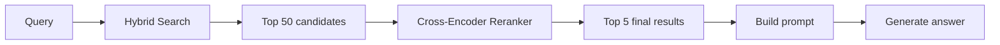
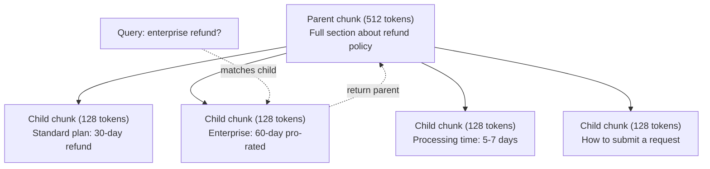
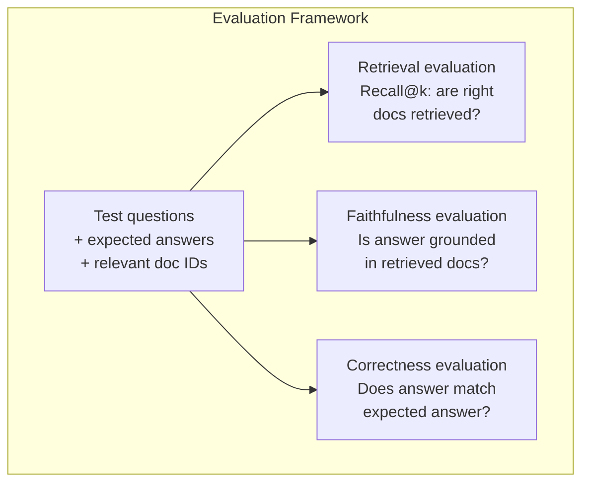

# Advanced RAG（Chunking、Reranking、Hybrid Search）

> Basic RAG 会检索 top-k 个最相似的 chunks。对简单问题这能工作。但遇到 multi-hop reasoning、模糊 query 和大规模语料库时，它会崩掉。Advanced RAG 是 10 个文档上的 demo 和 1000 万文档上的系统之间的差别。

**Type:** Build
**Languages:** Python
**Prerequisites:** Phase 11, Lesson 06 (RAG)
**Time:** ~90 minutes
**Related:** Phase 5 · 23 (Chunking Strategies for RAG) 覆盖全部六种 chunking 算法：recursive、semantic、sentence、parent-document、late chunking、contextual retrieval，并包含 Vectara/Anthropic benchmarks。本课在此基础上继续：hybrid search、reranking、query transformation。

## Learning Objectives

- 实现 advanced chunking 策略（semantic、recursive、parent-child），保留文档结构和上下文
- 构建 hybrid search pipeline，把 BM25 keyword matching、semantic vector search 和 cross-encoder reranker 组合起来
- 应用 query transformation 技术（HyDE、multi-query、step-back），改善模糊或复杂问题上的 retrieval
- 诊断并修复常见 RAG 失败：检索到错误 chunk、答案不在 context 中、multi-hop reasoning 断裂

## 问题

你在 Lesson 06 中构建了一个 basic RAG pipeline。它在小型语料库上回答直接问题时能工作。现在试试这些：

**Ambiguous query**："What was revenue last quarter?" Semantic search 返回关于 revenue strategy、revenue projections、CFO 对 revenue growth 看法的 chunks。它们都和 "revenue" 这个词语义相似，但没有一个包含实际数字。正确 chunk 写的是 "$47.2M in Q3 2025"，但它用的是 "earnings" 而不是 "revenue"。Embedding model 认为 "revenue strategy" 比 "Q3 earnings were $47.2M" 更接近 query。

**Multi-hop question**："Which team had the highest customer satisfaction score improvement?" 这需要找到每个 team 的 satisfaction scores，比较它们，再识别最大值。没有单个 chunk 包含答案。信息分散在各个 team reports 中。

**Large corpus problem**：你有 200 万个 chunks。正确答案在 chunk #1,847,293。你的 top-5 retrieval 拉回了 chunks #14、#89,201、#1,200,000、#44 和 #901,333。它们在 embedding space 中很接近，但都不包含答案。在这个规模下，approximate nearest neighbor search 会引入足够多的误差，把相关结果挤出 top-k。

Basic RAG 失败的原因是：vector similarity 不等于 relevance。一个 chunk 可以和 query 语义相似，却对回答问题没有用。Advanced RAG 用四类技术解决这个问题：hybrid search（加入 keyword matching）、reranking（更仔细地给候选项打分）、query transformation（搜索前先修正 query）、better chunking（以正确粒度检索）。

## 概念

### Hybrid Search: Semantic + Keyword

Semantic search（vector similarity）擅长理解 meaning。"How do I cancel my subscription?" 能匹配 "Steps to terminate your plan"，即使两者没有共享词。但它会漏掉 exact matches。"Error code E-4021" 可能匹配不到包含 "E-4021" 的 chunk，因为 embedding model 可能把它当作噪声。

Keyword search（BM25）正好相反。它擅长 exact matches。"E-4021" 能完美匹配。但如果文档写的是 "terminate your plan"，"cancel my subscription" 可能返回零结果。

Hybrid search 会同时运行两者，然后合并结果。

**BM25**（Best Matching 25）是标准 keyword search 算法。它从 1990 年代起就是搜索引擎的骨架。公式如下：

```text
BM25(q, d) = sum over terms t in q:
    IDF(t) * (tf(t,d) * (k1 + 1)) / (tf(t,d) + k1 * (1 - b + b * |d| / avgdl))
```

其中 tf(t,d) 是 term t 在 document d 中的频率，IDF(t) 是 inverse document frequency，|d| 是 document length，avgdl 是 average document length，k1 控制 term frequency saturation（默认 1.2），b 控制 length normalization（默认 0.75）。

通俗地说：当文档包含 query terms 时，BM25 会给更高分，尤其是稀有 terms；但重复 term 的收益会递减。一个出现 50 次 "revenue" 的文档，并不比只出现一次的文档相关 50 倍。

### Reciprocal Rank Fusion (RRF)

你有两个 ranked lists：一个来自 vector search，一个来自 BM25。怎么组合它们？Reciprocal Rank Fusion 是标准做法。

```text
RRF_score(d) = sum over rankings R:
    1 / (k + rank_R(d))
```

其中 k 是常数（通常为 60），用于防止 top-ranked result 过度支配分数。

一个文档在 vector search 中排名 #1，在 BM25 中排名 #5，得分为：1/(60+1) + 1/(60+5) = 0.0164 + 0.0154 = 0.0318

一个文档在 vector search 中排名 #3，在 BM25 中排名 #2，得分为：1/(60+3) + 1/(60+2) = 0.0159 + 0.0161 = 0.0320

RRF 会自然平衡两种信号。一个在两个列表中都排名靠前的文档会获得最佳分数。一个只在某个列表中排名 #1、但在另一个列表中缺席的文档，会获得中等分数。这很 robust，因为它使用 rank 而不是 raw score，所以两个系统之间的 score distribution 差异并不重要。

### Reranking

Retrieval（无论是 vector、keyword 还是 hybrid）速度快但不精确。它使用 bi-encoders：query 和每个 document 被独立 embedding，然后再比较。Embeddings 可以提前计算并缓存。这能扩展到百万级文档。

Reranking 使用 cross-encoders：query 和候选 document 会一起输入模型，模型输出 relevance score。模型同时看到两段文本，因此能捕捉它们之间更细粒度的交互。Cross-encoder 能理解 "What were Q3 earnings?" 与包含 "$47.2M in Q3" 的 chunk 高度相关，即使 bi-encoder 漏掉了这种连接。

Trade-off：cross-encoders 比 bi-encoders 慢 100-1000 倍，因为它们要联合处理 query-document pair。你不能为百万文档预先计算 cross-encoder scores。解决方案是：先检索较大的候选集（hybrid search 的 top-50），然后用 cross-encoder rerank 得到最终 top-5。



常见 reranking models（2026 lineup）：

- Cohere Rerank 3.5：managed API，多语言，在混合语料库上 recall gain 最好
- Voyage rerank-2.5：managed API，hosted options 中 latency 最低
- Jina-Reranker-v2 Multilingual：open-weight，支持 100+ languages
- bge-reranker-v2-m3：open-weight，强 baseline
- cross-encoder/ms-marco-MiniLM-L-6-v2：open-weight，可在 CPU 上跑 prototyping
- ColBERTv2 / Jina-ColBERT-v2：late-interaction multi-vector rerankers，scoring time 是 O(tokens) 而不是 O(docs)

### Query Transformation

有时问题不在 retrieval，而在 query 本身。"What was that thing about the new policy change?" 是一个很差的 search query。它没有具体 terms。Embedding 很模糊。没有 retrieval system 能从这个 query 找到正确文档。

**Query rewriting**：把用户 query 改写成更好的 search query。LLM 可以做这件事：

```text
User: "What was that thing about the new policy change?"
Rewritten: "Recent policy changes and updates"
```

**HyDE (Hypothetical Document Embeddings)**：不要用 query 搜索，而是生成一个 hypothetical answer，embed 它，再搜索相似的真实文档。

```text
Query: "What is the refund policy for enterprise?"
Hypothetical answer: "Enterprise customers are eligible for a full refund
within 60 days of purchase. Refunds are pro-rated based on the remaining
subscription period and processed within 5-7 business days."
```

Embed 这个 hypothetical answer，然后搜索与它相似的真实文档。直觉是：hypothetical answer 在 embedding space 中比原始问题更接近真实答案。问题和答案的语言结构不同。生成 hypothetical answer 可以弥合 "question space" 和 "answer space" 之间的差距。

HyDE 会在 retrieval 前增加一次 LLM call。这会增加 500-2000ms latency。当 raw queries 上 retrieval quality 很差时，这个代价是值得的。

### Parent-Child Chunking

标准 chunking 强迫你权衡：小 chunks 适合精确 retrieval，大 chunks 才有足够 context。Parent-child chunking 消除了这个 trade-off。

为 retrieval 索引小 chunks（128 tokens）。当检索到小 chunk 时，把它的 parent chunk（512 tokens）返回给 prompt。小 chunk 精确匹配 query。Parent chunk 给 LLM 足够的上下文来生成好答案。



Query "enterprise refund?" 会精确匹配 child chunk C2。但 prompt 收到的是完整 parent chunk P，其中包含关于 processing time 和 submission process 的周边上下文。

### Metadata Filtering

在运行 vector search 之前，先按 metadata 过滤语料库：date、source、category、author、language。这能缩小搜索空间，并阻止无关结果。

"What changed in the security policy last month?" 应该只搜索过去 30 天、security category 中的文档。如果没有 metadata filtering，你会搜索整个语料库，并可能检索到一份 2 年前的 security document，只因为它语义相似。

Production RAG systems 会把 metadata 和每个 chunk 一起存储：source document、creation date、category、author、version。Vector databases 支持在 similarity search 前按 metadata pre-filtering，这对大规模性能至关重要。

### Evaluation

你构建了 RAG system。怎么知道它是否工作？三个 metrics：

**Retrieval relevance (Recall@k)**：对于一组带有已知相关文档的 test questions，有多少比例的 relevant documents 出现在 top-k results 中？如果某个问题的答案在 chunk #47，那么 chunk #47 是否出现在 top-5 中？

**Faithfulness**：生成答案是否 grounded in retrieved documents？如果检索到的 chunks 写的是 "60-day refund window"，模型却说 "90-day refund window"，这就是 faithfulness failure。模型在拥有正确 context 的情况下仍然 hallucinated。

**Answer correctness**：生成答案是否匹配 expected answer？这是 end-to-end metric。它结合了 retrieval quality 和 generation quality。

一个简单的 faithfulness check：取生成答案中的每个 claim，验证它是否在 retrieved chunks 中以实质形式出现。如果答案包含任何 retrieved chunks 中没有的事实，它很可能是 hallucinated。



## Build It

### Step 1: BM25 Implementation

```python
import math
from collections import Counter

class BM25:
    def __init__(self, k1=1.2, b=0.75):
        self.k1 = k1
        self.b = b
        self.docs = []
        self.doc_lengths = []
        self.avg_dl = 0
        self.doc_freqs = {}
        self.n_docs = 0

    def index(self, documents):
        self.docs = documents
        self.n_docs = len(documents)
        self.doc_lengths = []
        self.doc_freqs = {}

        for doc in documents:
            words = doc.lower().split()
            self.doc_lengths.append(len(words))
            unique_words = set(words)
            for word in unique_words:
                self.doc_freqs[word] = self.doc_freqs.get(word, 0) + 1

        self.avg_dl = sum(self.doc_lengths) / self.n_docs if self.n_docs else 1

    def score(self, query, doc_idx):
        query_words = query.lower().split()
        doc_words = self.docs[doc_idx].lower().split()
        doc_len = self.doc_lengths[doc_idx]
        word_counts = Counter(doc_words)
        score = 0.0

        for term in query_words:
            if term not in word_counts:
                continue
            tf = word_counts[term]
            df = self.doc_freqs.get(term, 0)
            idf = math.log((self.n_docs - df + 0.5) / (df + 0.5) + 1)
            numerator = tf * (self.k1 + 1)
            denominator = tf + self.k1 * (1 - self.b + self.b * doc_len / self.avg_dl)
            score += idf * numerator / denominator

        return score

    def search(self, query, top_k=10):
        scores = [(i, self.score(query, i)) for i in range(self.n_docs)]
        scores.sort(key=lambda x: x[1], reverse=True)
        return scores[:top_k]
```

### Step 2: Reciprocal Rank Fusion

```python
def reciprocal_rank_fusion(ranked_lists, k=60):
    scores = {}
    for ranked_list in ranked_lists:
        for rank, (doc_id, _) in enumerate(ranked_list):
            if doc_id not in scores:
                scores[doc_id] = 0.0
            scores[doc_id] += 1.0 / (k + rank + 1)
    fused = sorted(scores.items(), key=lambda x: x[1], reverse=True)
    return fused
```

### Step 3: Hybrid Search Pipeline

```python
def hybrid_search(query, chunks, vector_embeddings, vocab, idf, bm25_index, top_k=5, fusion_k=60):
    query_emb = tfidf_embed(query, vocab, idf)
    vector_results = search(query_emb, vector_embeddings, top_k=top_k * 3)
    bm25_results = bm25_index.search(query, top_k=top_k * 3)
    fused = reciprocal_rank_fusion([vector_results, bm25_results], k=fusion_k)
    return fused[:top_k]
```

### Step 4: Simple Reranker

在 production 中，你会使用 cross-encoder model。这里我们构建一个 reranker，用 word overlap、term importance 和 phrase matching 给 query-document relevance 打分。

```python
def rerank(query, candidates, chunks):
    query_words = set(query.lower().split())
    stop_words = {"the", "a", "an", "is", "are", "was", "were", "what", "how",
                  "why", "when", "where", "do", "does", "for", "of", "in", "to",
                  "and", "or", "on", "at", "by", "it", "its", "this", "that",
                  "with", "from", "be", "has", "have", "had", "not", "but"}
    query_terms = query_words - stop_words

    scored = []
    for doc_id, initial_score in candidates:
        chunk = chunks[doc_id].lower()
        chunk_words = set(chunk.split())

        term_overlap = len(query_terms & chunk_words)

        query_bigrams = set()
        q_list = [w for w in query.lower().split() if w not in stop_words]
        for i in range(len(q_list) - 1):
            query_bigrams.add(q_list[i] + " " + q_list[i + 1])
        bigram_matches = sum(1 for bg in query_bigrams if bg in chunk)

        position_boost = 0
        for term in query_terms:
            pos = chunk.find(term)
            if pos != -1 and pos < len(chunk) // 3:
                position_boost += 0.5

        rerank_score = (
            term_overlap * 1.0
            + bigram_matches * 2.0
            + position_boost
            + initial_score * 5.0
        )
        scored.append((doc_id, rerank_score))

    scored.sort(key=lambda x: x[1], reverse=True)
    return scored
```

### Step 5: HyDE (Hypothetical Document Embeddings)

```python
def hyde_generate_hypothesis(query):
    templates = {
        "what": "The answer to '{query}' is as follows: Based on our documentation, {topic} involves specific policies and procedures that define how the process works.",
        "how": "To address '{query}': The process involves several steps. First, you need to initiate the request. Then, the system processes it according to the defined rules.",
        "default": "Regarding '{query}': Our records indicate specific details and policies related to this topic that provide a comprehensive answer."
    }
    query_lower = query.lower()
    if query_lower.startswith("what"):
        template = templates["what"]
    elif query_lower.startswith("how"):
        template = templates["how"]
    else:
        template = templates["default"]

    topic_words = [w for w in query.lower().split()
                   if w not in {"what", "is", "the", "how", "do", "does", "a", "an",
                                "for", "of", "to", "in", "on", "at", "by", "and", "or"}]
    topic = " ".join(topic_words) if topic_words else "this topic"

    return template.format(query=query, topic=topic)


def hyde_search(query, chunks, vector_embeddings, vocab, idf, top_k=5):
    hypothesis = hyde_generate_hypothesis(query)
    hypothesis_emb = tfidf_embed(hypothesis, vocab, idf)
    results = search(hypothesis_emb, vector_embeddings, top_k)
    return results, hypothesis
```

### Step 6: Parent-Child Chunking

```python
def create_parent_child_chunks(text, parent_size=200, child_size=50):
    words = text.split()
    parents = []
    children = []
    child_to_parent = {}

    parent_idx = 0
    start = 0
    while start < len(words):
        parent_end = min(start + parent_size, len(words))
        parent_text = " ".join(words[start:parent_end])
        parents.append(parent_text)

        child_start = start
        while child_start < parent_end:
            child_end = min(child_start + child_size, parent_end)
            child_text = " ".join(words[child_start:child_end])
            child_idx = len(children)
            children.append(child_text)
            child_to_parent[child_idx] = parent_idx
            child_start += child_size

        parent_idx += 1
        start += parent_size

    return parents, children, child_to_parent
```

### Step 7: Faithfulness Evaluation

```python
def evaluate_faithfulness(answer, retrieved_chunks):
    answer_sentences = [s.strip() for s in answer.split(".") if len(s.strip()) > 10]
    if not answer_sentences:
        return 1.0, []

    grounded = 0
    ungrounded = []
    context = " ".join(retrieved_chunks).lower()

    for sentence in answer_sentences:
        words = set(sentence.lower().split())
        stop_words = {"the", "a", "an", "is", "are", "was", "were", "and", "or",
                      "to", "of", "in", "for", "on", "at", "by", "it", "this", "that"}
        content_words = words - stop_words
        if not content_words:
            grounded += 1
            continue

        matched = sum(1 for w in content_words if w in context)
        ratio = matched / len(content_words) if content_words else 0

        if ratio >= 0.5:
            grounded += 1
        else:
            ungrounded.append(sentence)

    score = grounded / len(answer_sentences) if answer_sentences else 1.0
    return score, ungrounded


def evaluate_retrieval_recall(queries_with_relevant, retrieval_fn, k=5):
    total_recall = 0.0
    results = []

    for query, relevant_indices in queries_with_relevant:
        retrieved = retrieval_fn(query, k)
        retrieved_indices = set(idx for idx, _ in retrieved)
        relevant_set = set(relevant_indices)
        hits = len(retrieved_indices & relevant_set)
        recall = hits / len(relevant_set) if relevant_set else 1.0
        total_recall += recall
        results.append({
            "query": query,
            "recall": recall,
            "hits": hits,
            "total_relevant": len(relevant_set)
        })

    avg_recall = total_recall / len(queries_with_relevant) if queries_with_relevant else 0
    return avg_recall, results
```

## Use It

使用真实 cross-encoder 进行 reranking：

```python
from sentence_transformers import CrossEncoder

reranker = CrossEncoder("cross-encoder/ms-marco-MiniLM-L-6-v2")

def rerank_with_cross_encoder(query, candidates, chunks, top_k=5):
    pairs = [(query, chunks[doc_id]) for doc_id, _ in candidates]
    scores = reranker.predict(pairs)
    scored = list(zip([doc_id for doc_id, _ in candidates], scores))
    scored.sort(key=lambda x: x[1], reverse=True)
    return scored[:top_k]
```

使用 Cohere 的 managed reranker：

```python
import cohere

co = cohere.Client()

def rerank_with_cohere(query, candidates, chunks, top_k=5):
    docs = [chunks[doc_id] for doc_id, _ in candidates]
    response = co.rerank(
        model="rerank-english-v3.0",
        query=query,
        documents=docs,
        top_n=top_k
    )
    return [(candidates[r.index][0], r.relevance_score) for r in response.results]
```

使用真实 LLM 运行 HyDE：

```python
import anthropic

client = anthropic.Anthropic()

def hyde_with_llm(query):
    response = client.messages.create(
        model="claude-sonnet-4-20250514",
        max_tokens=256,
        messages=[{
            "role": "user",
            "content": f"Write a short paragraph that would be a good answer to this question. Do not say you don't know. Just write what the answer would look like.\n\nQuestion: {query}"
        }]
    )
    return response.content[0].text
```

使用 Weaviate 做 production hybrid search：

```python
import weaviate

client = weaviate.connect_to_local()

collection = client.collections.get("Documents")
response = collection.query.hybrid(
    query="enterprise refund policy",
    alpha=0.5,
    limit=10
)
```

alpha 参数控制平衡：0.0 = pure keyword（BM25），1.0 = pure vector，0.5 = equal weight。多数 production systems 使用 0.3 到 0.7 之间的 alpha。

## Ship It

本课产出：

- `outputs/prompt-advanced-rag-debugger.md`：用于诊断和修复 RAG quality issues 的 prompt
- `outputs/skill-advanced-rag.md`：用于通过 hybrid search 和 reranking 构建 production-grade RAG 的 skill

## Exercises

1. 在 sample documents 上比较 BM25、vector search 和 hybrid search。对 5 个 test queries 中的每一个，记录哪种方式能把最相关 chunk 返回在 #1 位置。Hybrid search 应该在 5 个中至少赢 3 个。

2. 实现 metadata filter。给每个 document 添加 "category" 字段（security、billing、api、product）。运行 vector search 前，只把 chunks 过滤到相关 category。用 "What encryption is used?" 测试，并验证它只搜索 security-category chunks。

3. 使用 Lesson 06 中的 simple generate function 构建完整 HyDE pipeline。对全部 5 个 test queries，比较 direct query search 和 HyDE search 的 retrieval quality（top-3 relevance）。HyDE 应该改善 vague queries 的结果。

4. 在 sample documents 上实现 parent-child chunking strategy。使用 child_size=30 和 parent_size=100。用 child chunks 搜索，但在 prompt 中返回 parent chunks。比较生成答案与 chunk_size=50 的 standard chunking 的差异。

5. 创建 evaluation dataset：10 个带有已知 answer chunks 的问题。测量 (a) vector search only、(b) BM25 only、(c) hybrid search、(d) hybrid + reranking 的 Recall@3、Recall@5、Recall@10。绘制结果，并识别 reranking 在哪里帮助最大。

## Key Terms

| Term | What people say | What it actually means |
|------|----------------|----------------------|
| BM25 | "Keyword search" | 一种 probabilistic ranking algorithm，按 term frequency、inverse document frequency 和 document length normalization 给文档打分 |
| Hybrid search | "Best of both worlds" | 并行运行 semantic (vector) search 和 keyword (BM25) search，然后用 rank fusion 合并结果 |
| Reciprocal Rank Fusion | "Merge ranked lists" | 对每个 document，在所有列表中累加 1/(k + rank)，从而组合多个 ranked lists |
| Reranking | "Second pass scoring" | 使用更昂贵的 cross-encoder model，对初始 retrieval 得到的 candidate set 重新打分 |
| Cross-encoder | "Joint query-document model" | 把 query 和 document 作为单个输入并产生 relevance score 的模型；比 bi-encoders 更准确，但太慢，不能用于 full corpus search |
| Bi-encoder | "Independent embedding model" | 独立 embed queries 和 documents 的模型；因为 embeddings 可预先计算而很快，但不如 cross-encoders 准确 |
| HyDE | "Search with a fake answer" | 生成 query 的 hypothetical answer，embed 它，再搜索与它相似的真实文档 |
| Parent-child chunking | "Small search, big context" | 索引 small chunks 以获得精确 retrieval，但返回 larger parent chunk 以提供足够 context |
| Metadata filtering | "Narrow before searching" | 在运行 vector search 前，按 date、source、category 等属性过滤 documents，从而减少 search space |
| Faithfulness | "Did it stay grounded" | 生成答案是否由 retrieved documents 支持，而不是从模型训练数据中 hallucinate 出来 |

## Further Reading

- Robertson & Zaragoza, "The Probabilistic Relevance Framework: BM25 and Beyond" (2009)：BM25 的权威参考，解释公式背后的 probabilistic foundations
- Cormack et al., "Reciprocal Rank Fusion Outperforms Condorcet and Individual Rank Learning Methods" (2009)：原始 RRF 论文，展示它胜过更复杂的 fusion methods
- Gao et al., "Precise Zero-Shot Dense Retrieval without Relevance Labels" (2022)：HyDE 论文，展示 hypothetical document embeddings 可以在没有任何 training data 的情况下改善 retrieval
- Nogueira & Cho, "Passage Re-ranking with BERT" (2019)：展示在 BM25 之上使用 cross-encoder reranking 能显著改善 retrieval quality
- [Khattab et al., "DSPy: Compiling Declarative Language Model Calls into Self-Improving Pipelines" (2023)](https://arxiv.org/abs/2310.03714)：把 prompt construction 和 weight selection 视为 retrieval pipelines 上的 optimization problem；读它是为了学习 "program LLMs" 而不是 "prompt LLMs"
- [Edge et al., "From Local to Global: A Graph RAG Approach to Query-Focused Summarization" (Microsoft Research 2024)](https://arxiv.org/abs/2404.16130)：GraphRAG 论文：entity-relation extraction + Leiden community detection 用于 query-focused summarization；重点是 global vs local retrieval 的区别
- [Asai et al., "Self-RAG: Learning to Retrieve, Generate, and Critique through Self-Reflection" (ICLR 2024)](https://arxiv.org/abs/2310.11511)：带 reflection tokens 的 self-evaluating RAG；这是 static retrieve-then-generate 之后的 agentic frontier
- [LangChain Query Construction blog](https://blog.langchain.dev/query-construction/)：如何把自然语言 query 翻译成 structured database queries（Text-to-SQL、Cypher），作为 pre-retrieval step
