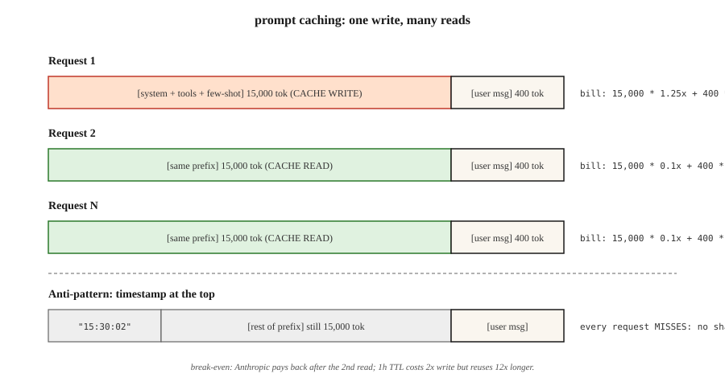

# 提示缓存与上下文缓存

> 你的 system prompt 有 4,000 个 token。你的 RAG context 有 20,000 个 token。你每次请求都发送它们。你也每次都为它们付费。Prompt caching 让 provider 在它们那边保持这个 prefix 热缓存，并在复用时只按正常价格的 10% 计费。用得正确，它能把推理成本降低 50–90%，把首 token 延迟降低 40–85%。

**Type:** Build
**Languages:** Python
**Prerequisites:** Phase 11 · 01 (Prompt Engineering), Phase 11 · 05 (Context Engineering), Phase 11 · 11 (Caching and Cost)
**Time:** ~60 minutes

## 问题

一个 coding agent 在对话的每一轮都把同一个 15,000-token system prompt 发给 Claude。20 轮对话，按每百万 input token 3 美元算，仅输入成本就是 0.90 美元，而且这还没算用户实际消息。乘以每天 10,000 场对话，账单会达到每天 9,000 美元，花在一段从不变化的文本上。

你不能缩短提示词，否则质量会下降。你也不能不发送它，因为模型每一轮都需要它。唯一的动作是：不要再为 provider 已经见过的 prefix 付全价。

这个动作就是 prompt caching。Anthropic 在 2024 年 8 月推出它（2025 年又提供了 1 小时 extended-TTL 版本），OpenAI 在当年稍后自动化了它，Google 则和 Gemini 1.5 一起推出显式 context caching。现在三家都在 frontier model 上把它作为一等功能提供。

## 概念



**机制。** 当一个请求的 prefix 与近期请求中的 prefix 匹配时，provider 会复用上一次运行留下的 KV-cache，而不是重新编码这些 token。第一次你支付少量 write premium；之后每次读取都获得大幅折扣。

**2026 年的三种 provider 形态。**

| Provider | API style | Hit discount | Write premium | Default TTL | Min cacheable |
|---------|-----------|--------------|---------------|-------------|---------------|
| Anthropic | 内容 block 上显式 `cache_control` marker | input 便宜 90% | 25% surcharge | 5 min（可延长到 1 hour） | 1,024 tokens（Sonnet/Opus），2,048（Haiku） |
| OpenAI | 自动 prefix 检测 | input 便宜 50% | 无 | 最多 1 hour（best-effort） | 1,024 tokens |
| Google (Gemini) | 显式 `CachedContent` API | 按存储计费；读取约为正常价格 25% | 按 token·hour 收存储费 | 用户设置（默认 1 hour） | 4,096 tokens（Flash），32,768（Pro） |

**不变量。** 三家都只缓存 prefix。如果请求之间有任何 token 不同，第一个不同 token 之后的所有内容都会 miss。把*稳定*部分放在顶部，把*变化*部分放在底部。

### 缓存友好的布局

```text
[system prompt]          <-- cache this
[tool definitions]       <-- cache this
[few-shot examples]      <-- cache this
[retrieved documents]    <-- cache if reused, else don't
[conversation history]   <-- cache up to last turn
[current user message]   <-- never cache (different every time)
```

违反这个顺序——把 user message 放到 system prompt 上面，或把动态检索结果插在 few-shot 中间——缓存就永远不会命中。

### 盈亏平衡计算

Anthropic 的 25% write premium 意味着一个缓存 block 至少要被读取两次，才会净省钱。1 次写入 + 1 次读取，平均每次请求成本是 0.675x（节省 32%）；1 次写入 + 10 次读取，平均是 0.205x（节省 80%）。经验法则：任何你预计在 TTL 内至少复用 3 次的内容，都值得缓存。

## Build It

### 第 1 步：Anthropic 显式 marker 的 prompt caching

```python
import anthropic

client = anthropic.Anthropic()

SYSTEM = [
    {
        "type": "text",
        "text": "You are a senior Python reviewer. Follow the rubric exactly.\n\n" + RUBRIC_15K_TOKENS,
        "cache_control": {"type": "ephemeral"},
    }
]

def review(code: str):
    return client.messages.create(
        model="claude-opus-4-7",
        max_tokens=1024,
        system=SYSTEM,
        messages=[{"role": "user", "content": code}],
    )
```

`cache_control` marker 告诉 Anthropic 把这个 block 存储 5 分钟。在这个窗口内复用会命中；过期后再次复用会重新写入。

**Response usage fields：**

```python
response = review(code_a)
response.usage
# InputTokensUsage(
#     input_tokens=120,
#     cache_creation_input_tokens=15023,   # paid at 1.25x
#     cache_read_input_tokens=0,
#     output_tokens=340,
# )

response_b = review(code_b)
response_b.usage
# cache_creation_input_tokens=0
# cache_read_input_tokens=15023           # paid at 0.1x
```

在 CI 中同时检查这两个字段。如果跨请求时 `cache_read_input_tokens` 一直是 0，说明你的 cache key 正在漂移。

### 第 2 步：1 小时 extended TTL

对长时间运行的 batch job，5 分钟默认 TTL 会在任务之间过期。设置 `ttl`：

```python
{"type": "text", "text": RUBRIC, "cache_control": {"type": "ephemeral", "ttl": "1h"}}
```

1 小时 TTL 的 write premium 是 2 倍（比 baseline 高 50%，而不是 25%），但只要任何 batch 对同一个 prefix 复用超过 5 次，就能很快回本。

### 第 3 步：OpenAI 自动缓存

OpenAI 不需要你配置任何东西。任何超过 1,024 token、并与近期请求匹配的 prefix，都会自动获得 50% 折扣。

```python
from openai import OpenAI
client = OpenAI()

resp = client.chat.completions.create(
    model="gpt-5",
    messages=[
        {"role": "system", "content": SYSTEM_PROMPT},   # long and stable
        {"role": "user", "content": user_msg},
    ],
)
resp.usage.prompt_tokens_details.cached_tokens  # the discounted portion
```

同样适用缓存友好布局规则。有两件事会杀掉 OpenAI 缓存，但不一定杀掉 Anthropic 缓存：改变 `user` 字段（它被用作 cache key 的一部分），以及重新排序 tools。

### 第 4 步：Gemini 显式 context caching

Gemini 把 cache 当成一个你创建并命名的一等对象：

```python
from google import genai
from google.genai import types

client = genai.Client()

cache = client.caches.create(
    model="gemini-3-pro",
    config=types.CreateCachedContentConfig(
        display_name="rubric-v3",
        system_instruction=RUBRIC,
        contents=[FEW_SHOT_EXAMPLES],
        ttl="3600s",
    ),
)

resp = client.models.generate_content(
    model="gemini-3-pro",
    contents=["Review this code:\n" + code],
    config=types.GenerateContentConfig(cached_content=cache.name),
)
```

Gemini 会在 cache 存活期间按 token·hour 收取存储费，读取约为正常 input rate 的 25%。当你要在多天内、跨许多 session 复用同一个巨大 prompt 时，这就是合适形态。

### 第 5 步：在生产中测量命中率

`code/main.py` 中有一个模拟三家 provider 的 accountant，会跟踪 write/read/miss 计数，并计算每 1K 请求的 blended cost。把目标命中率作为 deploy gate。大多数生产 Anthropic 设置在 warmup 后应该看到超过 80% 的 read fraction。

## 2026 年仍然会真实上线的坑

- **顶部动态时间戳。** `"Current time: 2026-04-22 15:30:02"` 放在 system prompt 顶部。每次请求都会 miss。把时间戳移到 cache breakpoint 下方。
- **Tool 重新排序。** 用稳定顺序序列化 tools。部署之间的 dict reshuffle 会打破所有命中。
- **自由文本近似重复。** “You are helpful.” vs “You are a helpful assistant.” —— 一个字节不同 = 完整 miss。
- **Block 太小。** Anthropic 强制 1,024-token 下限（Haiku 是 2,048）。更小的 block 会静默不缓存。
- **盲区成本看板。** 把“input tokens”拆成 cached 与 uncached。否则流量下降看起来会像缓存成功。

## Use It

2026 年的 caching stack：

| Situation | Pick |
|-----------|------|
| 拥有稳定 10k+ system prompt、很多轮对话的 agent | Anthropic `cache_control`，5-min TTL |
| 复用同一个 prefix 超过 30 分钟的 batch job | Anthropic，`ttl: "1h"` |
| GPT-5 上的 serverless endpoint，无自定义 infra | OpenAI automatic（只要让 prefix 稳定且足够长） |
| 多天复用巨大代码/文档语料 | Gemini 显式 `CachedContent` |
| 跨 provider fallback | 让可缓存 prefix 布局在各 provider 中保持一致，这样任何命中都能生效 |

把它和 user-message 层的 semantic caching（Phase 11 · 11）结合：prompt caching 处理*token 完全相同*的复用，semantic caching 处理*语义相同*的复用。

## Ship It

保存 `outputs/skill-prompt-caching-planner.md`：

```markdown
---
name: prompt-caching-planner
description: Design a cache-friendly prompt layout and pick the right provider caching mode.
version: 1.0.0
phase: 11
lesson: 15
tags: [llm-engineering, caching, cost]
---

Given a prompt (system + tools + few-shot + retrieval + history + user) and a usage profile (requests per hour, TTL needed, provider), output:

1. Layout. Reordered sections with a single cache breakpoint marked; explain which sections are stable, which are volatile.
2. Provider mode. Anthropic cache_control, OpenAI automatic, or Gemini CachedContent. Justify from TTL and reuse pattern.
3. Break-even. Expected reads per write within TTL; net cost vs no-cache with math.
4. Verification plan. CI assertion that cache_read_input_tokens > 0 on the second identical request; dashboard split by cached vs uncached tokens.
5. Failure modes. List the three most likely reasons the cache will miss in this setup (dynamic timestamp, tool reorder, near-duplicate text) and how you will prevent each.

Refuse to ship a cache plan that places a dynamic field above the breakpoint. Refuse to enable 1h TTL without a reuse count that makes the 2x write premium pay back.
```

## 练习

1. **Easy。** 取一个 10 轮对话，使用 Claude 和 5,000-token system prompt。分别在没有 `cache_control` 和开启 `cache_control` 的情况下运行。报告两者的 input-token 账单。
2. **Medium。** 编写一个测试 harness：给定 prompt template 和 request log，计算每个 provider 的预期命中率和美元节省额（Anthropic 5m、Anthropic 1h、OpenAI automatic、Gemini explicit）。
3. **Hard。** 构建一个布局优化器：给定一个 prompt 和一组标记为 `stable=True/False` 的字段，重写 prompt，把单个 cache breakpoint 放在最大缓存友好位置，同时不丢信息。在真实 Anthropic endpoint 上验证。

## 关键术语

| Term | 常见说法 | 实际含义 |
|------|----------|----------|
| Prompt caching | “让长提示变便宜” | 对匹配 prefix 复用 provider 侧 KV-cache；重复 input token 获得 50-90% 折扣。 |
| `cache_control` | “Anthropic marker” | content-block 属性，声明“到这里为止都可缓存”；`{"type": "ephemeral"}`。 |
| Cache write | “支付 premium” | 第一次填充 cache 的请求；Anthropic 按约 1.25x input rate 计费，OpenAI 免费。 |
| Cache read | “折扣” | 后续匹配 prefix 的请求；Anthropic 按 10%，OpenAI 按 50%，Gemini 约按 25% 计费。 |
| TTL | “它能活多久” | cache 保持热状态的秒数；Anthropic 默认 5m（可延长到 1h），OpenAI best-effort 最多 1h，Gemini 用户设置。 |
| Extended TTL | “Anthropic 1 小时缓存” | `{"type": "ephemeral", "ttl": "1h"}`；2x write premium，但对 batch 复用值得。 |
| Prefix match | “为什么我的缓存 miss 了” | 只有从开头到 breakpoint 的每个 token 都 byte-identical，cache 才会命中。 |
| Context caching (Gemini) | “显式那个” | Google 的具名、按存储计费的 cache 对象；最适合多天复用大语料。 |

## 延伸阅读

- [Anthropic — Prompt caching](https://docs.anthropic.com/en/docs/build-with-claude/prompt-caching) — `cache_control`、1h TTL、盈亏平衡表。
- [OpenAI — Prompt caching](https://platform.openai.com/docs/guides/prompt-caching) — 自动 prefix 匹配。
- [Google — Context caching](https://ai.google.dev/gemini-api/docs/caching) — `CachedContent` API 和存储定价。
- [Anthropic engineering — Prompt caching for long-context workloads](https://www.anthropic.com/news/prompt-caching) — 原始发布文章，包含延迟数字。
- Phase 11 · 05 (Context Engineering) — 如何切分 prompt，让 cache 能落地。
- Phase 11 · 11 (Caching and Cost) — 将 prompt caching 与 user message 上的 semantic cache 配对。
- [Pope et al., "Efficiently Scaling Transformer Inference" (2022)](https://arxiv.org/abs/2211.05102) — prompt caching 暴露给用户的 KV-cache 内存模型；解释为什么重读 cached prefix 比重算便宜约 10 倍。
- [Agrawal et al., "SARATHI: Efficient LLM Inference by Piggybacking Decodes with Chunked Prefills" (2023)](https://arxiv.org/abs/2308.16369) — prefill 是 prompt caching 跳过的阶段；这篇解释为什么 cache hit 会显著降低 TTFT，而不影响 TPOT。
- [Leviathan et al., "Fast Inference from Transformers via Speculative Decoding" (2023)](https://arxiv.org/abs/2211.17192) — prompt caching 与 speculative decoding、Flash Attention、MQA/GQA 一样，都是弯曲推理成本曲线的杠杆；读这篇了解另外三个。
