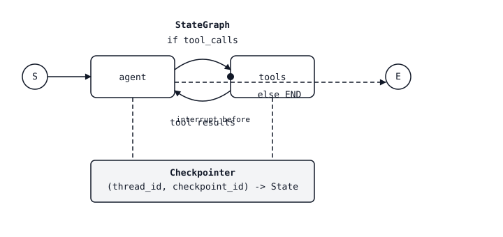

# LangGraph：Agents 的状态机

> 手写的 ReAct loop 是一个 `while True`。用 LangGraph 写的 ReAct loop 是一张 graph，你可以 checkpoint、interrupt、branch，并且 time-travel。Agent 本身没有变。变的是它外面的 harness。

**Type:** Build
**Languages:** Python
**Prerequisites:** Phase 11 · 09 (Function Calling), Phase 11 · 14 (Model Context Protocol)
**Time:** ~75 minutes

## 问题

你发布了一个 function-calling agent。它前三轮运行正常，然后出事了：模型尝试调用一个返回 500 的 tool，用户在任务中途改变主意，或者 agent 决定在没有 human sign-off 的情况下退款。`while True:` loop 没有 hooks。你无法暂停它，无法回退它，也无法分叉出一条 “如果模型当时选了另一个 tool 会怎样” 的路径。一旦它越过 demo 阶段进入生产，这个 agent 就变成了黑盒：要么工作了，要么没工作。

一旦你看见它，下一步就很明显。Agent 本来就是一个 state machine：system prompt、message history、pending tool calls，加上 next action。把这个 state machine 显式化：用 nodes 表示“模型思考”“tool 运行”“human 批准”，用 edges 表示它们之间的 conditional transitions。一旦 graph 是显式的，外层 harness 就免费得到四种能力：checkpointing（在 steps 之间保存 state）、interrupts（暂停等待 human）、streaming（stream tokens 和中间 events）、time-travel（回退到之前 state 并尝试另一条 branch）。

LangGraph 就是提供这个抽象的 library。它不是 LangChain 意义上的 agent framework（“这里有个 AgentExecutor，祝你好运”）。它是一个 graph runtime，内建 first-class state、first-class persistence 和 first-class interrupts。Agent loop 是你画出来的，不是手写出来的。

## 概念



一个 `StateGraph` 有三样东西。

1. **State.** 一个 typed dict（TypedDict 或 Pydantic model），它会在 graph 中流动。每个 node 都接收完整 state，并返回 partial update；LangGraph 会根据每个 field 的 *reducer* 合并更新，比如应当累积的 lists 使用 `operator.add`，默认则是 overwrite。
2. **Nodes.** Python functions，形状是 `state -> partial_state`。每个 node 是一个离散 step：“call the model”“run tools”“summarize”。
3. **Edges.** Nodes 之间的 transitions。Static edges 去固定位置。Conditional edges 接收一个 router function `state -> next_node_name`，让 graph 能根据 model output 分支。

你会 compile 这张 graph。Compile 会绑定 topology，附加 checkpointer（可选，但生产中必需），并返回一个 runnable。你用 initial state 和 `thread_id` invoke 它。Execution 的每一步都会持久化一个以 `(thread_id, checkpoint_id)` 为 key 的 checkpoint。

### 四种超能力

**Checkpointing.** 每次 node transition 都会把新 state 写到 store（测试时 in-memory，生产中 Postgres/Redis/SQLite）。用同一个 `thread_id` 再次调用 graph 就能 resume。Graph 会从暂停的位置继续。

**Interrupts.** 用 `interrupt_before=["human_review"]` 标记一个 node，execution 会在该 node 运行前停止。State 会持久化。你的 API 可以向用户返回 “awaiting approval”。后续对同一个 `thread_id` 发送 `Command(resume=...)`，即可继续 execution。

**Streaming.** `graph.stream(state, mode="updates")` 会随着执行产生 state deltas。`mode="messages"` 会 stream model nodes 内部的 LLM tokens。`mode="values"` 会产出完整 snapshots。你选择 UI 要展示什么。

**Time-travel.** `graph.get_state_history(thread_id)` 返回完整 checkpoint log。把任意之前的 `checkpoint_id` 传给 `graph.invoke`，就能从那个点 fork。它非常适合 debugging（“如果模型当时选了 tool B 呢？”）和 replay production traces 的 regression tests。

### Reducers 才是重点

每个 state field 都有 reducer。大多数默认行为都可以：新值覆盖旧值。但 message lists 需要 `operator.add`，这样新 messages 会 append，而不是 replace。Parallel edges 会通过 reducer 合并它们的 updates。如果两个 nodes 都更新 `messages`，而你忘了 `Annotated[list, add_messages]`，第二个会静默获胜，你会丢掉半轮对话。Reducer 是这个 library 唯一微妙的东西；把它弄对，其他部分就会自然组合起来。

### 四个 nodes 的 ReAct graph

一个 production ReAct agent 是四个 nodes 和两条 edges：

1. `agent`：用当前 message history 调用 LLM。返回 assistant message（可能包含 tool_calls）。
2. `tools`：执行最后一个 assistant message 中的 tool_calls，并把 tool results 作为 tool messages append。
3. 一条从 `agent` 出发的 conditional edge：如果最后一条 message 有 tool_calls，就路由到 `tools`，否则到 `END`。
4. 一条从 `tools` 回到 `agent` 的 static edge。

就是这样。你用大约 40 行代码，就得到完整 ReAct loop（Thought → Action → Observation → Thought → …），并且带 checkpointing、interrupts 和 streaming。

### StateGraph vs Send (fanout)

`Send(node_name, state)` 允许一个 node 派发 parallel subgraphs。例如：agent 决定同时查询三个 retrievers。每个 `Send` 都会生成一个 target node 的并行 execution；它们的 outputs 会通过 state reducer 合并。这就是 LangGraph 在不使用 threading primitives 的情况下表达 orchestrator-workers pattern 的方式。

### Subgraphs

一张 compiled graph 可以作为另一张 graph 中的 node。Outer graph 看到的是单个 node；inner graph 拥有自己的 state 和 checkpoints。团队通常用这种方式构建 supervisor-worker agents：supervisor graph 把 user intent 路由到某个 per-domain worker subgraph。

## Build It

### Step 1: state and nodes

```python
from typing import Annotated, TypedDict
from langchain_core.messages import AnyMessage, HumanMessage, AIMessage
from langgraph.graph import StateGraph, END
from langgraph.graph.message import add_messages
from langgraph.prebuilt import ToolNode
from langgraph.checkpoint.memory import MemorySaver

class State(TypedDict):
    messages: Annotated[list[AnyMessage], add_messages]

def agent_node(state: State) -> dict:
    response = llm.invoke(state["messages"])
    return {"messages": [response]}

def should_continue(state: State) -> str:
    last = state["messages"][-1]
    return "tools" if getattr(last, "tool_calls", None) else END

tool_node = ToolNode(tools=[search_web, read_file])

graph = StateGraph(State)
graph.add_node("agent", agent_node)
graph.add_node("tools", tool_node)
graph.set_entry_point("agent")
graph.add_conditional_edges("agent", should_continue, {"tools": "tools", END: END})
graph.add_edge("tools", "agent")

app = graph.compile(checkpointer=MemorySaver())
```

`add_messages` 是让 message list 累积而不是覆盖的 reducer。忘记它是最常见的 LangGraph bug。

### Step 2: run with a thread

```python
config = {"configurable": {"thread_id": "user-42"}}
for event in app.stream(
    {"messages": [HumanMessage("find the Anthropic headquarters address")]},
    config,
    stream_mode="updates",
):
    print(event)
```

每个 update 都是一个 dict：`{node_name: state_delta}`。你的 frontend 可以把这些 stream 到 UI，让用户看到 “agent is thinking… calling search_web… got result… answering.”

### Step 3: add a human-in-the-loop interrupt

标记一个 node，让 execution 在它运行前暂停。

```python
app = graph.compile(
    checkpointer=MemorySaver(),
    interrupt_before=["tools"],  # pause before every tool call
)

state = app.invoke({"messages": [HumanMessage("delete the production database")]}, config)
# state["__interrupt__"] is set. Inspect proposed tool calls.
# If approved:
from langgraph.types import Command
app.invoke(Command(resume=True), config)
# If denied: write a rejection message and resume
app.update_state(config, {"messages": [AIMessage("Blocked by human reviewer.")]})
```

State、checkpoint 和 thread 都会跨 interrupt 持久化。除了执行期间，什么都不需要留在 memory 里。

### Step 4: time-travel for debugging

```python
history = list(app.get_state_history(config))
for snapshot in history:
    print(snapshot.values["messages"][-1].content[:80], snapshot.config)

# Fork from a prior checkpoint
target = history[3].config  # three steps back
for event in app.stream(None, target, stream_mode="values"):
    pass  # replay from that point forward
```

把 `None` 作为 input 传入，会从给定 checkpoint replay；传入一个 value，则会先把它作为 update append 到该 checkpoint 的 state，再 resume。这就是你不用重跑整段 conversation，也能复现一次坏 agent run 的方式。

### Step 5: swap the checkpointer for production

```python
from langgraph.checkpoint.postgres import PostgresSaver

with PostgresSaver.from_conn_string("postgresql://...") as checkpointer:
    checkpointer.setup()
    app = graph.compile(checkpointer=checkpointer)
```

SQLite、Redis 和 Postgres 都已经提供。`MemorySaver` 用于 tests。任何要跨 restarts 持久化的东西，都需要真正的 store。

## 技能

> 你把 agents 构建成 graphs，而不是 `while True` loops。

在使用 LangGraph 前，先做 60 秒设计：

1. **命名 nodes。** 每个离散 decision 或 side-effecting action 都是一个 node。“Agent thinks”“tool runs”“reviewer approves”“response streams”。如果你列不出来，这个任务还不是 agent-shaped。
2. **声明 state。** 使用最小 TypedDict，并为每个 list field 配 reducer。不要把所有东西都塞进 `messages`；把 task-specific fields（working `plan`、`budget` counter、`retrieved_docs` list）提升到 top level。
3. **画出 edges。** 默认 static，除非下一步取决于 model output。每条 conditional edge 都需要一个带 named branches 的 router function。
4. **提前选择 checkpointer。** Tests 用 `MemorySaver`，其他任何场景用 Postgres/Redis/SQLite。不要在没有 checkpointer 的情况下发布；没有 checkpointer 就没有 resume、interrupt、time-travel。
5. **在 tools 运行前决定 interrupts，而不是运行后。** Approvals 要放在进入 side-effecting node 的 edge 上，这样可以在造成伤害前取消；validation 放在 model 输出后的 edge 上，这样可以低成本拒绝坏 calls。
6. **默认 stream。** UI 用 `mode="updates"`，model nodes 内部 token-level streaming 用 `mode="messages"`，eval 时完整 snapshots 用 `mode="values"`。

拒绝发布没有 checkpointer 的 LangGraph agent。拒绝发布在 side effect 之后才 interrupt 的 agent。拒绝发布没有把 `add_messages` 作为 reducer 的 `messages` field。

## 练习

1. **Easy.** 使用 calculator tool 和 web-search tool，实现上面的 four-node ReAct graph。验证一次 two-turn conversation 后，`list(app.get_state_history(config))` 至少返回四个 checkpoints。
2. **Medium.** 增加一个 `planner` node，它在 `agent` 前运行，并把 structured `plan: list[str]` 写入 state。让 `agent` 标记 plan steps 为 done。如果 `plan` 在 checkpoint resume 后丢失（说明 reducer 错了），测试应失败。
3. **Hard.** 构建一个 supervisor graph，使用 `Send` 在三个 subgraphs（`researcher`、`writer`、`reviewer`）之间路由。每个 subgraph 都有自己的 state 和 checkpointer。在 outer graph 上添加 `interrupt_before=["writer"]`，让 human 可以批准 research brief。确认从 prior checkpoint time-travel 时，只会重新运行 forked branch。

## 关键术语

| Term | What people say | What it actually means |
|------|-----------------|-----------------------|
| StateGraph | “The LangGraph graph” | Compile 前添加 nodes 和 edges 的 builder object。 |
| Reducer | “How the field merges” | 当 node 返回某个 field 的 update 时应用的函数 `(old, new) -> merged`；默认 overwrite，`add_messages` 会 append。 |
| Thread | “A conversation ID” | 一个 `thread_id` string，用于限定一个 session 的全部 checkpoints。 |
| Checkpoint | “A paused state” | Node transition 后持久化的完整 graph state snapshot，以 `(thread_id, checkpoint_id)` 为 key。 |
| Interrupt | “Pause for a human” | `interrupt_before` / `interrupt_after` 会在 node boundary 停止 execution；用 `Command(resume=...)` 继续。 |
| Time-travel | “Fork from a prior step” | `graph.invoke(None, config_with_old_checkpoint_id)` 会从该 checkpoint 向前 replay。 |
| Send | “Parallel subgraph dispatch” | Node 可以返回的 constructor，用于生成 N 个 target node 的并行 executions。 |
| Subgraph | “A compiled graph as a node” | 把 compiled StateGraph 当作另一张 graph 的 node 使用；保留自己的 state scope。 |

## 延伸阅读

- [LangGraph documentation](https://langchain-ai.github.io/langgraph/)：StateGraph、reducers、checkpointers 和 interrupts 的 canonical reference。
- [LangGraph concepts: state, reducers, checkpointers](https://langchain-ai.github.io/langgraph/concepts/low_level/)：本课使用的 mental model，直接来自源文档。
- [LangGraph Persistence and Checkpoints](https://langchain-ai.github.io/langgraph/concepts/persistence/)：Postgres/SQLite/Redis stores、checkpoint namespaces 和 thread IDs 的细节。
- [LangGraph Human-in-the-loop](https://langchain-ai.github.io/langgraph/concepts/human_in_the_loop/)：`interrupt_before`、`interrupt_after`、`Command(resume=...)` 和 edit-state pattern。
- [Yao et al., “ReAct: Synergizing Reasoning and Acting in Language Models” (ICLR 2023)](https://arxiv.org/abs/2210.03629)：每个 LangGraph agent 都在实现的 pattern；阅读它可以理解 reasoning trace 的动机。
- [Anthropic — Building effective agents (Dec 2024)](https://www.anthropic.com/research/building-effective-agents)：应该优先选择哪些 graph shapes（chain、router、orchestrator-workers、evaluator-optimizer）以及何时使用。
- Phase 11 · 09 (Function Calling)：每个 LangGraph agent node 都复用的 tool-call primitive。
- Phase 11 · 14 (Model Context Protocol)：外部 tool discovery，可通过 MCP adapter 插入 LangGraph `ToolNode`。
- Phase 11 · 17 (Agent framework tradeoffs)：什么时候选择 LangGraph，而不是 CrewAI、AutoGen 或 Agno。
