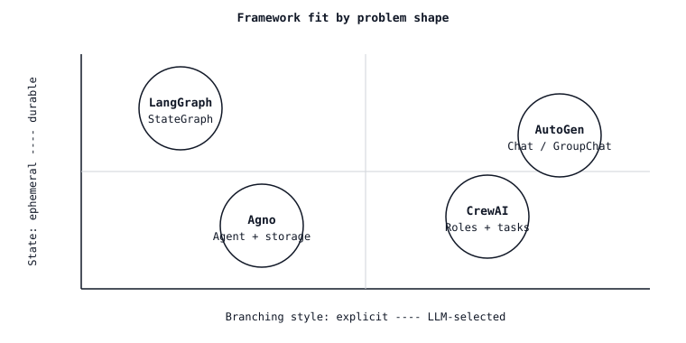

# Agent 框架取舍 — LangGraph vs CrewAI vs AutoGen vs Agno

> 每个框架都在卖同一个 demo（research agent 生成报告），也都藏着同一个 bug（state schema 和 orchestration layer 互相打架）。选择抽象与问题形状匹配的框架；其他一切都是你会写两遍的胶水代码。

**Type:** Learn
**Languages:** Python
**Prerequisites:** Phase 11 · 09 (Function Calling), Phase 11 · 16 (LangGraph)
**Time:** ~45 minutes

## 问题

你有一个任务，需要不止一次 LLM 调用。也许它是研究工作流（规划、搜索、总结、引用）。也许它是代码评审流水线（解析 diff、批评、打补丁、验证）。也许它是一个多轮 assistant，能订机票、写邮件、提交报销。你选了一个框架。

三天后，你发现框架的抽象开始漏水。CrewAI 给你角色，但当“researcher”需要把结构化计划交给“writer”时，它会和你打架。AutoGen 给你 agent 之间的聊天，但没有一等 state，所以你的 checkpoint 变成一坨 conversation log 的 pickle。LangGraph 给你 state graph，但要求你在知道 agent 会做什么之前，就先命名每一条 transition。Agno 给你一个单 agent 抽象，但当你试图 fan out 到三个并发 worker 时，它会尖叫。

修复方式不是“选择最好的框架”。修复方式是把框架的核心抽象匹配到你的问题形状。本课就是画出这张地图。

## 概念

四个框架主导了 2026 年的 landscape。它们的核心抽象并不相同。

| Framework | Core abstraction | Best fit | Worst fit |
|-----------|------------------|----------|-----------|
| **LangGraph** | `StateGraph` — typed state、nodes、conditional edges、checkpointer。 | 具有显式 state 和 human-in-the-loop interrupt 的 workflow；需要 time-travel debugging 的生产 agent。 | 拓扑未知、角色驱动的松散头脑风暴。 |
| **CrewAI** | `Crew` — roles（goal、backstory）、tasks、process（sequential 或 hierarchical）。 | 角色扮演或 persona-driven workflow，且计划较短、线性或分层。 | 超出 crew turn history 的任何复杂 state；复杂 branching。 |
| **AutoGen** | `ConversableAgent` pair — 两个或更多 agent 轮流说话，直到满足退出条件。 | 多 agent *dialogue*（teacher-student、proposer-critic、actor-reviewer），思考从聊天中涌现。 | 已知 DAG 的确定性 workflow；任何需要跨重启持久 state 的场景。 |
| **Agno** | `Agent` — 单个 LLM + tools + memory，可组合成 team。 | 快速构建单 agent 和轻量 team；强 multi-modality 与内置 storage driver。 | 深层、显式分支 graph，尤其带 custom reducers。 |

### “抽象”到底是什么意思

一个框架的核心抽象，就是你讲架构时会画在白板上的东西。

- **LangGraph** → 你画一张 graph。节点是步骤，边是 transition，每个位置的 state object 都有类型。心智模型是 state machine。
- **CrewAI** → 你画一张组织架构图。每个角色都有 job description，manager 分派任务。心智模型是一支小型专家团队。
- **AutoGen** → 你画一条 Slack DM。两个 agent 互相发消息；如果需要 moderator，就让第三个加入。心智模型是 chat。
- **Agno** → 你画一个挂着 tools 的单盒子。把盒子并排放，就成了 team。心智模型是“batteries included 的 agent”。

### State 问题

State 是大多数框架选择在生产中崩掉的地方。

- **LangGraph。** Typed state（`TypedDict` 或 Pydantic model）、per-field reducers、一等 checkpointer（SQLite/Postgres/Redis）。Resume、interrupt 和 time-travel 都是免费能力。*（见 Phase 11 · 16。）*
- **CrewAI。** State 通过 `context` 字段以字符串形式在 task 之间流动，或通过 `output_pydantic` 结构化流动。没有开箱即用的 durable per-crew store；如果 crew 必须在重启后继续，你需要自己接上。
- **AutoGen。** State 是 chat history，以及任何用户定义的 `context`。对话 transcript 可以持久化；任意 workflow state 不会持久化，除非你写 adapter。
- **Agno。** 通过 `storage=` 附加到 `Agent` 的内置 storage driver（SQLite、Postgres、Mongo、Redis、DynamoDB）会自动持久化 conversation session 和 user memory。它不是完整 graph checkpointer，而是 session store。

### Branching 问题

每个非平凡 agent 都会分支。关键是：谁决定分支。

- **LangGraph** — 由你通过 conditional edges 决定。Routing 是一个带命名分支的 Python 函数。分支在 compiled graph 中是一等概念；checkpointer 会记录走了哪条分支。
- **CrewAI** — hierarchical mode 下由 manager 决定；sequential mode 下由你在构建时决定。Routing 隐含在 task list 中；除了 manager 的提示词外，没有一等的“if”。
- **AutoGen** — agent 通过 chat 决定。Branching 从谁下一个发言中涌现。`GroupChatManager` 选择下一个 speaker；你可以手写 `speaker_selection_method`，但默认是 LLM-driven。
- **Agno** — agent 通过下一步调用哪个 tool 来决定。Team 有 coordinator/router/collaborator mode；超出这些的 branching 由开发者负责。

### Observability 问题

- **LangGraph** — 通过 LangSmith 或任意 OTel exporter 支持 OpenTelemetry。每次 node transition 都是一个 trace span；checkpoint 也充当可 replay 的 trace。LangSmith 是 first-party 选项；Langfuse/Phoenix 也有 adapter。
- **CrewAI** — 自 2025 年末起一等支持 OpenTelemetry；集成 Langfuse、Phoenix、Opik、AgentOps。
- **AutoGen** — 通过 `autogen-core` 集成 OpenTelemetry；AgentOps 和 Opik 有 connector。Tracing 粒度是 per-agent-message，不是 per-node。
- **Agno** — 内置 `monitoring=True` flag 加 OpenTelemetry exporter；与 Langfuse 有紧密的 session trace 集成。

### 成本与延迟

四个框架都会增加 per-call overhead（框架逻辑、验证、序列化）。开销从低到高大致是：Agno ≈ LangGraph < CrewAI ≈ AutoGen。差异主要由框架做了多少额外 LLM routing 决定。CrewAI 的 hierarchical manager 会花 token 决定谁下一步行动；AutoGen 的 `GroupChatManager` 也一样。LangGraph 只在你写 `llm.invoke` 的地方花 token。Agno 的单 agent 路径很薄。

当每次运行成本很重要时，优先选择显式 routing（LangGraph edges、AutoGen `speaker_selection_method`），而不是 LLM-selected routing。

### Interoperability

- **LangGraph** ↔ **LangChain** tools、retrievers、LLMs。一等 MCP adapter（tools 可作为 MCP server 导入）。
- **CrewAI** ↔ tools 继承自 `BaseTool`；LangChain tools、LlamaIndex tools 和 MCP tools 都能适配进来。通过 `allow_delegation=True` 支持 crew-to-crew delegation。
- **AutoGen** → `FunctionTool` 包装任意 Python callable；有 MCP adapter。与 AG2 生态的 agent-to-agent pattern 耦合紧密。
- **Agno** → `@tool` decorator 或 BaseTool subclass；MCP adapter；tools 可以在 agents 和 teams 之间共享。

## 技能

> 你能用一句话解释，为什么某个框架适合某个 agent 问题。

构建前 checklist：

1. **画出形状。** 这是 graph（typed state、named transitions）？角色扮演（specialists hand off work）？聊天（agents talk until done）？还是一个带 tools 的单 agent？
2. **决定谁来分支。** Developer-decided branching → LangGraph。Manager-agent-decided → CrewAI hierarchical。Chat-emergent → AutoGen。Tool-call-decided → Agno。
3. **检查 state budget。** 你需要 resume-from-checkpoint？Time-travel？运行中 human interrupt？如果需要，LangGraph 是默认选择；Agno sessions 覆盖 conversation-scoped state。
4. **检查 cost budget。** LLM-selected routing 每一轮都会多花 token。如果 agent 每天运行数千次，优先选择显式 routing。
5. **预算框架开销。** 每个框架都是一个额外 dependency。如果任务只是两个 LLM call 加一个 tool，写 30 行 plain Python；没有框架比任何框架都便宜。

在你能画出 graph、org chart、chat 或 agent box 之前，拒绝伸手拿框架。如果某个框架会迫使你为了真正需要的 state model 和它搏斗，也拒绝选择它。

## 决策矩阵

| Problem shape | Preferred framework | Why |
|---------------|---------------------|-----|
| 带 typed state、human approvals、long-running 的 workflow DAG | LangGraph | 一等 state、checkpointer、interrupt、time-travel。 |
| 拥有明确角色的 research / writing pipeline | CrewAI (sequential) 或 LangGraph subgraphs | CrewAI 能很便宜地表达 role-per-task；当 branching 变复杂时升级到 LangGraph。 |
| Proposer-critic 或 teacher-student dialogue | AutoGen | 双 agent chat 是它的原生形状。 |
| 带 tools、sessions、memory 的单 agent | Agno | 设置最轻，内置 storage 和 memory。 |
| 上千个并行 fanout，并带 reducers | LangGraph + `Send` | 唯一拥有一等 parallel-dispatch API 的框架。 |
| 快速 prototype，不承诺框架 | Plain Python + provider SDK | 没有框架就是最快的框架。 |

## 练习

1. **Easy。** 用同一个任务——“research Anthropic's headquarters, write a 200-word brief, cite sources”——分别用 LangGraph（四个节点：plan、search、write、cite）和 CrewAI（三个角色：researcher、writer、editor）实现。报告每次运行的 token cost 和代码行数。
2. **Medium。** 用 AutoGen（researcher ↔ writer chat，editor 通过 `GroupChat` 加入）和 Agno（带 `search_tools` 和 `write_tools` 的单 agent，加 session store）实现同一个任务。按三个维度给四种实现排序：(a) 每次运行成本，(b) 崩溃后恢复能力，(c) 在 write step 前注入 human approval 的能力。
3. **Hard。** 构建一个决策树脚本 `pick_framework.py`，接收简短问题描述（JSON：`{has_typed_state, has_roles, has_dialogue, has_parallel_fanout, needs_resume}`），并返回推荐框架和一句话理由。用你自己设计的六个 case 验证它。

## 关键术语

| Term | 常见说法 | 实际含义 |
|------|----------|----------|
| Orchestration | “agents 如何协作” | 决定哪个 node/role/agent 下一步运行的层。 |
| Durable state | “重启后恢复” | 在进程死亡后仍然存在的 state，附着在 checkpoint 或 session store 上。 |
| LLM-selected routing | “让模型决定” | Planner LLM 每轮选择下一步；灵活，但每次决策都要付 token。 |
| Explicit routing | “开发者决定” | Python 函数或静态 edge 选择下一步；便宜且可审计。 |
| Crew | “CrewAI team” | Roles + tasks + process（sequential 或 hierarchical）绑定成一个 runnable。 |
| GroupChat | “AutoGen 的 multi-agent chat” | 带 speaker selector 的 N 个 agent 托管对话。 |
| Team (Agno) | “Multi-agent Agno” | 一组 agents 上的 route / coordinate / collaborate mode。 |
| StateGraph | “LangGraph 的 graph” | Typed-state、node、conditional-edge、checkpointer 抽象。 |

## 延伸阅读

- [LangGraph documentation](https://langchain-ai.github.io/langgraph/) — StateGraph、checkpointers、interrupts、time-travel。
- [CrewAI documentation](https://docs.crewai.com/) — Crews、Flows、Agents、Tasks、Processes。
- [AutoGen documentation](https://microsoft.github.io/autogen/) — ConversableAgent、GroupChat、teams、tools。
- [Agno documentation](https://docs.agno.com/) — Agent、Team、Workflow、storage、memory。
- [Anthropic — Building effective agents (Dec 2024)](https://www.anthropic.com/research/building-effective-agents) — 与框架无关的模式库（prompt chaining、routing、parallelization、orchestrator-workers、evaluator-optimizer）。
- [Yao et al., "ReAct: Synergizing Reasoning and Acting" (ICLR 2023)](https://arxiv.org/abs/2210.03629) — 每个框架都会包装的那个循环。
- [Wu et al., "AutoGen: Enabling Next-Gen LLM Applications via Multi-Agent Conversation" (2023)](https://arxiv.org/abs/2308.08155) — AutoGen 的设计论文。
- [Park et al., "Generative Agents: Interactive Simulacra of Human Behavior" (UIST 2023)](https://arxiv.org/abs/2304.03442) — CrewAI 风格 persona stack 所建立的 role-play 基础。
- Phase 11 · 16 (LangGraph) — 本课用来对比的框架。
- Phase 11 · 19 (Reflexion) — 一个能干净映射到 LangGraph、但较别扭地映射到 CrewAI 的 pattern。
- Phase 11 · 22 (Production observability) — 如何为你选择的任意框架加 instrumentation。
