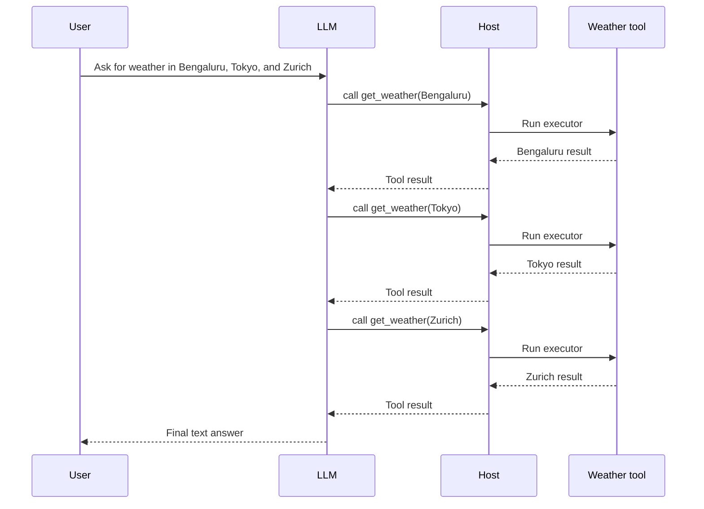
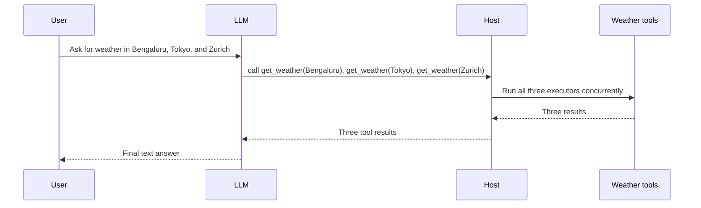

# 并行工具调用与工具流式传输

> 三个彼此独立的天气查询如果串行执行，就是三次往返。并行执行后，总耗时会压缩到最慢的那一次调用。现在每个 frontier provider 都能在单轮中发出多个工具调用。收益很真实，管线也很微妙。本课同时走过两半：并行 fan-out，以及流式参数重组，重点是 id 关联这个常见陷阱。

**Type:** Build
**Languages:** Python (stdlib, thread pool + streaming harness)
**Prerequisites:** Phase 13 · 02 (function calling deep dive)
**Time:** ~75 minutes

## 学习目标

- 解释为什么存在 `parallel_tool_calls: true`，以及什么时候应该关闭它。
- 在并行 fan-out 中，把流式参数片段关联回正确的工具调用 id。
- 把局部 `arguments` 字符串重新组装成完整 JSON，而不是过早解析。
- 运行一个三城市天气基准测试，展示串行和并行之间的延迟差异。

## 问题

没有并行调用时，一个 agent 回答“Bengaluru、Tokyo 和 Zurich 的天气怎么样”会这样做：



三次 LLM 往返，每次还要支付 executor 延迟。粗略看，墙钟时间大约是理想情况的 4 倍。

有并行调用时：



一次 LLM 往返。Executor 时间取三者最大值，而不是三者之和。在 OpenAI、Anthropic 和 Gemini 上的生产基准显示，fan-out 工作负载可以减少 60% 到 70% 的墙钟时间。

代价是关联复杂度。当三个调用乱序完成时，结果必须携带匹配的 `tool_call_id`，模型才能对齐它们。当结果流式到达时，你必须先把局部参数片段组装成完整 JSON，再执行调用。Gemini 3 增加唯一 id，部分原因就是为了解决真实世界里的问题：两个并行调用如果使用同一个工具名，会无法区分。

## 概念

### 启用并行

- **OpenAI。** `parallel_tool_calls: true` 默认开启。设置为 `false` 可以强制串行。
- **Anthropic。** 通过 `disable_parallel_tool_use: false` 启用并行（Claude 3.5 及以上默认开启）。设置为 `true` 表示串行。
- **Gemini。** 始终具备并行能力；`tool_config.function_calling_config.mode = "AUTO"` 让模型自行决定。

当工具之间有顺序依赖（`create_file` 之后才是 `write_file`）、一个调用的输出会成为另一个调用的输入，或者限流器无法承受 fan-out 时，应该关闭并行。

### Id 关联

模型发出的每个调用都有一个 `id`。Host 返回的每个结果都必须包含同一个 id。没有它，结果就是歧义的。

- **OpenAI。** 每条 tool-role message 上有 `tool_call_id`。
- **Anthropic。** 每个 `tool_result` block 上有 `tool_use_id`。
- **Gemini。** 每个 `functionResponse` 上有 `id`（Gemini 3 及以上；Gemini 2 按名称匹配，这会在同名并行调用时出错）。

### 并发运行调用

Host 会把每个调用的 executor 放到自己的线程、协程或远程 worker 上运行。最简单的 harness 使用线程池；生产系统通常使用 `asyncio.gather` 或结构化并发。完成顺序不可预测，id 才是标识符。

一个常见 bug：按照调用列表顺序返回结果，而不是按照完成顺序返回。通常这也能工作，因为模型只关心 `tool_call_id`，但如果某个结果被丢弃或重复，乱序提交会让调试更难。更推荐按完成顺序返回，并显式带上 id。

### 流式工具调用

当模型流式输出时，`arguments` 会分片到达。三个并行调用的三组参数片段会在同一条线上交错。你需要为每个 id 准备一个 accumulator。

不同 provider 的形状：

- **OpenAI。** 每个 chunk 是 `choices[0].delta.tool_calls[i].function.arguments`（局部字符串）。Chunk 携带 `index`（调用列表中的位置）。你按 index 累积，第一次出现时读取 `id`，等 `finish_reason = "tool_calls"` 后再解析 JSON。
- **Anthropic。** Stream event 先是 `message_start`，然后每个 block 有一个 `content_block_start`，类型为 `tool_use`（包含 id、name 和空 input）。`content_block_delta` event 携带 `input_json_delta` chunk。`content_block_stop` 关闭每个 block。
- **Gemini。** `streamFunctionCallArguments`（Gemini 3 及以上）会发出带 `functionCallId` 的 chunk，因此调用可以干净地交错。在 Gemini 3 之前，streaming 会一次返回一个完整调用。

### Partial JSON 与过早解析陷阱

在完整之前，你不能解析 `arguments`。像 `{"city": "Beng` 这样的局部 JSON 是无效的，会直接抛错。正确的闸门是 provider 的调用结束信号：OpenAI 的 `finish_reason = "tool_calls"`、Anthropic 的 `content_block_stop`，或者 Gemini 的 stream-end event。只有到那时才尝试 `json.loads`。更稳健的做法是使用增量 JSON parser，在结构完成时产出事件；OpenAI 的 streaming guide 建议这种方式用于展示实时“thinking”指示器的 UX。用括号计数判断完整性并不可靠（字符串里的括号或转义内容会造成误判），最多只能当作非正式的调试启发式。

### 乱序完成

三个调用可能这样结束：

- `call_A`：快速 API，最先返回。
- `call_B`：慢速 API，第二个返回。
- `call_C`：中位速度 API，第三个返回。

Host 回复仍然必须引用对应 id：

```json
[
  {"role": "tool", "tool_call_id": "call_A", "content": "..."},
  {"role": "tool", "tool_call_id": "call_B", "content": "..."},
  {"role": "tool", "tool_call_id": "call_C", "content": "..."}
]
```

对于 OpenAI 和 Anthropic，回复中的顺序不影响正确性。Gemini 也接受任意顺序，只要 id 匹配。

### 基准测试：串行 vs 并行

`code/main.py` 中的 harness 模拟三个 executor，延迟分别是 400、600 和 800 ms。串行运行总耗时 1800 ms。并行运行耗时为 `max(400, 600, 800) = 800 ms`。差值是常数，不是比例，所以工具数量越多，节省越明显。

现实世界的注意点：并行调用会给下游 API 施压。对一个有严格限流的服务做 10 路 fan-out 会失败。Phase 13 · 17 会覆盖 gateway 层面的 backpressure；retry 语义计划放到未来阶段。

### 流式 fan-out 的墙钟时间

如果模型本身也在流式输出，那么某个调用的参数一完整，你就可以开始执行它，而不必等所有调用都 finalize。这是 OpenAI 文档中提到的优化，但并非所有 SDK 都暴露。本课 harness 就这样做：模拟 stream 一旦产出某个完整参数对象，host 立刻启动对应调用。

## Use It

`code/main.py` 有两半。第一半用 `concurrent.futures.ThreadPoolExecutor` 串行和并行运行三个模拟天气调用，并打印墙钟时间。第二半回放一个假的 streaming response：三组并行调用的 `arguments` chunk 在同一条 stream 上交错，然后用 `StreamAccumulator` 按 id 重组。没有 LLM，没有网络，只有重组逻辑。

要观察的点：

- 串行计时大约到 1.8 秒。并行计时在相同假延迟下大约到 0.8 秒。
- Accumulator 通过按 id 缓冲、并且只在每个调用的 JSON 完整时才解析，处理乱序到达的 chunk。
- Executor 会在某个 id 的参数 finalize 后立即启动，而不是等全部 stream 结束。

## Ship It

本课产出 `outputs/skill-parallel-call-safety-check.md`。给定一个工具注册表，这个 skill 会审计哪些工具可以安全并行、哪些存在顺序依赖、哪些会压垮下游限流，并返回带有每个工具 `parallel_safe` 标记的修订版注册表。

## 练习

1. 运行 `code/main.py` 并改变模拟延迟。确认并行与串行的比例大约是 `max/sum`（真实运行会因为线程调度、序列化和 harness 开销而略微偏离理想值）。在哪种延迟分布下，并行不再重要？

2. 扩展 accumulator，处理“调用在 stream 中途被取消”的情况：丢弃对应 buffer，并发出 `cancelled` event。哪个 provider 明确记录了这种情况？检查 Anthropic 的 `content_block_stop` 语义，以及 OpenAI 的 `finish_reason: "length"` 行为。

3. 用 `asyncio.gather` 替换线程池，并给两者做基准测试。你应该能看到 async 有小幅优势，因为上下文切换成本更低，但前提是 executor 做的是真 I/O。

4. 选择两个不应该并行的工具（例如 `create_file` 之后才是 `write_file`）。给注册表加入 `ordering_dependency` graph，并基于这个 graph 限制并行 fan-out。这是依赖感知调度的最小机制，未来的 agent-engineering 阶段会把它形式化。

5. 阅读 OpenAI 的 parallel-function-calling 章节和 Anthropic 的 `disable_parallel_tool_use` 文档。找出 Anthropic 建议关闭并行的一类真实工具类型。（提示：对同一个资源做有后果的 mutation。）

## 关键术语

| Term | 常见说法 | 实际含义 |
|------|----------|----------|
| Parallel tool calls | “单轮 fan-out” | 模型在同一条 assistant message 中发出多个工具调用 |
| `parallel_tool_calls` | “OpenAI 的开关” | 启用或关闭多调用 emission |
| `disable_parallel_tool_use` | “Anthropic 的反向开关” | Opt-out 标记；默认启用并行 |
| Tool call id | “关联句柄” | 每个调用的标识符，结果 message 必须原样回显 |
| Accumulator | “Stream buffer” | 按 id 保存局部 `arguments` chunk 的字符串 buffer |
| Out-of-order completion | “最快的先回来” | 并行调用以不可预测顺序完成；id 是胶水 |
| Dependency graph | “顺序约束” | 某些工具的输出会流入其它工具的输入，因此不能并行 |
| Parse-early trap | “JSON.parse 炸了” | 试图解析一个尚未完整的 `arguments` 字符串 |
| `streamFunctionCallArguments` | “Gemini 3 功能” | 带每个调用唯一 id 的流式参数 chunk |
| Completion-order reply | “不要等全部结束” | 结果一到就按 id 返回 |

## 延伸阅读

- [OpenAI — Parallel function calling](https://platform.openai.com/docs/guides/function-calling#parallel-function-calling) — 默认行为和 opt-out 标记。
- [Anthropic — Tool use: implementing tool use](https://docs.anthropic.com/en/docs/agents-and-tools/tool-use/implementing-tool-use) — `disable_parallel_tool_use` 和结果批处理。
- [Google — Gemini function calling parallel section](https://ai.google.dev/gemini-api/docs/function-calling) — Gemini 3 中按 id 关联的并行调用。
- [OpenAI — Streaming responses with tools](https://platform.openai.com/docs/api-reference/responses-streaming) — OpenAI stream 的 chunked argument 重组。
- [Anthropic — Streaming messages](https://docs.anthropic.com/en/api/messages-streaming) — 带 `input_json_delta` 的 `content_block_delta`。
