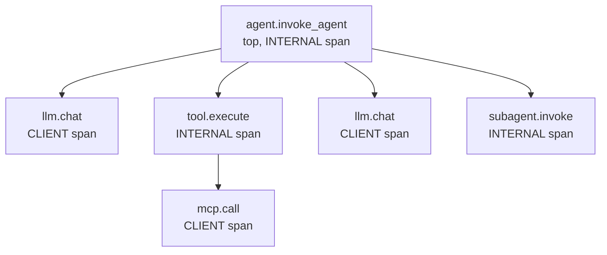

# OpenTelemetry GenAI：端到端追踪工具调用

> 一个 agent 调用五个工具、三个 MCP server 和两个 sub-agent。你需要一条 trace 覆盖全部链路。OpenTelemetry GenAI semantic conventions（v1.37 及以上的 stable attributes）是 2026 年的标准，被 Datadog、Langfuse、Arize Phoenix、OpenLLMetry 和 AgentOps 原生支持。本课列出必需 attribute，走过 span hierarchy（agent → LLM → tool），并交付一个 stdlib span emitter，可接入任意 OTel exporter。

**Type:** Build
**Languages:** Python (stdlib, OTel span emitter)
**Prerequisites:** Phase 13 · 07 (MCP server), Phase 13 · 08 (MCP client)
**Time:** ~75 minutes

## 学习目标

- 说出 LLM span 和 tool-execution span 所需的 OTel GenAI attribute。
- 构建覆盖 agent loop、LLM call、tool call 和 MCP client dispatch 的 trace hierarchy。
- 决定哪些内容应该捕获（opt-in），哪些内容默认 redaction。
- 不重写 tool code，也能把 span 发到本地 collector（Jaeger、Langfuse）。

## 问题

一个来自 2026 年 2 月的 debug：用户报告“我的 agent 有时 30 秒才响应，有时 3 秒就响应”。没有 trace。Log 里能看到 LLM call，但看不到 tool dispatch，看不到 MCP server round-trip，也看不到 sub-agent。你只能猜。最后你发现：某个 MCP server 偶尔卡在 cold-start。

没有端到端 tracing，你找不到这个问题。OTel GenAI 解决的就是它。

这些 conventions 在 2025-2026 年间由 OpenTelemetry semantic-conventions group 稳定下来。它们定义稳定的 attribute name，因此 Datadog、Langfuse、Phoenix、OpenLLMetry 和 AgentOps 都能解析同样的 span。Instrument 一次，可以发到任意 backend。

## 概念

### Span hierarchy

整条链路嵌在同一个 trace id 下。Span id 连接 parent-child 关系。

### 必需 attributes

根据 2025-2026 semconv：

- `gen_ai.operation.name` — `"chat"`、`"text_completion"`、`"embeddings"`、`"execute_tool"`、`"invoke_agent"`。
- `gen_ai.provider.name` — `"openai"`、`"anthropic"`、`"google"`、`"azure_openai"`。
- `gen_ai.request.model` — 请求的 model 字符串（例如 `"gpt-4o-2024-08-06"`）。
- `gen_ai.response.model` — 实际服务请求的 model。
- `gen_ai.usage.input_tokens` / `gen_ai.usage.output_tokens`。
- `gen_ai.response.id` — provider response id，用于关联。

Tool span 使用：

- `gen_ai.tool.name` — tool identifier。
- `gen_ai.tool.call.id` — 具体 call id。
- `gen_ai.tool.description` — tool description（可选）。

Agent span 使用：

- `gen_ai.agent.name` / `gen_ai.agent.id` / `gen_ai.agent.description`。

### Span kind

- 跨进程边界的调用使用 `SpanKind.CLIENT`（LLM provider、MCP server）。
- Agent 自身的 loop step 和 tool execution 使用 `SpanKind.INTERNAL`。

### Opt-in content capture

默认情况下，span 只携带指标和 timing，不携带 prompt 或 completion。大 payload 和 PII 默认关闭。设置 `OTEL_SEMCONV_STABILITY_OPT_IN=gen_ai_latest_experimental` 以及具体 content-capture env var，才能包含内容。生产环境启用前要仔细 review。

### Span 上的 events

Token-level event 可以作为 span event 添加：

- `gen_ai.content.prompt` — input messages。
- `gen_ai.content.completion` — output messages。
- `gen_ai.content.tool_call` — 记录下来的 tool call。

Event 在 span 内按时间排序，用于细粒度 replay。

### Exporters

OTel span 可以导出到：

- **Jaeger / Tempo。** OSS，on-prem。
- **Langfuse。** 面向 LLM observability；可视化 token usage。
- **Arize Phoenix。** Evals + tracing 组合。
- **Datadog。** 商业产品；原生解析 `gen_ai.*` attributes。
- **Honeycomb。** Column-oriented，适合查询。

它们都支持 OTLP 这个 wire format。你的代码不需要关心 backend。

### 跨 MCP 传播

当 MCP client 调用 server 时，把 W3C traceparent header 注入 request。Streamable HTTP 支持标准 header。Stdio 不原生携带 HTTP header；规范的 2026 roadmap 讨论了在 JSON-RPC call 上增加 `_meta.traceparent` 字段。

在该能力落地前：手动把 traceparent 放进每个 request 的 `_meta`。Server 记录 trace id。

### Metrics

除了 span，GenAI semconv 还定义了 metrics：

- `gen_ai.client.token.usage` — histogram。
- `gen_ai.client.operation.duration` — histogram。
- `gen_ai.tool.execution.duration` — histogram。

用它们构建不需要 per-call detail 的 dashboard。

### AgentOps layer

AgentOps（成立于 2024 年）专注 GenAI observability。它包装常见 framework（LangGraph、Pydantic AI、CrewAI），自动发出 OTel span。如果你的 stack 使用受支持 framework，它很有用；否则使用手动 instrumentation。

## Use It

`code/main.py` 会把一个 agent 的 OTel-shaped span 输出到 stdout（类似 OTLP-JSON 的格式）。这个 agent 调用一个 LLM、dispatch 两个工具，并做一次 MCP round-trip。没有真实 exporter；本课关注 span shape 和 attribute set。你可以把输出粘到 OTLP-compatible viewer，也可以直接阅读。

要观察的点：

- 所有 span 共享同一个 trace id。
- Parent-child link 通过 `parentSpanId` 编码。
- 必需的 `gen_ai.*` attributes 都已填充。
- Content capture 默认关闭；其中一个 scenario 会通过 env var 打开它。

## Ship It

本课产出 `outputs/skill-otel-genai-instrumentation.md`。给定一个 agent codebase，这个 skill 会产出 instrumentation plan：在哪里添加 span、填充哪些 attribute、目标 exporter 是什么。

## 练习

1. 运行 `code/main.py`。数一数 span，并识别哪些是 CLIENT，哪些是 INTERNAL。

2. 打开 content capture（env var），确认 `gen_ai.content.prompt` 和 `gen_ai.content.completion` event 出现。注意它对 PII 的影响。

3. 添加 tool-execution metric `gen_ai.tool.execution.duration`，并为每次调用发出一个 histogram sample。

4. 从 parent agent span 把 traceparent 传播到 MCP request 的 `_meta.traceparent` 字段。验证 MCP server 会看到同一个 trace id。

5. 阅读 OTel GenAI semconv spec。找出一个 semconv 中列出、但本课代码没有发出的 attribute，并把它加上。

## 关键术语

| Term | 常见说法 | 实际含义 |
|------|----------|----------|
| OTel | “OpenTelemetry” | traces、metrics、logs 的开放标准 |
| GenAI semconv | “GenAI semantic conventions” | LLM / tool / agent span 的稳定 attribute name |
| `gen_ai.*` | “Attribute namespace” | 所有 GenAI attribute 都共享这个前缀 |
| Span | “Timed operation” | 带开始时间、结束时间和 attributes 的工作单元 |
| Trace | “Cross-span ancestry” | 共享同一个 trace id 的 span 树 |
| SpanKind | “CLIENT / SERVER / INTERNAL” | 关于 span 方向的提示 |
| OTLP | “OpenTelemetry Line Protocol” | Exporter 使用的 wire format |
| Opt-in content | “Prompt / completion capture” | 默认关闭；通过 env var 启用 |
| traceparent | “W3C header” | 跨服务传播 trace context |
| Exporter | “Backend-specific shipper” | 把 span 发送到 Jaeger / Datadog / 等后端的组件 |

## 延伸阅读

- [OpenTelemetry — GenAI semconv](https://opentelemetry.io/docs/specs/semconv/gen-ai/) — GenAI spans、metrics 和 events 的权威 conventions。
- [OpenTelemetry — GenAI spans](https://opentelemetry.io/docs/specs/semconv/gen-ai/gen-ai-spans/) — LLM 和 tool-execution span attribute list。
- [OpenTelemetry — GenAI agent spans](https://opentelemetry.io/docs/specs/semconv/gen-ai/gen-ai-agent-spans/) — agent-level `invoke_agent` span。
- [open-telemetry/semantic-conventions — GenAI spans](https://github.com/open-telemetry/semantic-conventions/blob/main/docs/gen-ai/gen-ai-spans.md) — GitHub 上的 source of truth。
- [Datadog — LLM OTel semantic convention](https://www.datadoghq.com/blog/llm-otel-semantic-convention/) — 生产集成 walkthrough。
