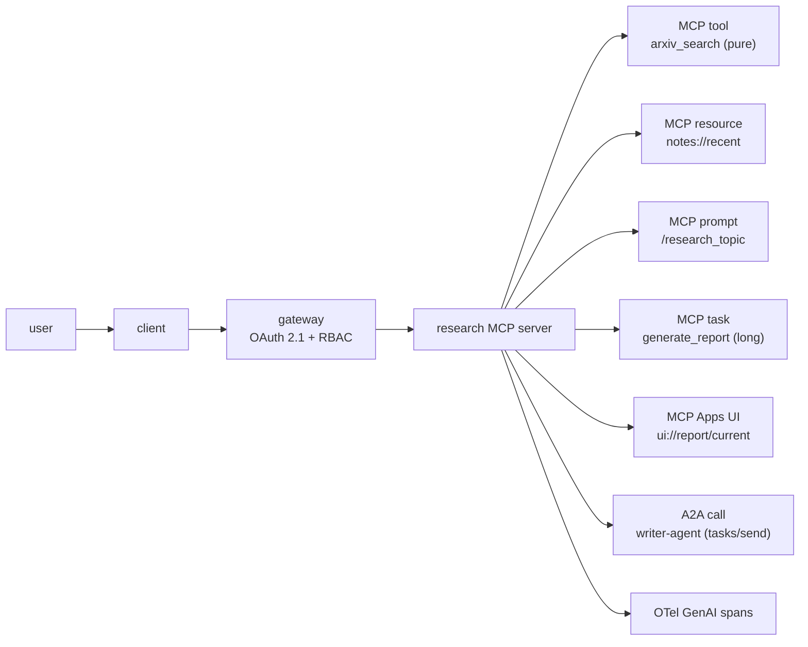
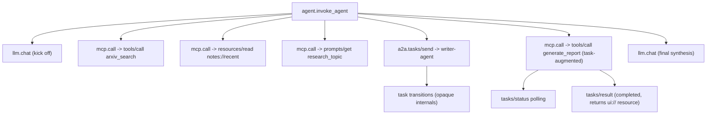

# Capstone：构建完整 Tool Ecosystem

> Phase 13 已经教完了每个零件。这个 capstone 会把它们接成一个 production-shaped system：一个带 tools + resources + prompts + tasks + UI 的 MCP server，边缘处的 OAuth 2.1，一个 RBAC gateway，一个 multi-server client，一次 A2A sub-agent call，写入 collector 的 OTel tracing，CI 中的 tool-poisoning detection，以及一个 AGENTS.md + SKILL.md bundle。学完后，你能为每个架构选择辩护。

**Type:** Build
**Languages:** Python (stdlib, end-to-end ecosystem harness)
**Prerequisites:** Phase 13 · 01 through 21
**Time:** ~120 minutes

## 学习目标

- 组合一个 MCP server，暴露 tools、resources、prompts，以及一个带 `ui://` app 的 task。
- 在 server 前面放置一个 OAuth 2.1 gateway，强制执行 RBAC 和 pinned hashes。
- 编写一个 multi-server client，用 OTel GenAI attributes 做 end-to-end tracing。
- 把 workload 的一部分委派给 A2A sub-agent，并验证 opacity 被保留。
- 用 AGENTS.md + SKILL.md 打包整个 stack，让其它 agents 可以驱动它。

## 问题

交付一个 “research and report” system：

- User asks: “summarize the three most-cited 2026 arXiv papers on agent protocols.”
- System: 通过 MCP 搜索 arXiv；通过 A2A 把 paper summarization 委派给 specialized writer agent；聚合结果；把 interactive report 渲染为 MCP Apps `ui://` resource；把每一步记录到 OTel。

Phase 13 的全部 primitives 都会出现。这不是玩具：Anthropic（Claude Research product）、OpenAI（GPTs with Apps SDK）和第三方在 2026 年交付的 production research-assistant systems 都是这种形状。

## 概念

### Architecture



### Trace hierarchy



一个 trace id。每个 span 都带有正确的 `gen_ai.*` attributes。

### Security posture

- OAuth 2.1 + PKCE，并用 resource indicator 把 audience pin 到 gateway。
- Gateway 持有 upstream credentials；用户永远看不到它们。
- RBAC：`alice` 有 `research:read`、`research:write`，可以调用全部 tools。`bob` 有 `research:read`，不能调用 `generate_report`。
- Pinned description manifest：丢弃任何 tool hashes 已变化的 server。
- Rule of Two audit：没有 tool 同时组合 untrusted input、sensitive data 和 consequential action。

### Rendering

最终的 `generate_report` task 返回 content blocks，以及一个 `ui://report/current` resource。Client 的 host（Claude Desktop 等）在 sandbox iframe 中渲染 interactive dashboard。Dashboard 包含排序后的 paper list、citation counts，以及一个 button：用户点击任意 paper 时，它会调用 `host.callTool('summarize_paper', {arxiv_id})`。

### Packaging

整个系统以如下形式发布：

```text
research-system/
  AGENTS.md                     # project conventions
  skills/
    run-research/
      SKILL.md                  # the top-level workflow
  servers/
    research-mcp/               # the MCP server
      pyproject.toml
      src/
  agents/
    writer/                     # the A2A agent
  gateway/
    config.yaml                 # RBAC + pinned manifest
```

用户用 `docker compose up` 部署。Claude Code、Cursor、Codex 和 opencode 用户都可以通过调用 `run-research` skill 来驱动这个系统。

### Phase 13 每课贡献了什么

| Lesson | What the capstone uses |
|--------|------------------------|
| 01-05 | Tool interface、provider-portability、parallel calls、schemas、linting |
| 06-10 | MCP primitives、server、client、transports、resources + prompts |
| 11-14 | Sampling、roots + elicitation、async tasks、`ui://` apps |
| 15-17 | Tool poisoning、OAuth 2.1、gateway + registry |
| 18 | A2A sub-agent delegation |
| 19 | OTel GenAI tracing |
| 20 | Routing gateway for the LLM layer |
| 21 | SKILL.md + AGENTS.md packaging |

## Use It

`code/main.py` 把前面课程的 patterns 接成一个可运行 demo。全部 stdlib，全部 in-process，因此你可以端到端读懂它。它会为 research-and-report scenario 跑完整 flow：与 gateway handshake、模拟 OAuth 2.1、合并 `tools/list`、把 `generate_report` 作为 task、向 writer 发起 A2A call、返回 `ui://` resource，并发出 OTel spans。

观察重点：

- 每一跳共用一个 trace id。
- Gateway policy 会阻止第二个用户写入。
- Task lifecycle 从 working → completed，并同时返回 text 和 `ui://` content。
- A2A call 的 inner state 对 orchestrator 不透明。
- AGENTS.md 和 SKILL.md 是另一个 agent 复现 workflow 所需的唯一文件。

## Ship It

本课产出 `outputs/skill-ecosystem-blueprint.md`。给定一个 product need（research、summarization、automation），这个 skill 会生成完整 architecture：使用哪些 MCP primitives、哪些 gateway controls、哪些 A2A calls、哪些 telemetry、以及如何 packaging。

## 练习

1. 运行 `code/main.py`。注意 single trace id 以及 spans 如何嵌套。数一数 demo 触碰了 Phase 13 中多少个 primitives。

2. 扩展 demo：添加第二个 backend MCP server（例如 `bibliography`），并确认 gateway 把它的 tools 合并进同一个 namespace。

3. 把 fake A2A writer agent 替换成运行在 subprocess 上的真实 agent。使用 Lesson 19 harness。

4. 在 orchestrator 和 LLM 之间的 routing gateway 中添加 PII redaction step。确认 user query 中的 emails 会被 scrub。

5. 为一个会维护这个系统的 teammate 写一份 AGENTS.md。它应该能在五分钟内读完，并给对方在 Cursor 或 Codex 中驱动 capstone 所需的一切。

## 关键术语

| Term | What people say | What it actually means |
|------|----------------|------------------------|
| Capstone | “Phase-13 integration demo” | 使用每个 primitive 的 end-to-end system |
| Research and report | “The scenario” | Search、summarize、render pattern |
| Ecosystem | “All the pieces together” | Server + client + gateway + sub-agent + telemetry + package |
| Trace hierarchy | “Single trace id” | 每一跳的 span 共享 trace；通过 span ids 建立 parent-child |
| Gateway-issued token | “Transitive auth” | Client 只看到 gateway 的 token；gateway 持有 upstream creds |
| Merged namespace | “All tools in one flat list” | Gateway 处的 multi-server merge，collision 时加 prefix |
| Opacity boundary | “A2A call hides internals” | Sub-agent 的 reasoning 对 orchestrator 不可见 |
| Three-layer stack | “AGENTS.md + SKILL.md + MCP” | Project context + workflow + tools |
| Defense-in-depth | “Multiple security layers” | Pinned hashes、OAuth、RBAC、Rule of Two、audit log |
| Spec compliance matrix | “What we ship that the spec requires” | 把 deliverables 映射到 2025-11-25 requirements 的 checklist |

## 延伸阅读

- [MCP — Specification 2025-11-25](https://modelcontextprotocol.io/specification/2025-11-25) — consolidated reference
- [MCP blog — 2026 roadmap](https://blog.modelcontextprotocol.io/posts/2026-mcp-roadmap/) — protocol 的未来方向
- [a2a-protocol.org](https://a2a-protocol.org/latest/) — A2A v1.0 reference
- [OpenTelemetry — GenAI semconv](https://opentelemetry.io/docs/specs/semconv/gen-ai/) — canonical tracing conventions
- [Anthropic — Claude Agent SDK overview](https://code.claude.com/docs/en/agent-sdk/overview) — production agent runtime patterns
