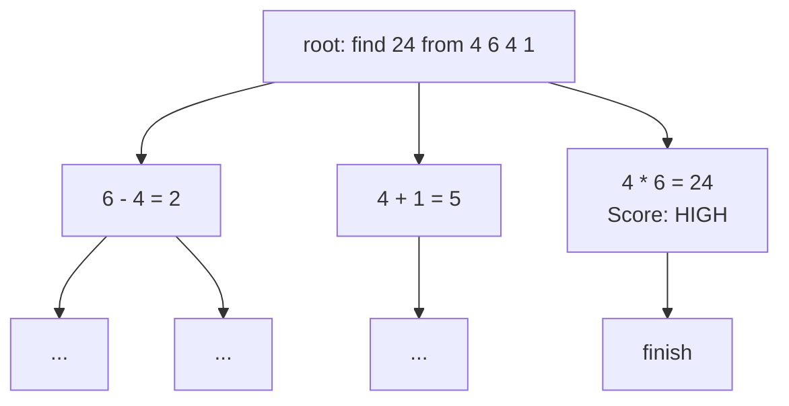

# 思维树与 LATS：审慎搜索

> 单条 chain-of-thought 轨迹没有回溯空间。ToT（Yao 等，2023）把推理变成一棵树，并在每个节点上做自我评估。LATS（Zhou 等，2024）把 ToT、ReAct 和 Reflexion 统一到蒙特卡洛树搜索之下。Game of 24 从 4%（CoT）提升到 74%（ToT）；LATS 在 HumanEval 上达到 92.7% pass@1。

**Type:** Build
**Languages:** Python (stdlib)
**Prerequisites:** Phase 14 · 01（Agent Loop），Phase 14 · 03（Reflexion）
**Time:** ~75 minutes

## 学习目标

- 把推理表述为搜索：节点是 “thoughts”，边是 “expansions”，value 是 “有多值得继续探索”。
- 用 stdlib 实现一个 ToT 风格的 BFS 树搜索，并用自我评估打分。
- 扩展到一个玩具版 LATS MCTS 循环，包含 select / expand / simulate / backpropagate。
- 判断什么时候搜索值得付出 token 倍增成本（Game of 24、代码生成），什么时候单条轨迹已经足够（简单问答）。

## 问题

Chain-of-thought 是线性行走。如果第一步错了，后续每一步都建立在错误前提上。在 Game of 24（用四个数字和 + − × ÷ 凑出 24）中，GPT-4 CoT 的准确率只有 4%。模型很早就选错了子表达式，然后无法恢复。

推理真正需要的是：提出多个候选、评估它们、选择有希望的路径，并在遇到死路时回溯。这就是搜索。Tree of Thoughts 和 LATS 是两个 canonical formulation。

## 概念

### Tree of Thoughts（Yao 等，NeurIPS 2023）

每个节点都是一个连贯的中间步骤（“一个 thought”）。每个节点可以扩展出 K 个子 thought。LLM 用一个 scoring prompt 自我评估每个节点。搜索会探索这棵树：BFS、DFS，或 beam。



自我评估是承重结构。论文展示了三种变体：`sure / likely / impossible` 分类、`1..10` 数值评分，以及候选之间投票。三者在 Game of 24 上都显著超过 CoT（GPT-4 从 4% 提升到 74%）。

### LATS（Zhou 等，ICML 2024）

LATS 把 ToT、ReAct 和 Reflexion 统一到 MCTS 之下。LLM 扮演三个角色：

- **Policy**：提出候选下一步 action（ReAct 风格）。
- **Value function**：给部分轨迹打分（ToT 风格自我评估）。
- **Self-reflector**：失败时写一段自然语言 reflection（Reflexion 风格），并用它重新播种后续 rollouts。

环境反馈（observations）会混入 value function，因此搜索依据真实工具结果，而不只是模型意见。论文发表时的结果：HumanEval pass@1 使用 GPT-4 达到 92.7%（SOTA），WebShop average 使用 GPT-3.5 达到 75.9（接近 gradient-based fine-tuning）。

### MCTS，最小版

每次迭代有四个阶段：

1. **Select**：从 root 走到 leaf，使用 UCT（upper confidence bound for trees）。
2. **Expand**：通过 policy 生成 K 个 children。
3. **Simulate**：从一个 child 开始用 policy rollout，用 value function（或 environment reward）给 leaf 打分。
4. **Backpropagate**：沿路径向上更新 visit counts 和 value estimates。

UCT 公式：`Q(s, a) + c * sqrt(ln N(s) / N(s, a))`。第一项是 exploitation；第二项是 exploration。`c` 需要按任务调。

### 成本现实

搜索会让 token 爆炸。Game of 24 上的 ToT 会使用 CoT 的 100-1000 倍 token。LATS 也类似。这不是免费的；把搜索留给这些情况：

- 单条轨迹已经被证明不够用的任务（Game of 24、复杂代码）。
- 正确性比 wall-clock 更重要的任务。
- 有便宜且可靠 value function 的任务（代码的单元测试、数学的显式目标）。

如果任务只有一个正确答案，而且 evaluator 噪声很大，搜索常常会让事情更糟：它会找到一个 “打分很高” 的错误答案。

### 2026 年的定位

大多数生产 agents 不运行 LATS。它们运行带工具验证的 ReAct（CRITIC，第 05 课）。搜索会出现在一些专门场景：

- 把测试作为 value function 的 coding agents（HumanEval 风格）。
- 探索多条 query path 的 deep-research agents。
- LangGraph subgraphs 内部的重规划 workflow。

AlphaEvolve（第 11 课）是 2025 年的极端形态：对代码做 evolutionary search，用 machine-checkable fitness 打分，并取得 frontier gains（56 年来首次改进 4x4 matmul）。

## Build It

`code/main.py` 实现了：

- 一个在风格化 “选择算术操作” 任务上的小型 ToT BFS。
- 同一任务上的玩具版 LATS MCTS 循环（Select / Expand / Simulate / Backpropagate），带 UCT selection。
- 一个把 symbolic score 和 self-eval score 组合起来的 value function。

运行它：

```bash
python3 code/main.py
```

trace 会展示 ToT 如何用 BFS 为每个节点扩展三个候选，并对比 LATS 如何通过 MCTS 收敛到最佳 rollout。两者的 token counts 都会打印出来。

## Use It

LangGraph 通过 subgraph patterns 支持 ToT 风格探索；LangChain 团队 2024 年 5 月关于 LATS 的博客是参考教程。LlamaIndex 提供了一个 `TreeOfThoughts` agent。对大多数 2026 年生产 agents 来说，这个模式藏在 `if task_complexity > threshold: use_search()` gate 后面——参见第 05 课中的 evaluator-optimizer pattern。

## Ship It

`outputs/skill-search-policy.md` 会根据任务形状、预算和 evaluator fidelity，在 linear ReAct、ToT、LATS 和 evolutionary search 之间做选择。

## 练习

1. 用 UCT c=0.1 和 c=2.0 分别运行玩具 LATS。trace 会发生什么变化？
2. 把 value function 换成噪声更大的 scorer（加入 random jitter）。MCTS 还能找到最佳 leaf 吗？它能容忍的最小 signal-to-noise 是多少？
3. 实现 beam-search ToT（每层保留 top-k），并和 BFS 对比。token budget 很紧时哪一个更好？
4. 阅读 LATS Section 5.1。复现 HumanEval trajectory count：需要多少 rollouts 才能达到论文报告的 pass@1？
5. 阅读 LATS 论文中关于 “when LATS helps less” 的讨论。写一段决策规则，把 task shape 映射到 search strategy。

## 关键术语

| Term | What people say | What it actually means |
|------|----------------|------------------------|
| Tree of Thoughts | “Branching CoT” | Yao 等人提出的树状 thought nodes，并带自我评估 |
| LATS | “MCTS for LLMs” | Zhou 等人提出的方案，把 ToT + ReAct + Reflexion 统一到 MCTS 下 |
| UCT | “Upper confidence bound” | 在 exploitation（Q）和 exploration（ln N / n）之间权衡的 selection formula |
| Value function | “How good is this state” | Prompted LLM score 或 environment reward；会喂给 backprop |
| Policy | “Action proposer” | ReAct 风格 generator；发出候选下一步 thoughts/actions |
| Rollout | “Simulated trajectory” | 从一个节点用 policy 走到 leaf，并用 value 打分 |
| Backpropagate | “Update ancestors” | 把 leaf 的 reward 沿路径向上传，更新 visit counts 和 Q |
| Search cost | “Token explosion” | Game of 24 上是 CoT 的 100-1000 倍；采用前先预算 |

## 延伸阅读

- [Yao et al., Tree of Thoughts (arXiv:2305.10601)](https://arxiv.org/abs/2305.10601)：canonical paper。
- [Zhou et al., LATS (arXiv:2310.04406)](https://arxiv.org/abs/2310.04406)：带 Reflexion feedback 的 MCTS。
- [LangGraph overview](https://docs.langchain.com/oss/python/langgraph/overview)：用于搜索的 subgraph patterns。
- [AlphaEvolve (arXiv:2506.13131)](https://arxiv.org/abs/2506.13131)：带 programmatic evaluators 的 evolutionary search。
