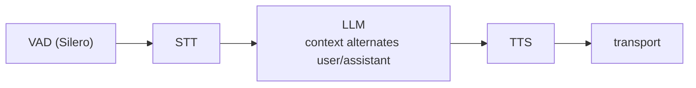

# Voice Agents：Pipecat 与 LiveKit

> Voice agents 在 2026 年已经是一类一线生产系统。Pipecat 给你一个 Python frame-based pipeline（VAD → STT → LLM → TTS → transport）。LiveKit Agents 通过 WebRTC 把 AI models 接到用户。高端生产 stack 的端到端 latency 目标落在 450–600ms。

**Type:** Learn
**Languages:** Python (stdlib)
**Prerequisites:** Phase 14 · 01（Agent Loop），Phase 14 · 12（Workflow Patterns）
**Time:** ~60 minutes

## 学习目标

- 描述 Pipecat 的 frame-based pipeline：DOWNSTREAM（source→sink）和 UPSTREAM（control）。
- 命名 canonical voice pipeline stages，以及 Pipecat 支持哪些 transports。
- 解释 LiveKit Agents 的两类 voice agent（MultimodalAgent、VoicePipelineAgent），以及各自适合什么场景。
- 总结 2026 年生产 latency 预期，以及这些预期如何驱动架构选择。

## 问题

Voice agents 不是一个文本循环再外挂 TTS。Latency budget 很残酷（约 600ms），partial audio 是默认状态，turn detection 本身就是一个 model，transports 从 telephony SIP 到 WebRTC 都有。你要么构建一个 frame-based pipeline（Pipecat），要么依赖一个 platform（LiveKit）。

## 概念

### Pipecat（pipecat-ai/pipecat）

- Python frame-based pipeline framework。
- `Frame` → `FrameProcessor` chain。
- 两个流向：
  - **DOWNSTREAM**：source → sink（audio in，TTS out）。
  - **UPSTREAM**：feedback 和 control（cancellation、metrics、barge-in）。
- `PipelineTask` 用 events（`on_pipeline_started`、`on_pipeline_finished`、`on_idle_timeout`）以及 metrics/tracing/RTVI observers 管理 lifecycle。

典型 pipeline：



Transports：Daily、LiveKit、SmallWebRTCTransport、FastAPI WebSocket、WhatsApp。

Pipecat Flows 增加 structured conversations（state machines）。Pipecat Cloud 是 managed runtime。

### LiveKit Agents（livekit/agents）

- 通过 WebRTC 把 AI models 接到用户。
- 核心概念：`Agent`、`AgentSession`、`entrypoint`、`AgentServer`。
- 两类 voice agent：
  - **MultimodalAgent**：通过 OpenAI Realtime 或同类模型直接处理音频。
  - **VoicePipelineAgent**：STT → LLM → TTS cascade；提供 text-level control。
- 通过 transformer model 做 semantic turn detection。
- 原生 MCP integration。
- 通过 SIP 支持 telephony。
- LiveKit Inference 提供 50+ 个无需 API keys 的 models；通过 plugins 支持另外 200+ 个。

### 商业平台

Vapi（优化后的 premium stack 约 450–600ms）和 Retell（180 次测试通话中约 600ms end-to-end）构建在这些模式之上。当你想要 managed voice stack、但没有 WebRTC team 时，选择平台。

### 这个模式哪里会出错

- **No barge-in handling.** 用户打断；agent 还在继续说。Pipecat 需要 UPSTREAM cancel frames，LiveKit 中也需要等价机制。
- **STT confidence ignored.** 低置信度 transcripts 被当成真理喂给 LLM。需要按 confidence gate，或请求确认。
- **TTS mid-sentence cutoff.** Pipeline 在话说到一半时取消，TTS 需要知道并切断 audio。
- **Latency budget ignored.** 每个 component 都会增加 50–200ms。上线前先把整条链路加总。

### 2026 年典型 latencies

- VAD：20–60ms
- STT partial：100–250ms
- LLM first token：150–400ms
- TTS first audio：100–200ms
- Transport RTT：30–80ms

端到端 450–600ms 是 premium。800–1200ms 很常见。任何超过 1500ms 的体验都会像坏掉了一样。

## Build It

`code/main.py` 是一个 frame-based toy pipeline，包含：

- `Frame` types（audio、transcript、text、tts_audio、control）。
- `Processor` interface，带 `process(frame)`。
- 五阶段 pipeline（VAD → STT → LLM → TTS → transport），由 scripted processors 组成。
- 一个 UPSTREAM cancel frame，用来演示 barge-in。

运行它：

```bash
python3 code/main.py
```

trace 会展示正常 flow，以及一个 barge-in cancel 如何在话说到一半时停止 TTS。

## Use It

- **Pipecat** 用于 full control：custom processors、Python-first、pluggable providers。
- **LiveKit Agents** 用于 WebRTC-first deployments 和 telephony。
- **Vapi / Retell** 用于没有 WebRTC team 的 hosted voice agents。
- **OpenAI Realtime / Gemini Live** 用于 direct audio-in/audio-out（MultimodalAgent）。

## Ship It

`outputs/skill-voice-pipeline.md` 会 scaffold 一个 Pipecat-shaped voice pipeline，包含 VAD + STT + LLM + TTS + transport，以及 barge-in handling。

## 练习

1. 给 toy pipeline 添加 metrics observer：统计每个 stage 每秒处理的 frames。Latency 积累在哪里？
2. 实现 confidence-gated STT：低于阈值时请求 “could you repeat that?”
3. 添加 semantic turn detection：简单规则——如果 transcript 以 “?” 结尾，就判定为 end of turn。
4. 阅读 Pipecat 的 transport docs。把 stdlib transport 换成 SmallWebRTCTransport config（stub）。
5. 在同一个 query 上测量 OpenAI Realtime 和 STT+LLM+TTS cascade。Text-level control 带来了多少 latency cost？

## 关键术语

| Term | What people say | What it actually means |
|------|----------------|------------------------|
| Frame | “Event” | Pipeline 中的 typed data unit（audio、transcript、text、control） |
| Processor | “Pipeline stage” | 带 process(frame) 的 handler |
| DOWNSTREAM | “Forward flow” | 从 source 到 sink：audio in，speech out |
| UPSTREAM | “Feedback flow” | Control：cancel、metrics、barge-in |
| VAD | “Voice activity detection” | 检测用户何时正在说话 |
| Semantic turn detection | “Smart end-of-turn” | 用模型判断用户是否已经说完 |
| MultimodalAgent | “Direct audio agent” | Audio in、audio out；中间没有文本 |
| VoicePipelineAgent | “Cascade agent” | STT + LLM + TTS；提供 text-level control |

## 延伸阅读

- [Pipecat docs](https://docs.pipecat.ai/getting-started/introduction)：frame-based pipeline、processors、transports。
- [LiveKit Agents docs](https://docs.livekit.io/agents/)：WebRTC + voice primitives。
- [Vapi](https://vapi.ai/)：managed voice platform。
- [Retell AI](https://www.retellai.com/)：managed voice，latency-benchmarked。
