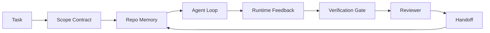

# Agent Workbench Engineering：为什么强模型仍然会失败

> 一个 capable model 还不够。可靠 agents 需要 workbench：instructions、state、scope、feedback、verification、review 和 handoff。把这些拿掉，即使是 frontier model 也会产出无法安全发布的工作。

**Type:** Learn + Build
**Languages:** Python (stdlib)
**Prerequisites:** Phase 14 · 01 (Agent Loop), Phase 14 · 26 (Failure Modes)
**Time:** ~45 minutes

## 学习目标

- 区分 model capability 和 execution reliability。
- 说出决定 agent 能否 ship 的七个 workbench surfaces。
- 在一个小型 repo task 上，对比 prompt-only run 与 workbench-guided run。
- 产出一份 failure-mode report，把每个缺失 surface 映射到它造成的 symptom。

## 问题

你把一个 frontier model 放进真实 repo，让它添加 input validation。它打开四个文件，写出看起来合理的代码，宣布成功，然后停止。你运行 tests。两个失败。第三个被修改的文件和 validation 毫无关系。没有任何记录说明 agent 假设了什么，最先尝试了什么，或者还有什么没做完。

这个 model 并不是不懂 Python。它是不懂这项工作。它不知道什么才算 done，不知道允许写哪里，不知道哪些 tests 是 authoritative，也不知道下一个 session 应该如何接手。

这不是 model bug。这是 workbench bug。Agent 周围的 surface 缺少把 one-shot generation 转成可靠、可恢复工程工作的部件。

## 概念

Workbench 是在任务期间包裹 model 的 operating environment。它有七个 surfaces：

| Surface | 承载什么 | 缺失时的 failure |
|---------|----------|------------------|
| Instructions | Startup rules、forbidden actions、definition of done | Agent 猜测什么才算 shipping |
| State | Current task、touched files、blockers、next action | 每个 session 都从零开始 |
| Scope | Allowed files、forbidden files、acceptance criteria | Edits 泄漏到无关代码 |
| Feedback | 被捕获进 loop 的真实 command output | Agent 在 400 上宣布 success |
| Verification | Tests、lint、smoke run、scope check | “Looks good” 进入 main |
| Review | 用另一个 role 做第二遍检查 | Builder 给自己的作业打分 |
| Handoff | 改了什么、为什么、还剩什么 | 下一个 session 重新发现一切 |

Workbench 独立于 model。你可以替换 model，并保留这些 surfaces。你不能替换 surfaces，却保留 reliability。



这个 loop 闭合在 state file 上，而不是 chat history 上。Chat 是 volatile 的。Repo 才是 system of record。

### Workbench versus prompt engineering

Prompting 告诉 model 这一轮你想要什么。Workbench 告诉 model 如何跨 turns、跨 sessions 做工作。大多数 agent failure stories，都是披着 prompt-engineering 外衣的 workbench failures。

### Workbench versus framework

Framework 给你 runtime（LangGraph、AutoGen、Agents SDK）。Workbench 给 agent 一个在 runtime 里工作的地方。两者都需要。这个 mini-track 讲的是第二个。

### 从 primitives 推理，而不是从 vendor taxonomies 推理

现在有大量关于 “harness engineering” 的文章。Addy Osmani、OpenAI、Anthropic、LangChain、Martin Fowler、MongoDB、HumanLayer、Augment Code、Thoughtworks、walkinglabs awesome list，以及持续不断的 Medium 和 Hacker News 文章都在谈它。它们对 harness 的边界、scope 和 vocabulary 并不一致。我们不需要选边。七个 surfaces 是 UX layer；每个 workbench 底下，都是支撑任何可靠 backend 的同一组 distributed-systems primitives。

先暂时拿掉 agent 标签。一次 agent run 是跨越时间、processes 和 machines 的 computation。要让它可靠，你需要任何 production system 都需要的 primitives。

| Primitive | 它是什么 | 对 agent 承载什么 |
|-----------|----------|------------------|
| Function | Typed handler。尽可能 pure。拥有自己的 inputs 和 outputs。 | Tool call、rule check、verification step、model invocation |
| Worker | 长生命周期 process，拥有一个或多个 functions 和 lifecycle | Builder、reviewer、verifier、MCP server |
| Trigger | 调用 function 的 event source | Agent loop tick、HTTP request、queue message、cron、file change、hook |
| Runtime | 决定什么在哪里运行、带什么 timeouts 和 resources 的边界 | Claude Code 的 process、LangGraph 的 runtime、worker container |
| HTTP / RPC | Caller 和 worker 之间的 wire | Tool-call protocol、MCP request、model API |
| Queue | Trigger 和 worker 之间的 durable buffer；back-pressure、retry、idempotency | Task board、feedback log、review inbox |
| Session persistence | 能跨 crashes、restarts、model swaps 存活的 state | `agent_state.json`、checkpoints、KV stores、repo itself |
| Authorization policy | 谁可以带着什么 scope 调用什么 function | Allowed / forbidden files、approval boundaries、MCP capability lists |

现在把七个 workbench surfaces 映射到这些 primitives 上。

- **Instructions**：policy + function metadata。Rules 是 checks（functions）。Router（`AGENTS.md`）是附着在 runtime startup 上的 policy。
- **State**：session persistence。Runtime 每一步都会读取的 keyed store。可以是 file、KV 或 DB；重要的是 persistence semantics，而不是 storage backend。
- **Scope**：per-task authorization policy。Allowed / forbidden globs 是 ACL。Approvals required 是 permission lattice。
- **Feedback**：写入 queue 的 invocation log。每个 shell call 都是一条 durable、replayable record。
- **Verification**：一个 function。对 inputs 是 deterministic 的。在 task close 时触发。Fails closed。
- **Review**：一个 separate worker，对 builder artifacts 只有 read-only authz，对 review reports 只有 write-only authz。
- **Handoff**：由 session-end trigger 发出的 durable record。下一个 session 的 startup trigger 会读取它。

Agent loop 本身是一个 worker：消费 events（user message、tool result、timer tick），调用 functions（model，以及 model 选择的 tools），写入 records（state、feedback），并发出 triggers（verify、review、handoff）。没有神秘之处；形状和 job processor 一样。

### 流行 patterns 翻译成 primitives

每个流行 harness pattern 都能化约为这八个 primitives。翻译表如下。

| Vendor or community pattern | 实际是什么 |
|------------------------------|------------|
| Ralph Loop（Claude Code、Codex、agentic_harness book）：当 agent 试图过早停止时，把原始意图重新注入 fresh context window | 一个 trigger，会用 clean context 重新 enqueue task；session persistence 承载 goal |
| Plan / Execute / Verify (PEV) | 三个 workers，每个 role 一个，通过 state 和 phase 间 queue 通信 |
| Harness-compute separation（OpenAI Agents SDK, April 2026）：把 control plane 和 execution plane 拆开 | 重述 control-plane / data-plane。这个概念比 agent 标签早几十年 |
| Open Agent Passport（OAP, March 2026）：执行前根据 declarative policy 对每个 tool call 签名并 audit | 由 pre-action worker 强制执行的 authorization policy，加 signed audit queue |
| Guides and Sensors（Birgitta Böckeler / Thoughtworks）：feedforward rules + feedback observability | Authorization policy + verification functions + observability traces |
| Progressive compaction, 5-stage（Claude Code reverse engineering, April 2026） | 一个 state-management worker，像 cron 一样在 session persistence 上运行，把它维持在预算内 |
| Hooks / middleware（LangChain、Claude Code）：拦截 model 和 tool calls | 包裹 runtime invocation path 的 triggers + functions |
| Skills as Markdown with progressive disclosure（Anthropic、Flue） | 一个 function registry，其中 function metadata 会 just-in-time 加载进 context |
| Sandbox agents（Codex、Sandcastle、Vercel Sandbox） | Compute plane：带隔离 filesystem、network 和 lifecycle 的 runtime |
| MCP servers | 通过 stable RPC 暴露 functions 的 workers，capability lists 作为 authorization |

这张表里的每一项，都是 agent community 重新抵达了一个 distributed systems 里已经有名字的 primitive，然后给它起了新名字。作为 marketing labels 很有用；作为 engineering vocabulary 不够有用。

### Receipts 实际说明了什么

harness-over-model 的主张现在有数字支撑。值得知道，因为它们也是反驳 “just wait for a smarter model” 的唯一诚实论据。

- Terminal Bench 2.0：同一个 model，只改 harness，就把一个 coding agent 从 top 30 之外推到第 5 名（LangChain, *Anatomy of an Agent Harness*）。
- Vercel：删除 agent 80% 的 tools；success rate 从 80% 跳到 100%（MongoDB）。
- Harvey：legal agents 仅靠 harness optimization，accuracy 翻倍以上（MongoDB）。
- 88% 的 enterprise AI agent projects 没能进入 production。Failures 聚集在 runtime，而不是 reasoning（preprints.org, *Harness Engineering for Language Agents*, March 2026）。
- 2025 年一项跨三个热门 open-source frameworks 的 benchmark study 报告约 50% task completion；long-context WebAgent 在 long-context conditions 下从 40-50% 跌到 10% 以下，主要原因是 infinite loops 和 goal loss（2026 年初大量文章报道）。

Takeaway 不是 “harness 永远赢”。Models 会随着时间吸收 harness tricks。Takeaway 是今天承重的工程在 model 周围，而不是 model 内部；承担这个重量的 primitives，正是每个 production system 一直都需要的东西。

### Vendor writeups 在哪里停得太早

这部分你不需要太客气。

- LangChain 的 *Anatomy of an Agent Harness* 枚举了十一个 components：prompts、tools、hooks、sandboxes、orchestration、memory、skills、subagents，以及一个 runtime “dumb loop”。它没有命名 queues、作为 deployment unit 的 workers、trigger semantics、作为独立 concern 的 session persistence，或 authorization policy。它把 harness 当成你配置的 object，而不是你部署的 system。
- Addy Osmani 的 *Agent Harness Engineering* 提出了 `Agent = Model + Harness` framing 和 ratchet pattern，但没有进一步说明 harness 是由什么构成的。它读起来像 stance，而不是 spec。
- Anthropic 和 OpenAI 对 surfaces 讲得最深，但仍待在自己的 runtimes 内。2026 年 4 月 Agents SDK 里的 “harness-compute separation” announcement，是第一篇明确支持 control-plane / data-plane split 的 vendor 文章。那是 primitive idea，不是新概念。
- agentic_harness book 把 harness 当成 config object（Jaymin West 的 *Agentic Engineering*, chapter 6），其中最有力的一句话是 “the harness is the primary security boundary in an agentic system.” 这其实只是 authorization policy 的另一种说法。
- Hacker News threads 不断抵达同一个地方。2026 年 4 月的 thread *The agent harness belongs outside the sandbox* 认为 harness 应该更像 “more like a hypervisor that sits outside everything and authorises access based on context and user.” 这再次说明 authorization policy 是一个 separate plane。

你不需要反对这些文章，也能看见 gap。它们在写一个已经存在的 system 的 UX descriptions。我们在写这个 system。System 构建正确时，七个 surfaces 会从 primitives 中自然浮现。System 构建错误时，再多 `AGENTS.md` polish 也修不好缺失的 queue。

所以，当你在别处听到 “harness engineering” 时，把它翻译成 primitives。Prompts 和 rules 是 policy 与 functions。Scaffolding 是 runtime。Guardrails 是 authorization + verification。Hooks 是 triggers。Memory 是 session persistence。Ralph Loop 是 requeue。Subagents 是 workers。Sandboxes 是 compute planes。Vocabulary 会变，engineering 不会变。Workbench 是 agent-facing UX；而 harness，如果要经得起下一次 vendor reframe，就是 functions、workers、triggers、runtimes、queues、persistence 和 policy 被正确接在一起。

## Build It

`code/main.py` 会把一个 tiny repo task 跑两遍。第一次是 prompt only，第二次接入七个 surfaces。Same model，same task。脚本会统计 failed run 中缺失了哪些 surfaces，并打印 failure-mode report。

这个 repo task 故意很小：给一个单文件 FastAPI-style handler 添加 input validation，并写一个 passing test。

运行：

```bash
python3 code/main.py
```

输出：两次 run 的 side-by-side log，一个总结 prompt-only run 的 `failure_modes.json`，以及 workbench run 的一行 verdict。

Agent 是一个 tiny rule-based stub；重点是 surfaces，不是 model。在这个 mini-track 的后续课程里，你会把每个 surface 重建成真实、可复用的 artifact。

## Use It

Workbench surfaces 已经在野外的三个地方存在，哪怕没人这样称呼它们：

- **Claude Code、Codex、Cursor.** `AGENTS.md` 和 `CLAUDE.md` 是 instructions surface。Slash commands 是 scope。Hooks 是 verification。
- **LangGraph、OpenAI Agents SDK.** Checkpoints 和 session stores 是 state surface。Handoffs 是 handoff surface。
- **真实 repo 上的 CI.** Tests、lint 和 type-check 是 verification。PR template 是 handoff。CODEOWNERS 是 review。

Workbench engineering 是把这些 surfaces 显式化、可复用化的 discipline，而不是让每个团队重新发现一次。

## Ship It

`outputs/skill-workbench-audit.md` 是一个 portable skill，会审计现有 repo 的七个 workbench surfaces，并报告哪些缺失、哪些部分完成、哪些健康。把它放到任意 agent setup 旁边，它会告诉你先修什么。

## 练习

1. 选择一个你已经运行 agent 的 repo。把七个 surfaces 从 0（missing）到 2（healthy）打分。你最弱的 surface 是哪个？
2. 扩展 `main.py`，让 prompt-only run 也产出一个假的 “success” claim。验证 verification gate 本应抓住它。
3. 为你自己的 product 添加第八个 surface。解释为什么它不能折叠进已有七个 surfaces。
4. 用一个会 hallucinate 额外 file write 的不同 stub agent 重新运行脚本。哪一个 surface 最先抓住它？
5. 把 Phase 14 · 26 的五种 industry-recurring failure modes 映射到七个 surfaces。每个 surface 被设计用来吸收哪种 mode？

## 关键术语

| Term | 常见说法 | 实际含义 |
|------|----------|----------|
| Workbench | “The setup” | Model 周围让工作变可靠的 engineered surfaces |
| Surface | “A doc” or “a script” | Agent 每一轮读取或写入的 named、machine-readable input |
| System of record | “The notes” | Chat history 消失后，agent 仍视为 truth 的文件 |
| Definition of done | “Acceptance” | Agent 无法伪造的 objective、file-backed checklist |
| Workbench audit | “Repo readiness check” | 开始工作前扫描七个 surfaces，标记缺失部分 |

## 延伸阅读

把这些当作 data points，而不是 authorities。每一篇都是 partial taxonomy。在决定是否采用它之前，先把每个概念翻译回 primitive（function、worker、trigger、runtime、HTTP/RPC、queue、persistence、policy）。

Vendor framings：

- [Addy Osmani, Agent Harness Engineering](https://addyosmani.com/blog/agent-harness-engineering/) — `Agent = Model + Harness` 和 ratchet pattern；infrastructure 较薄
- [LangChain, The Anatomy of an Agent Harness](https://blog.langchain.com/the-anatomy-of-an-agent-harness/) — 十一个 components：prompts、tools、hooks、orchestration、sandboxes、memory、skills、subagents、runtime；遗漏 queues、deployment、authz
- [OpenAI, Harness engineering: leveraging Codex in an agent-first world](https://openai.com/index/harness-engineering/) — Codex team 对 runtime 周围 surfaces 的看法
- [OpenAI, Unrolling the Codex agent loop](https://openai.com/index/unrolling-the-codex-agent-loop/) — 把 agent loop 化约成围绕 function calls 的 `while`
- [Anthropic, Effective harnesses for long-running agents](https://www.anthropic.com/engineering/effective-harnesses-for-long-running-agents) — specific runtime 内部的 long-horizon surfaces
- [Anthropic, Harness design for long-running application development](https://www.anthropic.com/engineering/harness-design-long-running-apps) — applied design notes
- [LangChain Deep Agents harness capabilities](https://docs.langchain.com/oss/python/deepagents/harness) — runtime config surface

Practitioner pieces with usable detail：

- [Martin Fowler / Birgitta Böckeler, Harness engineering for coding agent users](https://martinfowler.com/articles/harness-engineering.html) — guides（feedforward）+ sensors（feedback）；最清晰的 control-theory framing
- [HumanLayer, Skill Issue: Harness Engineering for Coding Agents](https://www.humanlayer.dev/blog/skill-issue-harness-engineering-for-coding-agents) — “it's not a model problem, it's a configuration problem”
- [MongoDB, The Agent Harness: Why the LLM Is the Smallest Part of Your Agent System](https://www.mongodb.com/company/blog/technical/agent-harness-why-llm-is-smallest-part-of-your-agent-system) — receipts：Vercel 80% to 100%、Harvey 2x accuracy、Terminal Bench Top 30 to Top 5
- [Augment Code, Harness Engineering for AI Coding Agents](https://www.augmentcode.com/guides/harness-engineering-ai-coding-agents) — constraint-first walkthrough
- [Sequoia podcast, Harrison Chase on Context Engineering Long-Horizon Agents](https://sequoiacap.com/podcast/context-engineering-our-way-to-long-horizon-agents-langchains-harrison-chase/) — runtime concerns over model concerns

Books, papers, and reference implementations：

- [Jaymin West, Agentic Engineering — Chapter 6: Harnesses](https://www.jayminwest.com/agentic-engineering-book/6-harnesses) — book-length treatment，把 harness 当作 primary security boundary
- [preprints.org, Harness Engineering for Language Agents (March 2026)](https://www.preprints.org/manuscript/202603.1756) — academic framing as control / agency / runtime
- [walkinglabs/awesome-harness-engineering](https://github.com/walkinglabs/awesome-harness-engineering) — 横跨 context、evaluation、observability、orchestration 的 curated reading list
- [ai-boost/awesome-harness-engineering](https://github.com/ai-boost/awesome-harness-engineering) — alternate curated list（tools、evals、memory、MCP、permissions）
- [andrewgarst/agentic_harness](https://github.com/andrewgarst/agentic_harness) — production-ready reference implementation，带 Redis-backed memory 和 eval suite
- [HKUDS/OpenHarness](https://github.com/HKUDS/OpenHarness) — open agent harness，内置 personal agent

Hacker News threads worth reading for the disagreements, not the consensus：

- [HN: Effective harnesses for long-running agents](https://news.ycombinator.com/item?id=46081704)
- [HN: Improving 15 LLMs at Coding in One Afternoon. Only the Harness Changed](https://news.ycombinator.com/item?id=46988596)
- [HN: The agent harness belongs outside the sandbox](https://news.ycombinator.com/item?id=47990675) — 主张把 authorization 作为 separate plane

本课程内的 cross-references：

- Phase 14 · 23 — OpenTelemetry GenAI conventions：sensors literature 指向的 observability layer
- Phase 14 · 26 — Failure modes catalog：七个 surfaces 设计用来吸收的 failure modes
- Phase 14 · 27 — Prompt injection defenses：位于 authorization-policy primitive 的 defenses
- Phase 14 · 29 — Production runtimes（queue、event、cron）：本课 primitives 在 deployment 中所在的位置
