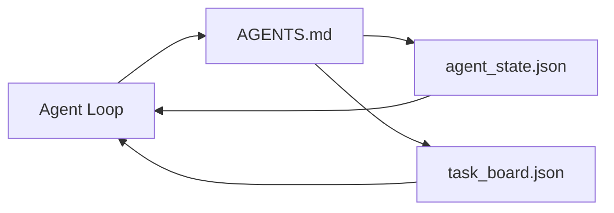

# 最小 Agent Workbench

> 最小可用 workbench 只需要三个文件：一个 root instructions router、一个 state file、一个 task board。其它所有东西都叠在这之上。如果一个 repo 连这三个文件都承载不了，任何模型都救不了它。

**Type:** Build
**Languages:** Python (stdlib)
**Prerequisites:** Phase 14 · 31（Why Capable Models Still Fail）
**Time:** ~45 minutes

## 学习目标

- 定义组成 minimum viable workbench 的三个文件。
- 解释为什么一个短小的 root router 优于一个冗长的单体 `AGENTS.md`。
- 构建一个 agent 每轮都能读取、结束时能写回的 state file。
- 构建一个无需 chat history 也能撑住 multi-session work 的 task board。

## 问题

大多数团队想做 workbench 时，会先写一个 3000 行的 `AGENTS.md`，然后就以为完成了。模型会加载它，忽略那些无法总结的部分，然后仍然在过去总会失败的地方失败。

你需要的是反过来。一个很小的 root file，只在相关时把 agent 路由到更深的文件。Durable state：agent 行动前读取，行动后写回。一个 task board：说明什么正在进行、什么被阻塞、下一步是什么。

三个文件。每个文件只有一个职责。每个文件都足够 machine-readable，以后可以演化成真正的系统。

## 概念



### AGENTS.md 是 router，不是 manual

好的 `AGENTS.md` 很短。它把 agent 指向：

- State file（你在哪里）。
- Task board（还剩什么）。
- 更深层规则（放在 `docs/agent-rules.md`）。
- Verification command（如何知道它能工作）。

更长的内容都放进更深的 docs，只在需要时加载。长 manual 会被忽略。短 router 会被遵守。

### agent_state.json 是 system of record

State 承载：active task id、touched files、made assumptions、blockers，以及 next action。Agent 每轮都读取它。下一个 session 读取它，而不是重放 chat。

State 放在文件里，因为 chat history 不可靠。Sessions 会死。Conversations 会被裁剪。文件不会。

### task_board.json 是 queue

Task board 保存每个 task，状态为 `todo | in_progress | done | blocked`。当 state 为空时，agent 从这个 queue 拉取任务；当你想知道 agent 是否在轨道上时，也读这个 queue。

Board 上的 task 有 id、goal、owner（`builder`、`reviewer` 或 `human`），以及 acceptance criteria。Board 有意保持小：当它长过一屏时，你遇到的是 planning problem，不是 board problem。

### 三个文件是地板，不是天花板

后续课程会加入 scope contracts、feedback runners、verification gates、reviewer checklists 和 handoff packets。本课的三个文件，是它们共同假设已经存在的底座。

## Build It

`code/main.py` 会把 minimal workbench 写入一个空 repo，并演示单个 agent turn：

1. 读取 `agent_state.json`。
2. 如果 state 为空，就从 `task_board.json` 拉取下一个 task。
3. 只触碰 scope 内的单个文件。
4. 写回更新后的 state。

运行它：

```bash
python3 code/main.py
```

脚本会在自己旁边创建 `workdir/`，放下三个文件，运行一轮，并打印 diff。重新运行它，可以看到第二轮如何从第一轮停下的位置继续。

## Use It

在生产 agent products 里，同样的三个文件会以不同名字出现：

- **Claude Code：** 用 `AGENTS.md` 或 `CLAUDE.md` 做 router，用 `.claude/state.json` 风格 stores 做 state，用 hooks 做 board。
- **Codex / Cursor：** workspace rules 做 router，session memory 做 state，chat sidebar 里的 queued tasks 做 board。
- **Custom Python agent：** 就是你刚写的这些文件。

名字会变。形状不会。

## 真实生产中的 patterns

当三个 patterns 叠在这个最小 workbench 上时，它就能撑住真实 monorepos。它们彼此独立；只挑你的 repo 真正需要的。

**Nested `AGENTS.md` with nearest-wins precedence.** OpenAI 在主 repo 中放了 88 个 `AGENTS.md` 文件，每个 subcomponent 一个。Codex、Cursor、Claude Code 和 Copilot 都会从工作文件一路走向 repo root，并拼接路径上找到的每个 `AGENTS.md`。Sub-directory 文件扩展 root file。Codex 增加了 `AGENTS.override.md`，用于替换而不是扩展；override 机制是 Codex-specific，跨工具工作时要避免。Augment Code 的测量结果很关键：最好的 `AGENTS.md` 文件带来的质量跃升，相当于从 Haiku 升级到 Opus；最差的文件会让输出比没有文件更差。

**Anti-patterns to refuse, even when they look like coverage.** 冲突指令会悄悄把 agent 从 interactive mode 掉到 greedy mode（ICLR 2026 AMBIG-SWE：resolve rate 从 48.8% 降到 28%）；要给 priority 编号，而不是平铺堆叠。不可验证的 style rules（“follow the Google Python Style Guide”）如果没有 enforcement command，会让 agent 发明 compliance；每条 style rule 都配一个精确 lint command。把 style 放在 commands 前面，会埋掉 verification path；commands first，style last。为人类而不是 agents 写，会浪费 context budget；简短本身就是功能。

**Cross-tool symlinks.** 用一个 root file 加 symlinks（`ln -s AGENTS.md CLAUDE.md`、`ln -s AGENTS.md .github/copilot-instructions.md`、`ln -s AGENTS.md .cursorrules`），可以让每个 coding agent 使用同一个 source of truth。Nx 的 `nx ai-setup` 会从单个 config 自动为 Claude Code、Cursor、Copilot、Gemini、Codex 和 OpenCode 生成这些内容。

## Ship It

`outputs/skill-minimal-workbench.md` 会为任意新 repo 生成三文件 workbench：按项目调好的 `AGENTS.md` router、带正确 keys 的 `agent_state.json`，以及用当前 backlog 初始化的 `task_board.json`。

## 练习

1. 给 `agent_state.json` 添加 `last_run` timestamp。如果文件超过 24 小时未更新，除非 operator 确认，否则拒绝运行。
2. 给 task board 添加 `priority` 字段，并修改 puller，让它总是选择最高优先级的 `todo`。
3. 把 `task_board.json` 迁移到 JSON Lines，让每个 task 占一行，版本控制中的 diff 更干净。
4. 写一个 `lint_workbench.py`：如果 `AGENTS.md` 超过 80 行，或引用了不存在的文件，就失败。
5. 判断这三个文件里丢掉哪一个最伤。为你的选择辩护。

## 关键术语

| Term | What people say | What it actually means |
|------|----------------|------------------------|
| Router | `AGENTS.md` | 短 root file，把 agent 指向更深的 docs 和 files |
| State file | “The notes” | Machine-readable record，记录 agent 当前在哪里；每轮写入 |
| Task board | “The backlog” | 带 status、owner、acceptance 的 JSON work queue |
| System of record | “Source of truth” | Chat 消失时，workbench 视为权威的文件 |

## 延伸阅读

- [agents.md — the open spec](https://agents.md/)：Cursor、Codex、Claude Code、Copilot、Gemini、OpenCode 都已采用。
- [Augment Code, A good AGENTS.md is a model upgrade. A bad one is worse than no docs at all](https://www.augmentcode.com/blog/how-to-write-good-agents-dot-md-files)：可测量的质量跃升。
- [Blake Crosley, AGENTS.md Patterns: What Actually Changes Agent Behavior](https://blakecrosley.com/blog/agents-md-patterns)：哪些经验有效，哪些无效。
- [Datadog Frontend, Steering AI Agents in Monorepos with AGENTS.md](https://dev.to/datadog-frontend-dev/steering-ai-agents-in-monorepos-with-agentsmd-13g0)：nested precedence 的实践。
- [Nx Blog, Teach Your AI Agent How to Work in a Monorepo](https://nx.dev/blog/nx-ai-agent-skills)：跨六种工具的 single-source generation。
- [The Prompt Shelf, AGENTS.md Best Practices: Structure, Scope, and Real Examples](https://thepromptshelf.dev/blog/agents-md-best-practices/)：能撑过 review 的 section ordering。
- [Anthropic, Claude Code subagents and session store](https://docs.anthropic.com/en/docs/agents-and-tools/claude-code/sub-agents)
- Phase 14 · 31：这个 minimum 吸收的 failure modes。
- Phase 14 · 34：本课预览的 durable state schema。
