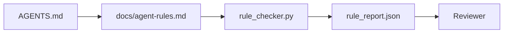

# Agent Instructions as Executable Constraints

> 写成 prose 的 instructions 只是愿望。写成 constraints 的 instructions 才是测试。Workbench 会把每条 rule 变成 agent 可以在 runtime 检查、reviewer 可以事后验证的东西。

**Type:** Build
**Languages:** Python (stdlib)
**Prerequisites:** Phase 14 · 32 (Minimal Workbench)
**Time:** ~50 minutes

## 学习目标

- 区分 routing prose 和 operational rules。
- 把 startup rules、forbidden actions、definition of done、uncertainty handling 和 approval boundaries 表达成 machine-checkable constraints。
- 实现一个 rule checker，对一次 run 按 rule set 打分。
- 让 rule set 适合 diff review，这样 reviewer 能看清发生了什么变化。

## 问题

典型的 `AGENTS.md` 读起来像 onboarding documentation。它告诉 agent 要 “be careful”、“test thoroughly”、“ask if unsure”。三天后，agent 提交了一个没有 tests 的改动，写进了 forbidden directory，而且从来没有提问，因为它根本不知道边界在哪里。

Instructions 在 operational 时很强，在 aspirational 时很弱。修复方式是：写出 workbench 可以解释、reviewer 可以评分的 rules。

## 概念

Rules 应该放在 `docs/agent-rules.md`，和短小的 root router 分开。每条 rule 都有 name、category 和 check。



### 覆盖大多数 rules 的五个 categories

| Category | 这条 rule 回答的问题 | Example |
|----------|----------------------|---------|
| Startup | 工作开始前必须满足什么？ | “state file exists and is fresh” |
| Forbidden | 什么事情绝不能发生？ | “do not edit `scripts/release.sh`” |
| Definition of done | 什么能证明任务完成？ | “pytest exits 0 and acceptance line passes” |
| Uncertainty | Agent 不确定时该做什么？ | “open a question note instead of guessing” |
| Approval | 什么事情需要 human approval？ | “any new dependency, any prod write” |

一条 rule 如果不适合这五类之一，通常应该拆成两条 rule。强制拆分。

### Rules 是 machine-readable

每条 rule 都有 slug、category、一行 description，以及一个 `check` 字段，指向 `rule_checker.py` 里的某个 function。添加 rule 就意味着添加 check；checker 会随着 workbench 一起增长。

### Rules 是 diff-friendly

Rules 放在单个 markdown 文件里，每条 rule 一个 heading。Renames 在 diff 中可见。新 rules 放在所属 category 顶部。过期 rules 应该删除，而不是注释掉，因为 workbench 才是 source of truth，不是团队上个季度心情如何的 chat log。

### Rules versus framework guardrails

Framework guardrails（OpenAI Agents SDK guardrails、LangGraph interrupts）在 runtime 层执行 rules。本课里的 rule set 是 human-readable、reviewable 的 contract，而这些 guardrails 负责实现这个 contract。两者都需要：runtime 在 turn 期间捕获 violations，rule set 证明 runtime 正在做正确的事。

### Progressive disclosure：一张 map，而不是 encyclopedia

`AGENTS.md` 不断变长的原因是：每次 incident 都会新增一条 rule，但没有 incident 会删除一条 rule。一年后，文件变成两千行，agent 读了第一屏，用完 attention budget，然后只按其中一小部分行动。巨大的 instruction file 会失败，原因和四十页 onboarding doc 一样：读者扫一遍，然后再也不会回到真正重要的部分。

修复方式不是更短的文件，而是分层文件。Root router 保持足够短，每个 session 都能读完，并且只保存 pointers。深度内容放进 topic files，只有当任务触及它们时 agent 才加载。给 agent 一张 map，而不是整本 encyclopedia，让它自己走到需要的页面。

```text
AGENTS.md                  # router, < 50 lines: what this repo is, where to look, the 5 hard rules
docs/
  agent-rules.md           # the full rule set (this lesson)
  architecture.md          # loaded when the task touches module boundaries
  testing.md               # loaded when the task writes or runs tests
  deploy.md                # loaded only for release work, gated behind an approval rule
feature_list.json          # the backlog (Phase 14 · 36)
```

| Tier | Lives in | Read when | Size budget |
|------|----------|-----------|-------------|
| Router | `AGENTS.md` | Every session, always | Under ~50 lines |
| Rules | `docs/agent-rules.md` | Every session, on startup | One screen per category |
| Topic docs | `docs/<topic>.md` | Only when the task touches that topic | As deep as needed |

两个 tests 能让分层保持诚实。Reachability test：agent 应该能从 router 出发最多两跳到达任何 rule，所以 router 必须通过 path 链接每个 topic doc，而不是用 prose 描述它。Freshness test：router 足够短，reviewer 能在每个 PR 上重读它，这是唯一能防止它静默长回 encyclopedia 的机制。一个不再 resolve 的 pointer 比 missing rule 更糟，所以 router 中的 broken link 本身就是 startup-check violation。

## Build It

`code/main.py` 提供：

- `agent-rules.md` parser，把 rules 加载进 dataclass。
- `rule_checker.py` 风格的 checker functions，每个 `check` reference 一个 function。
- 一个 demo agent run，会违反两条 rules；随后 check pass 会抓到它们。

运行：

```bash
python3 code/main.py
```

输出：parsed rule set、run trace、每条 rule 的 pass/fail，以及一个保存在脚本旁边的 `rule_report.json`。

## Production patterns in the wild

三种 patterns 可以区分一个能维持一个季度的 rule set，和一个一周后就腐烂的 rule set。

**Severity tagging at write time.** 每条 rule 都带 `severity`：`block`、`warn` 或 `info`。Checker 会报告三者；runtime 只会在 `block` 上拒绝。大多数团队一开始会高估 severity，然后在 deadline 压力下悄悄削弱它；写 rule 时就打 tag，会迫使团队提前校准。配合 verification gate（Phase 14 · 38），它会把任何 `block` rule override 签入 `overrides.jsonl` audit log。

**Rule expiry as a forcing function.** 每条 rule 都带 `expires_at` date（默认是 authoring 后 90 天）。当一条未过期 rule 连续 60 天没有 violation 时，checker 会发出 warning；下一次 quarterly review 要么证明继续保留它，要么把它削弱成 `info`，要么删除它。Cloudflare 的 production AI Code Review data（2026 年 4 月，30 天内跨 5,169 repos 的 131,246 review runs）显示：带 explicit expiry 的 rule sets 每个 repo 保持在 30 条以下；没有 expiry 的会增长到 80+，而且大多数永远不会触发。

**Markdown-as-source, JSON-as-cache.** `agent-rules.md` 是 authored file；`agent-rules.lock.json` 是 checker 在 hot path 中读取的 cache。Lock file 由 pre-commit hook 重新生成。Markdown diffs 适合 review；JSON parsing 不会进入每个 turn。形状和 `package.json` / `package-lock.json`、`Cargo.toml` / `Cargo.lock` 一样。

## Use It

Production 中：

- Claude Code、Codex、Cursor 在 session start 读取 rules，并在拒绝 actions 时引用它们。Checker 在 CI 中重新运行，捕获 silent drift。
- OpenAI Agents SDK guardrails 把同样的 checks 注册为 input 和 output guardrails。Markdown 是 docs surface；SDK 是 runtime surface。
- LangGraph interrupts 会在 in-flight node 违反 rule 时触发。Interrupt handler 读取 rule，询问 human，然后 resume。

这个 rule set 可以跨三者移植，因为它只是 markdown 加 function names。

## Ship It

`outputs/skill-rule-set-builder.md` 会采访 project owner，把他们现有的 prose instructions 分类进五个 categories，并输出 versioned `agent-rules.md` 和 checker stub。

## 练习

1. 如果你的 product 真的需要第六个 category，添加它。说明为什么它不能折叠进现有五类之一。
2. 扩展 checker，让 rule 可以携带 severity（`block`、`warn`、`info`），并让 report 按 severity 聚合。
3. 把 checker 接入 CI：如果最新 agent run 上有 block-severity rule 失败，就让 build fail。
4. 给每条 rule 添加 “expiry” 字段。90 天没有 check fail 后，这条 rule 进入 review。
5. 找一个真实的 `AGENTS.md`，把它改写成五类 rules。它有多少行是 operational？多少行是 aspirational？

## 关键术语

| Term | 常见说法 | 实际含义 |
|------|----------|----------|
| Operational rule | “A real instruction” | Workbench 可以在 runtime 检查的 rule |
| Aspirational rule | “Be careful” | 没有 check 的 rule；要么删除，要么升级 |
| Definition of done | “Acceptance” | 任务完成的客观、file-backed proof |
| Block severity | “Hard rule” | Violation 会中止 run；没有 operator 不能静默忽略 |
| Rule expiry | “Stale rule sweep” | N 天没有失败的 rule 进入 retirement review |

## 延伸阅读

- [OpenAI Agents SDK guardrails](https://platform.openai.com/docs/guides/agents-sdk/guardrails)
- [LangGraph interrupts](https://langchain-ai.github.io/langgraph/how-tos/human_in_the_loop/breakpoints/)
- [Anthropic, Building Effective Agents](https://www.anthropic.com/research/building-effective-agents)
- [Rick Hightower, Agent RuleZ: A Deterministic Policy Engine](https://medium.com/@richardhightower/agent-rulez-a-deterministic-policy-engine-for-ai-coding-agents-9489e0561edf) — block/warn/info severity in production
- [Cloudflare, Orchestrating AI Code Review at Scale](https://blog.cloudflare.com/ai-code-review/) — 131k review runs, rule composition lessons
- [microservices.io, GenAI development platform — part 1: guardrails](https://microservices.io/post/architecture/2026/03/09/genai-development-platform-part-1-development-guardrails.html) — defense in depth between rules and CI
- [Type-Checked Compliance: Deterministic Guardrails (arXiv 2604.01483)](https://arxiv.org/pdf/2604.01483) — Lean 4 as the upper bound on rule-as-check
- [logi-cmd/agent-guardrails](https://github.com/logi-cmd/agent-guardrails) — merge-gate implementation: scope, mutation testing, violation budgets
- Phase 14 · 32 — the minimal workbench this rule set drops into
- Phase 14 · 38 — the verification gate that consumes the rule report
- Phase 14 · 39 — the reviewer agent that scores rule compliance
