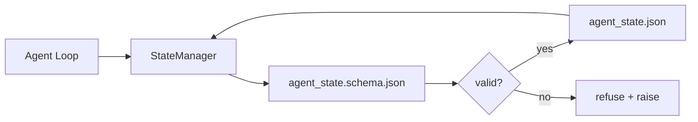

# Repo Memory 与持久状态

> Chat history 是易失的。Repo 是持久的。Workbench 把 agent state 存在带版本的文件里，让下一个 session、下一个 agent、下一个 reviewer 都从同一个 source of truth 读取。

**Type:** Build
**Languages:** Python (stdlib + `jsonschema` optional)
**Prerequisites:** Phase 14 · 32 (Minimal Workbench)
**Time:** ~60 minutes

## 学习目标

- 定义什么应该放进 repo memory，什么应该留在 chat history。
- 为 `agent_state.json` 和 `task_board.json` 编写 JSON Schemas。
- 构建一个 state manager，能够原子地 load、validate、mutate 和 persist state。
- 用 schema 在坏写入破坏 workbench 之前拒绝它。

## 问题

Agent 完成一次 session。Chat 关闭。下一个 session 打开后问应该从哪里开始。模型说 “let me check the files”，读到过期 notes，然后重做已经完成的工作。更糟的是，它重写了一个已经完成的文件，因为没人告诉它这个文件已经完成。

Workbench 的修复方式是 repo memory：state 存在 repo 里的 JSON 文件中，在 schema 约束下写入，以原子方式持久化，并且在 code review 中 diff-friendly。Chat 是 transient feed；repo 才是 system of record。

## 概念



### 什么属于 repo memory

| Belongs | Does not belong |
|---------|-----------------|
| Active task id | Raw chat transcripts |
| Touched files this session | Token-level reasoning traces |
| Assumptions the agent made | "The user seemed frustrated" |
| Open blockers | Sampled completions |
| Next action | Vendor-specific model ids |

判断标准是 durability：三个月后在 CI rerun 中，这个信息还会有用吗？如果会，放 repo。如果不会，放 telemetry。

### Schema-first state

JSON Schema 是合约。没有它，每个 agent 都会发明新字段，每个 reviewer 都要学习新形状，每个 CI script 都要为过去的版本写 special case。有了它，坏写入会被拒绝。

Schema 覆盖：

- Required keys。
- 允许的 `status` values。
- 禁止值（例如数组不能是 `null`）。
- Pattern constraints（task ids 匹配 `T-\d{3,}`）。
- 用于 migrations 的 version field。

### Atomic writes

State 写入必须能承受 partial failures：先写到 tempfile，fsync，然后 rename 覆盖目标文件。State file 是 source of truth；一个写到一半的文件比没有文件更糟。

### Migrations

当 schema 变化时，schema bump 旁边要一起提交 migration script。State file 带有 `schema_version` 字段；manager 会拒绝加载无法迁移的版本。

## Build It

`code/main.py` 实现了：

- `agent_state.schema.json` 和 `task_board.schema.json`。
- 一个 stdlib-only validator（JSON Schema 子集：required、type、enum、pattern、items）。
- 带 atomic temp-and-rename 写入的 `StateManager.load`、`StateManager.update`、`StateManager.commit`。
- 一个 demo：mutate state、persist、reload，并证明 round-trip 成功。

运行它：

```bash
python3 code/main.py
```

脚本会写入 `workdir/agent_state.json` 和 `workdir/task_board.json`，跨两个 turns 修改它们，并在每一步打印 validated state。

## 野外生产模式

四个模式能把本课的最小实现变成一个 multi-agent monorepo 可以承受的东西。

**Atomic temp-and-rename 不是可选项。** 2026 年 3 月 Hive 项目的一个 bug report 清楚记录了失败模式：`state.json` 通过 `write_text()` 写入，exceptions 被捕获并静默忽略。Partial writes 让 sessions 在没有信号的情况下从 corrupt state resume。修复永远是：在目标文件同目录下 `tempfile.mkstemp`，写入，`fsync`，`os.replace`（POSIX 和 Windows 上的 atomic rename）。本课的 `atomic_write` 正是这样做的。

**每个非幂等工具调用都需要 idempotency keys。** 如果 agent 在调用工具后、checkpoint 结果前崩溃，恢复时会重试工具调用。读操作安全；发邮件、DB inserts、file uploads 危险。模式是：执行前把每个 tool call ID 记录到 `pending_calls.jsonl`。重试时检查这个 ID；如果存在，就跳过调用并使用 cached result。Anthropic 和 LangChain 的 2026 guidance 都强调了这一点；LangGraph 的 checkpointer 也为同样原因持久化 pending writes。

**把大型 artifacts 和 state 分开。** 不要把 CSV、长 transcripts 或 generated files 存进 `agent_state.json`。把 artifact 存成单独文件（或上传到 object storage），state 里只保留 path。Checkpoints 保持小而快；artifacts 独立增长。

**Event sourcing 用于 audit，snapshots 用于 resume。** 每次 mutation 都 append 到 event log（`state.events.jsonl`）；定期 snapshot 到 `state.json`。Resume 读取 snapshot，然后 replay snapshot timestamp 之后的 events。这会消耗更多磁盘，但让你可以逐字 replay agent decisions——调试 long-horizon runs 时这是必需的。Postgres 内部 WAL 也是同样形状。

**要么做 schema migrations，要么拒绝加载。** `schema_version` integer 就是合约。当 manager 加载未知版本的文件时，它应该拒绝读取。把 migration script 和 schema bump 一起提交；`tools/migrate_state.py` 每次启动时都 idempotently 运行。

## Use It

生产中：

- **LangGraph checkpointers.** 同一思想，不同存储。Checkpointer 会把 graph state 持久化到 SQLite、Postgres 或自定义 backend。本课讲的 schema，是 checkpointer 出问题、你需要手动读取 state 时会用到的东西。
- **Letta memory blocks.** 带结构化 schemas 的 persistent blocks（Phase 14 · 08）。同样的纪律，只是 scope 放在 long-running personas 上。
- **OpenAI Agents SDK session store.** Pluggable backends，schema-aware。本课中的 state file 就是 local-file backend。

## Ship It

`outputs/skill-state-schema.md` 会生成项目专用的一对 JSON Schema（state + board）、一个接好 atomic writes 的 Python `StateManager`，以及 migration scaffold，确保下一次 schema bump 不会破坏 workbench。

## 练习

1. 添加一个 `last_human_touch` timestamp。拒绝 human edit 后五秒内的任何 agent write。
2. 扩展 validator 支持 `oneOf`，让 task 可以是 build task 或 review task，并拥有不同 required fields。
3. 添加 `schema_version` 字段，并编写从 v1 到 v2 的 migration（把 `blockers` 重命名为 `risks`）。
4. 把 storage backend 从 local file 移到 SQLite。保持 `StateManager` API 不变。
5. 让两个 agents 在 50 ms write race 中写同一个 state file。会发生什么？Atomic rename 如何救你？

## 关键术语

| Term | What people say | What it actually means |
|------|----------------|------------------------|
| Repo memory | "Notes file" | 存在 repo tracked files 中、受 schema 约束的 state |
| Schema-first | "Validate inputs" | 先定义合约，再定义 writer；拒绝 drift |
| Atomic write | "Just rename" | 写入 temp、fsync、rename，防止 partial failures corrupt 文件 |
| Migration | "Schema bump" | 把 vN state 转成 v(N+1) state 的脚本 |
| System of record | "Source of truth" | Workbench 视为权威的 artifact |

## 延伸阅读

- [JSON Schema specification](https://json-schema.org/specification.html)
- [LangGraph checkpointers](https://langchain-ai.github.io/langgraph/concepts/persistence/)
- [Letta memory blocks](https://docs.letta.com/concepts/memory)
- [Fast.io, AI Agent State Checkpointing: A Practical Guide](https://fast.io/resources/ai-agent-state-checkpointing/)：schema-first checkpointing with idempotency。
- [Fast.io, AI Agent Workflow State Persistence: Best Practices 2026](https://fast.io/resources/ai-agent-workflow-state-persistence/)：concurrency control、TTL、event sourcing。
- [Hive Issue #6263 — non-atomic state.json writes silently ignored](https://github.com/aden-hive/hive/issues/6263)：真实项目中的失败模式。
- [eunomia, Checkpoint/Restore Systems: Evolution, Techniques, Applications](https://eunomia.dev/blog/2025/05/11/checkpointrestore-systems-evolution-techniques-and-applications-in-ai-agents/)：从 OS 历史迁移到 agents 的 CR primitives。
- [Indium, 7 State Persistence Strategies for Long-Running AI Agents in 2026](https://www.indium.tech/blog/7-state-persistence-strategies-ai-agents-2026/)
- [Microsoft Agent Framework, Compaction](https://learn.microsoft.com/en-us/agent-framework/agents/conversations/compaction)：vendor checkpoint manager。
- Phase 14 · 08：memory blocks and sleep-time compute。
- Phase 14 · 32：本课 schematize 的 three-file minimum。
- Phase 14 · 40：从同一个 schema 读取的 handoff packets。
