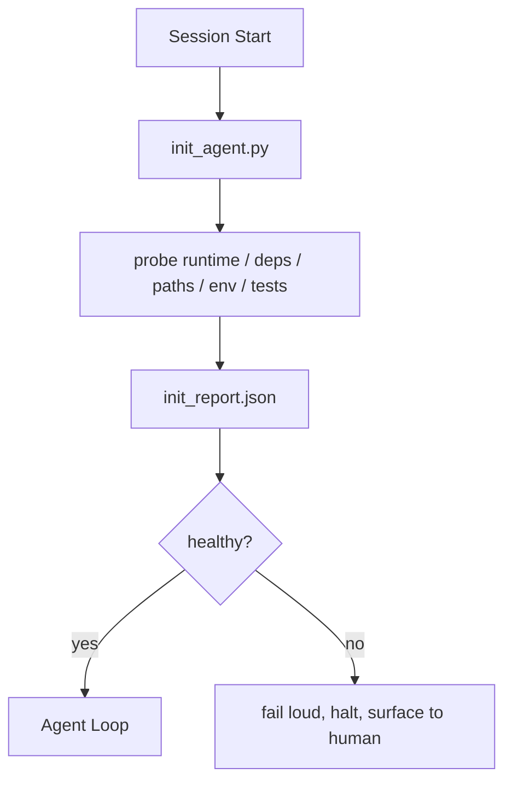

# Agent 初始化脚本

> 每个冷启动 session 都要付一笔税。Agent 会读同样的文件、重试同样的 probes、重新发现同样的路径。Init script 把这笔税只付一次，并把答案写进 state。

**Type:** Build
**Languages:** Python (stdlib)
**Prerequisites:** Phase 14 · 32 (Minimal Workbench), Phase 14 · 34 (Repo Memory)
**Time:** ~45 minutes

## 学习目标

- 识别 agent 不应该在每个 session 重做的工作。
- 构建一个 deterministic init script，用来探测 runtime、dependencies 和 repo health。
- 持久化 probe result，让 agent 读取结果，而不是重新运行 checks。
- 当 initialization 失败时，快速、大声失败，并且只有一个地方需要查看。

## 问题

打开一个 session。Agent 猜 Python 版本。猜测试命令。为了找到 entry point，把 repo root 列五遍。尝试 import 一个没安装的 package。问用户 config file 在哪里。等它真正开始编辑时，已经有一万 tokens 花在了本该由一个脚本完成的 setup work 上。

修复方式是一个 initialization script：它在 agent 做任何事之前运行，并写出一个 agent 启动时会读取的 `init_report.json`。

## 概念



### Init script 探测什么

| Probe | Why it matters |
|-------|----------------|
| Runtime versions | Python 或 Node 版本错误会制造 silent wrong-version bugs |
| Dependency availability | 现在发现 missing package，比之后才发现便宜十倍 |
| Test command | Agent 必须知道如何验证；如果命令缺失，workbench 就坏了 |
| Repo paths | Hard-coded paths 会漂移；只解析一次并 pin 住 |
| Environment variables | 缺少 `OPENAI_API_KEY` 是 failure surface，不是 runtime mystery |
| State + board freshness | crashed session 留下的 stale state 是 footgun |
| Last-known-good commit | session 结束时 handoff diff 的锚点 |

### Fail loud、fail fast、fail in one place

Probe failure 意味着 halt，并把问题暴露给人类。不要指望“agent 会自己搞定”。Init 的全部意义就是：workbench 坏掉时拒绝启动。

### Idempotent

连续运行两次。第二次除了 fresh timestamp 之外，应该是 no-op。Idempotency 让你可以把脚本接到 CI、hooks 或 pre-task slash command。

### Init 与 startup rules

Rules（Phase 14 · 33）描述采取行动前必须满足什么条件。Init 是建立这些 rules 可被检查的脚本。没有 init 的 rules 会退化成“要小心”。没有 rules 的 init 会变成精致的失败。

## Build It

`code/main.py` 实现了 `init_agent.py`：

- 五个 probes：Python version、通过 `importlib.util.find_spec` 列出的 dependencies、test command resolvability、required env vars、state file freshness。
- 每个 probe 返回 `(name, status, detail)`。
- 脚本写出包含完整 probe set 的 `init_report.json`，如果任何 block-severity probe 失败，就以非零状态退出。

运行：

```bash
python3 code/main.py
```

脚本会打印 probes 表，写出 `init_report.json`，happy path 上 exit zero；否则以 non-zero 退出，并列出 failed probes。

## 生产中的常见模式

有三个模式能区分真正有用的 init script 和纯仪式。

**Last-known-good commit anchoring.** 把当前 commit 与上次 successful merge 写入的 `LKG` file 对比。如果 diff 超过预算（默认 50 files），拒绝启动，并要求人类批准新的 baseline。Cloudflare 的 AI Code Review 就用这个模式来限定 reviewer agents 的 scope：每个 review session 都锚定到同一个 last-known-good，并且不会跨 sessions 叠加 drift。

**Lock files with TTL.** 第一次 probe pass 成功后写入 `prereqs.lock`。之后的 runs 会在 N 小时内信任这个 lock（默认 24h），并跳过昂贵 probes。Init script 先读取 lock；如果它仍然 fresh，并且 dependency manifest hash 匹配，就 short-circuit。这和 Docker layer caches 的模式相同：idempotent probe + content hash = skip。

**No network, no LLM, no surprises in the hot path.** Init probes 是 deterministic plumbing。一个会调用 LLM 来分类 failure、或访问外部服务检查 license 的 probe，不是 probe，而是 workflow。如果一个 probe 在 dry run 中超过三秒，就把它视作 workbench smell：要么移出 init，要么缓存结果。

## Use It

在 production 中：

- **Claude Code hooks.** `pre-task` hook 调用 init script；如果失败，就拒绝启动 agent。
- **GitHub Actions.** `setup-agent` job 运行 init script；agent job 依赖它。
- **Docker entrypoint.** Agent container 在 exec agent runtime 前运行 init script；失败时暴露 logs。

Init script 可移植，因为它不调用任何特定 framework。Bash、Make 或 tasks file 都可以包一层。

## Ship It

`outputs/skill-init-script.md` 会访谈项目，把 setup work 分类成 probes，并生成项目专用的 `init_agent.py`，以及一个在任何 agent step 之前运行它的 CI workflow。

## 练习

1. 添加一个 probe，把当前 commit 与 last-known-good commit 做 diff；如果变化超过 50 个 files，就拒绝启动。
2. 接线让脚本写入 `prereqs.lock` 文件；如果 lock 超过七天，就拒绝启动。
3. 添加 `--fix` flag，自动安装缺失的 dev dependencies，但未经批准永远不要修改 runtime dependencies。
4. 把 probes 从 hardcoded functions 移到 YAML registry。为这个 trade-off 辩护。
5. 为每个 probe 添加 timing budget。超过三秒的 probe 就是 workbench smell。

## 关键术语

| Term | What people say | What it actually means |
|------|----------------|------------------------|
| Probe | "A check" | 返回 `(name, status, detail)` 的 deterministic function |
| Init report | "Setup output" | 写在 state 旁边、包含 probe results 的 JSON |
| Idempotent | "Safe to re-run" | 连续两次运行会产生相同 report，timestamp 除外 |
| Fail loud | "Don't swallow" | Halt 并暴露给人类；没有 silent fallback |
| Setup tax | "Bootstrap cost" | Agent 每个 session 为重新发现显而易见的东西花掉的 tokens |

## 延伸阅读

- [Anthropic, Effective harnesses for long-running agents](https://www.anthropic.com/engineering/effective-harnesses-for-long-running-agents)
- [GitHub Actions, composite actions for setup](https://docs.github.com/en/actions/sharing-automations/creating-actions/creating-a-composite-action)
- [microservices.io, GenAI dev platform: guardrails](https://microservices.io/post/architecture/2026/03/09/genai-development-platform-part-1-development-guardrails.html)：作为 init 的 pre-commit + CI checks。
- [Augment Code, How to Build Your AGENTS.md (2026)](https://www.augmentcode.com/guides/how-to-build-agents-md)：init expectations。
- [Codex Blog, Codex CLI Context Compaction](https://codex.danielvaughan.com/2026/03/31/codex-cli-context-compaction-architecture/)：把 session start 视为 compaction-aware init。
- Phase 14 · 33：这个脚本启用的 rule set。
- Phase 14 · 34：这个脚本 seed 的 state file。
- Phase 14 · 38：init script feeding 的 verification gate。
- Phase 14 · 40：consume init report last-known-good 的 handoff。
