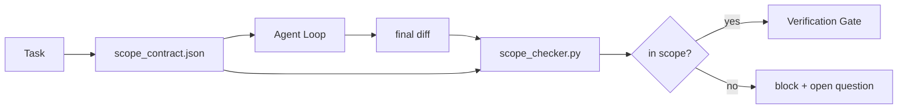

# Scope Contracts 与任务边界

> 模型不知道工作在哪里结束。Scope contract 是一个按任务生成的文件，它说明工作从哪里开始、在哪里结束，以及如果越界该如何回滚。Contract 会把 “stay in scope” 从愿望变成检查。

**Type:** Build
**Languages:** Python (stdlib)
**Prerequisites:** Phase 14 · 32（Minimal Workbench），Phase 14 · 33（Rules as Constraints）
**Time:** ~50 minutes

## 学习目标

- 写一个 scope contract，让 agent 在任务开始时读取，让 verifier 在任务结束时读取。
- 指定 allowed files、forbidden files、acceptance criteria、rollback plan 和 approval boundaries。
- 实现一个 scope checker，把 diff 和 contract 对比，并标出 violations。
- 让 scope creep 变得可见、自动、可 review。

## 问题

Agents 会 creep。任务是 “fix the login bug”。Diff 却碰了 login route、email helper、database driver、README 和 release script。每一次触碰在当时都有合理理由。但合在一起，它已经不是 review 时批准的那个 change 了。

Scope creep 是 agent work 中最缺少监控的 failure mode，因为 agent 会真诚地叙述每一步。修复方法不是更严格的 prompt。修复方法是磁盘上的 contract：它说清楚承诺了什么，然后用一个检查把结果和承诺对比。

## 概念



### Scope contract 里放什么

| Field | Purpose |
|-------|---------|
| `task_id` | 关联到 board 上的 task |
| `goal` | reviewer 可以验证的一句话目标 |
| `allowed_files` | agent 可以写入的 globs |
| `forbidden_files` | agent 即使意外也绝不能触碰的 globs |
| `acceptance_criteria` | 证明完成的 test commands 或 assertion lines |
| `rollback_plan` | 如果必须 halt，operator 可以执行的一段回滚说明 |
| `approvals_required` | 超出 scope、需要明确 human sign-off 的 actions |

没有 `forbidden_files` 的 contract 是不完整的。负空间是 contract 的一半。

### 用 globs，不用 raw paths

真实 repos 会移动文件。把 contracts 绑定到 globs（`app/**/*.py`、`tests/test_signup*.py`），这样 sessions 之间发生 refactor 时，contract 不会立刻失效。

### Rollback 是 scope 的一部分

列出如何 rollback，会迫使 contract author 思考可能出什么错。一个无法 rollback 的 contract，不应该被批准。

### Scope check 是 diff check

Agent 写出 diff。Checker 读取 diff、allowed globs、forbidden globs，以及已经运行过的 acceptance commands 列表。每个 violation 都是一个带标签的 finding，verification gate 可以据此拒绝。

### 两个层级的 scope：feature list 和 task contract

Scope contract 约束一个 task。它不约束整个 project。Agent 可以完美地留在 login fix 的 contract 内，却在下一轮决定 project 还需要 settings page、dark mode toggle 和 router rewrite。Contract 从没被问过哪些 work 属于 project scope；它只被问了哪些 files 属于 task scope。

第二个层级需要自己的 primitive：agent 在 session start 读取的 `feature_list.json`。它是 machine-readable、ordered project backlog。Agent 精确选择一个 `status` 为 `todo` 的 feature，把它的 `id` 写入 active scope contract，并且同一个 session 内禁止启动第二个 feature。“One feature at a time” 不再只是 prompt 里一行 agent 可以合理化绕过的话，而是它从磁盘读取的值，也是 gate 强制执行的检查。

```json
{
  "project": "knowledge-base",
  "active": "import-pdf",
  "features": [
    { "id": "import-pdf",   "status": "in_progress", "goal": "import a PDF into the library",        "done_when": "pytest tests/test_import.py && a sample PDF appears in the library view" },
    { "id": "full-text-search", "status": "todo",     "goal": "search document text and rank hits",   "done_when": "query returns ranked results with snippets" },
    { "id": "cite-answers", "status": "todo",         "goal": "answers carry source citations",        "done_when": "every answer renders at least one clickable citation" }
  ]
}
```

| Field | Purpose |
|-------|---------|
| `active` | 当前 session 唯一可以触碰的 feature；为空时表示选择一个并设置它 |
| `features[].id` | 稳定 slug，scope contract 的 `task_id` 指向它 |
| `features[].status` | `todo`、`in_progress`、`done`、`blocked`；同一时间最多一个 `in_progress` |
| `features[].goal` | reviewer 可以验证的一句话目标 |
| `features[].done_when` | 把 `in_progress` 翻到 `done` 的 acceptance line |

两条规则让这个列表成为承重结构，而不是装饰。第一，“at most one `in_progress`” 这个 invariant 本身就是 startup check（Phase 14 · 33）：如果列表里有两个，session 会拒绝开始，直到 human 解决。第二，feature list 是文件，不是 chat message，因为 chat 会滚出 context，而文件会跨 sessions、跨 agents 持久存在。Handoff（Phase 14 · 40）会把完成的 feature status 写回 `done`，这样下一个 session 打开时看到的是准确 board，而不是重新推导还剩什么。

Contract 和 list 通过 least privilege 组合，合并规则和下面一样：task contract 的 `allowed_files` 必须落在 active feature 触碰范围内，绝不能越出。

## Build It

`code/main.py` 实现了：

- `scope_contract.json` schema（JSON Schema 的子集，glob arrays）。
- 一个 diff parser，把 touched files 列表和 run commands 列表转换成 `RunSummary`。
- 一个 `scope_check`，根据 contract 返回 `(violations, in_scope, off_scope)`。
- 两个 demo runs：一个留在 scope 内，一个发生 creep。Checker 会用精确 file 和 reason 标出 creep。

运行它：

```bash
python3 code/main.py
```

输出：contract、两个 runs、每次 run 的 verdicts，以及保存的 `scope_report.json`。

## 真实生产中的 patterns

一位运行 “specsmaxxing”（调用 agent 前先用 YAML 写 scope contracts）的 practitioner 报告说，在不更换 agent 的情况下，三周内 rabbit-hole rate 从 52% 降到 21%。真正起作用的是 contract，不是模型。三个 patterns 能让这个收益稳住。

**Violation budgets, not binary failures.** `agent-guardrails`（Claude Code、Cursor、Windsurf、Codex 通过 MCP 使用的 OSS merge gate）为每个 task 提供 `violationBudget`：预算内的小 scope slips 会作为 warnings 暴露；只有超过预算时，merge gate 才会拒绝。搭配 `violationSeverity: "error" | "warning"`。Budget 是一个 gate 能上线和一个被讨厌的团队关掉之间的差别。

**Severity asymmetry by path family.** 对 `docs/**` 的 off-scope writes 通常是 `warn`；对 `scripts/**`、`migrations/**`、`config/prod/**` 的 off-scope writes 永远是 `block`。这个 asymmetry 必须住在 contract 里，而不是 runtime 里，因为它是 project-specific，而且会随 task 变化。

**Time and network budgets next to file budgets.** `time_budget_minutes` 字段约束 wall clock；runtime 超时后会拒绝继续，除非重新批准。`network_egress` hostname allowlist 可以阻止 agent 悄悄访问不属于任务的外部 API。这些也是 scope dimensions；file globs 必要但不充分。

**Multi-contract merge semantics（least privilege）.** 当两个 scope contracts 同时适用（例如 project-wide contract 加 task-specific contract）时，合并规则是：**intersect** `allowed_files`（两个 contracts 都必须允许该 path），**union** `forbidden_files`（任意一个都能禁止），`time_budget_minutes` 取最严格值（min），`approvals_required` 累加。`network_egress` 中，`None` 表示不强制，`[]` 表示 deny-all，`[...]` 表示 allowlist；合并时，`None` 让位给另一边，两个 lists 取交集，deny-all 保持 deny-all。把这些写进 contract schema，让 merge 变成机械且可 review 的操作。

## Use It

生产 patterns：

- **Claude Code slash commands.** `/scope` command 写 contract，并把它 pin 为 session context。Subagents 行动前读取 contract。
- **GitHub PRs.** 把 contract 作为 PR body 里的 JSON 文件或 checked-in artifact 推上去。CI 用 scope checker 检查 merge diff。
- **LangGraph interrupts.** Scope violation 触发 interrupt；handler 会问 human：是要扩大 contract，还是让 agent 退回去。

Contract 跟着 task 走。Task 关闭时，contract 归档到 `outputs/scope/closed/`。

## Ship It

`outputs/skill-scope-contract.md` 会根据 task description 生成 scope contract，以及一个 glob-aware checker，让 CI 在每个 agent diff 上运行。

## 练习

1. 添加一个 `network_egress` 字段，列出允许的外部 hosts。拒绝触碰其它 hosts 的 runs。
2. 扩展 checker：对 `docs/**` soft fail，对 `scripts/**` hard fail。解释为什么这样不对称。
3. 用静态规则集（不用 LLM）从 `goal` 字段推导 `allowed_files`。第一个 edge case 会在哪里出错？
4. 添加 `time_budget_minutes`，当 wall clock 超过它时拒绝继续。
5. 对同一个 diff 运行两个 contracts。两者同时适用时，正确的 merge semantics 是什么？

## 关键术语

| Term | What people say | What it actually means |
|------|----------------|------------------------|
| Scope contract | “The task brief” | Per-task JSON，列出 allowed/forbidden files、acceptance、rollback |
| Scope creep | “It also touched...” | 同一个 task 中修改了 contract 外的 files |
| Rollback plan | “We can revert” | 用于 halt 的一段 operator runbook |
| Approval boundary | “Needs sign-off” | Contract 中列出的、需要明确 human approval 的 action |
| Diff check | “Path audit” | 把 touched files 和 contract globs 对比 |

## 延伸阅读

- [LangGraph human-in-the-loop interrupts](https://langchain-ai.github.io/langgraph/concepts/human_in_the_loop/)
- [OpenAI Agents SDK tool approval policies](https://platform.openai.com/docs/guides/agents-sdk)
- [logi-cmd/agent-guardrails — merge gates and scope validation](https://github.com/logi-cmd/agent-guardrails)：violation budgets、severity tiers。
- [Dev|Journal, Preventing AI Agent Configuration Drift with Agent Contract Testing](https://earezki.com/ai-news/2026-05-05-i-built-a-tiny-ci-tool-to-keep-ai-agent-configs-from-drifting-in-my-repo/)：无外部依赖的 `--strict` mode。
- [Agentic Coding Is Not a Trap (production logs)](https://dev.to/jtorchia/agentic-coding-is-not-a-trap-i-answered-the-viral-hn-post-with-my-own-production-logs-33d9)：specsmaxxing receipts：52% → 21%。
- [OpenCode permission globs](https://opencode.ai/docs/agents/)：fine-grained per-permission scope。
- [Knostic, AI Coding Agent Security: Threat Models and Protection Strategies](https://www.knostic.ai/blog/ai-coding-agent-security)：作为 least privilege 一部分的 scope。
- [Augment Code, AI Spec Template](https://www.augmentcode.com/guides/ai-spec-template)：三层 boundary system（must/ask/never）。
- Phase 14 · 27：和 scope locks 搭配的 prompt injection defenses。
- Phase 14 · 33：这个 contract 按 task specialize 的 rule set。
- Phase 14 · 38：checker 汇报进入的 verification gate。
