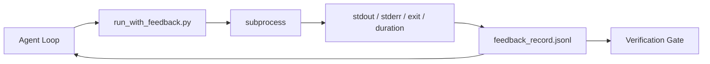

# Runtime Feedback Loops

> 看不到真实 command output 的 agents 只能猜。Feedback runner 会把 stdout、stderr、exit code 和 timing 捕获进结构化 record，下一轮可以读取。这样 agent 会响应事实，而不是响应自己对事实的预测。

**Type:** Build
**Languages:** Python (stdlib)
**Prerequisites:** Phase 14 · 32 (Minimal Workbench), Phase 14 · 35 (Init Script)
**Time:** ~50 minutes

## 学习目标

- 区分 runtime feedback 和 observability telemetry。
- 构建一个 feedback runner，包裹 shell commands 并持久化 structured records。
- 以 deterministic 方式截断大输出，让 loop 保持在 token budget 内。
- 当 feedback 缺失时，拒绝推进 loop。

## 问题

Agent 说 “running tests now”。下一条消息说 “all tests pass”。现实是没有任何 test 运行过。Agent 想象了输出，或者运行了 command 但从未读取结果，或者读取了结果却静默截断了失败行。

Feedback runner 会消除这个间隙。每个 command 都通过 runner。每条 record 都携带 command、captured stdout 和 stderr、exit code、wall-clock duration，以及一行 agent note。Agent 在下一轮读取 record。Verification gate 在任务结束时读取这些 records。

## 概念



### Feedback record 里放什么

| Field | 为什么重要 |
|-------|------------|
| `command` | 精确 argv，避免 shell expansion 意外 |
| `stdout_tail` | 最后 N 行，deterministic truncation |
| `stderr_tail` | 最后 N 行，和 stdout 分开 |
| `exit_code` | 明确无歧义的成功信号 |
| `duration_ms` | 暴露 slow probes 和 runaway processes |
| `started_at` | 用于 replay 的 timestamp |
| `agent_note` | Agent 写的一行预期说明 |

### Truncation 是 deterministic

50 MB log 会摧毁 loop。Runner 会用 `...truncated N lines...` marker 截取 head 和 tail，并保持 deterministic，所以同一份输出总会生成同一条 record。不做 sampling；agent 最需要看的部分（final error、final summary）通常在 tail。

### Feedback versus telemetry

Telemetry（Phase 14 · 23，OTel GenAI conventions）用于 human operators 跨时间 review runs。Feedback 用于这一次 run 的下一轮。它们共享一些字段，但存在不同文件里，也有不同 retention。

### 没有 feedback 就拒绝推进

如果 runner 在捕获 exit 前出错，record 会带 `exit_code: null` 和 `error: <reason>`。Agent loop 必须拒绝在 `null` exit 上宣称成功。没有 exit，就没有 progress。

## Build It

`code/main.py` 实现：

- `run_with_feedback(command, agent_note)`：包裹 `subprocess.run`，捕获 stdout/stderr/exit/duration，deterministically truncate，并 append 到 `feedback_record.jsonl`。
- 一个小 loader，把 JSONL stream 读入 Python list。
- 一个 demo，运行三个 commands（success、failure、slow），并打印每个 command 的最后一条 record。

运行：

```bash
python3 code/main.py
```

输出：三条 feedback records 会 append 到 `feedback_record.jsonl`，每个 command 的最后一条会 inline 打印。跨多次 re-run tail 这个文件，可以看到 loop 持续累积。

## Production patterns in the wild

三种 patterns 能把 runner 加固到可上线程度。

**Redact at write, not at read.** 任何接触 stdout 或 stderr 的 record 都可能泄露 secrets。Runner 在 JSONL append 前运行 redaction pass：移除匹配 `^Bearer `、`password=`、`api[_-]?key=`、`AKIA[0-9A-Z]{16}`（AWS）、`xox[baprs]-`（Slack）的 lines。Read time redaction 是 foot-gun；磁盘上的文件才是 attacker 能触达的东西。每季度根据 production runtime 观察到的 secret formats 审计 redaction patterns。

**Rotation policy, not a single file.** 把 `feedback_record.jsonl` 限制在每个文件 1 MB；超过后 rotate 到 `.1`、`.2`，丢弃 `.5`。Agent loop 只读取当前文件，所以 runtime cost 有界。CI artifact storage 保存完整 rotated set。没有 rotation 时，这个文件会成为每次 loader call 的瓶颈。

**Parent-command id for retry chains.** 每条 record 都有 `command_id`；retry records 携带 `parent_command_id`，指向上一轮尝试。Reviewer 的 “failed attempts” list（Phase 14 · 40）和 verification gate 的 audit 都会沿着这条链追踪。没有这个 link，retries 会看起来像独立 successes，audit 会隐藏失败历史。

## Use It

Production patterns：

- **Claude Code Bash tool.** 这个 tool 已经捕获 stdout、stderr、exit 和 duration。本课中的 runner 是任何 agent product 都能使用的 framework-agnostic 等价物。
- **LangGraph nodes.** 用 runner 包裹任何 shell node，让 record 持久化到 graph state 之外。
- **CI logs.** 把 JSONL pipe 到 CI artifact store；reviewers 可以 replay 任何 command，而不必重新运行 session。

Runner 是一个薄 wrapper，因为它拥有 record shape，所以可以活过每一次 framework migration。

## Ship It

`outputs/skill-feedback-runner.md` 会生成一个 project-specific `run_with_feedback.py`，包含正确的 truncation budget、接入 workbench 的 JSONL writer，以及 agent 每轮读取的 loader。

## 练习

1. 给每条 record 添加 `cwd` 字段，这样同一个 command 从不同目录运行时可以区分。
2. 添加一个 `redaction` step，移除匹配 `^Bearer ` 或 `password=` 的 lines。用 fixture record 测试它。
3. 把 `feedback_record.jsonl` 总大小限制在 1 MB，通过 rotate 到 `.1`、`.2` 文件实现。说明你的 rotation policy。
4. 添加 `parent_command_id`，让 retry chains 可见：哪个 command 产生了下一个 command 消费的 input。
5. 把 JSONL pipe 到一个小 TUI，高亮最新的 non-zero exit。列出这个 TUI 在 review 中有用所必须展示的八个关键 features。

## 关键术语

| Term | 常见说法 | 实际含义 |
|------|----------|----------|
| Feedback record | “Run log” | 带 command、output、exit、duration 的结构化 JSONL entry |
| Tail truncation | “Trim the log” | Deterministic head+tail capture，让 records 能放进 token budget |
| Refuse-on-null | “Block on missing data” | 当 `exit_code` 为 null 时，loop 不能推进 |
| Agent note | “Expectation tag” | Agent 在读取结果前写下的一行 prediction |
| Telemetry split | “Two log files” | Feedback 给下一轮使用，telemetry 给 operator 使用 |

## 延伸阅读

- [OpenTelemetry GenAI semantic conventions](https://opentelemetry.io/docs/specs/semconv/gen-ai/)
- [Anthropic, Effective harnesses for long-running agents](https://www.anthropic.com/engineering/effective-harnesses-for-long-running-agents)
- [Guardrails AI x MLflow — deterministic safety, PII, quality validators](https://guardrailsai.com/blog/guardrails-mlflow) — redaction patterns as regression tests
- [Aport.io, Best AI Agent Guardrails 2026: Pre-Action Authorization Compared](https://aport.io/blog/best-ai-agent-guardrails-2026-pre-action-authorization-compared/) — pre/post-tool capture
- [Andrii Furmanets, AI Agents in 2026: Practical Architecture for Tools, Memory, Evals, Guardrails](https://andriifurmanets.com/blogs/ai-agents-2026-practical-architecture-tools-memory-evals-guardrails) — observability surfaces
- Phase 14 · 23 — OTel GenAI conventions for the telemetry side
- Phase 14 · 24 — agent observability platforms (Langfuse, Phoenix, Opik)
- Phase 14 · 33 — the rule that demands feedback before declaring done
- Phase 14 · 38 — the verification gate that reads the JSONL
