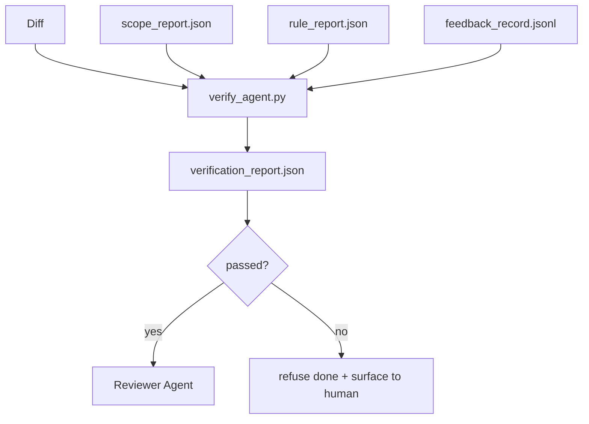

# Verification Gates

> Agent 不能自己把自己的工作标成 done。Verification gate 会读取 scope contract、feedback log、rule report 和 diff，然后回答一个问题：这个任务真的完成了吗？如果 gate 说没有完成，那么不管 chat 里怎么说，这个任务都没有完成。

**Type:** Build
**Languages:** Python (stdlib)
**Prerequisites:** Phase 14 · 33 (Rules), Phase 14 · 36 (Scope), Phase 14 · 37 (Feedback)
**Time:** ~55 minutes

## 学习目标

- 把 verification gate 定义为作用在 workbench artifacts 上的 deterministic function。
- 把 rule report、scope report、feedback records 和 diff 合并成一个 verdict。
- 输出一个 reviewer agent 和 CI 都能读取的 `verification_report.json`。
- 任何 block-severity failure 都无例外拒绝推进任务。

## 问题

Agents 太容易宣布成功。三种失败形态最常见：

- “Looks good.” 模型读了自己的 diff，然后判定它正确。
- “Tests passed.” 说得很自信，却没有测试真正运行过的记录。
- “Acceptance met.” Acceptance criteria 被解释得足够宽，宽到 “看起来像完成了” 也算。

Workbench 的修复方式是一个单一 verification gate：它读取 agent 已经产出的 artifacts，并做最终判断。Gate 是 deterministic 的。Gate 在 version control 里。Gate 接入 CI。Agent 贿赂不了它。

## 概念



### Gate 检查什么

| Check | Source artifact | Severity |
|-------|-----------------|----------|
| 所有 acceptance commands 都运行过 | `feedback_record.jsonl` | block |
| 所有 acceptance commands 都以 zero exit 退出 | `feedback_record.jsonl` | block |
| Scope check 没有 forbidden writes | `scope_report.json` | block |
| Scope check 没有 off-scope writes | `scope_report.json` | block or warn |
| 所有 block-severity rules 通过 | `rule_report.json` | block |
| Feedback 中没有 `null` exit codes | `feedback_record.jsonl` | block |
| Touched files 匹配 `scope.allowed_files` | both | warn |

`warn` finding 会注释 verdict；`block` finding 会阻止 `passed: true`。

### Deterministic，而不是 probabilistic

同一组 artifacts，gate 必须每次产出同一个 verdict。不要用 LLM judges。LLM judges 属于 reviewer side（Phase 14 · 39），那里目标是 qualitative evaluation，而不是状态判断。

### 一个 report，一个路径

Gate 每次 task close-out 都输出一个 `verification_report.json`，写在 `outputs/verification/<task_id>.json`。CI 读取同一路径。多个 gates 写不同路径，会分裂 source of truth。

### 无例外拒绝

Block-severity findings 不能被 agent override。只能由 human override，并且必须记录 `override_reason` 和 `overridden_by` user id。Override 是一个 signed change，不是 agent decision。

## Build It

`code/main.py` 实现了：

- 每个 input artifact 的 loader；为了让课程自包含，这些 artifacts 都在本地 stub。
- 一个 `verify(task_id, artifacts) -> VerdictReport` pure function。
- 一个 printer，展示 per-check results 和最终 pass/fail。
- 三个 task scenarios demo：clean pass、scope creep、missing acceptance。

运行它：

```bash
python3 code/main.py
```

输出是三个 verdict reports，每个都保存在脚本旁边。

## 野外生产模式

四个模式能把 gate 从 “另一个 lint job” 提升成 “决定性的边界”。

**Defense-in-depth，而不是单一 gate。** Pre-commit hook → CI status check → pre-tool authz hook → pre-merge gate。每一层都是 deterministic，因此一层漏掉的失败会被下一层抓住。microservices.io 2026 年 3 月 playbook 明确指出：pre-commit hook 是 non-bypassable 的，因为它不像 model-side skill 那样依赖 agent 遵守指令。Verification gate 位于 CI / pre-merge 层。

**用 deterministic check 防守，model-judge 只处理 nuance。** Anthropic 2026 Hybrid Norm pairing：可验证 rewards（unit tests、schema checks、exit codes）回答 “代码是否解决了问题？”；LLM rubrics 回答 “代码是否可读、安全、符合风格？” Gate 跑第一类；reviewer（Phase 14 · 39）跑第二类。混用会让信号坍塌。

**Signed override log，而不是 Slack threads。** 每次 override 都会在 `outputs/verification/overrides.jsonl` 中写一行，包含：timestamp、finding code、reason、signing user、current HEAD commit。Runtime 会拒绝任何缺少 signature 的 override；audit trail 被 git-tracked。这是 override policy 和 override theater 的分界线。

**Coverage floor 是 first-class check。** `coverage_report.json` 会喂给 `coverage_floor`（默认 80%）检查。如果 measured coverage 掉到 floor 以下，或比上次 merge 的 floor 低超过 1 个百分点，gate 会失败。没有这个检查，agents 会悄悄删除失败的 tests，而 verification reports 依然保持绿色。

**`--strict` mode 会把 warns 升级为 blocks。** 对 release branches、ship-blocking PRs 或 post-incident triage，`--strict` 会把每个 warning 都变成 hard fail。这个 flag 按 branch opt-in；不作为全局默认，因为 everything-strict 会腐蚀日常流程。

## Use It

生产模式：

- **CI step.** `verify_agent` job 会针对 agent 的 final artifacts 运行 gate。Merge protection 没有 `passed: true` 就拒绝。
- **Pre-handoff hook.** Agent runtime 在生成 handoff doc 前调用 gate。没有 green verdict，就没有 handoff。
- **Manual triage.** 当 agent 声称成功而 human 怀疑时，operators 阅读 report。

Gate 是 workbench flow 中的 deciding edge。所有其他 surface 都在它上游。

## Ship It

`outputs/skill-verification-gate.md` 会把 gate 接入具体项目：哪些 acceptance commands 喂给它，哪些 rules 是 block-severity，哪些 off-scope writes 可以容忍，override audit log 如何存储。

## 练习

1. 添加一个 `coverage_floor` check：test command 必须产生至少 80% 的 coverage report。决定哪个 artifact 携带 floor。
2. 支持 `--strict` mode，把每个 `warn` 升级成 `block`。记录 strict mode 适合作为默认值的场景。
3. 让 gate 除了 JSON 外也产生 Markdown summary。说明哪些字段应该进入 summary。
4. 添加 `time_since_last_human_touch` check：human keystroke 后 60 秒内编辑过的任何文件，都免于 off-scope flags。
5. 在你产品中的真实 agent diff 上运行 gate。有多少 findings 是真实问题，有多少是噪音？Gate 需要在哪里成长？

## 关键术语

| Term | What people say | What it actually means |
|------|----------------|------------------------|
| Verification gate | "The check that stops things" | 作用在 workbench artifacts 上、产出 pass/fail verdict 的 deterministic function |
| Block severity | "Hard fail" | 会阻止 `passed: true`，且需要 signed override 的 finding |
| Override log | "Why we let it through" | 带 reason 和 user id 的 signed entries，由 review 审计 |
| Acceptance command | "The proof" | 一个 shell command；其 zero exit 就是 `done` 的含义 |
| One report path | "Source of truth" | `outputs/verification/<task_id>.json`，同时供 CI 和 humans 消费 |

## 延伸阅读

- [Anthropic, Harness design for long-running application development](https://www.anthropic.com/engineering/harness-design-long-running-apps)
- [OpenAI Agents SDK guardrails](https://platform.openai.com/docs/guides/agents-sdk/guardrails)
- [microservices.io, GenAI dev platform: guardrails](https://microservices.io/post/architecture/2026/03/09/genai-development-platform-part-1-development-guardrails.html)：pre-commit 到 CI 之间的 defense in depth。
- [ICMD, The 2026 Playbook for Agentic AI Ops](https://icmd.app/article/the-2026-playbook-for-agentic-ai-ops-guardrails-costs-and-reliability-at-scale-1776661990431)：approval-gate ladder（draft → approval → auto under thresholds）。
- [Type-Checked Compliance: Deterministic Guardrails (arXiv 2604.01483)](https://arxiv.org/pdf/2604.01483)：Lean 4 作为 deterministic gating 的上界。
- [logi-cmd/agent-guardrails — merge gate spec](https://github.com/logi-cmd/agent-guardrails)：scope + mutation-testing gates。
- [Guardrails AI x MLflow](https://guardrailsai.com/blog/guardrails-mlflow)：deterministic validators as CI scorers。
- [Akira, Real-Time Guardrails for Agentic Systems](https://www.akira.ai/blog/real-time-guardrails-agentic-systems)：pre/post-tool gates。
- Phase 14 · 27：prompt injection defenses（gate 的 adversarial pair）。
- Phase 14 · 36：这个 gate 执行的 scope contract。
- Phase 14 · 37：这个 gate 评分的 feedback log。
- Phase 14 · 39：gate hand off 的 reviewer agent。
