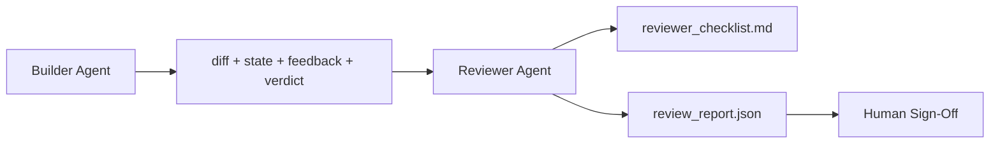

# Reviewer Agent：把 Builder 和 Marker 分开

> 写代码的 agent 不能给自己的代码打分。Reviewer 是第二个 loop：不同的 system prompt、不同的目标，并且对 builder 产出的所有东西只有只读访问。Builder 与 reviewer 之间的这道间隔，就是大部分可靠性的来源。

**Type:** Build
**Languages:** Python (stdlib)
**Prerequisites:** Phase 14 · 38 (Verification Gate)
**Time:** ~55 minutes

## 学习目标

- 说明为什么同一个 agent 无法可靠地 review 自己的工作。
- 构建一个 reviewer agent loop，消费 builder artifacts，并输出结构化 review report。
- 编写一个 reviewer rubric，按具体维度评分，而不是按感觉评分。
- 把 reviewer 接入 workbench，让人类 review step 从真实 artifact 开始。

## 问题

你让 agent 修一个 bug。它改了四个文件，跑了 tests，然后报告完成。Verification gate（Phase 14 · 38）确认 acceptance 已运行且 scope 受控。Gate 返回 `passed: true`。你合并。两天后你发现，这个 fix 只解决了 bug 的另一半。

Acceptance 是必要的，但不充分。Reviewer 会问 acceptance 无法回答的问题：这是否解决了正确的问题？它是否在没有说明的情况下扩大了 scope？它是否记录了本该被质疑的 assumptions？它是否把 workbench 留在了下一个 session 可以接上的状态？

## 概念



### Reviewer rubric

五个维度，每个维度 0 到 2 分。

| Dimension | Question |
|-----------|----------|
| Problem fit | Change 是否解决了任务陈述中的问题，而不是邻近问题？ |
| Scope discipline | Edits 是否限制在 contract 内，或者 contract 是否被有意扩展？ |
| Assumptions | 所有隐藏 assumptions 是否写在了可 review 的地方？ |
| Verification quality | Acceptance command 是否真正证明了目标，还是只证明了更弱版本？ |
| Handoff readiness | 下一个 session 是否能从当前 state 干净接上？ |

总分 10 分。低于 7 分是 soft fail；低于 5 分是 hard fail。

### Reviewer 是独立角色，不一定是独立模型

Reviewer 可以和 builder 使用同一个模型。纪律在于角色隔离：不同 system prompt、不同 inputs、对 diff 没有写权限。姿态变化就是信号变化。

### Reviewer 不能编辑 diff

Reviewer 读取 diff、state、feedback、verdict。它写 report。它不 patch diff。如果 report 说“修这个”，下一轮 builder turn 执行修复；reviewer 回到 review。混合角色会破坏这道间隔。

### Reviewer rubric 与 verification gate

Gate（Phase 14 · 38）检查 deterministic facts：acceptance 是否运行、rules 是否通过、scope 是否保持。Reviewer 做 qualitative judgments：这是不是正确的工作、是否有文档记录、handoff 是否可用。两者都需要。

## Build It

`code/main.py` 实现了：

- `ReviewerInputs` dataclass，打包 reviewer 会读取的 artifacts。
- Rubric scorer：每个维度一个 function。本课中每个 function 都是 deterministic 和 stub-grade；真实实现会调用 LLM。
- `review_report.json` writer，包含五个 scores、total 和 verdict（`pass`、`soft_fail`、`hard_fail`）。
- 两个 demo cases：一个 clean change，一个“tests 正确但问题错了”的 change。

运行：

```bash
python3 code/main.py
```

输出：两个 review reports 会写到磁盘，并在 console 中展示 dimensional scores 表。

## 生产中的常见模式

证据如下：Cloudflare 在 2026 年 4 月的 AI Code Review 系统，在 30 天内跨 5,169 个 repos、48,095 个 merge requests 运行了 131,246 次 review。Median review 用时 3 分 39 秒。最多七个 specialist reviewers（security、performance、code quality、docs、release management、compliance、Engineering Codex）会在 Review Coordinator 下并行运行，由 coordinator 去重 findings 并判断 severity。顶级模型只留给 coordinator；specialists 使用更便宜的 tiers。

四个模式让这件事可以 scale。

**Specialist pool, not one big reviewer.** 对 solo repo，一个带 5 维 rubric 的 reviewer 足够。一旦代码库有 security-critical、performance-critical 和 docs surfaces，就拆成更小 prompts 的 specialists。Coordinator 做 deduplication；specialists 永远不运行完整 rubric。Model-tier separation 自然出现：便宜 specialists，昂贵 coordinator。

**Bias mitigation as design requirement, not optimization.** LLM judges 稳定表现出四类 biases（Adnan Masood，2026 年 4 月）：position bias（GPT-4 在 (A,B) vs (B,A) ordering 上约 40% 不一致）、verbosity bias（长输出约 15% score inflation）、self-preference（judges 偏好同模型家族的 outputs）、authority（judges 会高估引用知名作者的内容）。缓解方法：同时评估两种 ordering，只计入一致胜出；使用明确奖励简洁的 1-4 scales；跨模型家族轮换 judges；评分前移除作者名。

**Calibration set, not vibes.** 准备一个包含 10-20 个历史 tasks、且 known correct verdicts 的集合。每次 prompt change 都在上面运行 reviewer。如果与历史记录的一致率低于 80%，就要先修订 rubric，再发布 reviewer。每个团队最终都会重新发现这一点；最好一开始就这么做。

**Hybrid norm with the gate.** Verification gate（Phase 14 · 38）处理 deterministic checks（acceptance 是否运行、tests 是否通过、scope 是否保持）。Reviewer 处理 semantic checks（是不是正确的工作、assumptions 是否记录、handoff 是否可用）。Anthropic 2026 年 guidance 对这个分工说得很明确：不要让 reviewer 重做 gate 已经证明的事。

## Use It

Production patterns：

- **Claude Code subagents.** Builder 关闭任务后，一个 reviewer subagent 运行。它会在 PR 上发布带 rubric scores 的 comment。
- **OpenAI Agents SDK handoffs.** Builder 在任务完成时 hand off 给 Reviewer。Reviewer 可以带 findings list 交还 builder，也可以升级给人类。
- **Two-model pairing.** Builder 使用更快、更便宜的模型。Reviewer 使用更强模型，并用更小 context 专注判断。

Reviewer 是 workbench 在人类无法亲自完成每个 review 时长出的第二双眼睛。

## Ship It

`outputs/skill-reviewer-agent.md` 会生成项目专用 reviewer rubric、接入 builder artifacts 的 reviewer agent stub，以及与 verification gate 的集成，让人类 review 从书面 report 开始，而不是从空白页开始。

## 练习

1. 添加第六个与你产品领域相关的维度。说明为什么它不能被现有五个维度吸收。
2. 用两个不同 system prompts（terse、verbose）运行 reviewer。哪一个生成的人类更可能阅读的 report？
3. 为每个维度添加 `confidence` 字段。当最低维度的 confidence 低于 0.6 时，拒绝发布 report。
4. 构建 calibration set：10 个有 known correct verdicts 的历史 task close-outs。在它们上运行 reviewer。它在哪里和历史记录不一致？
5. 添加一个“request more evidence” affordance：reviewer 可以在评分前向 builder 请求某个具体 test run。怎样的 back-off 才能防止它循环？

## 关键术语

| Term | What people say | What it actually means |
|------|----------------|------------------------|
| Reviewer rubric | "Checklist" | 五维 0-2 scoring，每个维度都有书面问题 |
| Soft fail | "Needs revisions" | 总分低于 7；builder 收到 findings 并处理 |
| Hard fail | "Reject" | 总分低于 5，或任一维度为 0；halt 并暴露给人类 |
| Role separation | "Different prompt" | 同一模型也能承担两个角色；纪律在于 inputs 和 posture |
| Confidence floor | "Don't ship low-signal reports" | Rubric 不确定时拒绝输出 verdict |

## 延伸阅读

- [OpenAI Agents SDK handoffs](https://platform.openai.com/docs/guides/agents-sdk/handoffs)
- [Anthropic Claude Code subagents](https://docs.anthropic.com/en/docs/agents-and-tools/claude-code/sub-agents)
- [Cloudflare, Orchestrating AI Code Review at Scale](https://blog.cloudflare.com/ai-code-review/)：7-specialist + coordinator architecture，131k runs / 30 days。
- [Agent-as-a-Judge: Evaluating Agents with Agents (OpenReview / ICLR)](https://openreview.net/forum?id=DeVm3YUnpj)：DevAI benchmark，366 hierarchical solution requirements。
- [Adnan Masood, Rubric-Based Evaluations and LLM-as-a-Judge: Methodologies, Biases, Empirical Validation](https://medium.com/@adnanmasood/rubric-based-evals-llm-as-a-judge-methodologies-and-empirical-validation-in-domain-context-71936b989e80)：4 类 biases 与 mitigations。
- [MLflow, LLM-as-a-Judge Evaluation](https://mlflow.org/llm-as-a-judge)：separated builder/evaluator 的 production tooling。
- [LangChain, How to Calibrate LLM-as-a-Judge with Human Corrections](https://www.langchain.com/articles/llm-as-a-judge)：calibration-set workflow。
- [Evidently AI, LLM-as-a-judge: a complete guide](https://www.evidentlyai.com/llm-guide/llm-as-a-judge)
- [Arize, LLM as a Judge — Primer and Pre-Built Evaluators](https://arize.com/llm-as-a-judge/)
- Phase 14 · 05：Self-Refine and CRITIC（single-agent self-review baseline）。
- Phase 14 · 30：Eval-driven agent development（calibration set generator）。
- Phase 14 · 38：reviewer 读取的 verification gate。
- Phase 14 · 40：reviewer report feeding 的 handoff packet。
