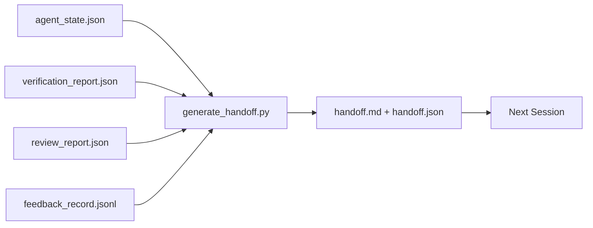

# Multi-Session Handoff

> Session 总会结束。工作不会。Handoff packet 是把 “agent 工作了一小时” 转成 “下一个 session 第一分钟就能 productive” 的 artifact。要有意识地构建它，而不是事后顺手补一段总结。

**Type:** Build
**Languages:** Python (stdlib)
**Prerequisites:** Phase 14 · 34 (Repo Memory), Phase 14 · 38 (Verification), Phase 14 · 39 (Reviewer)
**Time:** ~50 minutes

## 学习目标

- 识别每个 handoff packet 都需要的七个字段。
- 从 workbench artifacts 自动生成 handoff，而不是手写 prose。
- 把大型 feedback logs 裁剪成 handoff-sized summary。
- 让下一个 session 的 first action 变成 deterministic。

## 问题

Session 结束了。Agent 说 “great, we made progress.” 下一个 session 打开了。下一个 agent 问：“where did we leave off?” 第一个 agent 的答案已经没了。下一个 agent 重新发现、重新运行同样的 commands、重新问人类同样的问题，然后花三十分钟恢复上一个 session 最后三十秒的状态。

糟糕 handoff 的成本，会在任务生命周期里的每一个 session 反复支付。修复方式是在 session end 自动生成一个 packet：改了什么、为什么、试过什么、什么失败了、还剩什么、下一次先做什么。

## 概念



### 每个 handoff 都携带的七个字段

| Field | 它回答的问题 |
|-------|--------------|
| `summary` | 用一段话说明做了什么 |
| `changed_files` | 一眼看懂 diff |
| `commands_run` | 实际执行过什么 |
| `failed_attempts` | 试过什么，为什么没奏效 |
| `open_risks` | 下个 session 可能踩到什么，severity 是什么 |
| `next_action` | 下个 session 要采取的第一个具体步骤 |
| `verdict_pointer` | 指向 verification + review reports 的路径 |

`next_action` 是承重字段。一个 handoff 如果什么都有，唯独没有 `next_action`，那就是 status report，不是 handoff。

### Handoffs 是生成出来的，不是手写出来的

手写 handoff，就是会在困难的一天被跳过的 handoff。Generator 读取 workbench artifacts 并发出 packet。Agent 的工作是让 workbench 处在 generator 可以总结的状态，而不是亲手写 summary。

### 两种形式：human-readable 与 machine-readable

`handoff.md` 给人类阅读。`handoff.json` 给下一个 agent 加载。两者来自相同的 source artifacts。如果二者分歧，以 JSON 为准。

### Feedback log trimming

完整的 `feedback_record.jsonl` 可能有几百条 entries。Handoff 只携带最后 K 条，以及每一条 non-zero exit。下一个 session 如果需要，可以加载完整 log；但 packet 本身保持小而轻。

### 留下干净状态

Handoff 描述工作。Clean state 让工作可恢复。它们不是同一件事。如果下一个 session 打开时看到的是半应用的 diff、agent 忘记清理的 temp file、游离 branch，以及 tests 在真正运行前就 error，那么再完美的 `handoff.md` 也没有价值。下一个 agent 会把前十分钟花在清理上一个 agent 的残局，而不是继续构建；这个成本会在任务生命周期里每个 session 复利增长。

所以 session 不是在 feature works 时结束。它是在 workbench 处于 generator 可以总结、下一个 session 可以信任的状态时结束。Cleanup 是 handoff 之前独立的 phase，而且它是一项 check，不是习惯，因为习惯正是在困难的一天会被跳过的东西。

| Check | Clean means | Dirty blocks because |
|-------|-------------|----------------------|
| Working tree | 每个 change 都已 commit，或带 note 明确 stash | 半应用 diff 对下一个 agent 来说看起来像 intentional work |
| Temp artifacts | 没有 `*.tmp`、scratch dirs、debug prints 或 commented-out blocks 遗留 | Stray files 污染 diff 和下一个 agent 的 mental model |
| Tests | Green，或 red 且 failure 已在 `open_risks` 中命名 | Silent red test 是下个 session 会踩进去的 trap |
| Feature board | `feature_list.json` status 反映现实（Phase 14 · 36） | Stale board 会把下个 session 指向已经完成的工作 |
| Branch | 位于 expected branch，没有 detached HEAD，没有 orphan branches | Wrong branch 意味着下个 session 的第一个 commit 会落在错误位置 |

Cleanup phase 会发出一个包含 blocking issues 的 `clean_state.json`；空列表是 handoff generator 写入 packet 前断言的 precondition。建立在 dirty tree 上的 handoff 不是 handoff，而是转发出去的一团混乱。这两个 artifacts 成对出现：cleanup 证明 workbench 可以安全离开，handoff 证明下一个 session 知道从哪里开始。

## Build It

`code/main.py` 实现：

- 一个 loader，会把 state、verdict、review 和 feedback 汇总成单个 `WorkbenchSnapshot`。
- 一个 `generate_handoff(snapshot) -> (markdown, payload)` function。
- 一个 filter，会选出最后 K 条 feedback entries，以及所有 non-zero exits。
- 一个 demo run，会在 script 旁边写出 `handoff.md` 和 `handoff.json`。

运行：

```bash
python3 code/main.py
```

输出：打印出的 handoff body，以及磁盘上的两个文件。

## Production patterns in the wild

Codex CLI、Claude Code 和 OpenCode 各自提供不同的 compaction story；structured handoff packet 位于三者之上。

**Compaction strategies vary; the packet schema does not.** Codex CLI 的 POST /v1/responses/compact 是 server-side opaque AES blob（OpenAI models 的 fast path）；fallback 是本地 “handoff summary”，以 `_summary` user-role message 追加。Claude Code 在 95% context 时运行 five-stage progressive compaction。OpenCode 使用 timestamp-based message hiding 加 5-heading LLM summary。三种不同机制，同一个需求：把 compression 后仍要保留下来的内容序列化成 portable artifact。Packet 就是这个 artifact。

**Fresh-session handoff is not compaction.** Compaction 延长一个 session；handoff 干净地关闭一个 session 并启动下一个。Hermes Issue #20372 的 framing（April 2026）是对的：当 in-place compression 开始退化时，agent 应该写出 compact handoff，结束 session，并在 fresh context 中恢复。Packet 让这个 transition 变得便宜。错误做法是一直压缩到质量崩掉；正确做法是为早期、干净的 handoff 预留预算。

**One active handoff per branch and topic.** Multi-agent coordination 崩掉，更多时候是因为 stale handoffs，而不是 bad model output。始终包含 `branch`、`last_known_good_commit`，以及 `active | superseded | archived` 的 `status`。Stale handoffs 会被 archived；只有 active handoff 驱动下一个 session。这就是 handoff-as-notes 和 handoff-as-state 的区别。

**Wrap up before 50-75% context, not at the wall.** 手写模式 playbook（CLAUDE.md + HANDOVER.md）报告说，在 50-75% context budget 时结束 session，比拖到 95% 效果更好。Packet generator 会在 compression artifacts 污染 source state 之前干净运行。Context 还完整时写很便宜；model 已经开始迷路时就很贵。

## Use It

Production patterns：

- **Session-end hook.** Runtime 在用户关闭 chat 时触发 generator。Packet 写入 `outputs/handoff/<session_id>/`。
- **PR template.** Generator 的 markdown 也可以作为 PR body。Reviewers 不用打开五个其他文件就能阅读。
- **Cross-agent handoff.** 用一个产品构建（Claude Code），用另一个继续（Codex）。Packet 是 lingua franca。

Packet 小、规则、便宜。每跨过一个 session，节省都会复利增长。

## Ship It

`outputs/skill-handoff-generator.md` 会产出一个针对项目 artifact paths 调整过的 generator，一个运行它的 end-of-session hook，以及一个下一个 agent 在 startup 时读取的 `handoff.json` schema。

## 练习

1. 添加一个 `assumptions_to_validate` 字段，暴露 builder 记录但 reviewer 没有打到 1 分以上的每个 assumption。
2. 对 failing runs 和 passing runs 使用不同的 feedback summary trimming。为这种不对称做辩护。
3. 包含一个 “questions for the human” list。一个 question 进入 packet，而不是 chat message 的阈值是什么？
4. 让 generator idempotent：运行两次产出同一个 packet。哪些东西必须稳定，才能成立？
5. 添加一个 “next session prereqs” section，精确列出下一个 session 行动前必须加载的 artifacts。

## 关键术语

| Term | 常见说法 | 实际含义 |
|------|----------|----------|
| Handoff packet | “Session summary” | 同时携带 markdown 和 JSON、包含七个字段的 generated artifact |
| Next action | “What to do first” | 启动下一个 session 的那个具体步骤 |
| Feedback trim | “Log summary” | 最后 K 条 records 加每一条 non-zero exit |
| Status report | “What we did” | 缺少 `next_action` 的 document；有用，但不是 handoff |
| Verdict pointer | “Receipt” | 指向 verification + review reports 的路径，用于 traceability |

## 延伸阅读

- [Anthropic, Effective harnesses for long-running agents](https://www.anthropic.com/engineering/effective-harnesses-for-long-running-agents)
- [OpenAI Agents SDK handoffs](https://platform.openai.com/docs/guides/agents-sdk/handoffs)
- [Codex Blog, Codex CLI Context Compaction: Architecture, Configuration, Managing Long Sessions](https://codex.danielvaughan.com/2026/03/31/codex-cli-context-compaction-architecture/) — POST /v1/responses/compact and local fallback
- [Justin3go, Shedding Heavy Memories: Context Compaction in Codex, Claude Code, OpenCode](https://justin3go.com/en/posts/2026/04/09-context-compaction-in-codex-claude-code-and-opencode) — three-vendor compaction comparison
- [JD Hodges, Claude Handoff Prompt: How to Keep Context Across Sessions (2026)](https://www.jdhodges.com/blog/ai-session-handoffs-keep-context-across-conversations/) — CLAUDE.md + HANDOVER.md, 50-75% context budget
- [Mervin Praison, Managing Handoffs in Multi-Agent Coding Sessions: Fresh Context Without Losing Continuity](https://mer.vin/2026/04/managing-handoffs-in-multi-agent-coding-sessions-fresh-context-without-losing-continuity/) — distributed-systems framing
- [Hermes Issue #20372 — automatic fresh-session handoff when compression becomes risky](https://github.com/NousResearch/hermes-agent/issues/20372)
- [Hermes Issue #499 — Context Compaction Quality Overhaul](https://github.com/NousResearch/hermes-agent/issues/499) — handoff-oriented prompts in Codex CLI
- [Microsoft Agent Framework, Compaction](https://learn.microsoft.com/en-us/agent-framework/agents/conversations/compaction)
- [OpenCode, Context Management and Compaction](https://deepwiki.com/sst/opencode/2.4-context-management-and-compaction)
- [LangChain, Context Engineering for Agents](https://www.langchain.com/blog/context-engineering-for-agents)
- Phase 14 · 34 — generator 读取的 state file
- Phase 14 · 38 — packet 指向的 verification verdict
- Phase 14 · 39 — 打包进 packet 的 reviewer report
