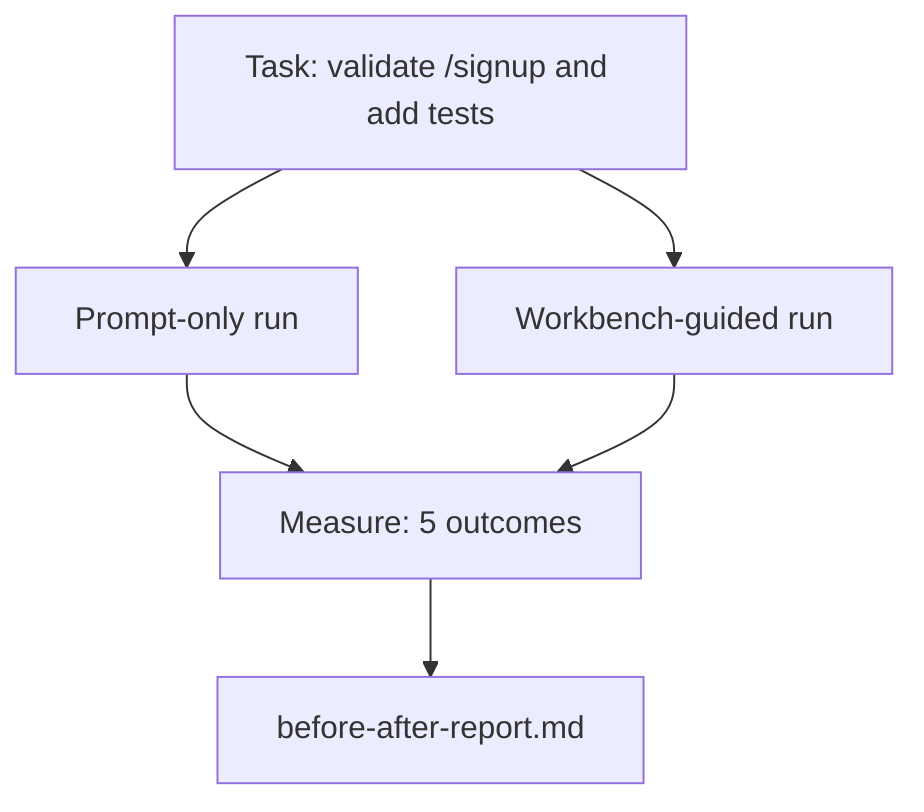

# 真实 Repo 上的 Workbench

> 十一课讲完的 surfaces，如果不能经受真实 codebase 的接触，就毫无价值。本课会在一个小型 sample app 上把同一个任务跑两遍：prompt-only 与 workbench-guided。让数字自己争辩。

**Type:** Build
**Languages:** Python (stdlib)
**Prerequisites:** Phases 14 · 32 to 14 · 40
**Time:** ~60 minutes

## 学习目标

- 把七个 workbench surfaces 汇总到一个小型应用上。
- 把同一个任务跑两遍（prompt-only 和 workbench-guided），并测量五个 outcomes。
- 阅读 before/after report，判断哪些 surfaces 杠杆最大。
- 面对 “but my model is good enough” 的质疑，为 workbench 辩护。

## 问题

玩具任务上的 demo 说服不了任何人。Workbench 的论据成立于：一个真实感任务落在一个真实感 repo 上，能以更少 failures、更少 reverts，以及一个下个 session 可用的 packet 进入生产。

本课交付这个真实感 repo，并让同一个任务经过两条 pipelines。结果是一份 before/after report，你可以直接交给怀疑者。

## 概念



### Sample app

`sample_app/` 中有一个 minimal FastAPI-style handler：

- `app.py`，包含 `/signup`（还没有 validation）。
- `test_app.py`，包含一个 happy-path test。
- `README.md` 和 `scripts/release.sh`，作为 forbidden-zone bait。

### 任务

> 给 `/signup` 添加 input validation：拒绝少于 8 个字符的 passwords，返回 422 和 typed error envelope。添加一个测试证明新行为。

### 两条 pipelines

Prompt-only：

1. 读取 README。
2. 读取 `app.py`。
3. 编辑文件。
4. 声称完成。

Workbench-guided：

1. 运行 init script（第 35 课）。
2. 读取 scope contract（第 36 课）。
3. 读取 state（第 34 课）。
4. 只编辑 allowed files。
5. 通过 feedback runner 运行 acceptance command（第 37 课）。
6. 运行 verification gate（第 38 课）。
7. 运行 reviewer（第 39 课）。
8. 生成 handoff（第 40 课）。

### 测量的五个 outcomes

| Outcome | Why it matters |
|---------|----------------|
| `tests_actually_run` | 大多数 “tests passed” 声明无法验证 |
| `acceptance_met` | 证明目标完成的 test，必须就是实际运行过的 test |
| `files_outside_scope` | Scope creep 是主要的静默 failure |
| `handoff_quality` | 下一个 session 会为它付出代价，或从中受益 |
| `reviewer_total` | 在 gate 之上的定性判断 |

## Build It

`code/main.py` 会在同一个 sample app fixture 上编排两条 pipelines。两条 pipelines 都是 scripted（没有 LLM in the loop），所以测量可复现。脚本会把对比写入 `before-after-report.md` 和 `comparison.json`。

运行它：

```bash
python3 code/main.py
```

输出：每条 pipeline 的 outcomes console table、保存到脚本旁边的 markdown report，以及给想画图的人使用的 JSON。

## 真实生产中的 patterns

怀疑者的问题是：“workbench 到底帮了多少？” 2026 年的数字比解释更有说服力。

**Terminal Bench Top-30 to Top-5 on the same model.** LangChain 的 *Anatomy of an Agent Harness*（2026 年 4 月）：一个 coding agent 只改 harness，就从 Terminal Bench 2.0 的 30 名开外跳到第 5。模型相同。Surfaces 不同。二十五名的差距。

**Vercel 80% to 100% by deleting tools.** Vercel 报告说，删掉 agent 80% 的 tools 后，success rate 从 80% 提升到 100%。Tool surface 更小，scope 更锋利，失败路径更少。负空间胜出。

**Harvey 2x accuracy via harness alone.** Legal agents 仅通过 harness optimization，就把 accuracy 提高到两倍以上，没有换模型。

**88% of enterprise AI agent projects fail to reach production.** preprints.org 的 *Harness Engineering for Language Agents* 论文（2026 年 3 月）把失败追踪到 runtime，而不是 reasoning：stale state、brittle retries、overgrown context，以及从中间错误恢复不佳。

**Long-context collapse.** WebAgent baseline 40-50% success 在 long-context conditions 下跌到 10% 以下，主要原因是 infinite loops 和 goal loss。Ralph Loop 和 handoff packet 就是为了吸收这类问题。

**False negatives still exist.** 单步事实任务、一行 lint、formatter runs、模型逐字记住的东西——这些 prompt-only 更快。Benchmark 应该诚实列出这些情况，避免把 workbench 描述成过度工程。

结论不是 “harness 永远获胜”。模型会随着时间吸收 harness tricks。结论是：今天，engineering load 位于七个 surfaces 中，而数字证明了这一点。

## Use It

当出现这些情况时，本课就是你引用的 case file：

- 有人问为什么每个 PR 都带 `agent-rules.md` 和 scope contract。
- 团队想 “just for this sprint” 丢掉 verification gate。
- 新 agent product 发布了，而你需要一个 portable benchmark 来判断它是否真的节省时间。

数字比解释更容易传播。

## Ship It

`outputs/skill-workbench-benchmark.md` 是一个 portable evaluation harness。它会针对项目自己的 sample app，让任意 agent product 同时跑两条 pipelines，并报告五个 outcomes。

## 练习

1. 添加第六个 outcome：time-to-first-meaningful-edit。怎样才能干净地测量它？
2. 在你 codebase 中一个真实的 second-day task 上运行对比。Workbench 的数字在哪里滑落？
3. 添加一个 “false negative” pass：列出 prompt-only 更快、workbench overhead 是真实成本的任务。然后为继续保留 workbench 辩护。
4. 把 scripted “agent” 换成真实 LLM call。哪些 outcomes 会变得更有噪声？
5. 写一页面向非工程师的 summary。哪些内容能留下？

## 关键术语

| Term | What people say | What it actually means |
|------|----------------|------------------------|
| Sample app | “Toy repo” | 小但足够真实，能覆盖全部七个 surfaces |
| Pipeline | “Workflow” | Agent 遵循的一组有序 surface reads/writes |
| Before/after report | “The receipts” | 交给怀疑者的 artifact |
| False negative | “Workbench overkill” | Prompt-only 更快的任务；诚实列出很有用 |
| Workbench benchmark | “Reliability score” | 在你的 codebase 上运行对比的 portable harness |

## 延伸阅读

- [LangChain, The Anatomy of an Agent Harness](https://blog.langchain.com/the-anatomy-of-an-agent-harness/)：Terminal Bench Top-30 to Top-5 receipt。
- [MongoDB, The Agent Harness: Why the LLM Is the Smallest Part of Your Agent System](https://www.mongodb.com/company/blog/technical/agent-harness-why-llm-is-smallest-part-of-your-agent-system)：Vercel + Harvey numbers。
- [preprints.org, Harness Engineering for Language Agents](https://www.preprints.org/manuscript/202603.1756)：88% enterprise failure rate、runtime root causes。
- [HN: Improving 15 LLMs at Coding in One Afternoon. Only the Harness Changed](https://news.ycombinator.com/item?id=46988596)：replicated across 15 models。
- [Cloudflare, Orchestrating AI Code Review at Scale](https://blog.cloudflare.com/ai-code-review/)：30 天生产中 131k review runs。
- [Anthropic, Building Effective Agents](https://www.anthropic.com/research/building-effective-agents)
- Phases 14 · 32 to 14 · 40：本课端到端 exercise 的 surfaces。
- Phase 14 · 19：SWE-bench、GAIA、AgentBench，本课补充的 macro benchmarks。
- Phase 14 · 30：同一个 harness 可接入的 eval-driven agent development。
