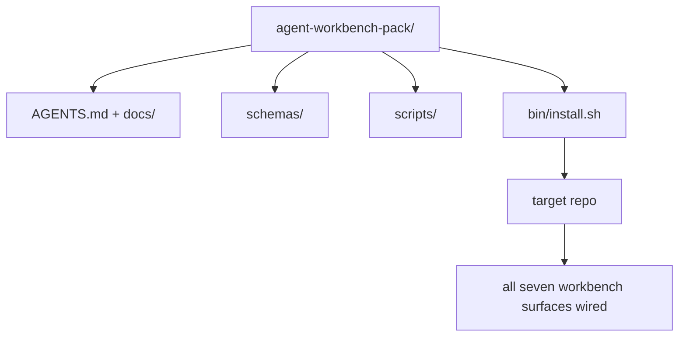

# Capstone：发布可复用的 Agent Workbench Pack

> 这个 mini-track 以一个可以丢进任意 repo 的 pack 收尾。十一课的 surfaces 被压缩成一个目录，你可以 `cp -r`，第二天早上就拥有一个可靠工作的 agent。这个 capstone 就是本课程交付价值的 artifact。

**Type:** Build
**Languages:** Python (stdlib)
**Prerequisites:** Phases 14 · 31 to 14 · 41
**Time:** ~75 minutes

## 学习目标

- 把七个 workbench surfaces 打包成一个 drop-in directory。
- Pin schemas、scripts 和 templates，让新 repo 获得一个 known-good baseline。
- 添加一个 installer script，以 idempotent 方式放置 pack。
- 决定哪些内容留在 pack 中，哪些留在外面，并为每个取舍辩护。

## 问题

一个存在于 Google Doc、chat history 和三个半记得的 scripts 里的 workbench，每个季度都会被重建一次。解法是 versioned pack：一个 repo 或目录，里面带 surfaces、schemas、scripts，以及一个 one-command installer。

完成本课时，你会在磁盘上交付 `outputs/agent-workbench-pack/`，并带有一个能把它放进任意 target repo 的 `bin/install.sh`。

## 概念



### Pack layout

```text
outputs/agent-workbench-pack/
├── AGENTS.md
├── docs/
│   ├── agent-rules.md
│   ├── reliability-policy.md
│   ├── handoff-protocol.md
│   └── reviewer-rubric.md
├── schemas/
│   ├── agent_state.schema.json
│   ├── task_board.schema.json
│   └── scope_contract.schema.json
├── scripts/
│   ├── init_agent.py
│   ├── run_with_feedback.py
│   ├── verify_agent.py
│   └── generate_handoff.py
├── bin/
│   └── install.sh
└── README.md
```

### 什么留在里面，什么留在外面

留在里面：

- Surface schemas。它们是 contract。
- 上面四个 scripts。它们是 runtime。
- 四份 docs。它们是 rules 和 rubric。

留在外面：

- Project-specific tasks。Tasks 属于 target repo 的 board，不属于 pack。
- Vendor SDK calls。Pack 是 framework-agnostic。
- Onboarding prose。Pack 放在团队现有 onboarding 旁边，而不是塞进 onboarding 里面。

### Installer

一个短小的 `bin/install.sh`（或 `bin/install.py`）：

1. 如果没有 `--force`，拒绝覆盖已有 pack。
2. 把 pack 复制到 target repo。
3. 如果存在 `.github/workflows/`，接入 CI。
4. 打印 next steps：填 board、设置 acceptance commands、运行 init script。

### Versioning

Pack 带有一个 `VERSION` 文件。需要 migrations 的 schema bumps 和 script changes 会 bump major。Doc-only changes bump patch。Target repo 的 `agent_state.json` 会记录它初始化时使用的 pack version。

## Build It

`code/main.py` 会在本 lesson 旁边把 pack 组装进 `outputs/agent-workbench-pack/`，内容来自这个 mini-track 前几课的 schemas、scripts 和你已经写好的 docs。

运行：

```bash
python3 code/main.py
```

脚本会 copy 并 pin surfaces，写入 README，打印 pack tree，然后以 zero exit 结束。重复运行是 idempotent。

## Production patterns in the wild

Pack 只有在能经受 forks、updates 和不友好的 upstream 时才有价值。四种 patterns 能让它做到这一点。

**`VERSION` is the contract, not the marketing.** Major bumps 需要 state migration。Minor bumps 需要 checker re-run。Patch bumps 只用于 doc-only。Installer 每次安装都会把 `.workbench-version` 写进 target repo；如果 target 的 lock 和 pack 的 `VERSION` 不一致，`lint_pack.py` 会拒绝 ship。这就是 `npm`、`Cargo` 和 `pyproject.toml` 经受十年变化的方式；agents 并不会改变这些规则。

**Single source for cross-tool distribution.** Nx 发布一个 `nx ai-setup`，从单一 config 放置 `AGENTS.md`、`CLAUDE.md`、`.cursor/rules/`、`.github/copilot-instructions.md` 和 MCP server。Pack 也应该这么做；installer 生成 symlinks（`ln -s AGENTS.md CLAUDE.md`），让 single source of truth 扇出到每个 coding agent。为了支持某一个工具而 fork pack，是 failure mode。

**`uninstall.sh` that refuses on non-trivial state.** 卸载 pack 绝不能删除用户的 `agent_state.json`、`task_board.json` 或 `outputs/`。Uninstaller 会删除 schemas、scripts、docs 和 `AGENTS.md`（带 `--keep-agents-md` opt-out），并且如果 state files 有任何 uncommitted changes，就拒绝继续。State 属于用户；pack 不拥有它。

**Skill-as-publishable. SkillKit-style distribution.** Pack 作为 SkillKit skill 发布：`skillkit install agent-workbench-pack` 从单一来源把它放进 32 个 AI agents。Pack repo 是 source of truth；SkillKit 是 distribution channel。Vendor lock-in 消失；七个 surfaces 保持不变。

## Use It

Pack 有三种发布位置：

- **作为可以丢进 repo 的目录。** `cp -r outputs/agent-workbench-pack /path/to/repo`。
- **作为 public template repo。** Fork-and-customize，并用 `VERSION` 控制 drift。
- **作为 SkillKit skill。** 接入你的 agent product，让一个命令完成放置。

Pack 是 recipe。每次 install 是一份 serving。

## Ship It

`outputs/skill-workbench-pack.md` 会生成一个 project-tuned pack：rules 根据团队历史 sharpen，scope globs 匹配 repo，rubric dimensions 增加一个 domain-specific entry。

## 练习

1. 决定哪一份 optional fifth doc 值得晋升到 canonical pack。为这个取舍辩护。
2. 用 Python 重写 installer，并添加 `--dry-run` flag。和 bash 版本比较 ergonomics。
3. 添加一个 `bin/uninstall.sh`，安全删除 pack，并在 state files 有 non-trivial history 时拒绝。什么算 non-trivial？
4. 添加一个 `lint_pack.py`，当 pack 偏离 `VERSION` 时 fail。把它接入 pack 自己 repo 的 CI。
5. 写一份 migration runbook，把 hand-rolled workbench 迁移到这个 pack。怎样的操作顺序能最小化 downtime？

## 关键术语

| Term | 常见说法 | 实际含义 |
|------|----------|----------|
| Workbench pack | “The starter kit” | 携带全部七个 surfaces 的 versioned directory |
| Installer | “Setup script” | 以 idempotent 方式放置 pack 的 `bin/install.sh` |
| Pack version | “VERSION” | Schema/script changes bump major，doc-only bump patch |
| Drop-in pack | “cp -r and go” | 第一天无需 per-repo customization 就能工作的 pack |
| Forkable template | “GitHub template” | 可通过 GitHub “Use this template” 克隆的 public repo |

## 延伸阅读

- Phases 14 · 31 to 14 · 41 — every surface this pack bundles
- [SkillKit](https://github.com/rohitg00/skillkit) — install this skill across 32 AI agents
- [Nx Blog, Teach Your AI Agent How to Work in a Monorepo](https://nx.dev/blog/nx-ai-agent-skills) — single-source generator across six tools
- [agents.md — the open spec](https://agents.md/) — what your pack's router must implement
- [HKUDS/OpenHarness](https://github.com/HKUDS/OpenHarness) — reference implementation of a pack-equivalent
- [andrewgarst/agentic_harness](https://github.com/andrewgarst/agentic_harness) — Redis-backed reference with eval suite
- [Augment Code, A good AGENTS.md is a model upgrade](https://www.augmentcode.com/blog/how-to-write-good-agents-dot-md-files) — pack docs quality bar
- [Anthropic, Effective harnesses for long-running agents](https://www.anthropic.com/engineering/effective-harnesses-for-long-running-agents)
- [Anthropic, Harness design for long-running application development](https://www.anthropic.com/engineering/harness-design-long-running-apps)
- Phase 14 · 30 — eval-driven agent development that consumes the pack's verification gate
- Phase 14 · 41 — the before/after benchmark this pack improves on
