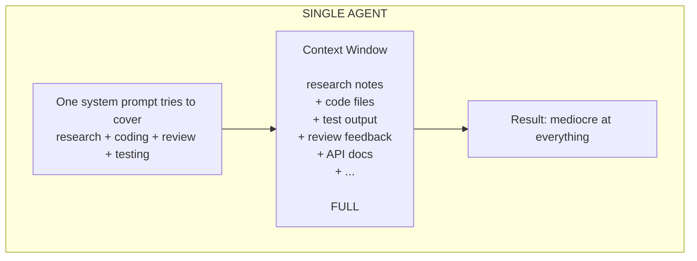
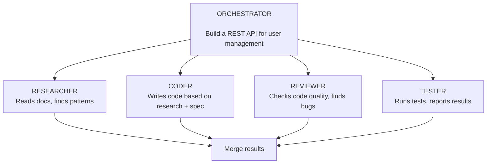
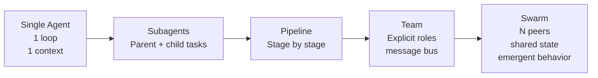
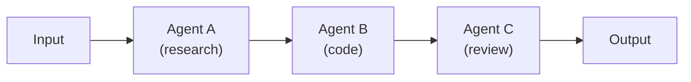
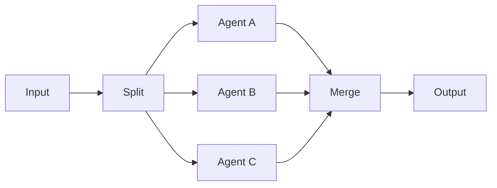
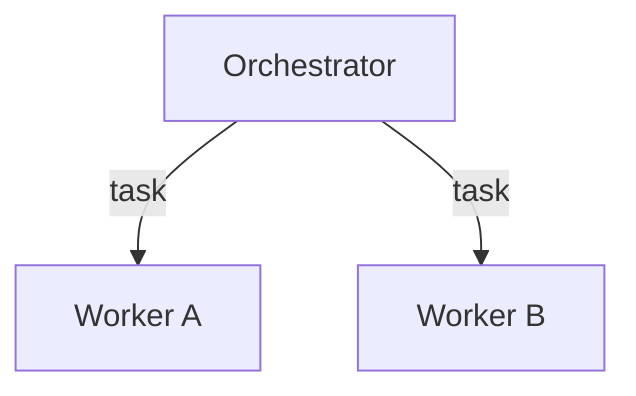
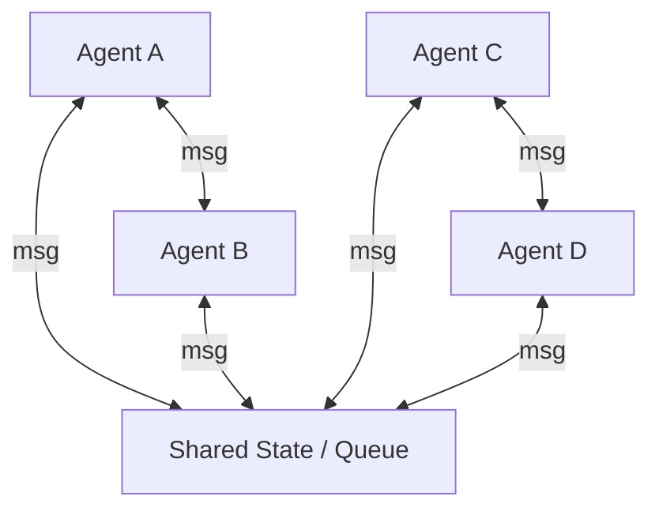

# 为什么要多 Agent？

> 一个 agent 撞到墙时，聪明的做法不是造一个更大的 agent，而是使用更多 agents。

**Type:** Learn
**Languages:** TypeScript
**Prerequisites:** Phase 14 (Agent Engineering)
**Time:** ~60 minutes

## 学习目标

- 识别 single-agent ceiling（context overflow、mixed expertise、sequential bottleneck），并解释什么时候应该拆成 multiple agents。
- 比较 orchestration patterns（pipeline、parallel fan-out、supervisor、hierarchical），并为给定 task structure 选择合适模式。
- 设计一个 multi-agent system，具备清晰的 role boundaries、shared state 和 communication contract。
- 分析 multi-agent complexity（latency、cost、debugging difficulty）与 single-agent simplicity 之间的取舍。

## 问题

你在 Phase 14 做出了一个 single agent。它能工作。它能读文件、运行命令、调用 API，并对结果进行推理。然后你把它指向一个真实 codebase：200 个文件、三种语言、依赖基础设施的测试，以及一个写代码前必须研究外部 API 的需求。

Agent 卡住了。不是因为 LLM 笨，而是因为任务超过了一个 agent loop 能处理的范围。Context window 被文件内容塞满。Agent 忘了 40 次 tool calls 之前读过什么。它试图同时当 researcher、coder 和 reviewer，结果三件事都做得不好。

这就是 single-agent ceiling。每当任务需要以下能力时，你都会撞上它：

- **超过一个 window 的上下文**：读取 50 个文件会轻松超过 200k tokens。
- **不同阶段需要不同专业性**：research 所需的 prompting 和 code generation 不一样。
- **可以并行发生的工作**：既然能同时读三个文件，为什么要按顺序读 file A、file B、file C？

## 概念

### Single-Agent Ceiling

Single agent 是一个 loop、一个 context window、一个 system prompt。可以这样理解：



三件事会坏掉：

1. **Context saturation**：tool results 越堆越多。到第 30 轮时，agent 已经消耗了 150k tokens 的文件内容、命令输出和之前推理。第 5 轮的关键细节会丢失。

2. **Role confusion**：一个写着“你是 researcher、coder、reviewer 和 tester”的 system prompt，会产生一个半研究、半写代码、永远没有真正完成 review 的 agent。

3. **Sequential bottleneck**：agent 先读 file A，再读 file B，再读 file C。三个串行 LLM calls，三个串行 tool executions，没有并行性。

### Multi-Agent Solution

把工作拆开。给每个 agent 一个 job、一个 context window、一个为该 job 调整过的 system prompt：



每个 agent 都有：

- 一个聚焦的 system prompt（“你是 code reviewer。你唯一的工作是找 bug。”）
- 自己的 context window（不被其他 agents 的工作污染）
- 清晰的 input/output contract（接收 research notes，输出 code）

### 真实系统也这么做

**Claude Code subagents**：当 Claude Code 用 `Task` 生成 subagent 时，它会创建一个带 scoped task 的 child agent。Parent 保持自己的 context 干净。Child 做聚焦工作，并返回 summary。

**Devin**：运行 planner agent、coder agent 和 browser agent。Planner 把工作拆成 steps。Coder 写代码。Browser 研究文档。每个都有独立 context。

**Multi-agent coding teams (SWE-bench)**：SWE-bench 上表现最好的系统会使用一个读取 codebase 的 researcher、一个设计 fix 的 planner，以及一个实现它的 coder。Single-agent systems 得分更低。

**ChatGPT Deep Research**：并行生成多个 search agents，每个探索不同角度，然后综合结果。

### Spectrum

Multi-agent 不是二元选择，而是一条谱系：



**Single agent**：一个 loop、一个 prompt。适合简单任务。

**Subagents**：parent 为聚焦子任务生成 children。Parent 维护 plan。Children 回报结果。这就是 Claude Code 的做法。

**Pipeline**：agents 按顺序运行。Agent A 的输出成为 Agent B 的输入。适合分阶段 workflow：research -> code -> review -> test。

**Team**：agents 通过 shared message bus 并行运行。每个都有一个 role。Orchestrator 负责协调。适合需要不同技能同时工作的任务。

**Swarm**：许多相同或近似相同的 agents，共享 state。没有固定 orchestrator。Agents 从 queue 中领取工作。适合 high-throughput parallel tasks。

### 四种 Multi-Agent Patterns

#### Pattern 1: Pipeline



每个 agent 转换数据，并把结果传给下一个。容易推理。某个 stage 失败会阻塞后续所有 stage。

#### Pattern 2: Fan-out / Fan-in



把工作拆给并行 agents，然后合并结果。适合能分解为独立 subtasks 的任务。

#### Pattern 3: Orchestrator-Worker



一个 smart orchestrator 决定要做什么，委派给 workers，并综合结果。Orchestrator 本身也是一个 agent，带有生成 workers 的 tools。

#### Pattern 4: Peer Swarm



没有 central orchestrator。Agents peer-to-peer 通信。决策从交互中涌现。更难 debug，但能扩展到大量 agents。

### 什么时候不要用 Multi-Agent

Multi-agent 会增加复杂度。Agents 之间的每条 message 都是一个潜在失败点。Debugging 会从“读一段 conversation”变成“追踪五个 agents 之间的 messages”。

**保持 single-agent 的情况：**

- 任务能放进一个 context window（working data 低于约 100k tokens）。
- 不同阶段不需要不同 system prompts。
- 顺序执行足够快。
- 任务简单到拆分后 overhead 大于收益。

**复杂度成本：**

- 每个 agent boundary 都是一次有损压缩：agent A 的完整 context 会被总结成给 agent B 的 message。
- Coordination logic（谁做什么、什么时候做、按什么顺序）本身就是 bug 来源。
- Latency 增加：N 个 agents 至少意味着 N 次串行 LLM calls；如果它们需要来回沟通，会更多。
- Cost 成倍增长：每个 agent 都独立消耗 tokens。

经验法则：如果一个任务少于 20 次 tool calls，并且能放进 100k tokens，就保持 single-agent。

```figure
swarm-messages
```

## Build It

### Step 1: Overloaded Single Agent

这里是一个试图包办一切的 single agent。它只有一个巨大的 system prompt，以及一个同时保存 research、code 和 reviews 的 context window：

```typescript
type AgentResult = {
  content: string;
  tokensUsed: number;
  toolCalls: number;
};

async function singleAgentApproach(task: string): Promise<AgentResult> {
  const systemPrompt = `You are a full-stack developer. You must:
1. Research the requirements
2. Write the code
3. Review the code for bugs
4. Write tests
Do ALL of these in a single conversation.`;

  const contextWindow: string[] = [];
  let totalTokens = 0;
  let totalToolCalls = 0;

  const research = await fakeLLMCall(systemPrompt, `Research: ${task}`);
  contextWindow.push(research.output);
  totalTokens += research.tokens;
  totalToolCalls += research.calls;

  const code = await fakeLLMCall(
    systemPrompt,
    `Given this research:\n${contextWindow.join("\n")}\n\nNow write code for: ${task}`
  );
  contextWindow.push(code.output);
  totalTokens += code.tokens;
  totalToolCalls += code.calls;

  const review = await fakeLLMCall(
    systemPrompt,
    `Given all previous context:\n${contextWindow.join("\n")}\n\nReview the code.`
  );
  contextWindow.push(review.output);
  totalTokens += review.tokens;
  totalToolCalls += review.calls;

  return {
    content: contextWindow.join("\n---\n"),
    tokensUsed: totalTokens,
    toolCalls: totalToolCalls,
  };
}
```

这种做法的问题：

- Context window 会随着每个 stage 增长。到 review step 时，它包含 research notes、code 和 prior reasoning。
- System prompt 很泛，无法为每个 stage 调优。
- 没有任何东西并行运行。

### Step 2: Specialist Agents

现在把它拆开。每个 agent 只做一件事：

```typescript
type SpecialistAgent = {
  name: string;
  systemPrompt: string;
  run: (input: string) => Promise<AgentResult>;
};

function createSpecialist(name: string, systemPrompt: string): SpecialistAgent {
  return {
    name,
    systemPrompt,
    run: async (input: string) => {
      const result = await fakeLLMCall(systemPrompt, input);
      return {
        content: result.output,
        tokensUsed: result.tokens,
        toolCalls: result.calls,
      };
    },
  };
}

const researcher = createSpecialist(
  "researcher",
  "You are a technical researcher. Read documentation, find patterns, and summarize findings. Output only the facts needed for implementation."
);

const coder = createSpecialist(
  "coder",
  "You are a senior TypeScript developer. Given requirements and research notes, write clean, tested code. Nothing else."
);

const reviewer = createSpecialist(
  "reviewer",
  "You are a code reviewer. Find bugs, security issues, and logic errors. Be specific. Cite line numbers."
);
```

每个 specialist 都有聚焦的 prompt。每个 specialist 都拿到干净的 context window，只包含它需要的输入。

### Step 3: 通过 Messages 协调

用显式 message passing 把 specialists 接起来：

```typescript
type AgentMessage = {
  from: string;
  to: string;
  content: string;
  timestamp: number;
};

async function multiAgentApproach(task: string): Promise<AgentResult> {
  const messages: AgentMessage[] = [];
  let totalTokens = 0;
  let totalToolCalls = 0;

  const researchResult = await researcher.run(task);
  messages.push({
    from: "researcher",
    to: "coder",
    content: researchResult.content,
    timestamp: Date.now(),
  });
  totalTokens += researchResult.tokensUsed;
  totalToolCalls += researchResult.toolCalls;

  const coderInput = messages
    .filter((m) => m.to === "coder")
    .map((m) => `[From ${m.from}]: ${m.content}`)
    .join("\n");

  const codeResult = await coder.run(coderInput);
  messages.push({
    from: "coder",
    to: "reviewer",
    content: codeResult.content,
    timestamp: Date.now(),
  });
  totalTokens += codeResult.tokensUsed;
  totalToolCalls += codeResult.toolCalls;

  const reviewerInput = messages
    .filter((m) => m.to === "reviewer")
    .map((m) => `[From ${m.from}]: ${m.content}`)
    .join("\n");

  const reviewResult = await reviewer.run(reviewerInput);
  messages.push({
    from: "reviewer",
    to: "orchestrator",
    content: reviewResult.content,
    timestamp: Date.now(),
  });
  totalTokens += reviewResult.tokensUsed;
  totalToolCalls += reviewResult.toolCalls;

  return {
    content: messages.map((m) => `[${m.from} -> ${m.to}]: ${m.content}`).join("\n\n"),
    tokensUsed: totalTokens,
    toolCalls: totalToolCalls,
  };
}
```

每个 agent 只收到发给自己的 messages。没有 context pollution。Researcher 读文档产生的 50k tokens 永远不会进入 reviewer 的 context。

### Step 4: Compare

```typescript
async function compare() {
  const task = "Build a rate limiter middleware for an Express.js API";

  console.log("=== Single Agent ===");
  const single = await singleAgentApproach(task);
  console.log(`Tokens: ${single.tokensUsed}`);
  console.log(`Tool calls: ${single.toolCalls}`);

  console.log("\n=== Multi-Agent ===");
  const multi = await multiAgentApproach(task);
  console.log(`Tokens: ${multi.tokensUsed}`);
  console.log(`Tool calls: ${multi.toolCalls}`);
}
```

Multi-agent version 使用更多 total tokens（三个 agents，三次独立 LLM calls），但每个 agent 的 context 都保持干净。每个 stage 的质量会提升，因为 system prompt 是 specialized 的。

## Use It

本课产出一个可复用 prompt，用来决定什么时候应该切换到 multi-agent。见 `outputs/prompt-multi-agent-decision.md`。

## 练习

1. 增加第四个 specialist：一个 “tester” agent，接收 coder 的 code 和 reviewer 的 feedback，然后写 tests。
2. 修改 pipeline，让 reviewer 可以把 feedback 发回 coder，形成 revision loop（最多 2 轮）。
3. 把顺序 pipeline 改成 fan-out：并行运行 researcher 和一个 “requirements analyzer” agent，然后在传给 coder 前合并它们的输出。

## 关键术语

| Term | 常见说法 | 实际含义 |
|------|----------|----------|
| Swarm | “A hive mind of AI agents” | 一组带 shared state 且没有固定 leader 的 peer agents。行为从局部交互中涌现。 |
| Orchestrator | “The boss agent” | 一个 tools 包含生成和管理其他 agents 的 agent。它规划和委派，但可能不亲自做实际工作。 |
| Coordinator | “The traffic cop” | 一个非 agent 组件（通常只是 code，而不是 LLM），根据规则在 agents 之间路由 messages。 |
| Consensus | “The agents agree” | 多个 agents 必须在继续前达成一致的 protocol。用于解决互相冲突的 outputs。 |
| Emergent behavior | “The agents figured it out themselves” | 由 agents 交互产生、但未被显式编程的系统级模式。可能有用，也可能有害。 |
| Fan-out / fan-in | “Map-reduce for agents” | 把任务拆给并行 agents（fan-out），再合并它们的结果（fan-in）。 |
| Message passing | “Agents talk to each other” | Agents 之间的通信机制：从一个 agent 发往另一个 agent 的 structured data，用来替代 shared context windows。 |

## 延伸阅读

- [The Landscape of Emerging AI Agent Architectures](https://arxiv.org/abs/2409.02977) - survey of multi-agent patterns
- [AutoGen: Enabling Next-Gen LLM Applications](https://arxiv.org/abs/2308.08155) - Microsoft's multi-agent conversation framework
- [Claude Code subagents documentation](https://docs.anthropic.com/en/docs/claude-code) - how Claude Code delegates with Task
- [CrewAI documentation](https://docs.crewai.com/) - role-based multi-agent framework
